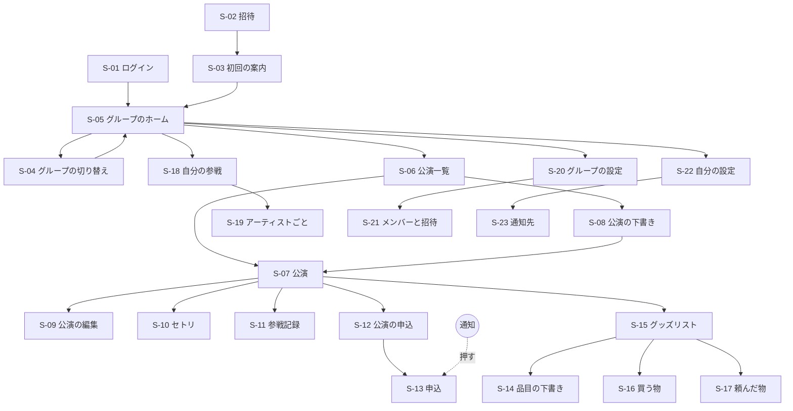

# API設計

状態：案（2026-11-21）。工程5の成果物。承認はこのファイルを足すPRのマージで残す。決め方の理由と選ばなかった案は[論点の記録](discussions/api-design.md)、APIの形の決定は[ADR-0005](decisions/ADR-0005-api-conventions.md)にある。

- 関連：[ユーザーストーリー](user-stories.md)、[データモデル](data-model.md)、[AWS構成](architecture.md)、[ADR-0003](decisions/ADR-0003-layers-in-contexts.md)、[ADR-0004](decisions/ADR-0004-dev-tools.md)
- このページは、画面の一覧と移り方、画面ごとに呼ぶAPI、APIの形の決まりを書く。見た目（色・配置・文言）は最初の1本の設計で決める。
- MVP1のユーザーストーリー37本は、末尾の「ストーリーとの対応」で、どれかの画面とAPIに結びつけてある。

## 全体の決まり

### つなぎ先と認証

- 画面はAPI GatewayのURLへ直接送る。CORSは画面のドメインだけを許す。
- すべてのパスでCognitoのJWTが要る。JWTの無い要求はAPI Gatewayが401で断るので、Lambda `api`には届かない。
- `api`は、JWTの`sub`に結びつく`users`の行が`active`かを毎回確かめる。行が無ければ`not_registered`、`withdrawing`なら`account_closing`で断る。
- 例外は招待の2本（`GET /invites/{token}`と`POST /invites/{token}/accept`）。ここだけは`users`の行が無いJWTも受ける。招待リンクを通らずにユーザーを作らない決まり（データモデル「退会の手順」）を守るため、APIで行を作るのは`accept`だけにする。最初のオーナーは、デプロイの流れで流す初期データの手順で作る（APIは作らない。大関さんの確認待ち）。

### パスの形

- グループの中の資源は、`/groups/{groupId}/...`の下に置く。公開関数には、パスのグループIDとJWTのユーザーをそのまま渡す。最初の`FOR SHARE`のロックは、このグループIDで取る。グループの外の書き込み（グループを作る、通知先の登録と削除）は、操作した人の`users`の行を`FOR SHARE`でロックして`active`かを確かめてから書く。退会の開始と重なっても、退会が通ったあとに行ができない（データモデル「書き込みの順番」）。
- パスの資源のIDが、パスのグループのものでなければ`not_found`にする。別グループの行があることも、中身も返さない。本文で送るID（申込の`concertId`、同行者・購入担当・分配の`userId`、下書きの会場とアーティスト、品目の属するツアーと公演）と、`/me`の下の他人の行のIDも同じで、無いときと同じ`not_found`にする。
- グループをまたぐもの（自分の参戦の一覧、通知先、退会）は`/me/...`に置く。
- 版の番号はパスに付けない。APIは外部に公開せず、画面と同時にデプロイするため。Service Workerが古い画面を持っているあいだに互換を壊す変更を出すときは、前の形の要求も受ける期間を、その変更の設計書に書く。

### 中身の形

- 要求と応答の中身はJSONで、キーはキャメルケース（`concertId`）にする。
- 公演の日は`YYYY-MM-DD`、開場・開演時刻は`HH:mm`（どちらも日本時間）。チケットの期限など`timestamptz`の値は、時差を付けたISO 8601（`2027-01-10T20:00:00+09:00`）で受け、応答は時差`+09:00`で返す。
- 入力はZodで確かめ、知らないキーがあれば`invalid_input`で断る。
- 部分更新（`PATCH`）では、送らなかった欄は変えず、`null`を送った欄は空にする（`.claude/rules/coding-standards.md`）。
- 一覧はページを分けない。公演と参戦の一覧は、`when=upcoming|past`と`year`で絞れる。

### 作成を2回送ったとき

公演会場の近くでは電波が弱く、返事が届かずに同じ作成を送り直すことがある。作成のAPIは次のように扱う。

- 画面がUUIDv7のIDを作り、本文の`id`で送る。サーバーはUUIDの版が7でなければ`invalid_input`にする。
- 同じIDの行がパスのグループにあり、中身も同じなら、1回目と同じ応答を状態コード200で返す。1回目は201。
- 同じIDの行があって中身が違う場合と、同じIDの行が別のグループにある場合は、`id_conflict`で断る。どちらも行の中身は返さない。
- 作成のほかの操作は、2回送っても結果が同じになる形にする。状態を進める操作は「どの状態にするか」を送り、すでにその状態なら何もせず200を返す。一覧を丸ごと置き換える操作は`PUT`にする。
- 消す操作（`DELETE`）は、行がもう無くても204を返す。1回目と2回目を同じ応答にするため。行が別のグループにあるときも同じ204にし、あることを知らせない。行があってその人が消せないとき（申込者でないなど）だけ`forbidden`にする。
- 比べる「中身」は、サーバーが値を直したあとの形で比べる。例えば画像は、一時置き場のキーをコピー先のキーに直してから比べる。コピー先のキーは、下書きIDと一時置き場のキーから決まる形（`groups/<groupId>/drafts/<userId>/<draftId>/<一時置き場のキーの末尾>`）にする。

2本の要求が重なったときは、次のように扱う。グループの行の`FOR SHARE`は書き込み同士を待たせないので、行ごとに決める。

- 作成は`INSERT ... ON CONFLICT DO NOTHING`で書き、書けなかったら読み直して、上の決まりで比べる。一意の決まりにぶつかって500にしない。グッズリストの行も同じ形で、最初の書き込みで作る。
- 招待から参加するときは招待リンクの行を、下書きを直す・消す・確定するときは下書きの行を、申込を直す・状態を変える・消すときは申込の行を、`FOR UPDATE`でロックしてから確かめる。上限の最後の1回に2人が同時に参加しても、1人だけが入る。
- セトリは`UPDATE ... WHERE version = <送った版>`で比べて書く。まだ行の無いセトリの最初の保存が2本重なったら、あとのほうを`stale_version`にする。

IDを画面で作らないものが4つある。

| 操作 | 2回送ったときに同じ結果になる理由 |
|---|---|
| 招待リンクから参加する | 1人のCognitoのユーザーに`users`の行は1つだけで、すでにメンバーなら、リンクの状態を見る前に200を返す |
| 通知先を登録する | `endpoint`が一意なので、同じ端末の2回目は同じ行を返す |
| 頼まれ物・購入担当・印 | 品目と頼んだ人（または品目）の組で1行なので、`PUT`で置き換える |
| 画像を上げる準備 | 行を作らない。2回目は別のキーとURLを返し、使われなかった一時置き場の画像は1日で消える |

### エラーの形

エラーはRFC 9457の`application/problem+json`で返し、`code`を足す。画面は`code`だけを見て文言を出し分ける。

```json
{
  "type": "about:blank",
  "title": "Unprocessable Content",
  "status": 422,
  "code": "invalid_input",
  "errors": [{ "path": "quantity", "code": "too_small" }]
}
```

`errors`は`invalid_input`のときだけ付ける。`detail`には個人の情報を書かない（データモデル「退会で消す範囲」のログの方針と同じ）。

| `code` | 状態コード | いつ |
|---|---|---|
| `invalid_input` | 422 | 形・値の範囲が合わない。欄ごとの理由を`errors`に入れる |
| `not_registered` | 403 | JWTはあるが`users`の行が無い（招待の2本のほか） |
| `account_closing` | 403 | 本人が退会を始めている |
| `not_found` | 404 | 行が無い、別グループの行、自分が外された・抜けている途中のグループ |
| `forbidden` | 403 | メンバーだが、その操作をできる人ではない（申込者でない、オーナーでない、自分用グループで招待リンクを出す、など） |
| `group_closing` | 409 | グループが解散を始めている。読むことはでき、書き込みだけを断る |
| `id_conflict` | 409 | 作成で送ったIDが、中身の違う行か別グループの行と重なる |
| `already_exists` | 409 | 一意の決まりにぶつかる（同じ公演への2回目の参戦、同じ名前のアーティスト） |
| `in_use` | 409 | 公演で使っている会場・アーティストを消そうとした |
| `stale_version` | 409 | セトリを古い版から保存しようとした |
| `invalid_transition` | 409 | 申込の状態の移り方に無い変更（落選から入金済みなど） |
| `invite_unusable` | 409 | 招待リンクが期限切れ・上限・取り消し済み。どれかは区別しない |
| `last_member` | 409 | ほかにメンバーがいないオーナーが抜けようとした。画面は解散を案内する |
| `internal` | 500 | 想定していない失敗。`detail`は付けない |

### 時間のかかる操作

解散・退会・メンバーを外す・抜けるは、受け付けたら202を返し、続きは`erasure-worker`が進める（データモデル「解散と退会」）。応答の本文は`{ "accepted": true }`だけにする。2回目の送信も202にする。この4本だけは、同じ対象の終わっていないジョブ（`erasure_jobs`）があれば、`account_closing`・`not_found`・`group_closing`の確かめより先に202を返す。

### 画像

- 上げるときは、`POST /groups/{groupId}/image-uploads`で一時置き場（`uploads/`）へのアップロード用URLとキーを受け取り、端末がS3へ上げる。そのあと下書きを作るか直す要求でキーを送ると、`api`がロックを持ったままS3の中でコピーして確定する（データモデルR13）。
- 見るときは、品目を返す応答に有効期限5分の取得用URL（`imageUrl`）を入れて返す。画面は期限が切れたら一覧を取り直す（データモデルR12）。

### 型を画面と共有する

- Honoのルートは、文脈ごとのファイルを`src/functions/api/`でつなぎ、つないだ型`AppType`を出す。画面は`hono/client`の`hc<AppType>`で呼び、`import type`だけで型を受け取る（ADR-0004の追記）。
- 入力のZodのスキーマは`src/functions/api/`の文脈ごとのファイルに置き、公開関数（`src/contexts/<文脈>/index.ts`）には確かめたあとの値を渡す。

## 画面の一覧と移り方

画面は23。番号（S-xx）は答え合わせ用で、コードの名前には使わない。

### 移り方



- 下の段の画面（公演・申込など）は、パスに`groupId`を含む画面のURLを持つ。通知を押したときは、リマインドの`url`（`/groups/<groupId>/ticket-applications/<id>`）で申込の画面を開く。
- ログインの方式（メールとパスワードか、メールに届くコードか）は最初の1本の要件で決める（論点の記録の「login」）。S-01はCognitoの画面か自前の画面かも、そこで決める。

### 画面ごとの中身と呼ぶAPI

APIの名前は、下の「APIの一覧」の表の1列目と同じ。

| 画面 | 中身 | 呼ぶAPI |
|---|---|---|
| S-01 ログイン | Cognitoでのログイン | （Cognito） |
| S-02 招待 | グループ名と、参加するボタン。未登録なら表示名を入れる | 招待を見る、招待から参加する |
| S-03 初回の案内 | ホーム画面への追加と、通知の許可の案内。許可されたら端末を登録する | 通知先を登録する |
| S-04 グループの切り替え | 自分のグループの一覧。自分用グループは分けて出す。グループを作る | 自分のグループ一覧、グループを作る |
| S-05 グループのホーム | これからの公演と、自分の申込で次にすることの一覧。通知先が無い・送れなかった端末があるときの帯 | グループを見る、公演一覧、申込一覧（`applicant=me`）、通知先一覧 |
| S-06 公演一覧 | これからの公演と過去の公演。自分の下書き | 公演一覧、公演の下書き一覧 |
| S-07 公演 | 日付・会場と最寄り駅・開場開演・ツアーのグッズ販売時間・URL・アーティスト。誰が行くか、参戦記録 | 公演を見る、公演の参戦一覧、参戦する、参戦をやめる |
| S-08 公演の下書き | ツアーと公演をまとめて、または単発の公演を入れる。会場とアーティストは登録済みから選ぶか新しく入れる | 公演の下書きを作る・直す・消す・確定する、会場一覧、アーティスト一覧、ツアー一覧 |
| S-09 公演の編集 | 公演・ツアー・会場・アーティストを直す。使っていない会場とアーティストを消す | 公演を直す、ツアーを直す、会場を作る・直す・消す、アーティストを作る・直す・消す、会場一覧、アーティスト一覧 |
| S-10 セトリ | 曲順の入力。曲目ごとのメモとアーティスト。版が古いと出たら取り直しを促す | セトリを見る、セトリを保存する |
| S-11 参戦記録 | 座席、同行者（メンバーか名前）、ひとこと | 参戦記録を保存する、参戦記録を消す、メンバー一覧 |
| S-12 公演の申込 | 公演ごとの、誰がどの受付にどの状態で申し込んだか。申込を足す | 申込一覧（`concertId`）、申込を作る |
| S-13 申込 | 状態と期限、期限切れ・受取できるかの表示。状態を進める。スマチケの分配 | 申込を見る、申込を直す、申込の状態を変える、申込を消す、分配を保存する、メンバー一覧 |
| S-14 品目の下書き | 品名・価格・写真・属するツアーか公演 | 画像を上げる準備、品目の下書きを作る・直す・消す・確定する |
| S-15 グッズリスト | 載せられる品目と写真。品目ごとに、欲しい数・購入担当・印 | グッズリストを見る、欲しい数を入れる、欲しい数を消す、購入担当を決める、購入担当を外す、品目を直す、品目を消す、メンバー一覧 |
| S-16 買う物 | 自分が購入担当の品目と数、誰に頼まれたか、合計金額（売り切れを除いた額も）。印を付ける | 自分が買う物、印を付ける |
| S-17 頼んだ物 | 自分が頼んだ品目、数、購入担当、金額、印 | 自分が頼んだ物 |
| S-18 自分の参戦 | グループをまたいだ、これからの予定と行った公演。解散したグループの参戦は写しで出す | 自分の参戦一覧、自分の参戦を見る |
| S-19 アーティストごと | アーティストごとの参戦回数と日付 | アーティストごとの参戦 |
| S-20 グループの設定 | 名前、オーナー。解散（何が消えて何が残るかを示して確かめる）、抜ける | グループを見る、解散の確かめ、解散する、抜ける・外すの確かめ、メンバーを外す（自分） |
| S-21 メンバーと招待 | メンバー一覧。オーナーは招待リンクを発行し、メンバーを外す | メンバー一覧、招待リンクを発行する、抜ける・外すの確かめ、メンバーを外す |
| S-22 自分の設定 | 表示名、退会（消えるものと残るものを示して確かめる） | 自分を見る、退会の確かめ、退会する |
| S-23 通知先 | 登録した端末の一覧と、送れなかった端末の印。1台ずつ外す。この端末を登録する | 通知先一覧、通知先を登録する、通知先を外す |

## APIの一覧

パスの`{g}`は`{groupId}`の略。「できる人」が書いていないものは、グループのメンバー全員ができる。

### グループ（`group`）

| 名前 | メソッドとパス | 中身と決まり |
|---|---|---|
| 自分を見る | `GET /me` | ユーザーID、表示名、自分用グループのID |
| 自分のグループ一覧 | `GET /me/groups` | グループごとにID、名前、`kind`、自分がオーナーか、`status` |
| 招待を見る | `GET /invites/{token}` | グループ名と、使えるか。すでにメンバーなら、リンクの状態を見ずに「メンバー」と返す。そうでなく使えなければ`invite_unusable` |
| 招待から参加する | `POST /invites/{token}/accept` | 本文は`{ displayName }`（未登録のときだけ必須）。すでにメンバーなら、リンクの状態を見ずに何もせず200。本人が退会を始めていれば`account_closing`。未登録なら、ユーザー・自分用グループ・メンバーを1つのトランザクションで作る。登録済みならメンバーだけ加える。利用回数は、メンバーを新しく加えたときだけ数える。そのグループを抜ける処理の途中なら`invite_unusable`（終わったら入り直せる） |
| グループを作る | `POST /groups` | 本文は`{ id, name }`。作った人がオーナーになる。`kind`は`shared` |
| グループを見る | `GET /groups/{g}` | 名前、`kind`、オーナー、`status`、自分がオーナーか |
| メンバー一覧 | `GET /groups/{g}/members` | ユーザーID、表示名、参加した日時、オーナーか |
| 招待リンクを発行する | `POST /groups/{g}/invite-links` | 本文は`{ id, expiresAt, maxUses }`。オーナーだけ。自分用グループでは`forbidden`。応答でリンクのURLを返す。トークンは、SSMに置く秘密の値とリンクのIDからHMAC-SHA256で作り、サーバーはハッシュだけを保存する。こうすると、2回目の送信でも同じトークンを返せる（大関さんの確認待ち） |
| 抜ける・外すの確かめ | `GET /groups/{g}/members/{userId}/removal-preview` | 消えるものと残るものの件数（残る参戦、消える予定・申込・頼まれ物・下書き、空に戻る分配と購入担当、人数に置き換わる同行者）。本人かオーナーだけ |
| メンバーを外す | `DELETE /groups/{g}/members/{userId}` | `userId`が自分なら抜ける、ほかの人なら外す。外すのはオーナーだけで、自分自身は外せない（抜けるとして扱う）。オーナーが抜けるときは一番前から参加しているメンバーに引き継ぐ。ほかにメンバーがいなければ`last_member`。自分用グループは`forbidden`。202 |
| 解散の確かめ | `GET /groups/{g}/disband-preview` | 消えるものと残るものの件数。オーナーだけ |
| 解散する | `DELETE /groups/{g}` | オーナーだけ。自分用グループは`forbidden`。202。解散を始めた時点で、招待リンクは使えなくなる |
| 退会の確かめ | `GET /me/withdrawal-preview` | 消えるものと残るものの件数。オーナーのグループごとに、引き継ぐ先か解散になるか |
| 退会する | `DELETE /me` | 202。画面は応答を受けたら「退会を受け付けました」と出してサインアウトする |

### 公演カタログ（`catalog`）

| 名前 | メソッドとパス | 中身と決まり |
|---|---|---|
| アーティスト一覧 | `GET /groups/{g}/artists` | 名前の順 |
| アーティストを作る | `POST /groups/{g}/artists` | `{ id, name }`。正規化した名前が同じなら`already_exists`で、応答に既存のアーティストのIDを入れる |
| アーティストを直す・消す | `PATCH`・`DELETE /groups/{g}/artists/{artistId}` | 使っていれば消せない（`in_use`） |
| 会場一覧 | `GET /groups/{g}/venues` |  |
| 会場を作る | `POST /groups/{g}/venues` | `{ id, name, nearestStation, memo }` |
| 会場を直す・消す | `PATCH`・`DELETE /groups/{g}/venues/{venueId}` | 使っていれば消せない（`in_use`） |
| ツアー一覧 | `GET /groups/{g}/tours` |  |
| ツアーを直す | `PATCH /groups/{g}/tours/{tourId}` | ツアーは下書きの確定で作る |
| 公演一覧 | `GET /groups/{g}/concerts?when=upcoming\|past&year=` | 確定した公演だけ。日付の順（`past`は新しい順）。今日の公演は`upcoming`に入れる。日付は日本時間で比べる |
| 公演を見る | `GET /groups/{g}/concerts/{concertId}` | 公演、ツアー（グッズ販売時間を含む）、会場、出演順のアーティスト |
| 公演を直す | `PATCH /groups/{g}/concerts/{concertId}` | 日付・会場・時刻・URL・題名・アーティストの並び。アーティストを送るときは並び全体を置き換える |
| 公演の下書き一覧 | `GET /groups/{g}/concert-drafts` | 自分が作った下書きだけ |
| 公演の下書きを作る・直す・消す | `POST /groups/{g}/concert-drafts`、`PATCH`・`DELETE /groups/{g}/concert-drafts/{draftId}` | 中身は、ツアー（任意）と公演の配列。会場とアーティストは、登録済みのIDか新しい名前のどちらか。決まっていなくてもよい。直す・消すのは作った人だけ |
| 公演の下書きを確定する | `POST /groups/{g}/concert-drafts/{draftId}/confirm` | 本文は`{ tourId, concertIds }`（画面が作るUUIDv7。`concertIds`は下書きの公演と同じ順）。1つのトランザクションで、新しい会場・アーティスト・ツアー・公演を作り、下書きを消す。新しい名前のアーティストが正規化して既存と同じなら、既存のほうを使う。会場が決まっていない公演や、ツアーも題名もない公演があれば`invalid_input`。下書きがもう無くても、`concertIds`の公演がすべてこのグループにあれば、確定済みとして同じ応答を返す |
| セトリを見る | `GET /groups/{g}/concerts/{concertId}/setlist` | 曲目の配列と`version`。まだ無ければ空の配列と`version: 0` |
| セトリを保存する | `PUT /groups/{g}/concerts/{concertId}/setlist` | 本文は`{ version, items }`。曲目は全体を置き換える。`version`が今の版と違えば`stale_version`で、応答に今の版の曲目を入れる。保存できたら`version`を1増やす。送り直しに備えて、今の版が送った版の次で、最後に保存した人が自分で、曲目も同じなら、200で今の版を返す。曲目のアーティストは、その公演のアーティストだけ |

### 参戦記録（`attendance`）

| 名前 | メソッドとパス | 中身と決まり |
|---|---|---|
| 公演の参戦一覧 | `GET /groups/{g}/concerts/{concertId}/attendances` | メンバーごとに参戦と、あれば参戦記録（座席、同行者、ひとこと） |
| 参戦する | `POST /groups/{g}/concerts/{concertId}/attendances` | 本文は`{ id }`。自分の参戦を作る。同じ公演に自分の参戦がすでにあれば、IDが同じなら200、違えば`already_exists` |
| 参戦をやめる | `DELETE /groups/{g}/attendances/{attendanceId}` | 本人だけ。参戦記録も消える |
| 参戦記録を保存する | `PUT /groups/{g}/attendances/{attendanceId}/record` | 本文は`{ seat, comment, companions }`。同行者は`{ userId }`か`{ name }`の配列で、全体を置き換える。人数に置き換えた同行者の数（`hiddenCompanionCount`）は読むだけで、保存では変えない。一覧と参戦を見るAPIでは、この数も返す。本人だけ。`userId`は同じグループの有効なメンバーだけ（ロックして確かめる。データモデル「書き込みの順番」） |
| 参戦記録を消す | `DELETE /groups/{g}/attendances/{attendanceId}/record` | 本人だけ。参戦は残り、「行く予定」に戻る |
| 自分の参戦一覧 | `GET /me/attendances?when=upcoming\|past&year=` | グループをまたいだ自分の参戦。解散・抜けたあとの参戦は公演の写しで返し、同行者は人数で返す |
| 自分の参戦を見る | `GET /me/attendances/{attendanceId}` | 本人だけ。解散・抜けたあとの参戦は、写しのセトリも返す。解散・抜けたあとの参戦はMVP1では読むだけで、直す・消すAPIは無い（ロックを取るグループが無いため） |
| アーティストごとの参戦 | `GET /me/artist-summary` | 正規化した名前ごとに、表示名、回数、参戦の日付の一覧。写しの名前も含める |

### チケット（`ticket`）

| 名前 | メソッドとパス | 中身と決まり |
|---|---|---|
| 申込一覧 | `GET /groups/{g}/ticket-applications?concertId=&applicant=me` | どちらの絞り込みも任意。申込ごとに、保存した状態と、計算した`displayStatus`（`won`のまま入金期限を過ぎたら`expired`）と`pickupAvailable` |
| 申込を作る | `POST /groups/{g}/ticket-applications` | 本文は`{ id, concertId, saleName, quantity, pickupMethod, status, resultAnnouncedAt, paymentDeadline, pickupStartsAt }`。`status`は`applied`か`won`（先着）。作った人が申込者。リマインドは下の「申込とリマインド」の決まりで合わせる |
| 申込を見る | `GET /groups/{g}/ticket-applications/{applicationId}` | 申込、計算した表示、分配 |
| 申込を直す | `PATCH /groups/{g}/ticket-applications/{applicationId}` | 申込者だけ。期限を入れた・直した・空にしたときは、下の「申込とリマインド」の決まりで合わせる |
| 申込の状態を変える | `PUT /groups/{g}/ticket-applications/{applicationId}/status` | 本文は`{ status }`。申込者だけ。移れるのは`applied`→`won`・`lost`、`won`→`paid`、`paid`→`picked_up`。期限切れ（`won`のまま期限を過ぎた）から`paid`にも移れる。すでにその状態なら何もせず200。ほかは`invalid_transition`。リマインドは下の「申込とリマインド」の決まりで合わせる |
| 申込を消す | `DELETE /groups/{g}/ticket-applications/{applicationId}` | 申込者だけ。まだ届いていないリマインドを取り消す |
| 分配を保存する | `PUT /groups/{g}/ticket-applications/{applicationId}/distributions` | 本文は`{ items: [{ seq, userId, guestName, distributedAt }] }`で全体を置き換える。申込者だけ。受取方法がスマチケの申込だけ。`seq`は1から枚数まで。`userId`は同じグループの有効なメンバー |

### グッズ（`merch`）

| 名前 | メソッドとパス | 中身と決まり |
|---|---|---|
| 画像を上げる準備 | `POST /groups/{g}/image-uploads` | 本文は`{ contentType }`（`image/jpeg`・`image/png`・`image/webp`・`image/heic`）。一時置き場のキーと、アップロード用URLを返す。大きさの上限は署名付きURLの条件で決める |
| 品目の下書きを作る・直す・消す | `POST /groups/{g}/merch-drafts`、`PATCH`・`DELETE /groups/{g}/merch-drafts/{draftId}` | 中身は品名、価格、属するツアーか公演、画像。画像は作るときも直すときも一時置き場のキーで送り、`api`が`drafts/<userId>/`の下にコピーして確定する（データモデルR13）。写真を替えたら、前の画像のキーを消す予定の表に入れる。直す・消すのは作った人だけ |
| 品目の下書き一覧 | `GET /groups/{g}/merch-drafts` | 自分が作った下書きだけ |
| 品目の下書きを確定する | `POST /groups/{g}/merch-drafts/{draftId}/confirm` | 本文は`{ itemId }`。画像を`items/`の下にコピーし、品目を作って下書きを消す。下書きがもう無くても、`itemId`の品目がこのグループにあれば同じ応答を返す |
| 品目を直す・消す | `PATCH`・`DELETE /groups/{g}/merch-items/{itemId}` | 写真を替えるときも一時置き場のキーで送り、前の画像のキーは消す予定の表に入れる。品目を消すと画像も消す予定の表に入る |
| グッズリストを見る | `GET /groups/{g}/concerts/{concertId}/merch-list` | 載せられる品目（公演の品目と、公演のツアーの品目）と`imageUrl`。品目ごとに、購入担当と印、メンバーごとの欲しい数 |
| 欲しい数を入れる・消す | `PUT`・`DELETE /groups/{g}/concerts/{concertId}/merch-list/requests/{itemId}` | 本文は`{ quantity }`（1以上）。自分の分だけ。品目は、その公演かツアーのものだけ。グッズリストの行は最初の書き込みで作る |
| 購入担当を決める・外す | `PUT`・`DELETE /groups/{g}/concerts/{concertId}/merch-list/buyers/{itemId}` | 本文は`{ userId }`。担当は同じグループの有効なメンバー。担当を別の人に替えたら印は消える |
| 印を付ける | `PUT /groups/{g}/concerts/{concertId}/merch-list/buyers/{itemId}/purchase-status` | 本文は`{ purchaseStatus }`（`bought`・`sold_out`・`null`）。その品目の購入担当だけ。担当のいない品目は`not_found` |
| 自分が買う物 | `GET /groups/{g}/concerts/{concertId}/merch-list/my-purchases` | 自分が購入担当の品目、数、頼んだ人ごとの数、合計金額、売り切れを除いた合計金額、価格の無い品目があるか |
| 自分が頼んだ物 | `GET /groups/{g}/concerts/{concertId}/merch-list/my-requests` | 自分が欲しい数を入れた品目ごとに、数、購入担当、金額、印 |

### 通知（`notification`）

| 名前 | メソッドとパス | 中身と決まり |
|---|---|---|
| 通知先一覧 | `GET /me/push-subscriptions` | 端末ごとに登録日時と、最後に送れなかった日時 |
| 通知先を登録する | `POST /me/push-subscriptions` | 本文はブラウザの`PushSubscription`の`endpoint`と鍵。同じ`endpoint`がすでに自分のものなら同じ行を返す。別の人のものなら、その行を消して自分のものにする（端末を譲った場合） |
| 通知先を外す | `DELETE /me/push-subscriptions/{subscriptionId}` | 本人だけ。まだ送っていないリマインドは、ほかの端末に送る |

VAPIDの公開鍵は画面のビルドの設定に入れ、APIでは出さない。リマインドを作る・取り消すAPIは無い。チケットの公開関数が、同じトランザクションの中で通知の公開関数を呼ぶ。Schedulerの予約を作る・時刻を直すのはコミットの前、消すのはコミットのあとにする（ADR-0003の決定4）。

### 申込とリマインド

申込を作る・直す・状態を変える・消すの4つの操作は、どれも同じ1つの関数でリマインドを合わせる。関数は、申込の今の状態と期限から「あるべき予約」を計算し、今ある予約との差だけを作る・時刻を直す・取り消す。

| 申込の状態 | あるべき予約 |
|---|---|
| `applied` | 結果発表日時があれば、結果発表（`ticket:<申込ID>:result`） |
| `won`（期限切れを含む） | 入金期限があれば、前日20時と締切の3時間前の2回 |
| `paid` | 受取開始日時があれば、受取開始 |
| `lost`・`picked_up`・消した申込 | なし |

送信時刻を過ぎた予約の扱いは、データモデル「届ける時刻」のとおり（期限の前なら1分後、過ぎていれば作らない）。当選してから入金期限を入れたときも、この関数で入金期限の予約ができる。

## ストーリーとの対応

| ストーリー | 画面 | API |
|---|---|---|
| G-01 招待リンクから参加する | S-02、S-03 | 招待を見る、招待から参加する |
| G-02 招待リンクを発行する | S-21 | 招待リンクを発行する |
| G-03 仲間と使うグループを作る | S-04 | グループを作る |
| G-04 自分のグループを切り替える | S-04 | 自分のグループ一覧 |
| G-05 退会する | S-22 | 退会の確かめ、退会する |
| G-06 グループを解散する | S-20 | 解散の確かめ、解散する |
| G-07 メンバーをグループから外す | S-21 | 抜ける・外すの確かめ、メンバーを外す |
| G-08 自分からグループを抜ける | S-20 | 抜ける・外すの確かめ、メンバーを外す（自分） |
| C-01 ツアーをまとめて登録する | S-08 | 公演の下書きを作る、公演の下書きを確定する |
| C-02 単発の公演やフェスを登録する | S-08 | 公演の下書きを作る、公演の下書きを確定する |
| C-03 下書きを確かめてから公演を確定する | S-06、S-08 | 公演の下書き一覧、公演の下書きを作る・直す・消す・確定する |
| C-04 登録した会場を選び直す | S-08、S-09 | 会場一覧、会場を作る・直す・消す |
| C-05 登録したアーティストを選ぶ | S-08、S-09 | アーティスト一覧、アーティストを作る・直す・消す |
| C-06 過去の公演をさかのぼって登録する | S-08 | 公演の下書きを作る、公演の下書きを確定する（時刻は空でよい） |
| C-07 公演の情報を確かめる | S-06、S-07 | 公演一覧、公演を見る |
| C-08 公演の情報を直す | S-09 | 公演を直す、ツアーを直す |
| C-09 セトリを入力する | S-10 | セトリを見る、セトリを保存する |
| A-01 公演に行く予定を登録する | S-07 | 参戦する、参戦をやめる |
| A-02 公演に誰が行くかを見る | S-07 | 公演の参戦一覧 |
| A-03 参戦記録を残す | S-11 | 参戦記録を保存する、参戦記録を消す |
| A-04 自分の参戦を一覧で見る | S-18 | 自分の参戦一覧、自分の参戦を見る |
| A-05 アーティストごとに参戦をまとめる | S-19 | アーティストごとの参戦 |
| T-01 チケット申込を登録する | S-12、S-13 | 申込を作る、申込を直す、申込を消す |
| T-02 申込の状態を進める | S-13 | 申込の状態を変える |
| T-03 期限のリマインドを受け取る | S-13 | 申込を作る・直す・状態を変える・消す（リマインドの予約はその中で行う） |
| T-04 公演ごとの申込状況を見る | S-12 | 申込一覧（`concertId`） |
| T-05 スマチケを分配する | S-13 | 分配を保存する |
| M-01 品目を写真付きで登録する | S-14 | 画像を上げる準備、品目の下書きを作る・直す・確定する |
| M-02 欲しい物と数を入れる | S-15 | グッズリストを見る、欲しい数を入れる・消す |
| M-03 購入担当を決める | S-15 | 購入担当を決める・外す |
| M-04 買う物と合計金額を見る | S-16 | 自分が買う物 |
| M-05 頼んだ物を確かめる | S-17 | 自分が頼んだ物 |
| M-06 買えた品目と売り切れの品目に印を付ける | S-16 | 印を付ける |
| N-01 通知を受け取る端末を登録する | S-03、S-23 | 通知先を登録する |
| N-02 通知が届かない状態を知る | S-05、S-23 | 通知先一覧 |
| N-03 通知から申込を開く | S-13 | 申込を見る（リマインドの`url`で開く） |
| N-04 通知を受け取る端末を外す | S-23 | 通知先一覧、通知先を外す |

## 決めないこと

- 見た目（色・配置・文言）、画面のルーティングとデータの取り方の道具（最初の1本の設計。ADR-0004）
- ログインの方式とS-01の作り（最初の1本の要件。論点の記録の「login」）
- 画像の大きさの上限の値と、HEICを画面で変換するか（グッズの画面の設計）
- API Gatewayの流量の制限の値（工程6の費用の試算と合わせて）
- 公演とツアーの削除。ストーリーに無いので作らない。要るとわかったら足す
