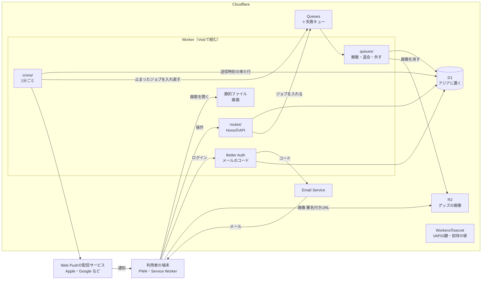

# アーキテクチャ

状態：提案（2026-11-27、[ADR-0008](decisions/ADR-0008-cloudflare.md)と同じPRのマージで承認）。インフラとDBはすべてCloudflareに置き、バックエンドはVoidで組む。2026-11-13に確定したAWSとNeonの構成は、ADR-0008で置き換えた。前の版はgitの履歴（`8a25fcb`）にある。

- 関連：[ADR-0008](decisions/ADR-0008-cloudflare.md)、[データモデル](data-model.md)、[ADR-0002](decisions/ADR-0002-schema-and-functions.md)、[API設計](api.md)、[PR/FAQ](prfaq.md)、[論点の記録](discussions/cloudflare-migration.md)

## 全体図

## 処理の流れ

| 流れ | 通るもの |
|---|---|
| ログイン | 端末 → Better Auth。メールのコードはEmail Serviceで送る。ユーザーを作る前に有効な招待のトークンを確かめ、無ければ断る。ログインの状態はD1に置く |
| 画面の操作 | 端末 → `routes/`のAPI → D1。APIは毎回ログインの状態とユーザーが有効かを確かめ、グループの操作ではメンバーであることを確かめる。書き込みは先に読んで判断し、どの文にも同じ条件を付けた`batch()`でまとめて流す。同じ条件を付けられないときは、条件が外れたら失敗する確かめの文を先頭に置き、全部を取り消させる（ADR-0008の決定6） |
| グッズの画像 | 端末が頼むと、APIはメンバーかを確かめてからR2の署名付きURLを返す。上げるときは`uploads/`へのURLを出し、上げ終わったらAPIがグループの状態を確かめ、D1に「確定中」の記録を書いてから本来の場所にコピーする。確定のときにグループがもう有効でなければ、APIがコピーを消す。R2で置き場を一覧して消し、24時間後にもう一度消す。消す範囲は、解散ならグループの画像すべて、退会と外すなら本人の下書きの画像だけで、確定した品目の画像は残す（ADR-0008の決定6）。確定しなかった画像はR2のライフサイクルで1日後に消える。見るときは期限5分のURLを出す（データモデルR12・R13） |
| 解散・退会・外す | APIが受け付けてジョブの行を書き、Queuesにジョブを入れる。受け手がD1とR2を順に片づける。止まったジョブは1分ごとのCronが見つけて入れ直す。再試行を使い切ったジョブは失敗キューに入り、D1のジョブの行を「失敗」にする。「失敗」の行はCronが入れ直さない |
| リマインド | APIはリマインドの行に送信時刻を書くだけで、予約は作らない。1分ごとのCronが送信時刻の来た行を引き受け、Web Pushで送る。引き受けに成功した実行だけが送り、`sending`のまま止まった行は10分後に引き受け直す。送信期限（送信時刻の1時間後）を過ぎた行は送らない。D1を戻したときは、Cronを止めた時刻を記録し、送信時刻がその時刻より前の行を送らないものに変えてから再開する |

## 構成要素

| 要素 | 使うもの | 理由 | 決めた場所 |
|---|---|---|---|
| 画面 | React＋ViteのPWA。Workerの静的ファイルとして置く | VoidのSPA＋APIの形で、APIと同じWorkerから出せる | ADR-0008の決定1・決定3 |
| API | Workers。Voidの`routes/`にHonoの書き方で置く。入力はZodで確かめる | HonoとZodをそのまま使える。型つきの呼び出しは`void/client` | ADR-0008の決定3 |
| ログイン | VoidのBetter Auth（メールのコード）、Email Service | Cloudflareにまとまる。招待の確認をユーザーを作る前に入れられる | ADR-0008の決定5 |
| データベース | D1（SQLite）、Drizzle | Cloudflareにまとめるため（大関の判断）。戻せる期間は30日 | ADR-0008の決定1・決定6 |
| 画像 | R2（非公開）と署名付きURL | メンバーだけが見られる、という要件のため。外への転送は無料 | ADR-0008の決定1 |
| リマインド | 1分ごとのCron | D1は眠らないので毎分見ても費用が増えない。予約を作る・消す処理が要らない | ADR-0008の決定4 |
| 解散・退会・外す | Queuesと受け手、失敗キュー | 本人がいなくても最後まで進め、止まっても続きから再開するため | ADR-0008の決定1、ADR-0002の決定6 |
| 設定と秘密 | Workersのsecret（`void secret put`） | VAPIDの秘密鍵と、招待のトークンを作る値を置く。リポジトリには書かない | ADR-0008の決定1 |
| ログ | Workersのログ。保存は7日 | 個人の情報は書かない。日数はAWSのときと同じ | ADR-0008の決定1 |
| 配置 | `void deploy`（中でcf CLI）。CIは`CLOUDFLARE_API_TOKEN` | 資源の作成、マイグレーション、配置を1回で行う | ADR-0008の決定3 |

## 決めたこと

| | 決めたこと | 理由 | 選ばなかった案 |
|---|---|---|---|
| D-1 | AWSとNeonは使わず、すべてCloudflareに置く | 管理するものを1つにまとめるため（大関の判断） | DBはNeonのままHyperdrive、画面とAPIだけ移す、移さない |
| D-2 | Workers Paid（月5ドル）を使う | 無料プランではメンバーにログインのメールを送れないため | 無料プラン |
| D-3 | バックエンドはVoidで組み、配置は`void deploy`にする | 土台をVoidに任せ、HonoとDrizzleはそのまま使えるため | Hono単体、cf CLI、wrangler |
| D-4 | リマインドは1分ごとのCronでD1を見て送る | 予約を作る・消す処理が要らず、毎分見ても費用が増えないため | 1件ごとのDurable Objectのアラーム、Workflows |
| D-5 | ログインはBetter Authのメールのコード。メールはEmail Service | Cloudflareにまとまり、招待の確認をユーザーを作る前に入れられるため | Cognitoを残す、外のログインのサービス |
| D-6 | D1の書き込みは、先に読んでから条件を付けた`batch()`で流す | D1にロックと途中で判断を挟むトランザクションが無いため | グループごとのDurable Object、条件を付けない |
| D-7 | 画像の決まり（署名付きURL、期限5分、`uploads/`から確定のときにコピー、1日で消す）はAWSのときのまま | R2が署名付きURLとライフサイクルに対応しているため | 変えない理由が無い |
| D-8 | 結合検証と本番は、Workers・D1・R2を2組作って分ける | 最初の1本の要件F-01のため | 1組で共有する |
| D-9 | ログの保存は7日。名前・メールアドレス・通知の内容は書かない | AWSのときの決まり（C-3、データモデルのログの方針）のまま | 変えない理由が無い |

## 費用の見込み

10人で使う見込みで、月5ドル（1ドル150〜160円で約750〜800円）。Workers Paidに含まれる量の中に収まる見込みである。Paidに含まれる量は次のとおり（2026-11-27にCloudflareの料金のページで確かめた）。

| 部品 | 含まれる量（月） |
|---|---|
| Workers | 1,000万リクエスト、CPU 3,000万ミリ秒 |
| D1 | 読み取り250億行、書き込み5,000万行、保存5GB |
| R2 | 保存10GB、書き込みの操作100万回、読み取りの操作1,000万回 |
| Queues | 100万操作 |
| Email Service | 3,000通 |

1分ごとのCronは月に約4万3,000回動く。送信時刻の索引を使えば、1回の読み取りは数行で、D1の含まれる量の中に収まる。

## 決めないこと

- 費用の見張り方。Cloudflareの請求の通知で何を見るか（AWSのときのBudgetsの代わり）
- 流量の上限と、要求が急に増えたときの知らせ方（AWSのときのC-8・C-9の代わり）
- 失敗キューに入ったときの知らせ方（AWSのときのC-4の代わり）
- 結合検証と本番を、Voidでどう分けるか
- メールの送信元のアドレスとドメイン、独自ドメインを使うか
- 通知の中身はDeclarative Web Pushの形にする（AWSのときのC-5）ことは変えない。Web Pushのライブラリはpushforgeなどから設計書で選ぶ
