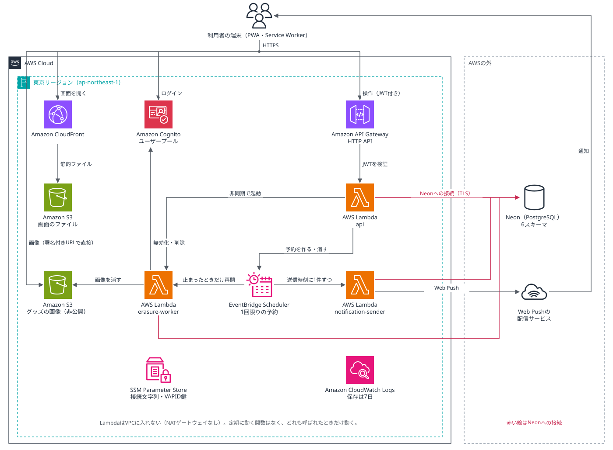
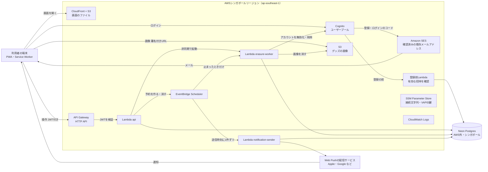

# AWSアーキテクチャ

状態：確定（2026-11-13）。案は2026-11-07に作り、同日リマインドを1件ずつ予約する方式に直した。関数とスキーマの分け方は[ADR-0002](decisions/ADR-0002-schema-and-functions.md)（2026-11-12承認）に合わせた。このページで決めたことは「決めたこと」の節にある。リージョンと費用は、工程6の[ADR-0006](decisions/ADR-0006-region-and-cost.md)で決めた（2026-11-22）。

- 関連：[データモデル](data-model.md)、[ADR-0002](decisions/ADR-0002-schema-and-functions.md)、[PR/FAQ](prfaq.md)

## 全体図

AWSの公式アイコン（AWS Architecture Icons）で描いた図。画像はまだリージョンが東京のままで、C-4のSQSとアラームも描いていない。正しいのは下のmermaidの図である（描き直しは「決めないこと」）。

## 処理の流れ

| 流れ | 通るもの |
|---|---|
| ログイン | 端末 → Cognito。招待リンクから登録したときだけ`users`の行を作る |
| 画面の操作 | 端末 → API Gateway（CognitoのJWTを検証）→ Lambda `api` → Neon。`api`は毎回`users`が有効かも確かめる |
| グッズの画像 | 端末が`api`に頼むと、`api`はグループのメンバーかを確かめてから、S3の署名付きURLを返す。端末はそのURLでS3と直接やりとりする。バケットは公開しない。上げるときは一時置き場（`uploads/`）へのアップロード用URLを出し、端末が上げ終わったら`api`がグループの状態を確かめて、S3の中で本来の場所にコピーする。確定されなかった画像は、S3のライフサイクルの設定で1日後に消える。見るときは有効期限5分の取得用URLを出す（データモデルR12・R13） |
| 解散・退会・外す | `api`が受け付けて`erasure_jobs`に書き、`erasure-worker`を非同期で起動する。`erasure-worker`はNeon、S3、Cognitoを順に片づける。ジョブを書くときに、止まったら再開させる1回限りの予約もSchedulerに作る。定期的には起動しない |
| リマインド | `api`がリマインドを作るときに、送信時刻に1回だけ動くSchedulerの予約を作る。その時刻に`notification-sender`が起動し、そのリマインドを引き受けてWeb Pushの配信サービスへ送る。Neonが起きるのは送るときだけ |

## 構成要素

| 要素 | 使うもの | 理由 | 決めた場所 |
|---|---|---|---|
| 画面 | PWA。CloudFront + S3に置く | 静的ファイルだけなので、サーバーが要らない。CloudFrontでHTTPSにする | このページ（B-1） |
| 認証 | Cognito Essentials、登録前Lambda、Amazon SES | 有効な招待からだけ登録し、確認済みの既存メールアドレスからコードを送る | [ADR-0007](decisions/ADR-0007-cognito-email.md)、[最初の1本の設計](designs/first-slice.md) |
| API | API Gateway HTTP APIとLambda `api` | REST APIより安く、JWTの検証を組み込みで使える | ADR-0002 |
| 解散・退会・外す | Lambda `erasure-worker` | HTTP APIの30秒の打ち切りを避け、本人がいなくても最後まで進めるため | ADR-0002 |
| 通知 | EventBridge SchedulerとLambda `notification-sender`、Web Push | PR/FAQで決めた。リマインド1件ごとに1回限りの予約を作る（2026-11-07） | ADR-0002、データモデル |
| データベース | Neon（Postgres）。AWSの外にある | PR/FAQで決めた。途中で判断を挟めるトランザクションで接続する | ADR-0002 |
| 画像 | S3（非公開のバケット）と署名付きURL | グループのメンバーだけが見られる、という非機能要件のため | このページ（B-2） |
| 設定と秘密 | SSM Parameter Store（SecureString） | Neonの接続文字列とWeb PushのVAPID鍵を置く。標準のパラメーターは無料 | このページ（C-1） |
| 失敗の知らせ | SQSのキュー、CloudWatchのアラーム、メール | リマインドと削除の処理の失敗を見落とさないため | このページ（C-4） |
| ログ | CloudWatch Logs。保存は7日 | 個人の情報は書かない。保存期間を短く決める | データモデル（ログの方針）、期間はこのページ（C-3） |

## 決めたこと

C-1〜C-3は2026-11-13に大関さんが回答フォームで決めた。C-3のほかは、お勧めの案のとおりである。C-4〜C-6は、2026-11-21に大関さんが出した構成の見直しを、Claudeが確かめて決めた。選択肢ごとの利点と欠点は、論点の記録（[aws-architecture](discussions/aws-architecture.md)）にある。C-2は2026-11-22に東京からシンガポールに変え、C-7〜C-9を足した。この4つは工程6の論点の記録（[cost-and-region](discussions/cost-and-region.md)）とADR-0006で決めた。

| | 決めたこと | 理由 | 選ばなかった案 |
|---|---|---|---|
| A-1 | Lambdaはどれも呼ばれたときだけ動き、Neonにはその都度つないで、終わったら切る。定期的に動く関数は置かない | 使われていない間はNeonの計算資源が止まり、無料の計算時間に収まる見込みのため | 常駐のサーバー（ECS Fargateなど）。月の固定費がかかり、Neonも起きたままになる |
| A-2 | LambdaはVPCに入れない | NeonはインターネットごしにTLSでつなぐので、VPCが要らない。NATゲートウェイの月の固定費がかからない | VPCに入れてNATを置く |
| B-1 | 画面はCloudFront + S3に置く | IaCで全体を同じ形で書けるため | Amplify Hosting（設定がIaCの外に分かれる）、AWSの外（Vercelなど） |
| B-2 | 画像は署名付きURLで、端末とS3が直接やりとりする。URLは`api`がメンバーかを確かめてから出す。アップロードは一時置き場を通して`api`が確定する。取得用URLの期限は5分で、グループを抜けた人もその間は見られる例外を認める（2026-11-13、Codexのレビューを受けて大関さんが決定） | 画像のデータがLambdaを通らないので、実行時間と費用を抑えられる | Lambdaを通して受け渡す |
| C-1 | Neonの接続文字列とWeb PushのVAPID鍵は、SSM Parameter Store（SecureString）に置く | 標準のパラメーターは無料のため | Secrets Manager（1つごとに月額がかかる） |
| C-2 | リージョンはシンガポール（ap-southeast-1）。Neonもシンガポール（aws-ap-southeast-1）に作る（2026-11-22、ADR-0006の決定1。2026-11-13の決定は東京だった） | Neonに東京が無く、往復の多いLambdaとNeonを近くに置くほうが速いため | AWSは東京でNeonだけシンガポール、DBを東京にあるもの（Aurora DSQL、Supabase）に替える |
| C-3 | CloudWatch Logsの保存期間は7日にする | 個人で作るアプリなので7日で足りると判断し、費用も抑えるため（大関さんの判断。お勧めは14日） | 14日、30日 |
| C-4 | Schedulerが起動できなかったときと、Lambda（`notification-sender`と`erasure-worker`）が再試行を使い切ったときの送り先を、同じSQSのキューにする。再送回数を使い切るか送信期限で打ち切った時点で一時失敗が残ったときも、`notification-sender`がこのキューに入れる。キューに1件でも入ったら、CloudWatchのアラームからメールで知らせる。Lambdaの自動の再試行は既定の2回のままにし、1時間を過ぎた再試行は捨てる。見張りの予約は、リマインドを予約するときに一緒に作る（2026-11-21） | リマインドが知らないうちに失敗すると、発券忘れを防ぐ目的が成り立たないため。関数の失敗と、関数は終わったが届かなかったことの両方を見る | CloudWatch Logsを見に行ったときだけ気づく |
| C-5 | 通知の中身はDeclarative Web Pushの形にする。Service Workerは対応していない環境のために残し、同じ中身を読んで表示する（2026-11-21） | iOSでService Workerが通知を出し損ねると、購読ごと取り消されることがあるため | 今の形のまま、Service Workerがすべて表示する |
| C-6 | ログはPowertools for AWS LambdaのLoggerで書く。Idempotencyの機能は使わない（2026-11-21） | 二重送信はNeonの行の引き受けで防いでいて、記録用の表を増やさずに済むため | Idempotencyも使う（DynamoDBなどの表が増える） |
| C-7 | 費用はAWS Budgetsの月5ドルの予算でメールを送る。Neonの計算時間は週に1回コンソールで見て、上限の半分を超えたらLaunchプランに移す（2026-11-22、ADR-0006の決定5） | 通知だけの予算は無料のため。Neonは操作が1日に散ると無料の上限を超えることがあるので、週に1回見る（Neonを見る間隔は大関さんが決めた。2026-11-22のADR-0006のマージで確定） | Neonの使った量を定期に読む関数を作る |
| C-8 | API Gatewayのステージの流量の上限は、毎秒20回、瞬間40回（2026-11-22、ADR-0006の決定6） | 瞬間の暴走を抑え、費用の増え方を1日約7ドル（Lambdaの実行時間とログの量を仮に置いた試算で、上限の保証ではない）に抑えるため。Neonの計算時間はこれでは守れない | 上限を置かない |
| C-9 | API Gatewayの要求の数とLambdaの起動の数（リージョンの合計）に、1時間ごとのCloudWatchのアラームを置き、C-4と同じメールで知らせる（2026-11-22、ADR-0006の決定7） | Budgetsは気づくのが約2日あとで、Neonの計算時間を使い切る前に暴走に気づくため | Neonの使った量を定期に読む関数を作る |

## 費用の見込み

従来は10人で月約3円（税抜き）と見込んだ。SESで月100通を送る比較値は約4.50円。2環境の標準アラーム13個も見込むと、無料枠10個が使え、Neonも無料枠内の場合は約49.50円（税・クレジット適用前）。元の内訳は[ADR-0006](decisions/ADR-0006-region-and-cost.md#費用の試算)、前提と枠を超えた場合は[最初の1本の設計](designs/first-slice.md#sesを足した費用)を参照する。

## 決めないこと

- 独自ドメインを使うか（公開前）
- 全体図の画像（`images/aws-architecture.svg`）に、シンガポールのリージョンの名前と、C-4のSQS・アラームを描き足すこと。全体図のmermaidは、シンガポールに直した（最初の1本の設計の前）
