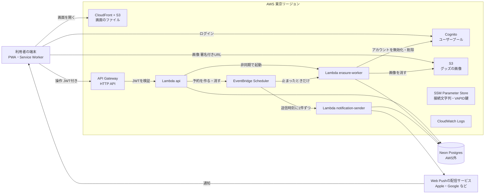

# AWSアーキテクチャ

状態：案（2026-11-07。同日、リマインドを1件ずつ予約する方式に直した）。関数とスキーマの分け方は [ADR-0002](decisions/ADR-0002-schema-and-functions.md)（承認待ち）に合わせた。「このページで新しく置いた案」の節は、まだどの資料でも決めていない。

- 関連：[データモデル](data-model.md)、[ADR-0002](decisions/ADR-0002-schema-and-functions.md)、[PR/FAQ](prfaq.md)

## 全体図

## 処理の流れ

| 流れ | 通るもの |
|---|---|
| ログイン | 端末 → Cognito。招待リンクから登録したときだけ `users` の行を作る |
| 画面の操作 | 端末 → API Gateway（Cognitoの JWT を検証）→ Lambda `api` → Neon。`api` は毎回 `users` が有効かも確かめる |
| グッズの画像 | `api` がS3の署名付きURLを返し、端末がS3に直接アップロード・表示する。バケットは公開しない |
| 解散・退会・外す | `api` が受け付けて `erasure_jobs` に書き、`erasure-worker` を非同期で起動する。`erasure-worker` はNeon、S3、Cognitoを順に片づける。ジョブを書くときに、止まったら再開させる1回限りの予約もSchedulerに作る。定期的には起動しない |
| リマインド | `api` がリマインドを作るときに、送信時刻に1回だけ動くSchedulerの予約を作る。その時刻に `notification-sender` が起動し、そのリマインドを引き受けてWeb Pushの配信サービスへ送る。Neonが起きるのは送るときだけ |

## 構成要素

| 要素 | 使うもの | 理由 | 決めた場所 |
|---|---|---|---|
| 画面 | PWA。CloudFront + S3 に置く | 静的ファイルだけなので、サーバーが要らない。CloudFrontでHTTPSにする | このページの案 |
| 認証 | Cognito ユーザープール | PR/FAQで決めた。グループの文脈が腐敗防止層になる | PR/FAQ、ADR-0001 |
| API | API Gateway HTTP API と Lambda `api` | REST APIより安く、JWTの検証を組み込みで使える | ADR-0002 |
| 解散・退会・外す | Lambda `erasure-worker` | HTTP APIの30秒の打ち切りを避け、本人がいなくても最後まで進めるため | ADR-0002 |
| 通知 | EventBridge Scheduler と Lambda `notification-sender`、Web Push | PR/FAQで決めた。リマインド1件ごとに1回限りの予約を作る（2026-11-07） | ADR-0002、データモデル |
| データベース | Neon（Postgres）。AWSの外にある | PR/FAQで決めた。途中で判断を挟めるトランザクションで接続する | ADR-0002 |
| 画像 | S3（非公開のバケット）と署名付きURL | グループのメンバーだけが見られる、という非機能要件のため | このページの案 |
| 設定と秘密 | SSM Parameter Store（SecureString） | Neonの接続文字列とWeb PushのVAPID鍵を置く。標準のパラメーターは無料 | このページの案 |
| ログ | CloudWatch Logs | 個人の情報は書かない。保存期間を短く決める | データモデル（ログの方針）、期間はこのページの案 |

## このページで新しく置いた案

- 画面は CloudFront + S3 に置く。Amplify Hosting も候補だが、IaCで全体を同じ形で書けるほうを選んだ。
- Lambdaはどれも呼ばれたときだけ動き、Neonにはその都度つないで、終わったら切る。定期的に動く関数は置かないので、使われていない間はNeonの計算資源が止まる。
- Lambdaは VPC に入れない。Neon はインターネット越しに TLS で接続するので、NAT ゲートウェイ（月額の固定費がかかる）を置かずに済む。
- 画像は署名付きURLで端末とS3が直接やりとりする。Lambdaを画像のデータが通らないので、実行時間と費用を抑えられる。
- 秘密情報は SSM Parameter Store に置く。Secrets Manager は1つあたり月額の料金がかかるため使わない。
- リージョンは東京（ap-northeast-1）。Neon のリージョンは、東京に近いものを工程6で公式の一覧から選ぶ。
- CloudWatch Logs の保存期間は14日にする。

## 費用の見込み（推測）

利用者は10人以下なので、どのサービスも小さな量で済む見込みである。ただし、次の点は公式の料金ページで確かめていない。工程6でAWSとNeonの料金ページをもとに試算して確定する。

- Lambda、EventBridge Scheduler、CloudFront、SSM Parameter Store（標準）、Cognito は、無料の範囲に収まる見込み。
- API Gateway HTTP API は、無料枠が新規アカウントの12か月に限られる見込み。それ以降も、この量なら月に数円程度と推測する。
- S3 は画像の量に応じて少額がかかる可能性がある（PR/FAQの内部FAQのとおり）。
- NAT ゲートウェイとVPCエンドポイントは置かないので、固定費は出ない。

## 決めないこと

- IaCの道具（CDK、Terraform など）、ORM、Neonへの接続の道具（工程4）
- 独自ドメインを使うか（公開前）
- 監視とアラートの範囲（`erasure_jobs` の失敗をどう知らせるか）（工程4以降）
