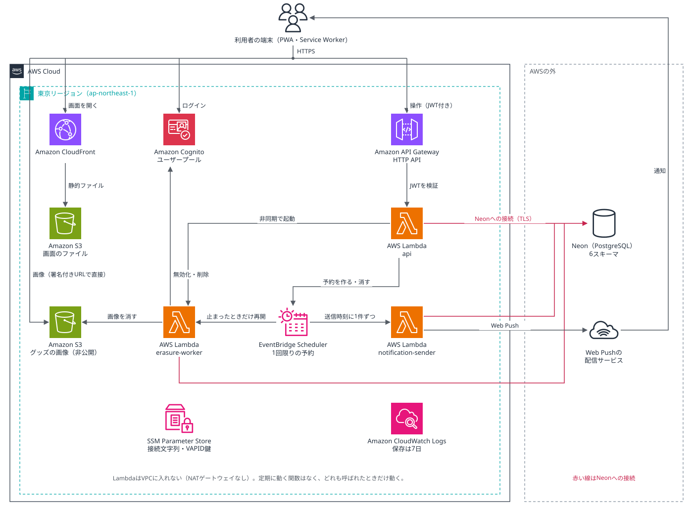
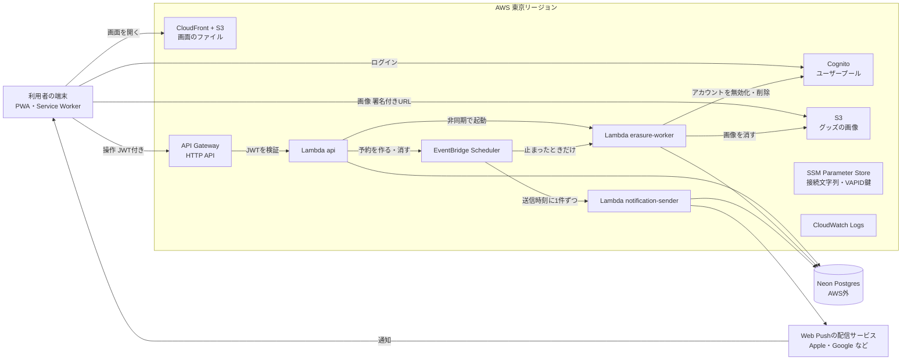

# AWSアーキテクチャ

状態：確定（2026-11-13）。案は2026-11-07に作り、同日リマインドを1件ずつ予約する方式に直した。関数とスキーマの分け方は[ADR-0002](decisions/ADR-0002-schema-and-functions.md)（2026-11-12承認）に合わせた。このページで決めた7点は「決めたこと」の節にある。費用は工程6で公式の料金ページをもとに試算する。

- 関連：[データモデル](data-model.md)、[ADR-0002](decisions/ADR-0002-schema-and-functions.md)、[PR/FAQ](prfaq.md)

## 全体図

AWSの公式アイコン（AWS Architecture Icons）で描いた図。下のmermaidの図と同じ内容である。

## 処理の流れ

| 流れ | 通るもの |
|---|---|
| ログイン | 端末 → Cognito。招待リンクから登録したときだけ`users`の行を作る |
| 画面の操作 | 端末 → API Gateway（CognitoのJWTを検証）→ Lambda `api` → Neon。`api`は毎回`users`が有効かも確かめる |
| グッズの画像 | 端末が`api`に頼むと、`api`はグループのメンバーかを確かめてから、S3の署名付きURLを返す。端末はそのURLでS3と直接やりとりする。バケットは公開しない。上げるときは一時置き場（`uploads/`）へのアップロード用URLを出し、端末が上げ終わったら`api`がグループの状態を確かめて、S3の中で本来の場所にコピーする。確定されなかった画像は、S3のライフサイクルの設定で1日後に消える。見るときは有効期限5分の取得用URLを出す（データモデルR12・R13） |
| 解散・退会・外す | `api`が受け付けて`erasure_jobs`に書き、`erasure-worker`を非同期で起動する。`erasure-worker`はNeon、S3、Cognitoを順に片づける。ジョブを書くときに、止まったら再開させる1回限りの予約もSchedulerに作る。定期的には起動しない |
| リマインド | `api`がリマインドを作るときに、送信時刻に1回だけ動くSchedulerの予約を作る。その時刻に`notification-sender`が起動し、そのリマインドを引き受けてWeb Pushの配信サービスへ送る。Neonが起きるのは送るときだけ |

## 構成要素

| 要素 | 使うもの | 理由 | 決めた場所 |
|---|---|---|---|
| 画面 | PWA。CloudFront + S3に置く | 静的ファイルだけなので、サーバーが要らない。CloudFrontでHTTPSにする | このページ（B-1） |
| 認証 | Cognitoユーザープール | PR/FAQで決めた。グループの文脈が腐敗防止層になる | PR/FAQ、ADR-0001 |
| API | API Gateway HTTP APIとLambda `api` | REST APIより安く、JWTの検証を組み込みで使える | ADR-0002 |
| 解散・退会・外す | Lambda `erasure-worker` | HTTP APIの30秒の打ち切りを避け、本人がいなくても最後まで進めるため | ADR-0002 |
| 通知 | EventBridge SchedulerとLambda `notification-sender`、Web Push | PR/FAQで決めた。リマインド1件ごとに1回限りの予約を作る（2026-11-07） | ADR-0002、データモデル |
| データベース | Neon（Postgres）。AWSの外にある | PR/FAQで決めた。途中で判断を挟めるトランザクションで接続する | ADR-0002 |
| 画像 | S3（非公開のバケット）と署名付きURL | グループのメンバーだけが見られる、という非機能要件のため | このページ（B-2） |
| 設定と秘密 | SSM Parameter Store（SecureString） | Neonの接続文字列とWeb PushのVAPID鍵を置く。標準のパラメーターは無料 | このページ（C-1） |
| ログ | CloudWatch Logs。保存は7日 | 個人の情報は書かない。保存期間を短く決める | データモデル（ログの方針）、期間はこのページ（C-3） |

## 決めたこと

2026-11-13に大関さんが回答フォームで決めた。C-3のほかは、お勧めの案のとおりである。選択肢ごとの利点と欠点は、論点の記録（[aws-architecture](discussions/aws-architecture.md)）にある。

| | 決めたこと | 理由 | 選ばなかった案 |
|---|---|---|---|
| A-1 | Lambdaはどれも呼ばれたときだけ動き、Neonにはその都度つないで、終わったら切る。定期的に動く関数は置かない | 使われていない間はNeonの計算資源が止まり、無料の計算時間に収まる見込みのため | 常駐のサーバー（ECS Fargateなど）。月の固定費がかかり、Neonも起きたままになる |
| A-2 | LambdaはVPCに入れない | NeonはインターネットごしにTLSでつなぐので、VPCが要らない。NATゲートウェイの月の固定費がかからない | VPCに入れてNATを置く |
| B-1 | 画面はCloudFront + S3に置く | IaCで全体を同じ形で書けるため | Amplify Hosting（設定がIaCの外に分かれる）、AWSの外（Vercelなど） |
| B-2 | 画像は署名付きURLで、端末とS3が直接やりとりする。URLは`api`がメンバーかを確かめてから出す。アップロードは一時置き場を通して`api`が確定する。取得用URLの期限は5分で、グループを抜けた人もその間は見られる例外を認める（2026-11-13、Codexのレビューを受けて大関さんが決定） | 画像のデータがLambdaを通らないので、実行時間と費用を抑えられる | Lambdaを通して受け渡す |
| C-1 | Neonの接続文字列とWeb PushのVAPID鍵は、SSM Parameter Store（SecureString）に置く | 標準のパラメーターは無料のため | Secrets Manager（1つごとに月額がかかる） |
| C-2 | リージョンは東京（ap-northeast-1）。Neonのリージョンは、東京に近いものを工程6で公式の一覧から選ぶ | 利用者が日本にいるため | 大阪（ap-northeast-3） |
| C-3 | CloudWatch Logsの保存期間は7日にする | 大関さんの判断（お勧めは14日）。理由は確認中 | 14日、30日 |

## 費用の見込み（推測）

利用者は10人以下なので、どのサービスも小さな量で済む見込みである。ただし、次の点は公式の料金ページで確かめていない。工程6でAWSとNeonの料金ページをもとに試算して確定する。

- Lambda、EventBridge Scheduler、CloudFront、SSM Parameter Store（標準）、Cognitoは、無料の範囲に収まる見込み。
- API Gateway HTTP APIは、無料枠が新規アカウントの12か月に限られる見込み。それ以降も、この量なら月に数円程度と推測する。
- S3は画像の量に応じて少額がかかる可能性がある（PR/FAQの内部FAQのとおり）。
- NATゲートウェイとVPCエンドポイントは置かないので、固定費は出ない。

## 決めないこと

- IaCの道具（CDK、Terraformなど）、ORM、Neonへの接続の道具（工程4）
- 独自ドメインを使うか（公開前）
- 監視とアラートの範囲（`erasure_jobs`の失敗をどう知らせるか）（工程4以降）
