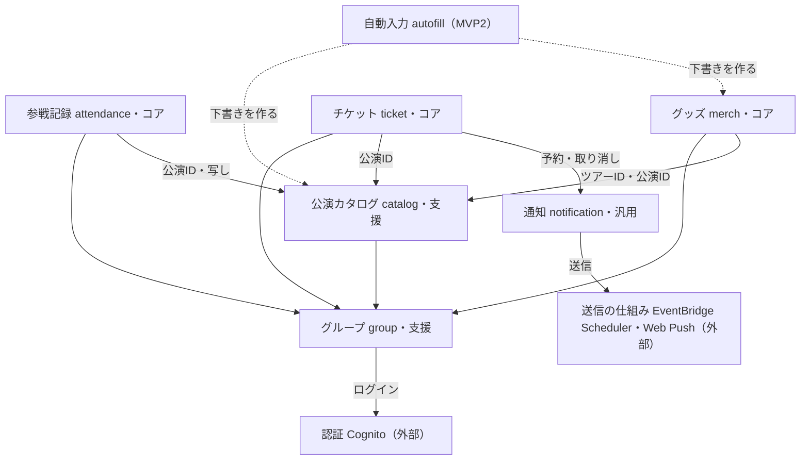

# 文脈マップ

状態：確定（2026-11-05）。決めたことは末尾を参照。2026-11-07にデータモデルとADR-0002（承認待ち）に合わせて、メンバーの指し方、解散と退会の範囲を更新。

矢印は「使う側 → 使われる側（上流）」。

## 文脈

| 文脈 | モジュール | 重み | 役割 | 用語 |
|---|---|---|---|---|
| 参戦記録 | `attendance` | コア | 誰がどの公演に行くかと、行った本人の記録を持つ。解散後も残る本人のデータの置き場所 | 参戦、参戦記録、座席、同行者、公演の写し |
| グッズ | `merch` | コア | 品目と画像（S3）、公演ごとの購入担当と頼まれ物、合計金額を持つ | グッズ、グッズリスト、購入担当、頼まれ物、下書き |
| チケット | `ticket` | コア | 申込ごとの状態と期限を持ち、いつ何を知らせるかを決める | チケット申込、申込者、当落、入金期限、受取、受取方法、受取開始日時、分配 |
| 公演カタログ | `catalog` | 支援 | アーティスト、ツアー、公演、会場、セトリを持ち、グループの全員に同じものを見せる | アーティスト、ツアー、公演、会場、セトリ、曲目、下書き |
| グループ | `group` | 支援 | ユーザー、グループ、メンバー、招待リンクを持ち、退会と解散を始める | ユーザー、グループ、メンバー、オーナー、招待リンク、退会、解散 |
| 通知 | `notification` | 汎用 | 「この人に、この日に、この文面を届ける」予約と通知先を持つ。チケットの言葉は持たない | リマインド、通知先 |
| 自動入力（MVP2） | `autofill` | 汎用 | 貼られた告知ページを1回だけ読み、LLMで公演とグッズの下書きにする | ― |

コアはプレスリリースの3つの柱（記録・グッズ・チケット）に合わせた。

## 関係

| 使う側 | 使われる側（上流） | 受け取るもの | 関係の型 |
|---|---|---|---|
| グループ | Cognito（外部） | ログインした人のID | 腐敗防止層。Cognitoの言葉をほかの文脈に出さない |
| 公演カタログ、参戦記録、チケット、グッズ | グループ | グループID、ユーザーID、メンバーかどうかの確認（2026-11-07にメンバーIDから変更） | 順応者 |
| 参戦記録 | 公演カタログ | 公演ID、解散のときの公演とセトリの内容 | 顧客／供給者 |
| チケット、グッズ | 公演カタログ | 公演ID、ツアーID | 順応者 |
| チケット | 通知 | リマインドの予約と取り消し | 公開ホストサービス |
| 通知 | EventBridge Scheduler、Web Push（外部） | 決まった時刻の起動、端末への送信 | 腐敗防止層 |
| 自動入力（MVP2） | 公演カタログ、グッズ | 下書きを作る窓口 | 公開ホストサービス。自動入力は外のサイトとLLMに対して腐敗防止層になる |

## 解散の順番

解散の処理が文脈を順に呼ぶ。どの段階も2回呼んで結果が変わらないように作り、失敗したら最初からやり直す。

1. グループ：解散の処理を始め、招待リンクの利用を止める
2. 参戦記録：公演日が解散した日以前の参戦に公演、アーティスト名、セトリの写しを付け、同行者の名前を人数に置き換える。これからの公演の参戦は消す
3. チケット：チケット申込と分配を消し、通知に予約の取り消しを頼む
4. グッズ：品目、グッズリスト、頼まれ物、S3の画像を消す
5. 公演カタログ：グループのアーティスト、ツアー、公演、会場、セトリを消す
6. グループ：メンバー一覧、招待リンク、グループを消す

退会では、グループの処理が本人のデータを持つ文脈を順に呼び、参戦記録、チケット申込、頼まれ物、下書き、通知の予約と通知先、Cognitoのアカウントを消す。公演、セトリ、確定した品目などグループの全員のデータは残す。ほかの人の参戦記録で同行者になっていたら、名前を人数に置き換える。

メンバーを外す・自分から抜けるときは、その人のそのグループでのデータを解散と同じように扱う。過去の参戦は写しで本人に残し、予定、申込、頼まれ物、下書きは消す（2026-11-07）。

解散、退会、外す・抜けるは、受け付けたあと専用の関数（`erasure-worker`）が進み具合を記録しながら進め、途中で止まっても続きから再開する（[ADR-0002](decisions/ADR-0002-schema-and-functions.md)、[データモデル](data-model.md)）。

## 用語集に入れる変更

- 文脈「共有」を「グループ」（`group`）に改名する
- 下書き（`Draft`）を、公演カタログとグッズの両方で使う状態にする
- 申込者（`Applicant`）をチケットに足す
- 公演の写し（`ConcertSnapshot`）を参戦記録に足す
- ほかの用語は仮の振り分けのまま確定する

## 決めたこと（2026-11-05）

- Q1 下書きをどの文脈が持つか：公演カタログとグッズがそれぞれ持つ
- Q2 解散をどう進めるか：解散の処理が文脈を順に呼ぶ
- Q3 チケットのリマインドを誰に送るか：申込者だけ
- Q4 退会した人がほかの人の参戦記録で同行者になっていたら：人数表示に置き換える
- Q5 コアの文脈：参戦記録・グッズ・チケットの3つ
- Q6 「共有」の文脈の名前：「グループ」に変える

## 決めないこと

- 工程3まで：オーナーが退会したときの扱い、スマチケの分配先にyoinを使っていない人を入れられるか、Lambdaとスキーマの分け方、参戦記録をアーティストごとにまとめる方法（2026-11-06〜07に[データモデル](data-model.md)とADR-0002で決めた）
- リマインドの送り方：2026-11-07に、1件ずつSchedulerで予約すると決めた。届ける時刻も期限の種類ごとに決めた
- MVP2：自動入力の方式と利用規約、曲マスタを置く文脈
