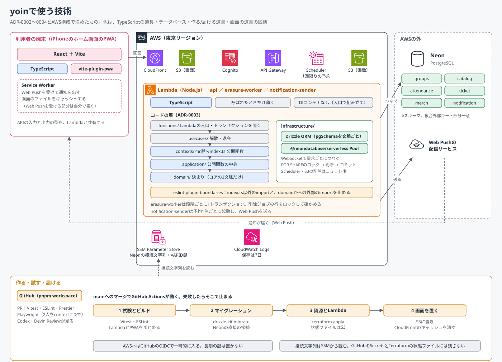

# ADR-0004開発の道具

- 状態：承認（2026-11-21、PR #9のマージ）。道具は2026-11-17に大関が問いのページで選んだ
- 決めた人：大関
- 関連：[ADR-0002](ADR-0002-schema-and-functions.md)、[ADR-0003](ADR-0003-layers-in-contexts.md)、[AWS構成](../architecture.md)、[論点の記録](../discussions/dev-tools.md)

## 背景

工程3でデータモデルとLambdaの分け方を、ADR-0003で文脈の中の層の分け方を決めた。実装は最初から、土台（IaC・CI・デプロイ・Cognito・Web Push）も含めてDevinに委譲する。そのため、使う道具を委譲の前に決め切る（`AGENTS.md`「進め方の決まり」）。

道具を選ぶときの条件は次のとおり。

- Lambdaは3つで、どれも呼ばれたときだけ動き、Neonにはその都度つなぐ（ADR-0002の決定5、AWS構成のA-1）。
- 書き込みは1つのトランザクションで、最初に`FOR SHARE`でロックし、結果を見て続きを決める（ADR-0002の決定3）。
- スキーマは文脈ごとに6つで、複合外部キーと部分一意インデックスを使う（データモデル）。
- 画面はCloudFrontとS3に置く静的なPWAで、iPhoneのホーム画面でWeb Pushを受ける（AWS構成のB-1）。
- migrationはデプロイの流れに入れ、手で流す手順は作らない（`AGENTS.md`）。

## 決定

使う技術の全体は次の図のとおり。

### 1.言語は、LambdaもPWAもTypeScriptにする

LambdaはNode.jsで動かす。Node.jsの版は、Lambdaで使えるLTSのうち最新のものにし、最初の委譲の前にAWSのランタイムの一覧で確かめる。APIの入力と出力の型は、画面とLambdaで共有する。

### 2. DBの読み書きはDrizzle ORMにする

- テーブルは文脈ごとに`pgSchema`で定義し、定義のファイルはその文脈の`infrastructure/`に置く（ADR-0003）。
- ロックは`select().for('share')`のように型つきで書く。SQLの文字列を直接書くのは、Drizzleで表せないときだけにし、PRの説明に理由を書く。
- マイグレーションはdrizzle-kitでSQLのファイルを作り、リポジトリに入れる。作ったSQLは、PRのレビューで中身を読む（`AGENTS.md`の「必ず見る」の「DBの表とmigration」）。
- 同じ文脈の中の外部キーは、Drizzleのテーブル定義に書く。文脈をまたぐ外部キー（ADR-0002の決定2。例：`attendance.attendances.concert_id`から`catalog.concerts.id`へのRESTRICT）は、テーブル定義に書かず、drizzle-kitの手書きのマイグレーション（`drizzle-kit generate --custom`）にSQLで書く。Drizzleで外部キーを書くには参照先のテーブル定義をimportする必要があり、それは決定6の検査が止める依存だからである。
- drizzle-kitの設定は、各文脈の`infrastructure/`のテーブル定義をファイルの場所で集める。設定とマイグレーションのファイルは`src/contexts/`の外に置き、実行時のコードからはimportしない。

### 3.マイグレーションは、GitHub Actionsのデプロイで先に流す

`main`へのマージで動くデプロイの仕事を、次の順にする。どこかで失敗したら、そこで止まる。

1. 試験とビルド（Lambdaのコードをまとめ、PWAを静的なファイルにする）
2. マイグレーション（Neonの直接の接続で`drizzle-kit migrate`）
3. Terraformで資源とLambdaを更新する
4. PWAのファイルをS3に置き、CloudFrontのキャッシュを消す

- GitHub ActionsからAWSへは、GitHubのOIDCで一時的な権限を受けて入る。長期の鍵はGitHubに置かない。
- Neonの接続文字列は、SSM Parameter Storeから読む（AWS構成のC-1）。GitHubのSecretsには置かない。直接の接続（マイグレーション用）とプールを通す接続（Lambda用）の2つをSSMに置く。
- マイグレーションを先に流すので、マイグレーションは前の版のLambdaでも動く形にする。列や表を消すときは、使わなくするデプロイと消すデプロイを分ける。
- 消すマイグレーション（列や表のDROP）には、先頭に`-- requires-deployed: <使わなくした変更のコミット>`を書く。デプロイの手順2は、流す前に次の2つを確かめ、どちらかを満たさなければ止まる。1つ目は、3つのLambdaのいま動いている版（Terraformが各Lambdaのタグに、デプロイしたコミットと時刻を書く）がそのコミットを含むこと。2つ目は、その版に切り替わってから、Lambdaの最大の実行時間（15分）より長くたっていること。前の版で起動した呼び出しはデプロイで止まらないので、終わるのを待つためである。待っている実行が新しい実行に置き換わって、使わなくするデプロイが飛ばされたときも、列を使う版が動いている間は消さない。止まったデプロイは、時間をおいて同じコミットで動かし直す。
- デプロイの仕事は、環境ごとに1本ずつ動かす（GitHub Actionsの`concurrency`。`cancel-in-progress`はfalse）。2つのマージが続いても、先のデプロイが手順4まで終わってから次の手順2が始まる。動いている途中のデプロイは取り消さない。待っている古い実行は新しい実行に置き換わり、新しい実行は`main`の先頭を使うので、古い版が後から出ることはない。

最初のデプロイの前に、次の順で1回だけ準備する。この準備が済めば、最初のデプロイから手順1〜4がそのまま流れる。

1. Neonのプロジェクトを作る（手で）。
2. 初回用の小さなTerraformの構成で、状態ファイルのバケットと、GitHubのOIDCのロールを作る。
3. 準備用のスクリプトで、SSMのパラメーターをSecureStringとして作り、値を入れる。値はスクリプトを動かす人がその場で入れ、リポジトリにもTerraformにも残さない。
4. GitHub Actionsのロールに、マイグレーション用の接続文字列のパラメーターだけを読む権限を付ける（初回用の構成で、名前を指定して付ける）。

### 4. LambdaからNeonへは、サーバーレスドライバーのPoolでつなぐ

`@neondatabase/serverless`の`Pool`をWebSocketでつなぎ、Drizzleの`neon-serverless`のつなぎ方で使う。接続はプールを通す接続文字列にし、要求ごとにつないで、終わったら切る（AWS構成のA-1）。HTTPで1回ずつ送る`neon()`は、途中で判断を挟めないので使わない。

### 5. IaCはTerraformにする

- AWSの資源（Lambda、API Gateway、Cognito、EventBridge Scheduler、S3、CloudFront、IAM）をTerraformで書く。
- 状態ファイルは、東京リージョンのS3のバケットに置き、同じバケットのロックファイルで同時の実行を防ぐ。このバケットとGitHubのOIDCの設定は、最初に1回だけ作る小さなTerraformの構成で作る。
- Lambdaのコードは、手順1でまとめたファイルをTerraformが受け取って更新する。
- Neonのプロジェクトは、Terraformでは作らない。数が少なく変えることもまれなので、手で作る。
- SSMのパラメーター（Neonの接続文字列2つとWeb PushのVAPID鍵）は、置き場所ごとTerraformの外で作る（2026-11-17 大関の判断）。Terraformが`aws_ssm_parameter`を資源やデータソースとして持つと、値を外で入れても、状態の更新のたびに値が状態ファイルに平文で記録されるためである。TerraformはIAMの権限とLambdaの設定で、パラメーターの名前（とそこから組み立てたARN）だけを使う。Lambdaは動くときに名前で値を読む。

### 6.文脈の境目は、ESLintのプラグインで検査する

eslint-plugin-boundariesで、ADR-0003の決定5の2つを書く。lintはCIとエディタの両方で動く。Drizzleのテーブル定義はTypeScriptの値なので、ほかの文脈の`infrastructure/`をimportした時点でこの検査が止める。文脈をまたぐ外部キーはSQLのマイグレーションに書くので（決定2）、この検査の例外は作らない。SQLの文字列でほかの文脈の表を読むことは検査で止められないので、レビューで見る。

### 7. PWAはReactとViteで作る

静的なファイルを出してS3に置く。Service Workerはvite-plugin-pwaで作り、Web Pushを受ける部分は自分で書く。画面の移り方やデータの取り方の道具は、最初の1本の設計で決める。

### 8.そのほかの道具

| 用途 | 道具 |
|---|---|
| パッケージの管理 | pnpm（workspace） |
| 単体と結合の試験 | Vitest |
| 結合試験のDB | GitHub ActionsのPostgresのコンテナ（Neonと同じ版）。試験ごとに空のDBから始め、Neonの計算時間を使わない。Neonにしかない動き（接続の数の上限、休止からの起動）は結合検証環境で見る |
| 性質で確かめる試験 | fast-check（Vitestの中で動かす）。コアの文脈の決まり、リマインドの送信と再送、解散などの削除ジョブに使う（2026-11-18 大関の判断。記録は`docs/discussions/verification-loop.md`の論点「property-tests」） |
| E2E | Playwright。2人をブラウザのcontext 2つで動かす |
| APIの入口のルーティングと入力の確認 | HonoとZod。関数`api`の中でパスごとに公開関数を呼び分け、入力の確認とエラーの形をそろえる |
| lintと整形 | ESLintとPrettier |
| CIとデプロイ | GitHub Actions |

結合試験のDBとAPIの入口の2つは、PR #8の論点の記録（`tooling.md`）で仮決定にしていたものを、2026-11-21に大関がこのADRへ移すと決めた。`tooling.md`は同じ問いの記録が`dev-tools.md`と2本になるので消した。

## 検討した案

選んだ理由と選ばなかった理由は、問いごとに[論点の記録](../discussions/dev-tools.md)に残した。ここには、決定どうしのつながりで決まったことだけを書く。

### IaCをAWS CDKにする

アプリと同じTypeScriptで書け、Lambdaのビルドも任せられる。推奨はこの案だったが、大関がTerraformを選んだ。Terraformでは、Lambdaのビルドをデプロイの手順1で別に行い、状態ファイルの置き場所を最初に作る。

### Neonの接続文字列をGitHubのSecretsに置く

マイグレーションの手順は短くなる。しかし、秘密の値の置き場所が2つになり、Neonのパスワードを変えたときに両方を直す必要がある。OIDCでAWSに入れば、SSMから読める。

## 結果

### よくなること

- 言語がTypeScriptの1つにそろい、APIの型を画面と共有できる。
- 文脈ごとのスキーマ、ロック、境目の検査が、Drizzleのテーブル定義を中心につながる。
- デプロイの順番が1本の仕事で読め、マイグレーションが失敗したら新しいLambdaを出さない。
- 秘密の値はSSMの1か所に置き、GitHubにもTerraformの状態ファイルにも残さない。

### 引き受けること

- Terraformの状態ファイルのバケット、GitHubのOIDCの設定、SSMのパラメーターを、最初に1回作る必要がある。SSMのパラメーターはTerraformの外にあるので、名前を変えるときはTerraformの設定と準備用のスクリプトの両方を直す。
- Lambdaのビルドを、Terraformの外の手順で用意する必要がある。
- サーバーレスドライバーはNeon専用なので、ほかのPostgresへ移るときは接続の部分を差し替える。
- drizzle-kitが作るマイグレーションのSQLを、毎回読む必要がある。
- マイグレーションを先に流すので、表を壊す変更は2回のデプロイに分ける。

## この決定では決めないこと

- 画面の移り方やデータの取り方の道具（最初の1本の設計で決める）
- 監視とアラートの範囲（工程6）
- Neonのリージョンと、無料枠に収まるか（工程6）
- Neonのブランチを試験に使うか。2026-11-21に、MVP1では使わないと決めた（無料枠の計算時間を使うため。記録は`docs/discussions/api-design.md`の論点「neon-branch」）

## 2026-11-21の追記

承認のあと、大関さんが出した構成の見直しをClaudeが確かめ、次の3つを足した。決めた理由と選ばなかった案は、`docs/discussions/api-design.md`の論点「contract-source」と、`docs/discussions/aws-architecture.md`の論点「declarative-web-push」「powertools」にある。

- APIの入力と出力の型は、Honoの`hono/client`で画面と共有する。OpenAPIの文書は作らない。APIを外部に公開しないため。
- 通知の中身はDeclarative Web Pushの形にする。決定7のService Workerは、対応していない環境のために残す。
- ログはPowertools for AWS LambdaのLoggerで書く。Idempotencyの機能は使わない。
