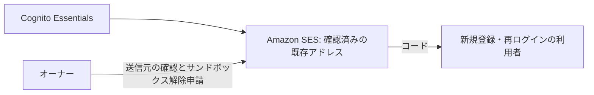

# ADR-0007 認証メールはCognitoからAmazon SESで送る

- 状態: 提案（オーナーは方式・送信元の種類・申請者を選択済み。設計PRの承認待ち）

## 背景

メールのコードでログインし、パスワードは持たない（F-05）。Cognitoの既定送信だけではメールOTPを使えない。承認済みのAWS構成とADR-0006の費用試算にはSESを含めていなかった。

## 決定

Cognito Essentialsから同じシンガポールリージョンのAmazon SESを使う。オーナーが既存メールアドレスを選んで送信元を確認し、[サンドボックス解除](https://docs.aws.amazon.com/ses/latest/dg/request-production-access.html)を申請する。新規ドメイン・専用IP・カスタムメール送信Lambdaは追加しない。実アドレスはリポジトリに置かない。

TerraformでプールにEmailSendingAccount=DEVELOPER、検証済みSES identityのSourceArn、SignInPolicyのEMAIL_OTP、MfaConfiguration=OFFを設定する。ブラウザのクライアントにはシークレットを発行せず、ALLOW_USER_AUTH、PreventUserExistenceErrors=ENABLED、トークン失効を有効にする。初回はIaC適用ロールだけにCognitoのSES用サービスリンクロールの作成を許可し、iam:AWSServiceNameをemail.cognito-idp.amazonaws.comに限定する。プールのメール設定をコンソールで後から直す手順は作らない。

結合検証と本番はAWSアカウント・シンガポールのSES割当を共有する。CIは実送信せず、結合検証の実送信は検証用宛先に1日10通まで、連続送信は1秒より間隔を空ける。解除前は受信先も事前に検証する。サンドボックスの上限は200通/24時間・1通/秒であり、解除後の枠はアカウントで確認する。

## 結果

従来のログイン要件を保つ。受信確認と本番アクセス承認が必要になる。認証メールを100通/月と置くと従来の試算に税抜き約1.50円を足し、SES送信料だけを加えた比較値は約4.50円/月。2環境の監視費、抑止リストの運用、受信制約は[最初の1本の設計](../designs/first-slice.md)に置く。送信元と返信先の具体的な扱いは[論点の記録](../discussions/first-slice.md#認証メールにどのアドレスを表示し返信を受けるか)で決める。
