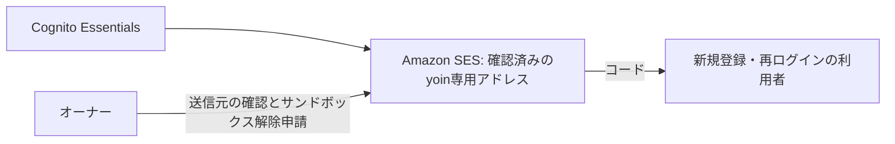

# ADR-0007 認証メールはCognitoからAmazon SESで送る

- 状態: 置き換え（2026-11-27、ADR-0008）。もとは提案（オーナーは方式・送信元の種類・申請者を選択済み。設計PRの承認待ち）

## 背景

メールのコードでログインし、パスワードは持たない（F-05）。Cognitoの既定送信だけではメールOTPを使えない。承認済みのAWS構成とADR-0006の費用試算にはSESを含めていなかった。

## 決定

Cognito Essentialsから同じシンガポールリージョンのAmazon SESを使う。yoin専用の無料メールのアドレスを作り、送信元・返信先・問い合わせ先を同じアドレスにする。オーナーがSESで送信元を確認し、[サンドボックス解除](https://docs.aws.amazon.com/ses/latest/dg/request-production-access.html)を申請する。新規ドメイン・専用IP・カスタムメール送信Lambdaは追加しない。実アドレスはリポジトリに置かない。

TerraformでプールにEmailSendingAccount=DEVELOPER、検証済みSES identityのSourceArn、SignInPolicyのEMAIL_OTP、MfaConfiguration=OFFを設定する。ブラウザのクライアントにはシークレットを発行せず、ALLOW_USER_AUTH、PreventUserExistenceErrors=ENABLED、トークン失効を有効にする。初回はIaC適用ロールだけにCognitoのSES用サービスリンクロールの作成を許可し、iam:AWSServiceNameをemail.cognito-idp.amazonaws.comに限定する。プールのメール設定をコンソールで後から直す手順は作らない。

[登録確認メールを送るプール設定](https://docs.aws.amazon.com/cognito/latest/developerguide/user-pool-settings-email-phone-verification.html)として`AutoVerifiedAttributes=["email"]`を指定する。一方、登録前Lambdaの応答の`autoConfirmUser`と`autoVerifyEmail`は立てず、利用者がコードを入れてから確認する。 招待付きの`SignUp`は、生の招待トークンを`ValidationData`で渡す。登録前Lambdaは保存済みのハッシュと照合し、イベントの中身をログに書かない。

結合検証と本番はAWSアカウント・シンガポールのSES割当を共有する。CIは実送信せず、結合検証の実送信は検証用宛先に1日10通まで、連続送信は1秒より間隔を空ける。解除前は受信先も事前に検証する。サンドボックスの上限は200通/24時間・1通/秒であり、解除後の枠はアカウントで確認する。

両環境が共有するSESのアカウント単位の抑止設定は、Terraformの`aws_sesv2_account_suppression_attributes`で`suppressed_reasons`を`BOUNCE`と`COMPLAINT`に明示する。アカウントとリージョンの組につき1つだけ管理する。既定値の根拠と確認手順は[最初の1本の設計](../designs/first-slice.md#ログと監視)を参照する。

## 結果

従来のログイン要件を保つ。受信確認と本番アクセス承認が必要になる。認証メールを100通/月と置くと従来の試算に税抜き約1.50円を足し、標準アラーム6個が無料枠に収まる場合の比較値は約4.50円/月。送信数の監視、抑止リストの運用、GmailとiCloudでの受信確認と独自ドメインへの切り替え条件は[最初の1本の設計](../designs/first-slice.md)に置く。

## 2026-11-27の追記（ADR-0008で置き換えた）

CognitoとSESを使わず、VoidのBetter Authでパスキーのログインにし、メールは送らないことにした（[ADR-0008](ADR-0008-cloudflare.md)の決定5）。このADRは全部置き換えた。パスワードを持たないことと、招待リンクを通らない登録を断ることは変えない。メールのコードでログインする要件（F-05）は、最初の1本の要件定義書を直すときにパスキーへ書き換える。
