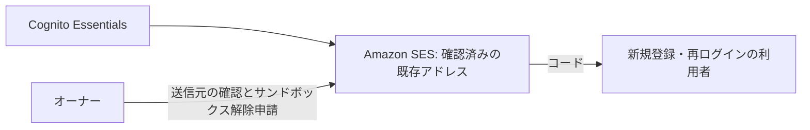

# ADR-0007 認証メールはCognitoからAmazon SESで送る

- 状態: 提案（オーナーは方式・送信元の種類・申請者を選択済み。設計PRの承認待ち）

## 背景

メールのコードでログインし、パスワードは持たない（F-05）。Cognitoの既定送信だけではメールOTPを使えない。承認済みのAWS構成とADR-0006の費用試算にはSESを含めていなかった。

## 決定

Cognito Essentialsから同じシンガポールリージョンのAmazon SESを使う。オーナーが既存メールアドレスを選んで送信元を確認し、[サンドボックス解除](https://docs.aws.amazon.com/ses/latest/dg/request-production-access.html)を申請する。新規ドメイン・専用IP・カスタムメール送信Lambdaは追加しない。実アドレスはリポジトリに置かない。

## 結果

従来のログイン要件を保つ。受信確認と本番アクセス承認が必要になる。認証メールを100通/月と置くと従来の試算に税抜き約1.50円を足し、約4.50円/月。選択肢と採否は[論点の記録](../discussions/first-slice.md#メールのコードを送る仕組みをどれにするか)、単価・受信制約は[最初の1本の設計](../designs/first-slice.md#sesを足した費用)に置く。
