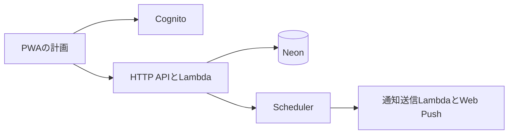
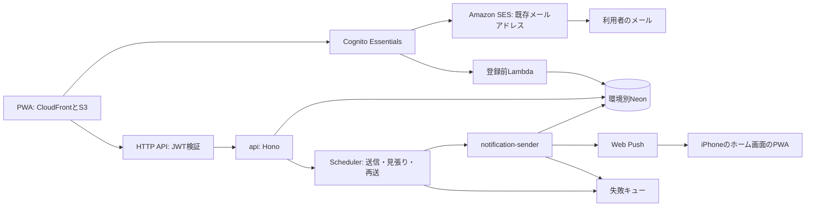
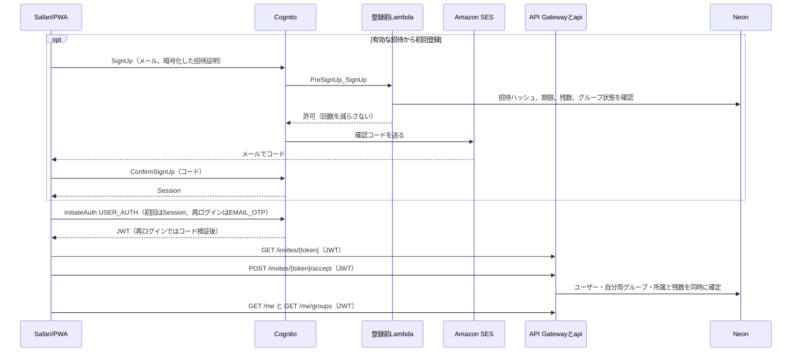
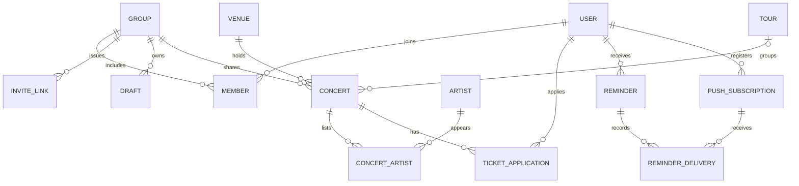
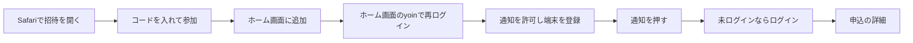
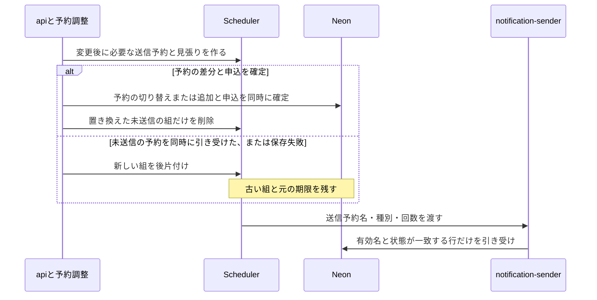

# 設計書: 招待からリマインドがiPhoneに届くまで

- ステータス: draft
- レベル: L3
- 関連: [承認済みの要件](../requirements/first-slice.md)、[API設計](../api.md)、[データモデル](../data-model.md)、[AWS構成](../architecture.md)、[メール送信のADR](../decisions/ADR-0007-cognito-email.md)

## この設計を一言で

招待された人はメールのコードで参加し、仲間と公演やチケット申込を共有する。自分の申込の期限は、ホーム画面に追加したiPhoneに届く。通知の時刻変更が保存されなければ、元の予約を残す。

## 背景

承認済みのAWS構成と文脈の境界を使い、最初の1本を本番と同じ構成で通す。Cognitoの認証だけではアプリへの参加を認めず、Web Pushを送った端末もサーバー側で記録する。

## 目的

実装と試験が同じAPI契約・DB制約・通知の失敗時の動きを参照できるようにする。

## 要件

G-01・G-02、C-02・C-03・C-07、T-01〜T-03、N-01〜N-03を満たす。公演の申込一覧（T-04の一部）と起動時の自分のグループ一覧も含む。画面・異常系・境界・受け入れ条件は[要件定義書](../requirements/first-slice.md)を正とする。

## 対象範囲

要件の11画面、下表のAPI、登録前Lambda、通知送信Lambda、14テーブル、Terraform、デプロイ時のマイグレーションと初期データ、PWA、2人のE2Eを作る。

## 対象外

グループの作成・切替・退会・解散・除名の画面/API、削除ワーカー、ツアー作成、過去公演の画面、公演編集、分配、参戦、グッズ、画像、通知先を手動で外す操作は作らない。この回の公演の下書きはツアーなしの公演1件に限る。

## 現状構成

承認済みの構成は設計上のもので、配備済みのアプリや移行元のDBはない。Cognitoのメール送信元は従来の構成に含まれていなかった。

## 変更後構成

結合検証と本番を同じTerraformから別々に作る。Cognitoプール、Neonプロジェクト、Schedulerのグループ、SSMのパスと実行権限を分離する。AWSとNeonはシンガポールに置く。

## データフロー

- 未確認なら確認コードを再送してから続ける。登録済みなら [USER_AUTH](https://docs.aws.amazon.com/cognito-user-identity-pools/latest/APIReference/API_InitiateAuth.html) の [EMAIL_OTP](https://docs.aws.amazon.com/cognito-user-identity-pools/latest/APIReference/API_RespondToAuthChallenge.html) にコードを返す。初回は [ConfirmSignUpのSession](https://docs.aws.amazon.com/cognito-user-identity-pools/latest/APIReference/API_ConfirmSignUp.html) で確認コードを再利用できる。
- [登録前Lambda](https://docs.aws.amazon.com/cognito/latest/developerguide/user-pool-lambda-pre-sign-up.html)は既存の署名秘密をブラウザに渡さない。ブラウザは配布済みの公開鍵で、招待トークンと登録メールのダイジェストを暗号化し、版付きの暗号文だけをSignUpのValidationDataに渡す。RSA-OAEP/SHA-256、2048ビットとし、暗号化するデータは固定長のトークンとメールのSHA-256に限る。秘密鍵は環境別のSSM SecureStringに置く。Lambdaは復号、要求の正規化したメールとの照合、DB上の招待の検査を行う。暗号文の使い回しだけでは別のメールで登録できない。生トークンや暗号文をログに出さない。
- 招待が無効、照会が失敗、または証明が無ければ登録を拒む。Cognitoの例外はUserLambdaValidationException。autoConfirmUser / autoVerifyEmailは設定しない。PreSignUp_AdminCreateUserは初期データのため招待検査をしない。通常の登録者には管理者権限を与えない。
- 招待を持つ人は期限内に別アドレスで登録を試せる。確認メールの再送は登録前Lambdaを通らない。招待は短く発行し、参加時にもう一度期限と残数を確かめる。登録拒否後のアカウント不在・メール0通は実環境で確かめる（[AWS確認とBot回答](../discussions/first-slice.md#aws公式文書で確かめたこと)）。

## API 設計

HTTP APIからLambdaのHonoに渡す。Zodで未知キーと誤った型を拒む。以下の g は groupId。JSONはcamelCase、公演の日付・時刻は日本時間、期限は時差付きISO 8601で受けて+09:00で返す。[既存の入出力と共通契約](../api.md#全体の決まり)も適用する。

| メソッドとパス | 入力 → 成功応答と認可 |
|---|---|
| GET /me、GET /me/groups | JWT → 自分のID・表示名・自分用グループID、または所属グループの一覧。起動時に使う |
| GET /groups/{g}、GET /groups/{g}/members | メンバー → グループ名・種類・状態・オーナー情報、またはメンバーのID・表示名・参加日・役割 |
| POST /groups/{g}/invite-links | id・expiresAt・maxUses → URL。共有グループのオーナーだけ |
| GET /invites/{token} | JWT → グループ名・registered・参加可否・既存メンバーか。既存メンバーを先に扱う |
| POST /invites/{token}/accept | 未登録者だけdisplayName必須 → 200とgroupId。既存メンバーには何も加えず同じ行き先を返す |
| GET /groups/{g}/artists、GET /groups/{g}/venues | メンバー → 選択用の一覧。アーティストには色、会場には最寄り駅を含める |
| GET /groups/{g}/concert-drafts、POST /groups/{g}/concert-drafts | 本人の一覧。作成はidとconcerts（1件、ツアーなし）→ 保存した下書き |
| PATCH /groups/{g}/concert-drafts/{draftId}、DELETE 同パス | 作成者だけ。PATCHは公演1件の更新 → 下書き、DELETEは204 |
| POST /groups/{g}/concert-drafts/{draftId}/confirm | 作成者だけ。concertIds（UUIDv7を1件、tourIdなし）→ 200と確定した公演ID。再送は同一グループに全IDがあれば同じ応答 |
| GET /groups/{g}/concerts、GET /groups/{g}/concerts/{concertId} | メンバー → 日付順の公演一覧（画面はwhen=upcomingを使用）、または日付・題名・会場・時刻・公式URL・出演順の詳細 |
| GET /groups/{g}/ticket-applications | メンバー → 申込一覧。concertIdとapplicant=meで絞れる。displayStatus、pickupAvailable、座席・整理番号、DBで記録したcreatedAtを含む |
| POST /groups/{g}/ticket-applications | id・concertId・枚数・受取方法・初期状態（applied/won）・任意の受付名・期限3種・座席/整理番号 → 作った人が申込者となる申込 |
| GET /groups/{g}/ticket-applications/{applicationId} | メンバー → 申込と計算した表示。本人だけにリマインドの種類・実際の時刻・状態を返す。分配は対象外 |
| PATCH /groups/{g}/ticket-applications/{applicationId}、DELETE 同パス | 申込者だけ。PATCHは編集可能な欄の部分更新 → 申込、DELETEは204 |
| PUT /groups/{g}/ticket-applications/{applicationId}/status | 申込者だけ。status → 200と申込。同じ状態なら何もしない |
| GET /me/push-subscriptions、POST /me/push-subscriptions | 本人の通知先一覧。POSTはendpointとkeys（p256dh・auth）→ 登録行。他人と同じendpointなら409、既存IDを返さない |

- API Gatewayは環境のissuerとapp clientを照合する。apiはCognitoアクセストークン（token_use=access）だけを受け、JWTのsubをgroups.users.cognito_subから内部のuuidへ引く。Cognito subを内部の主キーにしない。JWTなしはGatewayの401、users行なしは招待の2本以外403 not_registered。CognitoのアクセスJWTはaudがなければGatewayがclient_idを使う（[JWT authorizer](https://docs.aws.amazon.com/apigateway/latest/developerguide/http-api-jwt-authorizer.html)）。
- グループIDと資源IDを組で照会する。非メンバー・不在・別グループIDは404 not_found。メンバーに見える資源があり、操作する権限だけが無いなら403 forbidden。グループの削除対象が不在なら再送でも404。初回が成功して応答が失われた場合も、画面は一覧を読み直す。他のグループでの存在は調べない。初回204、再送404でも副作用は重ならない。
- 作成は画面が作るUUIDv7で重複を見分ける。初回201、同じID・同じ内容は200、別内容や別グループの同一IDは409 id_conflict。通知先はendpointを重複の印にし、同じ本人なら200。PATCHの省略は維持、nullは任意欄だけを消す。APIで申込者IDを入力させない。
- エラーはRFC 9457のapplication/problem+json。422 invalid_inputはerrorsに欄を入れる。409はinvite_unusable、already_exists、invalid_transition、group_closing、id_conflictを区別する。退会開始は403 account_closing。未知の失敗は内容を伏せて500 internal。Gatewayの401と流量制限の429は画面で別扱いにする。
- 境界値は招待期限が現在より後で30日以内・1〜10回、枚数1〜99、受付名100字・座席と整理番号200字まで。空欄をnullにそろえ、文字数はUnicodeコードポイントで数える。

## DB 設計

Drizzleの表定義は文脈ごとのinfrastructureに置く。型・null・外部キーの全一覧は[データモデル](../data-model.md#テーブル)を正とし、以下の14表だけを初回SQLに含める。

| スキーマ・テーブル | 主な列・制約と照会 |
|---|---|
| groups.users / groups.groups | users(id PK, cognito_sub UNIQUE, display_name, status)、groups(id PK, owner_id, kind, status, name)。自分用はowner_idごとに1件（kindに対する部分一意索引） |
| groups.members / groups.invite_links | members PK(group_id,user_id)、逆引き(user_id,group_id)。invite_links(id PK, group_id, token_hash UNIQUE, expires_at, max_uses, used_count, revoked_at)とCHECK 0 ≤ used_count ≤ max_uses |
| catalog.artists / catalog.venues | id PKとgroup_id。artistsは(group_id,name_key) UNIQUEと12色のCHECK。名称検索はgroup_idを先頭にする |
| catalog.tours / catalog.concerts | id PKとgroup_id。concertsのvenue_id/tour_idは同じグループへの複合FK。tour_idはnull可。公演一覧は(group_id,日付,id) |
| catalog.concert_artists / catalog.drafts | concert_artists PK(concert_id,artist_id)、同じグループへの複合FK、出演順。draftsはJSONBのpayloadを持ち、(group_id,created_by,created_at)で一覧 |
| ticket.ticket_applications | id PK。公演への同グループ複合FK、申込者、各期限、状態、枚数、受取方法、座席・整理番号。created_atは初回の挿入時にDBで記録し、編集・状態変更・作成の再送では変えない。CHECKで状態・受取方法・枚数を守り、(group_id,concert_id)、(group_id,申込者)で絞る |
| notification.reminders | id PK、宛先、dedupe_key UNIQUE、send_at、schedule_name UNIQUE、status CHECK、claimed_at、sent_at、attempts smallint NOT NULL DEFAULT 0（0〜4）、retry_at、通知文とURL。宛先の索引 |
| notification.push_subscriptions / notification.reminder_deliveries | subscriptionsのendpoint UNIQUE、user_id索引。deliveries PK(reminder_id,push_subscription_id)、status CHECK、attempted_at。FKで両親の削除時CASCADE、push_subscription_id側にも索引 |

招待参加はユーザー作成・自分用グループ・所属・利用回数を1トランザクションで更新する。対象の招待行とグループの状態を確認し、所属を新規に加えた場合だけ、期限内かつ残数が正の条件付きUPDATEで1回加算する。0行なら全体を戻す。競合した同じ人はコミット後に既存所属を確認し、残数を減らさない。確定した公演と下書き削除も1トランザクション。

申込削除では先に未送信のリマインドを取り消し、申込を削除する。Pushの404/410は通知先とその子の送信結果を削除する。退会・解散・匿名化のAPIやジョブ表は今回作らない。将来の削除・匿名化の順序や保持対象は[既存のデータモデル](../data-model.md#解散と退会)から変更しない。個人情報を他文脈の表に写さない。

## フロントエンド設計

React＋Vite、React RouterとTanStack Query、Honoクライアントを使う。グループIDをクエリキーに含め、更新後に関係する一覧と詳細を読み直す。S-01の招待先や通知からの戻り先は同一オリジンのパスに限る。

- Safariとホーム画面のPWAは別のログイン状態を持つ。各環境のCognitoリフレッシュトークンは365日、ログアウト時に失効させて端末の保持分を消す。Service WorkerにJWTを渡さない。招待トークンや認証画面はオフラインキャッシュに置かない。
- ホームは自分の申込と有効な期限から「次にすること」を作り、最も近い期日を帯にする。通知先0台またはlastFailedAt付きの端末があればS-23へ案内する。許可拒否でも帯を残す。
- 7日ちょうどはカウントダウンなし。座席を出せる自分の申込が複数なら、座席が空でない入金済み/受取済みのうち、受取済みを優先する。同じ状態では申込一覧のcreatedAtが新しいものを選び、同時刻ならIDの昇順で最初の1件を使う。
- 通知はDeclarative Web Pushで出し、未対応端末はService Workerで表示する。開くのは同一オリジンの申込URLだけ。削除済みなら見つからない画面を出す。

## バックエンド設計

Lambdaの入口で依存を手動で組み立て、Honoから文脈の公開関数を呼ぶ。domainはI/OやDrizzleを知らない。applicationは集約の生成と再構築を分け、infrastructureが変換する。SQLは各文脈内に閉じる。メンバー検査と書き込みロックを先に取り、文脈をまたぐ処理には同じトランザクションを明示的に渡す。チケットは通知の公開関数を呼ぶが、通知はチケットを読まない。

申込の4種類の書き込みは同じ予約調整関数を使う。appliedは結果発表、wonは日本時間の前日20時と締切3時間前、paidは受取開始、lost/picked_up/削除では予約なし。期限が空なら作らない。予定時刻を過ぎた場合は期限前だけ1分後とし、状態も期限も変わらなければ、通知文・計算済み時刻・送信済みの状態を変えない。期限切れと受取開始はその時刻ちょうどから表示に反映する。

- 新規・変更とも送信と見張り（10分後）を先に作る。並行処理と中途停止で世代名が重ならないよう、世代nは環境別PostgreSQLシーケンスのnextvalで発行する。形はreminder-<id>-<n>とreminder-watch-<id>-<n>。差分を計算した時点でscheduledだった行の時刻変更だけを、旧名かつscheduledの条件付きUPDATEで切り替える。見張りのために追加の行ロックやadvisory lockは取らない。この切り替えが競合で0行なら申込変更も戻し、新しい組だけを消す。コミット結果が不明なら、別の接続で新旧どちらが有効かを確かめるまで削除しない。
- 変更前からsending・sent・canceledの行は時刻の切り替えに使わない。期限変更後に同じ種類の予約が必要なら、申込と同じDBトランザクションで旧行のdedupe_keyを履歴用のhistory:<旧予約ID>へ移し、元のキーで別IDの新規行を挿入する。新規行は送信結果と再送回数を引き継がず、申込画面は元のキーで現行の予約だけを読む。引き受け済みの旧行は自分の処理を終え、旧送信が新しい予約やその再送に触れることはない。計算結果に予約がなければ新規行は作らない。同じ期限での再送信や受付名だけの編集では、完了済みの予約を作り直さない。
- 送信・見張り・再送にはDB上の有効名を渡す。旧名や未確定の名前では送らない。初回予約がDB確定前に起動した場合も、確定後に起動する見張りがscheduledを引き受ける。送信と再送は起動後に自動削除する。見張りは同名で時刻を動かすため自動削除を無効にし、不要になった時点で明示的に消す。古い見張りは自分の世代の予約だけを消す。
- 引き受けは状態とclaimed_atも見る条件付きUPDATE。最初・再送の各回を初めて引き受けるときだけattemptsを増やす。見張りはclaimed_atが10分以上古ければ同じ回を再開し、10分未満ならclaimed_atの10分1秒後に見張りを移す。送信前に見張りが次回も起動することを確かめる。
- 記録がsentの端末は再送しない。端末ごとの成功とlast_failed_atの解除、初回の成功時刻sent_atは同じトランザクションで保存する。404/410の端末はgoneとして扱ってから削除する。通知先が0台なら再送待ちにせず、完了状態sentにする。申込詳細はsent_atから得たsentToAnyDeviceを使い、1台分も受理されなかった完了を「送信なし」と表示する。後から通知先を足しても過去の通知は出さない。
- 一時失敗は5分後に3回まで。reminder-retry-<id>-<回数>で二重作成を止める。停止後に作り直すとき同名があれば、世代・回数が一致する既存予約の時刻を使う。再送予約と見張り（再送の10分後）を確保してから、retry_atを保存しclaimed_atを空にする。再送はretry_at以降かつ入力の回数がattemptsの次のときだけ引き受ける。次の再送が来なければ見張りが同じ条件で引き受ける。引き受け時はretry_atを空にする。使い切った場合は端末のlast_failed_atを保存してC-4に通知したあと、完了にする。通知が失敗したら見張りで再開する。C-4の同一予約に対する重複報告は許す。Web Pushの受理直後に停止した場合も重複を許す。

## エラー処理

| 観点 | 設計 |
|---|---|
| リトライ | Schedulerの送信不能は最大2回、Lambda非同期実行の関数エラーも最大2回、各イベントの保持は最大1時間。サービスのバックオフに従い、使い切り・期限切れはC-4へ送る。Web Pushの業務上の再送3回は5分固定。Cognitoのメール送信要求を画面で自動再送しない |
| タイムアウト | 登録前LambdaはAWSの5秒制限より短い4秒とし、秘密の取得とNeon照会を合わせて3秒で打ち切る。apiは20秒、DB文とScheduler SDKは各3秒、送信Lambdaは60秒、端末のPush要求は各5秒を上限とする。無制限に待つと、招待の同期応答枠やグループの書き込みロックを使い切る |
| 冪等性 | 作成ID、招待の所属PK、通知先endpoint、予約の世代・回数と端末ごとの送信記録を使う。Schedulerの再呼び出しは同名・同じ入力に限る |
| 部分失敗 | 予約作成とDB確定の一方だけが成功しても、旧予約を先に消さず、有効名で送信を止める。取消・削除はDBから確定し、その後AWS側を消す |
| 縮退 | SESが止まれば新規登録・再ログインに時間をおく案内を出す。既にログイン済みの操作は継続できる。予約を保存できなければ申込の変更を成功と返さない。Pushが届かなくてもアプリから期限を確認できる |

## ログと監視

Powertoolsの構造化ログを7日保存する。操作種別・要求ID・エラー分類・回数・経過時間のみとし、招待URLやヘッダー、氏名、メール、JWT、Push endpointと鍵、通知文を記録しない。Gatewayのログに実パスや本文を入れない。

ADR-0006に従い、Budgetsは月5ドル、Gatewayは20回/秒・瞬間40回。10人×30操作/日の見込みから、1時間のアラームをAPIは125件、Lambdaの合計は150件で始め、結合検証で調整する。C-4で予約の起動失敗、Lambda実行失敗、再送枯渇を検知する。SESの送信失敗・バウンス・苦情も監視し、E-16の上限到達時は利用者に待つよう案内する。

## セキュリティ

Cognitoのプール・発行者・アプリクライアントを環境で分離する。SSMの秘密は必要な関数だけが読み、VAPID公開鍵と招待証明の暗号化用公開鍵だけをPWAへ配る。HMACから作る元の招待トークンはDBにハッシュだけを保存する。秘密鍵・既存メールアドレスの実値をコード、作業ログ、Terraformソースに書かない。招待画面にReferrer-Policy: no-referrerを設定し、外部リソースへURLを送らない。CORSはその環境のPWAのオリジンに限る。

通知の購読情報は本人にしか返さない。任意URLへのサーバーからの要求を避けるため、PushのendpointはHTTPSで、対応するPushプロバイダーのホストに限り、転送先URLには追従しない。ロック画面に公演名と受付名が出ることは通知を許可する画面で案内する。

## 性能

定期ポーリングでNeonを起こさず、予約単位で起動する。登録前LambdaのDB照会は1本とし、採用ドライバーのトランザクションは書き込みに限って使う。一覧は10人の利用を前提にページ分けしない。日付と申込者の索引を使い、ホームの表示に端末ごとの送信履歴を読まない。

## テスト方針

- CIはメールを送らない。登録前のイベント試験で招待の無効・期限・上限・AdminCreateUserを確認する。API結合試験でJWTなし・usersなし・非メンバー・非オーナーを区別し、招待の最後の1回を2人で競合させる。DELETE不在と他グループの404を比較する。
- Playwrightは2つのcontextで、オーナーの招待発行、招待者の参加、公演確定、申込から受取済みまでを通す。CIではテスト用の認証代替を使い、本番構成に認証の迂回を置かない。結合検証で2人を用意するときは、初期データの手順がAdminCreateUser（SUPPRESS）で用意する。実プールへのメールなしの認証E2Eが要る場合のパスワードは結合検証専用設定に限り、本番では許可しない。
- fast-checkで予約の時刻と状態遷移、再送上限、世代切替と引き受けの競合、旧見張り、同じ再送、端末ごとの再開を確かめる。Push成功直後に失敗させ、成功記録と端末の失敗印が別々に残らないことも確かめる。
- 1月10日12時の入金期限で、1月9日20時の通知を送ったあと、同日21時に期限を翌日の1月11日12時へ延ばす。期限が保存され、1月10日20時は別IDで予約され、3時間前の予約が1月11日9時に切り替わることを確かめる。同じ変更を送り直しても予約を増やさない。
- 同じ公演の受取済みの申込2件に座席を入れ、古い申込をあとで編集しても、券面が作成日時の新しい申込を選ぶことを確かめる。
- 結合検証では初期データでオーナーと共有グループを用意する。大関さんはオーナーとして招待リンクを発行し、2人目として別のメールアドレスでiPhoneのSafariから参加する。2人目はホーム画面のyoinで再ログインして通知を許可し、公演を確定して自分の期限付き申込を作る。そのiPhoneで結果発表・入金期限・受取開始の通知を受け取り、通知から自分の申込を開く（AC-07〜AC-10b）。大関さんはオーナーとしてパソコンでも開き、2人目の申込が読めても編集できないことを確かめる（AC-11）。
- 大関さんは登録拒否後のAdminGetUserでアカウントが無く、確認メールも届かないことと、正常な初回登録からログインまではメールが1通であることを確かめる。CIの上限エラー画面テストは応答を模す。実AWSとiPhoneはこの設計作成時点では未検証。

## 移行とリリース

Drizzleで環境共通のSQLを生成し、表・制約・索引・世代シーケンスの差分をレビューする。SQLは文脈ディレクトリの外に置く。マイグレーションは環境ごとのデプロイに1回だけ組み込み、手動適用しない。mainの試験→結合検証のマイグレーション→Terraform→初期データ→PWA配置→オーナーの確認→承認付き本番デプロイの順。既存データ移行・旧クライアントの互換対応は不要。

初期データは環境別にCognitoのsubを取得し、オーナー・自分用グループ・共有グループ・所属を二重に作らない。オーナーのCognitoアカウントはemail_verified=true、パスワードなし、招待メール送付なしで作る。結合検証と本番の設定を混同しない。Neonの復元はADR-0006の6時間が上限。事故時は書き込みと送信を停止し、復元先とCognito・Schedulerの差を確認する。照合できない予約をそのまま有効にせず、有効な申込と宛先から未来の予約だけを組み直して再開する。この回は解散・退会を作らないため、その削除をやり直す仕組みは対象外。

### SESを足した費用

[ADR-0006の試算](../decisions/ADR-0006-region-and-cost.md#費用の試算)と同じ10人・1日30操作/人・1ドル150円で比べる。API約9,000回/月など既存の内訳は変えない。API操作のたびにメールは送らないため、比較用に10人が各月10通まで使う月100通を置く。登録・再ログイン・再送・結合検証の合計として見積もり、実測値とはしない。

| 項目 | 月額（税・クレジット・SES無料枠を除く） |
|---|---|
| Cognito Essentials | 10 MAUは直接ログイン月1万MAUの無料枠内（アカウント/組織で共有）。0円、固定費なし |
| SES à la carte | 100通 × 0.10ドル/1,000通 = 0.01ドル = 約1.50円。固定費なし。専用IPや新規ドメインは購入しない |
| 新しい合計 | ADR-0006の約3円＋約1.50円＝約4.50円（10%税込で約4.95円）。クレジット適用前 |

実通数が10通なら送信料は約0.15円。SES Essentials（別のSES料金プラン）の場合は月100通で0.016ドル（約2.40円）だが、本設計の試算はà la carte。単価と無料枠は[AWS Cognito料金](https://aws.amazon.com/cognito/pricing/)・[Amazon SES料金](https://aws.amazon.com/ses/pricing/)による。AWSのサンドボックスの上限と本番アクセス後の割当は金額と別であり、既定送信の50通/日をSESの上限に使わない。

## リスク

- SESの確認メールに応じられる既存アドレスをオーナーが選ぶ。既存アドレスを確認しただけでは、そのドメインのDMARC整合までは保証されない。FromとMAIL FROMのSPF整合、またはFromと署名ドメインのDKIM整合が必要で、送信元ドメインが厳格に拒否する場合は不達になり得る（[AWSのDMARC解説](https://docs.aws.amazon.com/ses/latest/dg/send-email-authentication-dmarc.html)）。結合検証で受信結果とAuthentication-Resultsを確かめ、不達なら別の既存アドレスで再確認する。未承認のまま本番へ出さない。
- SchedulerとDBは一つのトランザクションにはできない。不要予約が一時的に残っても、有効名を確かめて止める。Pushの受理とDB保存も一つにはできず、重複通知を完全にはなくせない。

## 決めたこと（問いと答え）

[論点の記録](../discussions/first-slice.md)

## 未決事項

オーナーへの質問は回答待ち0件。[画面とデータ取得の道具](../discussions/first-slice.md#画面の移り方とデータの取り方の道具を何にするか)の技術提案1件は、この設計書と一緒に承認を受ける。

[SES方式の論点](../discussions/first-slice.md#メールのコードを送る仕組みをどれにするか)のとおり、既存メールアドレスを使い、オーナーが解除を申請する。アドレスの実値の設定、送信元確認、AWSの承認と受信確認は実装・結合検証の作業として残る。
