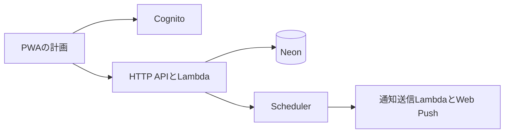
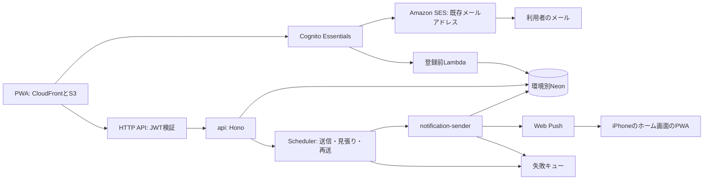
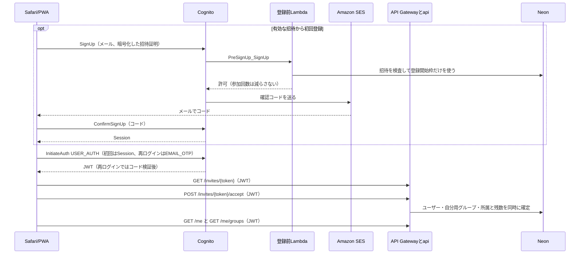
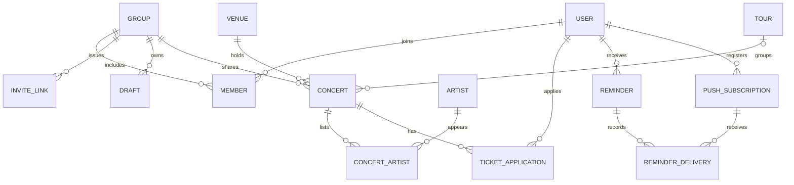
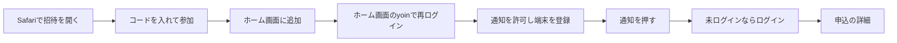
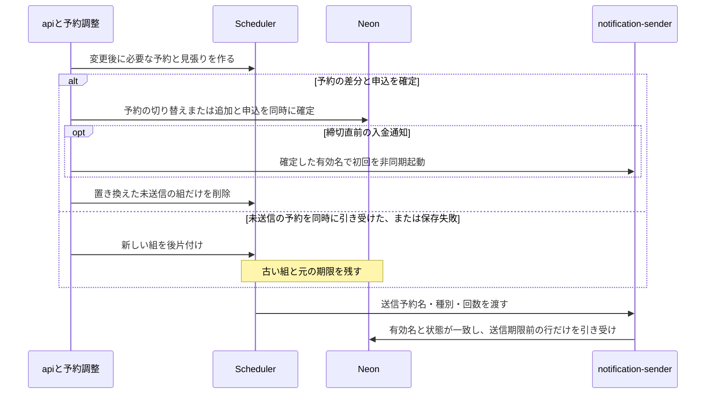

# 設計書: 招待からリマインドがiPhoneに届くまで

- ステータス: draft
- レベル: L3
- 関連: [承認済みの要件](../requirements/first-slice.md)、[API設計](../api.md)、[データモデル](../data-model.md)、[AWS構成](../architecture.md)、[メール送信のADR](../decisions/ADR-0007-cognito-email.md)

## この設計を一言で

招待された人はメールのコードで参加し、仲間と公演やチケット申込を共有する。自分の申込の期限は、ホーム画面に追加したiPhoneに届く。通知の時刻変更が保存されなければ、元の予約を残す。

## 背景

承認済みのAWS構成と文脈の境界を使い、最初の1本を本番と同じ構成で通す。Cognitoの認証だけではアプリへの参加を認めず、Web Pushを送った端末もサーバー側で記録する。

## 目的

実装と試験が同じAPI契約・DB制約・通知の失敗時の動きを参照できるようにする。

## 要件

G-01・G-02、C-02・C-03・C-07、T-01〜T-03、N-01〜N-03を満たす。公演の申込一覧（T-04の一部）と起動時の自分のグループ一覧も含む。画面・異常系・境界・受け入れ条件は[要件定義書](../requirements/first-slice.md)を正とする。

| 設計書の節 | 対応する要件 |
|---|---|
| 変更後構成・移行とリリース | F-01〜F-04 |
| データフロー・セキュリティ | F-05〜F-11、E-01〜E-04・E-16、B-08・B-12 |
| API設計・DB設計 | F-07・F-09・F-13〜F-14・F-19〜F-24・F-26〜F-33・F-39〜F-41、E-01〜E-08・E-14〜E-15・E-18、B-08〜B-09・B-11〜B-12 |
| フロントエンド設計 | F-06・F-08・F-11〜F-18（F-17aを含む）・F-22〜F-28・F-30〜F-32・F-37b〜F-48、E-09・E-15〜E-17、B-05〜B-07・B-11 |
| バックエンド設計 | F-27〜F-37（F-37aを含む）、E-05〜E-08・E-10〜E-13、B-01〜B-05・B-10 |
| エラー処理・ログと監視・性能 | F-04・F-05・F-36、E-10〜E-12・E-16 |
| テスト方針 | F-49〜F-50。各機能・異常系・境界条件の試験観点は実装前の試験計画に対応付ける |

## 対象範囲

要件の11画面、下表のAPI、登録前Lambda、通知送信Lambda、14テーブル、Terraform、デプロイ時のマイグレーションと初期データ、PWA、2人のE2Eを作る。

## 対象外

グループの作成・切替・退会・解散・除名の画面/API、削除ワーカー、ツアー作成、昔の公演をさかのぼって登録する機能（C-06）、公演編集、分配、参戦、グッズ、画像、通知先を手動で外す操作は作らない。この回の公演の下書きはツアーなしの公演1件に限る。確定済みで日付が過ぎた公演は一覧に出す（F-22）。

## 現状構成

承認済みの構成は設計上のもので、配備済みのアプリや移行元のDBはない。Cognitoのメール送信元は従来の構成に含まれていなかった。

## 変更後構成

結合検証と本番を同じTerraformから別々に作る。Cognitoプール、Neonプロジェクト、Schedulerのグループ、SSMのパスと実行権限を分離する。AWSとNeonはシンガポールに置く。

## データフロー

- 招待なしのS-01はSignUpを呼ばず、[USER_AUTH](https://docs.aws.amazon.com/cognito-user-identity-pools/latest/APIReference/API_InitiateAuth.html)のEMAIL_OTPだけを使う。招待付きでは暗号化した証明でSignUpを試す。UsernameExistsExceptionなら同じ入力でUSER_AUTHへ進む。UserNotConfirmedExceptionなら、招待付きの場合だけ確認入力へ戻り、利用者の操作でResendConfirmationCodeを呼ぶ。招待なしなら招待リンクから開き直すよう案内する。PreventUserExistenceErrorsはENABLED。画面はアカウントの存在を表示しない。CognitoのSignUp自体では既存アドレスの応答を完全には隠せない。
- [登録前Lambda](https://docs.aws.amazon.com/cognito/latest/developerguide/user-pool-lambda-pre-sign-up.html)は招待トークンと正規化したメールのSHA-256を照合する。ブラウザは配布済みの公開鍵（RSA-OAEP/SHA-256、2048ビット）で暗号化し、版付き暗号文だけをSignUpのValidationDataに入れる。TLSに加え、Cognito・監査やイベントの照会箇所で任意のValidationDataに生の招待が残らないための対策であり、リンクを知る人による別メールの登録は防がない。生トークンも暗号文もアプリのログに出さない。鍵を替えるときはSSMに新旧を置いて新しい公開鍵を配布し、旧PWAの入れ替えを確認してから旧鍵を削除する。
- 同期Lambdaは復号・メール照合後、有効期限・取り消し・残り参加枠・グループ状態を条件に、登録開始数だけを1文のUPDATEで増やす。このLambdaのDBロールは招待検査と開始数の更新に必要な権限だけを持つ。登録開始数の上限は参加上限の3倍。開始数はCognitoの失敗やトリガー再試行で戻さない。招待は有効24時間以内・参加1〜10人。参加のときだけ参加数を増やし、登録開始枠の不足で既存会員のログインや確認済みの招待参加は拒まない。枠を使い切ったときはオーナーが必要に応じてリンクを発行し直す。
- プールは`AutoVerifiedAttributes=["email"]`を設定し、Cognitoに登録確認コードを送らせる。登録前Lambdaの応答では`autoConfirmUser`と`autoVerifyEmail`を立てない。利用者が届いたコードで確認するまでは未確認のままとする。[ConfirmSignUpのSession](https://docs.aws.amazon.com/cognito-user-identity-pools/latest/APIReference/API_ConfirmSignUp.html)は初回ログインで再利用する。通常は確認メール1通、再ログインは[EMAIL_OTPのコード入力](https://docs.aws.amazon.com/cognito-user-identity-pools/latest/APIReference/API_RespondToAuthChallenge.html)。PreSignUp_AdminCreateUserは初期データ用に通す。

| SDKで受ける結果 | S-01の案内と次の操作 |
|---|---|
| SignUpがUserLambdaValidationException | Lambdaの固定メッセージ末尾を完全一致で分類する。invite_unusableなら別の招待リンク、retry_laterまたは読めない文なら時間をおいて再操作。生の例外は出さない |
| SignUpがLimitExceededException | 未確認アカウントが残る場合がある。後で同じアドレスと招待から続け、既存・未確認なら確認入力と明示的なコード再送へ進む。登録が成功したとは表示しない |
| 送信操作がTooManyRequestsException、LimitExceededException、CodeDeliveryFailureException、または送信設定エラー | 要求数・送信量・配信の問題として「時間をおいてやり直してください」。自動再送しない。設定エラーが続く場合は運用側で調べる |
| ConfirmSignUpまたはRespondToAuthChallengeがCodeMismatchException / ExpiredCodeException | 誤り・期限切れの案内からコード入力や再送へ。認証セッション切れはUSER_AUTHからやり直す |

確認メールの再送と既存アカウントへの認証コード送信は登録前Lambdaを通らない。PWAが直接呼ぶCognitoにGatewayの流量制限は効かず、既存会員への送信や共有SES枠に負荷がかかる残余リスクがある。[監視](#ログと監視)を入れ、追加の送信制限を有料のAWS WAFで行うかは運用費の判断として残す。

## API 設計

HTTP APIからLambdaのHonoに渡す。Zodで未知キーと誤った型を拒む。以下の g は groupId。JSONはcamelCase、公演の日付・時刻は日本時間、期限は時差付きISO 8601で受けて+09:00で返す。[既存の入出力と共通契約](../api.md#全体の決まり)も適用する。

| メソッドとパス | 入力 → 成功応答と認可 |
|---|---|
| GET /me、GET /me/groups | JWT → 自分のID・表示名・自分用グループID、または所属グループの一覧。起動時に使う |
| GET /groups/{g}、GET /groups/{g}/members | メンバー → グループ名・種類・状態・オーナー情報、またはメンバーのID・表示名・参加日・役割 |
| POST /groups/{g}/invite-links | id・expiresAt・maxUses → URL。共有グループのオーナーだけ |
| GET /invites/{token} | JWT → グループ名・registered・参加可否・既存メンバーか。既存メンバーを先に扱う |
| POST /invites/{token}/accept | 未登録者だけdisplayName必須 → 200とgroupId。既存メンバーには何も加えず同じ行き先を返す |
| GET /groups/{g}/artists、GET /groups/{g}/venues | メンバー → 選択用の一覧。アーティストには色、会場には最寄り駅を含める |
| GET /groups/{g}/concert-drafts、POST /groups/{g}/concert-drafts | 本人の一覧。作成はidとconcerts（1件、ツアーなし）→ 保存した下書き |
| PATCH /groups/{g}/concert-drafts/{draftId}、DELETE 同パス | 作成者だけ。PATCHは公演1件の更新 → 下書き、DELETEは204 |
| POST /groups/{g}/concert-drafts/{draftId}/confirm | 作成者だけ。concertIds（UUIDv7を1件、tourIdなし）→ 200と確定した公演ID。再送は同一グループに全IDがあれば同じ応答 |
| GET /groups/{g}/concerts、GET /groups/{g}/concerts/{concertId} | メンバー → 日付順の公演一覧（when=upcomingまたはwhen=past）、または日付・題名・会場・時刻・公式URL・出演順の詳細 |
| GET /groups/{g}/ticket-applications | メンバー → 申込一覧。concertIdとapplicant=meで絞れる。displayStatus、pickupAvailable、座席・整理番号、DBで記録したcreatedAtを含む |
| POST /groups/{g}/ticket-applications | id・concertId・枚数・受取方法・初期状態（applied/won）・任意の受付名・期限3種・座席/整理番号 → 作った人が申込者となる申込 |
| GET /groups/{g}/ticket-applications/{applicationId} | メンバー → 申込と計算した表示。本人だけにリマインドの種類・実際の時刻・状態を返す。分配は対象外 |
| PATCH /groups/{g}/ticket-applications/{applicationId}、DELETE 同パス | 申込者だけ。PATCHは編集可能な欄の部分更新 → 申込、DELETEは204 |
| PUT /groups/{g}/ticket-applications/{applicationId}/status | 申込者だけ。status → 200と申込。同じ状態なら何もしない |
| GET /me/push-subscriptions、POST /me/push-subscriptions | 本人の通知先一覧。POSTはendpointとkeys（p256dh・auth）→ 登録行。他人と同じendpointなら409、既存IDを返さない |

- API Gatewayは環境のissuerとapp clientを照合する。apiはCognitoアクセストークン（token_use=access）だけを受け、JWTのsubをgroups.users.cognito_subから内部のuuidへ引く。Cognito subを内部の主キーにしない。JWTなしはGatewayの401、users行なしは招待の2本以外403 not_registered。CognitoのアクセスJWTはaudがなければGatewayがclient_idを使う（[JWT authorizer](https://docs.aws.amazon.com/apigateway/latest/developerguide/http-api-jwt-authorizer.html)）。
- グループIDと資源IDを組で照会する。非メンバー・不在・別グループIDは404 not_found。メンバーに見える資源があり、操作する権限だけが無いなら403 forbidden。グループの削除対象が不在なら再送でも404。初回が成功して応答が失われた場合も、画面は一覧を読み直す。他のグループでの存在は調べない。初回204、再送404でも副作用は重ならない。
- 作成は画面が作るUUIDv7で重複を見分ける。初回201。同じ操作・グループ・認証済み作成者に属する同じIDと内容だけを再送として200にする。ただし、グループの全員が読めるアーティストと会場の作成には作成者を持たず、同じグループのメンバーなら、操作・グループ・ID・入力の一致で再送とする。他人の非公開下書きの同一IDには、本文の一致にかかわらず汎用の409 id_conflictを返し、作成者・内容・所属を出さない。通知先はendpointを重複の印にし、同じ本人なら200。PATCHの省略は維持、nullは任意欄だけを消す。APIで申込者IDを入力させない。
- エラーはRFC 9457のapplication/problem+json。422 invalid_inputはerrorsに欄を入れる。409はinvite_unusable、already_exists、invalid_transition、group_closing、id_conflict、reminder_conflictを区別する。退会開始は403 account_closing。未知の失敗は内容を伏せて500 internal。Gatewayの401と流量制限の429は画面で別扱いにする。
- 境界値は招待期限が現在より後で24時間以内・1〜10回、枚数1〜99、受付名100字・座席と整理番号200字まで。空欄をnullにそろえ、文字数はUnicodeコードポイントで数える。

## DB 設計

Drizzleの表定義は文脈ごとのinfrastructureに置く。型・null・外部キーの全一覧は[データモデル](../data-model.md#テーブル)を正とし、以下の14表だけを初回SQLに含める。

| スキーマ・テーブル | 主な列・制約と照会 |
|---|---|
| groups.users / groups.groups | users(id PK, cognito_sub UNIQUE, display_name, status)、groups(id PK, owner_id, kind, status, name)。自分用はowner_idごとに1件（kindに対する部分一意索引） |
| groups.members / groups.invite_links | members PK(group_id,user_id)、逆引き(user_id,group_id)。invite_links(id PK, group_id, token_hash UNIQUE, expires_at, max_uses, used_count, registration_starts, revoked_at)。参加数と登録開始数を別々に制限 |
| catalog.artists / catalog.venues | id PKとgroup_id。artistsは(group_id,name_key) UNIQUEと12色のCHECK。名称検索はgroup_idを先頭にする |
| catalog.tours / catalog.concerts | id PKとgroup_id。concertsのvenue_id/tour_idは同じグループへの複合FK。tour_idはnull可。公演一覧は(group_id,日付,id) |
| catalog.concert_artists / catalog.drafts | concert_artists PK(concert_id,artist_id)、同じグループへの複合FK、出演順。draftsはJSONBのpayloadを持ち、(group_id,created_by,created_at)で一覧 |
| ticket.ticket_applications | id PK。公演への同グループ複合FK、申込者、各期限、状態、枚数、受取方法、座席・整理番号。created_atは初回の挿入時にDBで記録し、編集・状態変更・作成の再送では変えない。CHECKで状態・受取方法・枚数を守り、(group_id,concert_id)、(group_id,申込者)で絞る |
| notification.reminders | id PK、宛先、dedupe_key UNIQUE、send_at、recover_until、schedule_name UNIQUE、status CHECK、claimed_at、sent_at、attempts smallint NOT NULL DEFAULT 0（0〜4をCHECK）、retry_at、通知文とURL。宛先の索引 |
| notification.push_subscriptions / notification.reminder_deliveries | subscriptionsのendpoint UNIQUE、user_id索引。deliveries PK(reminder_id,push_subscription_id)、status CHECK、attempt_no smallint NOT NULL（1〜4をCHECK）、attempted_at。FKで両親の削除時CASCADE、push_subscription_id側にも索引 |

招待参加はユーザー作成・自分用グループ・所属・利用回数を1トランザクションで更新する。対象の招待行とグループの状態を確認し、所属を新規に加えた場合だけ、期限内かつ残数が正の条件付きUPDATEで1回加算する。0行なら全体を戻す。競合した同じ人はコミット後に既存所属を確認し、残数を減らさない。確定した公演と下書き削除も1トランザクション。

申込削除では先に未送信のリマインドを取り消し、申込を削除する。Pushの404/410は通知先とその子の送信結果を削除する。退会・解散・匿名化のAPIやジョブ表は今回作らない。SESのアカウント単位の抑止リストは、Cognitoとは別に宛先が残り得る。後の退会処理で消す順序は[データモデル](../data-model.md#退会の手順yadr-04)に記録する。公開前のプライバシーポリシーにも、シンガポールのAmazon SESがログインメールの宛先を扱うことを書く。

## フロントエンド設計

React＋Vite、React RouterとTanStack Query、Honoクライアントを使う。認証されたセッションごとにQueryClientを作り、キーにユーザーIDとグループIDを含める。ログアウト・アカウント交代では通信を中断し、キャッシュを消して別のQueryClientに替える。完了が遅れた旧応答は新しいキャッシュに入らない。Service Workerは認証済み応答を保存しない。S-01の招待先や通知からの戻り先は同一オリジンのパスに限る。

- Safariとホーム画面のPWAは別のログイン状態を持つ。リフレッシュトークンは365日。Cognitoの失効を有効にしてログアウト時はRevokeTokenを呼び、成否にかかわらず端末の保持分を消す。Gatewayの署名検証は発行済みのアクセストークンの失効を見ないため、最長1時間の有効期限までは使える前提とする。通知先はログアウトでは消さない。Service WorkerにJWTを渡さず、招待トークンや認証画面もオフラインキャッシュに置かない。
- ホームは自分の申込と有効な期限から「次にすること」を作り、最も近い期日を帯にする。通知先0台またはlastFailedAt付きの端末があればS-23へ案内する。許可拒否でも帯を残す。
- ホームはwhen=upcomingで最も近い公演を探す。公演一覧（S-06）はwhen=upcomingとwhen=pastを使い、自分の下書きも別に出す。日本時間の今日の公演は「これから」に入れる。
- これからの公演がないときは、券の代わりに「これからの公演はありません。」と表示する。「公演を追加する」ボタンで公演の下書き（S-08）を開く。次にすることがないときは「次にすることはありません。」と表示し、この欄にボタンは置かない。期限の帯も出さない（F-17・F-17a）。
- 7日ちょうどはカウントダウンなし。座席を出せる自分の申込が複数なら、座席が空でない入金済み/受取済みのうち、受取済みを優先する。同じ状態では申込一覧のcreatedAtが新しいものを選び、同時刻ならIDの昇順で最初の1件を使う。
- 通知はDeclarative Web Pushで出し、未対応端末はService Workerで表示する。開くのは同一オリジンの申込URLだけ。削除済みなら見つからない画面を出す。

## バックエンド設計

Lambdaの入口で依存を手動で組み立て、Honoから文脈の公開関数を呼ぶ。domainはI/OやDrizzleを知らない。applicationは集約の生成と再構築を分け、infrastructureが変換する。SQLは各文脈内に閉じる。メンバー検査と書き込みロックを先に取り、文脈をまたぐ処理には同じトランザクションを明示的に渡す。チケットは通知の公開関数を呼ぶが、通知はチケットを読まない。

申込の4種類の書き込みは同じ予約調整関数を使う。appliedは結果発表、wonは日本時間の前日20時と締切3時間前、paidは受取開始、lost/picked_up/削除では予約なし。期限が空なら作らない。予定時刻を過ぎた場合は期限前だけ原則1分後に予約する。入金では1分後の予約と[Schedulerの60秒精度](https://docs.aws.amazon.com/scheduler/latest/UserGuide/schedule-types.html)による起動幅（60秒未満）が締切前に収まらない場合、期限前なら保存直後の送信に切り替える。状態も期限も変わらなければ、通知文・計算済み時刻・送信済みの状態を変えない。期限切れと受取開始はその時刻ちょうどから表示に反映する。

- 新規・変更は送信と見張り（10分後）を先に作る。世代nは環境別の`notification.reminder_generation_seq`から発行する。予約名のidはハイフンなし32桁のUUID、nは正のbigintを小文字36進数で表す。送信と見張りは`reminder-<id>-<n>`と`reminder-watch-<id>-<n>`。差分を計算した時点でscheduledだった行だけを、旧名かつscheduledの条件付きUPDATEで切り替える。競合で0行なら申込変更も戻し、新しい組だけを消し、409 `reminder_conflict`を返す。画面は申込を取り直して編集をやり直せる。コミット結果が不明なら、別の接続で有効名を確かめるまで削除しない。
- 締切直前の即時送信だけは見張りを先に作り、通常の送信用Schedulerは作らない。現在時刻をsend_atにし、申込と現行行のDBコミットが確定した後、APIから同じ環境のnotification-senderを非同期で起動する。初回の入力と有効名照合・引き受けは通常の送信と同じ。APIの実行ロールにこの関数だけの呼び出し権限を付け、起動要求の失敗はC-4へ送る。DB確定前やロールバック時は起動しない。起動や端末への配送に時間がかかっても、締切後に送信を始めない。入金の2種類がともに該当すれば、それぞれを起動する。
- 状態や期限が変わったとき、差分計算時点でscheduledで後継も必要なら、上の切り替えで現行キーを保つ。それ以外で旧予約が新しい期限を表さなくなったら、申込と同じトランザクションで旧行のdedupe_keyを`history:<旧予約ID>`に移す。不要なscheduledは先にcanceledにする。計算時点でsending・sent・canceledの行はその状態を保ち、引き受け済みの行は自分の処理を終える。後継が必要なときだけ元のキーで別IDを挿入し、再送回数・送信結果を引き継がない。申込詳細は元のキーだけで読み、旧期限の送信結果を返さない。同じ期限の再送信や受付名だけの編集では履歴化も作り直しもしない。
- 送信・見張り・再送にはDB上の有効名を渡す。旧名や未確定の名前では送らない。初回予約がDB確定前に起動した場合も、確定後に起動する見張りがscheduledを引き受ける。送信と再送は起動後に自動削除する。見張りは同名で時刻を動かすため自動削除を無効にし、不要になった時点で明示的に消す。古い見張りは自分の世代の予約だけを消す。
- 引き受けは状態とclaimed_atも見る条件付きUPDATE。新しい回だけはattempts < 4を条件に1増やす。見張りはclaimed_atが10分以上古ければ同じ回を再開し、10分未満ならclaimed_atの10分1秒後に見張りを移す。作成と移動で同じ設定を使い、[UpdateSchedule](https://docs.aws.amazon.com/scheduler/latest/APIReference/API_UpdateSchedule.html)にもターゲット、実行ロール、入力、DLQ、再試行設定、FlexibleTimeWindow=OFF、自動削除なしを毎回渡す。
- 初回・再送・見張りのすべてで（失敗キューから復旧した場合も）、引き受けの条件付きUPDATEに「DBの現在時刻 < recover_until」を入れる。引き受け後も端末ごとにWeb Push要求の直前に時刻を確認し、期限ちょうど以降は新たに要求も再送予約も作らない。その回で一時失敗があっても、期限前なら残りの対象端末への送信を続ける。
- 端末の最新結果に、その結果を記録した回の`reminders.attempts`を`attempt_no`として保存する。`sent`・`gone`の端末は以後送らない。見張りが同じ回を再開するときは、同じ`attempt_no`で`failed`を記録済みの端末も飛ばし、その回で結果がない端末に送る。次の再送回では回数が増えるため、前の回で`failed`だった端末を再び試せる。端末ごとの成功とlast_failed_atの解除、初回の成功時刻sent_atは同じトランザクションで保存する。404/410の端末はgoneとして扱ってから削除する。通知先が0台なら再送待ちにせず、完了状態sentにする。申込詳細はsent_atから得たsentToAnyDeviceを使い、1台分も受理されなかった完了を「送信なし」と表示する。後から通知先を足しても過去の通知は出さない。
- その回で全対象端末を試すか、実際に期限に達して残りの送信を止めたあとに、次の再送を判断する。一時失敗が残り、再送時刻が送信期限より前なら5分後に3回まで再送する。`reminder-retry-<id>-<n>-<回数>`で世代と回ごとの重複を止める。停止後に作り直すとき同名があれば、入力も一致する既存予約の時刻を使う。再送予約と見張り（再送の10分後）を確保してから、retry_atを保存しclaimed_atを空にする。再送はretry_at以降、attempts < 4かつ入力の回数がattemptsの次のときだけ引き受ける。次の再送が来なければ見張りが同じ条件で引き受ける。引き受け時はretry_atを空にする。再送回数を使い切ったか、次の再送時刻が期限ちょうど以降なら、再送を作らず完了処理に進む。
- 再送を使い切ったときと期限で打ち切ったときは、同じ完了処理を使う。有効名・状態・引き受け時刻を照合し、送信中の実行または条件付きUPDATEで引き受けた1実行だけが完了処理を行う。このための引き受けではPushを送らず、attemptsも増やさない。最新の結果がfailedのままの登録済み端末だけにlast_failed_atを保存する。成功・gone・未試行の端末は対象外。該当端末があればC-4へ通知してから状態をsentにし、retry_atとclaimed_atを空にし、その世代の残りの予約を消す。送信結果とsent_atは変えない。通知に失敗したら完了にせず、見張りが10分以上経過した引き受けを取り直し、Pushせずに完了処理を再開する。C-4の同一予約に対する重複報告は許す。Web Pushの受理直後に停止した場合も重複を許す。

### 失敗キューから現行の通知だけを復旧する

環境別の同じ標準SQSキューに、SchedulerのTarget.DeadLetterConfig、送信Lambda非同期呼び出しのOnFailure、一時失敗が残ったまま送信を終えたアプリ通知を送る。Schedulerターゲット実行ロールとLambda実行ロールには、それぞれ対象キューだけのsqs:SendMessageを付ける。受信メッセージはSchedulerの属性、LambdaのrequestContext/requestPayload、アプリ通知の種別で分ける。予約の入力と報告には通知ID・有効名・種別・回数だけを入れる。

オーナーがC-4の警報を受け、キューの件数が0になるまで保守手順で処理する。ALARM中は次の失敗ごとにメールが届くとは限らない。キューの保持は4日とし、消す前にDBの有効名、履歴化の有無、状態、次回、復旧期限を照合する。

| DBの状態 | オーナーが取る操作 |
|---|---|
| 現行で未完了、復旧期限内 | 環境限定の保守操作で有効名を指定し、まだ必要な起動と見張りだけ確保する。初回・次回・同じ回の再開の区別は送信関数の条件付き引き受けに任せ、attemptsや送信済み端末を初期化しない。直せたことを確かめてメッセージを除去する |
| 不在・別世代・履歴・完了・取消、または送信期限に達した | 再送しない。該当する現行行が期限切れで未完了なら、送信関数と同じ条件で完了させる。一時失敗が残ったまま送信を終えたアプリ通知は案内・調査だけとし、処理後にメッセージを除去する |
| DB未復旧、状態不明、見張りの再作成失敗 | メッセージを除去せず、復旧後に照合し直す |

復旧と実際の送信に使う期限は、通常は計算した送信時刻から1時間後。入金はその時刻と入金期限の早い方とし、期限ちょうどは含まない。チケットが`recover_until`を計算して予約に保存し、通知側はチケットを読まない。ログや対処記録に宛先・通知文を書かない。

## エラー処理

| 観点 | 設計 |
|---|---|
| リトライ | Schedulerの送信不能は最大2回、Lambda非同期実行の関数エラーも最大2回、各イベントの保持は最大1時間。サービスのバックオフに従い、使い切り・期限切れはC-4へ送る。Web Pushの業務上の再送3回は5分固定。Cognitoのメール送信要求を画面で自動再送しない |
| タイムアウト | 登録前LambdaはAWSの5秒制限より短い4秒。SSMの鍵・接続情報は初期化時に取得して実行環境内に保ち、DB書き込みに最大3秒を充てる。初期化と処理を含む応答枠も超えないよう残り時間で打ち切る。apiは20秒、DB文とScheduler SDKは各3秒、送信Lambdaは60秒、端末のPush要求は各5秒を上限とする |
| 冪等性 | 作成ID、招待の所属PK、通知先endpoint、予約の世代・回数と端末ごとの送信記録を使う。Schedulerの再呼び出しは同名・同じ入力に限る |
| 部分失敗 | 予約作成とDB確定の一方だけが成功しても、旧予約を先に消さず、有効名で送信を止める。取消・削除はDBから確定し、その後AWS側を消す |
| 縮退 | SESが止まれば新規登録・再ログインに時間をおく案内を出す。既にログイン済みの操作は継続できる。予約を保存できなければ申込の変更を成功と返さない。Pushが届かなくてもアプリから期限を確認できる |

## ログと監視

Powertoolsの構造化ログを7日保存する。操作種別・要求ID・エラー分類・回数・経過時間のみとし、招待URLやヘッダー、氏名、メール、JWT、Push endpointと鍵、通知文を記録しない。Gatewayのログに実パスや本文を入れない。

ADR-0006に従い、Budgetsは月5ドル、Gatewayは20回/秒・瞬間40回。CloudWatchはAPIの1時間125件を環境別2個、Lambdaの1時間150件をリージョン全体1個、C-4キューの可視件数>0を環境別2個で見る。失敗キューへの送付自体が失敗した場合は、SchedulerのInvocationsFailedToBeSentToDeadLetterCountとLambdaのDestinationDeliveryFailuresをそれぞれ環境別に1件以上で通知する（計4個）。

SESは共有のアカウント／リージョンの集計値だけを見て、1時間のSendが20件以上、24時間の送信割当の使用率が80%以上、Reputation.BounceRateが5%以上、Reputation.ComplaintRateが0.1%以上を各1個の警報にする。オーナーに宛先も本文もない警報を送る。宛先入りのSESイベント通知は構成しない。恒久バウンス・苦情はアカウント単位の抑止リストで止め、安易に解除しない。オーナーが本人と宛先を別経路で確認し、原因が解消した場合のみ解除する。問い合わせや監視ログに抑止対象の一覧を転記しない。

送信割当の使用率は、共有の監視Lambdaが1時間ごとに[SES GetAccount](https://docs.aws.amazon.com/ses/latest/APIReference-V2/API_GetAccount.html)を呼び、`100 × SentLast24Hours / Max24HourSend`を標準解像度のカスタムメトリクス1個に出す。無制限の割当では使用率の警報を使わない。このLambdaはNeonを使わない。[SESのReject](https://docs.aws.amazon.com/ses/latest/dg/monitor-sending-activity.html)はウイルス検出で配信しなかったメールの指標で、割当超過の拒否は数えない。使用率の警報は日次枠が尽きる前に気づくためのもので、瞬間的な秒間枠の超過は自動検知できない。Cognito経由の画面では原因を断定せずE-16の案内を出す。問い合わせを受けたオーナーは時刻と操作種別から、SESの使用率・秒間枠（MaxSendRate）とCognitoのSignUpThrottles・SignInThrottlesを切り分けて確認する。Cognitoの指標もSESの拒否件数とはみなさない。

## セキュリティ

Cognitoのプール・発行者・アプリクライアントを環境で分離する。SSMの秘密は必要な関数だけが読み、VAPID公開鍵と招待証明の暗号化用公開鍵だけをPWAへ配る。HMACから作る元の招待トークンはDBにハッシュだけを保存する。秘密鍵・既存メールアドレスの実値をコード、作業ログ、Terraformソースに書かない。招待画面にReferrer-Policy: no-referrerを設定し、外部リソースへURLを送らない。CORSはその環境のPWAのオリジンに限る。

送信元の設定はplanやstateにも残り得る。planの平文をCIに出さず、公開の成果物にも置かない。S3の状態は専用の環境別キーと権限で分離し、暗号化とアクセス制限を適用する。SSMの秘密値はTerraformのデータソースでは読まず、許可された関数が実行時に読む。

通知の購読情報は本人にしか返さない。任意URLへのサーバーからの要求を避けるため、PushのendpointはHTTPSで、対応するPushプロバイダーのホストに限り、転送先URLには追従しない。ロック画面に公演名と受付名が出ることは通知を許可する画面で案内する。

## 性能

定期ポーリングでNeonを起こさず、予約単位で起動する。登録前LambdaのDB書き込みは1文とする。一覧は10人の利用を前提にページ分けしない。日付と申込者の索引を使い、ホームの表示に端末ごとの送信履歴を読まない。

## テスト方針

- CIはメールを送らない。Playwrightはランナー内のPWAとHono、使い捨てPostgreSQLを使う。2つのcontextで、オーナーの招待発行、招待者の参加、公演確定、申込から受取済みまでを通す。試験専用の入口がランナー内の短命な鍵とテストissuerで2人のJWTを発行し、試験用アダプターがJWTを検証してHonoの認証済み入力に渡す。画面の試験用コード入力はランナー内の代替だけで扱う。試験用の入口・鍵・発行者を製品ビルドの依存から外し、成果物に試験用の入口が無く、試験JWTを受けないことを検査する。結合検証は実際のメールOTPのみとし、パスワード方式は足さない。
- ローカルのHonoではusers行なし・非メンバー・非オーナー、招待の最後の1回、他人の下書きIDへ同じ／違う内容を送った場合の応答、DELETE不在と別グループの404を確かめる。Gatewayの401はローカルHonoの試験に含めず、Terraformでissuer・client・全ルートのauthorizerを照合し、実環境でJWTなし・別issuer・別clientを拒否することを確かめる。同じブラウザで会員を交代し、旧会員の下書きや通知状態が一瞬も表示されないことも確かめる。
- 登録前のイベント試験は招待の無効・期限・登録開始枠・AdminCreateUserを確認する。SDKの境界に上の例外を注入し、特にSignUpのLimitExceededExceptionから未確認ユーザーの確認を再開できることを確かめる。結合検証で休止したNeonを使う初回登録の応答時間を測り、登録開始枠を超えた新規登録は送信されず、既存会員のログインは継続することを確かめる。
- fast-checkで予約の時刻と状態遷移、再送上限、世代切替と引き受けの競合、旧見張り、同じ再送、端末ごとの再開を確かめる。Push成功直後に失敗させ、成功記録と端末の失敗印が別々に残らないことも確かめる。
- 固定時計で12:00締切の通知を11:40に開始し、端末Aの一時失敗を`attempt_no=1`で保存した直後、端末Bへの送信前に停止させる。11:50に見張りが同じ回を再開して、Aを再試行せずBに送ること、Bが成功したら11:55の再送（2回目）ではAだけに送ることを確かめる。
- 1月10日12時の入金期限で、1月9日20時の通知を送ったあと、同日21時に期限を翌日の1月11日12時へ延ばす。期限が保存され、1月10日20時は別IDで予約され、3時間前の予約が1月11日9時に切り替わることを確かめる。同じ変更を送り直しても予約を増やさない。
- 送信済みの期限を過去に直したときは、申込詳細に旧予約の時刻や結果がなく、新規予約もないことを確かめる。取り消した期限の入れ直し、旧世代の送信結果の分離、5回目の拒否も確かめる。結合検証で見張り移動後の設定、SchedulerとLambdaの各失敗経路、停止中のDBが戻った後のキュー処理を確認する。
- 同じ公演の受取済みの申込2件に座席を入れ、古い申込をあとで編集しても、券面が作成日時の新しい申込を選ぶことを確かめる。
- 固定時計で、入金締切12:00の通知を11:59に復旧し、起動が締切ちょうど・締切後になった場合に、初回・再送・見張りのどれもPushを要求せず完了することを確かめる。締切前に引き受けた場合は、処理中に締切を越えた後の未送信端末に送らず、すでに受理された結果は保持する。
- 固定時計で、12:00締切を11:58に登録したときは2件を11:59に予約し、11:59:30なら保存確定直後に両方の初回を起動する。12:00ちょうど以降はどちらも作らない。11:59:30に保存が失敗した場合は起動せず、保存できても締切までに起動しなければ送らないことを確かめる。
- 固定時計で、12:00締切の通知を11:59:30に開始し、先に送った端末Aだけが一時失敗する。次の再送が間に合わなくても、締切前なら端末Bにも送る。Bが成功した場合は再送を作らず、Aだけに失敗表示を出してC-4に報告し、Bの成功を保持する。11:55にその回が終わり、次の再送が締切ちょうどになる場合も再送は作らない。Bへ送る直前に12:00になった場合はBに送らず、失敗表示も付けない。予約済みの再送が遅れて締切後に起動した場合はPushせず、失敗が残る端末だけを報告する。C-4への通知に失敗させた場合は、見張りがPushせずに報告と完了処理をやり直すことを確かめる。
- 共有のアーティスト・会場を作成し、同じグループの別メンバーが同一ID・同一入力で送っても200で1行のまま、同一ID・異なる入力や別グループでは409 id_conflictになることを確かめる。アーティストは同じグループでIDだけが異なる同名の要求を409 already_existsにする。
- 日本時間で昨日・今日・明日の確定済み公演と、自分の下書きを用意する。S-06の「これから」に今日と明日、「過去」に昨日、自分の下書きは別の一覧に出ることを確かめる。
- 結合検証では初期データでオーナーと共有グループを用意する。大関さんはオーナーとして招待リンクを発行し、2人目として別のメールアドレスでiPhoneのSafariから参加する。2人目はホーム画面のyoinで再ログインして通知を許可し、公演を確定して自分の期限付き申込を作る。そのiPhoneで結果発表・入金期限・受取開始の通知を受け取り、通知から自分の申込を開く（AC-07〜AC-10b）。大関さんはオーナーとしてパソコンでも開き、2人目の申込が読めても編集できないことを確かめる（AC-11）。
- AC-10bでは2人目が受取開始の通知を予約してからS-22でログアウトする。通知先を残したまま、そのiPhoneの未ログイン状態で通知を押す。S-01で同じ人が再ログインし、ホームではなく押した通知の申込詳細へ戻ることを確かめる。
- AC-09の予約時刻は固定時計で厳密に比べる。結合検証ではFlexibleTimeWindowなしの予約時刻、Scheduler起動、Push受理、端末着信を別々に記録する。通常経路の試験目安は、Scheduler起動が予約の分内（60秒未満）、Push受理が起動から60秒以内、着信が受理から2分以内。端末は通信可能な状態にし、範囲を外れた段を記録する。試験計画にもこの判定を引き継ぐ。
- 大関さんはTerraform適用後の実プールで、登録拒否後のAdminGetUser不在・メール0通、正常な初回1通、メールOTPによる再ログインを確認する。SESのバウンス／苦情は結合検証のSESシミュレーターと監視試験で、実宛先を使わずに確認する。シミュレーターだけでは実際の抑止リスト入りや評判指標を検証できないため、抑止の検査は同意済みの検証専用宛先を明示登録し、送信停止と解除を別に確かめる。実AWSとiPhoneはこの設計作成時点では未検証。

## 移行とリリース

### コードと設定の置き場所

[ADR-0002の決定7](../decisions/ADR-0002-schema-and-functions.md#7コードの置き場所)と[ADR-0004の決定2](../decisions/ADR-0004-dev-tools.md#2-dbの読み書きはdrizzle-ormにする)に沿って、ルートからの置き場所を決める。

| 対象 | 置き場所 |
|---|---|
| React＋Viteの画面とService Worker | `apps/web/` |
| Terraform | `infra/terraform/`。2環境で同じ定義を使い、状態と環境ごとの設定は分ける |
| Drizzleのテーブル定義 | `src/contexts/<文脈名>/infrastructure/` |
| マイグレーションSQL | `db/migrations/`。drizzle-kitの設定は`db/drizzle.config.ts`。どちらも文脈の外に置き、アプリの実行時コードから読み込まない |
| API、登録前Lambda、通知送信Lambdaの入口 | `src/functions/api/`、`src/functions/pre-sign-up/`、`src/functions/notification-sender/` |
| 初期データのジョブ | `.github/workflows/deploy.yml`のデプロイ内のジョブ。実行するコードは`scripts/seed-initial-data.ts`。対象環境の設定だけを読む |

Drizzleで環境共通のSQLを生成し、表・制約・索引・世代シーケンスの差分をレビューする。マイグレーションは環境ごとのデプロイに1回だけ組み込み、手動適用しない。mainの試験→結合検証のマイグレーション→Terraform→初期データ→PWA配置→オーナーの確認→承認付き本番デプロイの順。既存データ移行・旧クライアントの互換対応は不要。

初期データは環境別にCognitoのsubを取得し、オーナー・自分用グループ・共有グループ・所属を二重に作らない。オーナーのCognitoアカウントはemail_verified=true、パスワードなし、招待メール送付なしで作る。結合検証と本番の設定を混同しない。Neonの復元はADR-0006の6時間が上限。事故時は書き込みと送信を停止し、復元先とCognito・Schedulerの差を確認する。照合できない予約をそのまま有効にせず、有効な申込と宛先から未来の予約だけを組み直して再開する。この回は解散・退会を作らないため、その削除をやり直す仕組みは対象外。

### SESを足した費用

[ADR-0006の試算](../decisions/ADR-0006-region-and-cost.md#費用の試算)と同じ10人・1日30操作/人・1ドル150円で比べる。API約9,000回/月など既存の内訳は変えない。API操作のたびにメールは送らないため、比較用に10人が各月10通まで使う月100通を置く。登録・再ログイン・再送・結合検証の合計として見積もり、実測値とはしない。

| 項目 | 月額（税・クレジット・SES無料枠を除く） |
|---|---|
| Cognito Essentials | 10 MAUは直接ログイン月1万MAUの無料枠内（アカウント/組織で共有）。0円、固定費なし |
| SES à la carte | 100通 × 0.10ドル/1,000通 = 0.01ドル = 約1.50円。固定費なし。専用IPや新規ドメインは購入しない |
| SESだけを足した比較値 | ADR-0006の約3円＋約1.50円＝約4.50円（10%税込で約4.95円）。運用全体の見積もりではない |
| 監視を含む試算 | 標準アラーム13個（環境別API・失敗キュー・キュー送付失敗で8個、Lambdaリージョン合計1個、共有SES4個）。各アラームは1メトリクス。無料枠10個をこの構成で使えるなら、超過3個 × 0.10ドル＝約45円。上記の比較値と合計で約49.50円（税込約54.45円） |
| Neonが無料枠を超えた場合 | 2つの環境ともプロジェクトごとの無料枠内が上の合計の前提。片方が月120 CU時でLaunchに移れば、そのプロジェクトの計算だけで120 × 0.106ドル＝12.72ドル（約1,908円）。データ保存などの従量費は別 |

試算は同じAWSアカウントの2環境で利用量を合わせた比較で、SES割当の監視Lambda（月約720回の起動）とカスタムメトリクス1個も各無料枠内とする。他のアラームや費用、WAF、税・クレジットは含めない。SESはà la carteとし、単価と無料枠は[AWS Cognito料金](https://aws.amazon.com/cognito/pricing/)・[Amazon SES料金](https://aws.amazon.com/ses/pricing/)・[CloudWatch料金](https://aws.amazon.com/cloudwatch/pricing/)・[Neon料金](https://neon.com/pricing)による。既定送信の50通/日はSESの枠ではない。

## リスク

- [AWSのDMARC解説](https://docs.aws.amazon.com/ses/latest/dg/send-email-authentication-dmarc.html)のとおり、既存アドレスを確認しただけではDMARCに合格しない。本番に使うFromで招待客の主要なメールサービス（Gmail、iCloudなど）に届き、受信側のAuthentication-Resultsが、Fromに整合したSPFまたはDKIMによるdmarc=passとなることをリリース条件とする。満たせなければ送信元を選び直し、公開しない。
- SchedulerとDBは一つのトランザクションにはできない。不要予約が一時的に残っても、有効名を確かめて止める。Pushの受理とDB保存も一つにはできず、重複通知を完全にはなくせない。

## 決めたこと（問いと答え）

[論点の記録](../discussions/first-slice.md)

## 未決事項

オーナーへの質問は3件。 [送信元と返信先](../discussions/first-slice.md#認証メールにどのアドレスを表示し返信を受けるか)、[退会機能前の本番参加](../discussions/first-slice.md#退会機能がない期間に本番で誰が参加するか)、[認証の追加防御にかける固定費](../discussions/first-slice.md#認証メールの追加制限に固定費をかけるか)。既存アドレスを使いオーナーが解除を申請する決定は変えない。公開時の選択肢はまだ採用しない。[画面とデータ取得の道具](../discussions/first-slice.md#画面の移り方とデータの取り方の道具を何にするか)の技術提案1件は設計書と一緒に承認を受ける。
