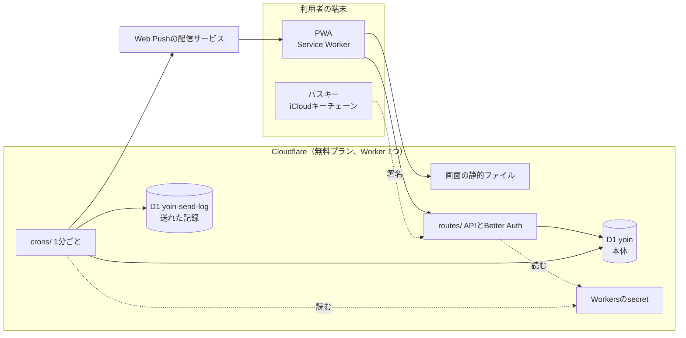
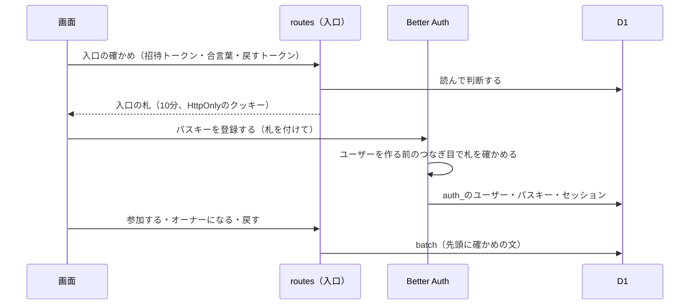
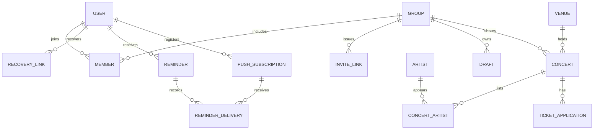
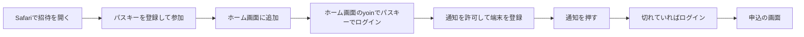
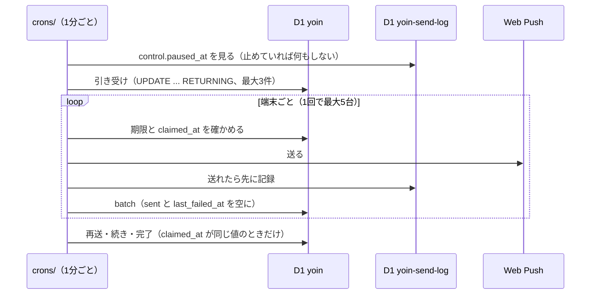
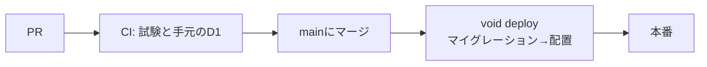

# 設計書: 招待からリマインドがiPhoneに届くまで

- ステータス: draft
- レベル: L3
- 関連: [承認済みの要件](../requirements/first-slice.md)、[API設計](../api.md)、[データモデル](../data-model.md)、[構成](../architecture.md)、[ADR-0008](../decisions/ADR-0008-cloudflare.md)
- 2026-11-28に、ADR-0008（Cloudflare・D1・Void・パスキー）と論点の記録[first-slice-cloudflare](../discussions/first-slice-cloudflare.md)の6つの決定に合わせて書き直した。AWSの版は`git log`の`docs/designs/first-slice.md`にある

## この設計を一言で

1つのWorker（Voidで組む）が、画面・API・Better Authのパスキー・1分ごとのCronを持つ。招待された人はパスキーを登録して参加し、自分の申込の期限はCronがWeb PushでiPhoneに届ける。配置先は本番の1つだけで、0円の無料プランで動かす。

## 背景

2026-11-27にADR-0008で、AWSとNeonからCloudflareへ移し、ログインをメールのコードからパスキーに替えた。前の版の設計（Cognito、SES、Lambda、EventBridge Scheduler、SQS、Terraform）は使えないので、構成・ログイン・リマインドの送り方を書き直す。要件・画面・申込とリマインドの決まりは前の版から変えていない。

## 目的

実装と試験が、同じAPIの形・D1の書き込みの順番・リマインドの失敗時の動きを見られるようにする。

## 要件

[要件定義書](../requirements/first-slice.md)の11本のストーリーと、F-01〜F-50、E-01〜E-22、B-01〜B-14を満たす。画面・異常系・境界・受け入れ条件は要件定義書を見る。

| 設計書の節 | 対応する要件 |
|---|---|
| 変更後構成・移行とリリース | F-01〜F-04、F-01a |
| ログインとユーザーを作る入口 | F-03、F-05〜F-08、F-05a、F-05b、F-10、F-11、E-02、E-16、E-19〜E-21、B-13、B-14 |
| API設計・DB設計 | F-07、F-09、F-13、F-14、F-19〜F-24、F-26〜F-33、F-36a、F-39〜F-41、E-01〜E-08、E-14、E-15、E-18、E-22、B-08、B-09、B-11、B-12 |
| フロントエンド設計 | F-06、F-08、F-11〜F-18（F-17aを含む）、F-22〜F-28、F-30〜F-32、F-37b〜F-48、E-09、E-15〜E-17、B-05〜B-07、B-11 |
| リマインドの送り方 | F-27〜F-37（F-37aを含む）、E-05〜E-08、E-10〜E-13、B-01〜B-05、B-10 |
| D1を過去の時点に戻したとき | F-36a、E-22 |
| エラー処理・ログと監視・性能 | F-04、F-36、E-10〜E-12、E-16、非機能要件 |
| テスト方針 | F-49、F-50、AC-01〜AC-12 |

## 対象範囲

要件の14画面、下表のAPI、1分ごとのCronの受け手、本体のD1の17表とBetter Authの`auth_`の表、`yoin-send-log`のD1の3表、Voidの設定、デプロイの流れ、PWA、2人のE2Eを作る。

## 対象外

グループの作成・切替・退会・解散・外すの画面とAPI、Queuesの受け手、R2と画像、ツアーの作成、昔の公演をさかのぼって登録する機能（C-06）、公演の編集、分配、参戦、グッズ、通知先を外す操作、パスキーを足す・消す画面、結合検証の環境、独自ドメインは作らない。この回の公演の下書きは、ツアーなしの公演1件に限る。

## 現状構成

アプリのコードも配置済みの資源も無い。`infra/terraform/`と`scripts/`にAWS向けのファイルが残っているが、使わない（片づけは作り直しの計画で行う）。

## 変更後構成

| 資源 | 名前と設定 |
|---|---|
| Worker | `yoin`。URLは`https://yoin.<アカウントのworkers.devの名前>.workers.dev`（F-01a）。アカウントのworkers.devの名前は、大関さんが最初の配置の前にCloudflareの管理画面で決め、決めた値をこの表に書き足すPRを出す。Workerの名前とアカウントのworkers.devの名前は、最初の配置のあと替えない |
| D1 本体 | `yoin`。location hintは`apac`（F-04） |
| D1 送れた記録 | `yoin-send-log`。本体と別のデータベースにして、本体を過去の時点に戻しても戻らないようにする（データモデルR22） |
| Cron | `* * * * *`の1個（無料プランの5個のうち1個） |
| secret | `BETTER_AUTH_SECRET`、`INVITE_TOKEN_SECRET`、`RECOVERY_TOKEN_SECRET`、`SETUP_PASSPHRASE`、`VAPID_PRIVATE_KEY`、`VAPID_SUBJECT`、`REMINDERS_PAUSED`（ふだんは`0`）。値は大関さんが`void secret put`で置く |
| 公開の値 | `VAPID_PUBLIC_KEY`。GitHub Actionsの変数（Secretsではない）に置き、画面のビルドで埋め込む。配置先が1つなので、環境ごとの`config.json`はやめる |

Voidは、自分のアカウントへ配置するときに配置先を1つしか持てない（Voidの文書`reference/cli/deploy.md`。動かしてはいない）。結合検証を作らないと決めた（論点fs-env）ので、この制約に合う。

## ログインとユーザーを作る入口

### パスキーとセッション

- Better Authのパスキーのプラグインを使う。パスワードとメールの方式は入れない。rpIDはWorkerのホスト名（`yoin.<アカウント>.workers.dev`）、originは`https://`付きの同じ名前にする。
- セッションは365日（F-06）。クッキーは`__Host-`で始まる名前にし、`Secure`・`HttpOnly`・`SameSite=Lax`・`Path=/`で、`Domain`を付けない。`workers.dev`の下の同じアカウントのほかのWorkerにクッキーが届かないようにするためである（Voidの文書に、`workers.dev`の名前ではクッキーが同じアカウントのほかのWorkerに届くとある）。この形をVoidのBetter Authの設定で取れるかは、実装の最初に確かめる。取れなければ、同じアカウントにほかのWorkerを置かないことで足りるので、その旨をこの節に書き足す。
- ログアウト（F-08）はBetter Authのセッションを消す。通知先は消さない。
- iPhoneのSafariとホーム画面のyoinは、セッションを別々に持つ。パスキーはiCloudキーチェーンで共有されるので、ホーム画面のyoinでは登録し直さずにログインできる（F-11）。

### ユーザーを作れる3つの入口

Better Authのユーザーを作れるのは、次の3つから来たときだけである（F-05）。どの入口も、まず入口の確かめを通し、次にBetter Authのユーザーとパスキーを作り、最後にアプリの行を1つの`batch()`で書く。

- 入口の札は、入口の種類・対象のID（招待リンク・戻すリンク・はじめの登録）・期限10分を、`BETTER_AUTH_SECRET`から作った鍵でHMACした値にする。D1には書かない。札が無いか、期限切れか、署名が合わなければ、ユーザーを作る前のつなぎ目（Better Authの`databaseHooks.user.create.before`）で断る。
- 札には乱数の`ticketId`を入れる。ユーザーを作る前のつなぎ目は、同じ`ticketId`で作ったBetter Authのユーザーがすでにあれば断る（作ったユーザーに`ticketId`を持たせる）。札1枚で作れるユーザーは1人だけになる。
- 札でできるのは、パスキーの登録と、その入口の最後の要求だけである。札でアプリのほかのAPIは呼べない。
- 認証の条件は3つに分かれる。札を出す3本（`GET /invites/{token}`、`POST /setup/verify`、`GET /recovery/{token}`）はセッションが無くても呼べる。最後の要求（`accept`、`setup/complete`）は、札と、パスキーの登録でできたセッションの両方が要る。ほかのAPIはセッションと`users`の行が要る。戻す2つ（`recovery`、`setup/recover`）は、最後の要求を別に呼ばず、パスキーの登録の中で済ませる（下の「戻すリンク」）。
- パスキーを登録したあと最後の要求が届かず、`groups.users`から指されないBetter Authのユーザーが残ったら、1時間後にCronが消す（データモデルR24）。
- Better Authのパスキーのプラグインで、セッションの無い人の登録をどうつなぐか（セッションなしの登録の設定を使うか、入口でユーザーを作ってから札つきのセッションで登録するか）は、Voidに入っているBetter Authの版で実装の最初に確かめる。どちらでも、上の札とつなぎ目の確かめは入れる。

### 招待から参加する（F-10、E-01、E-03、E-21、B-08）

1. S-02は`GET /invites/{token}`を呼ぶ。ログインしていなければ、招待を見るAPIは札を出し、画面はS-01でパスキーを登録させてからS-02に戻る。パスキーをすでに持つ人は、ふつうにログインする。
2. `POST /invites/{token}/accept`は、データモデルR24のとおり、確かめの文（期限・取り消し・回数・グループが`active`）、`users`・自分用グループ・メンバーの作成、`used_count`の加算を1つの`batch()`で流す。最後の1回に2人が同時に来ても、確かめの文で1人だけが通る（B-08）。
3. 断られたら、この要求で作ったBetter Authのユーザーとパスキーを消してから`invite_unusable`を返す（E-21）。すでに`users`の行がある人のユーザーは消さない。

### はじめの登録（S-24、F-03、E-19、B-14）

| 段 | 動き |
|---|---|
| 合言葉を確かめる | `POST /setup/verify`。本文は`{ passphrase }`。入れた値と`SETUP_PASSPHRASE`をそれぞれSHA-256にし、長さの同じ値として時間の変わらない比べ方で比べる。合言葉も、そのハッシュも、ログに書かない |
| 間違えた回数 | `groups.setup_state`の1行に、続けて間違えた回数と、試せない期限を持つ。5回続けて間違えたら1時間試せない（`too_many_attempts`）。合えば回数を0に戻す。合言葉は大関さんが20文字以上の乱数で作る。1時間に5回なので、総当たりでは当たらない |
| オーナーになる | 合えば札を出し、画面はパスキーを登録して`POST /setup/complete`を呼ぶ。本文は`{ groupId, groupName, displayName }`。1つの`batch()`の先頭の確かめの文で、`groups.users`が0行であることを見る。続けて`users`、自分用グループ、仲間と使うグループ、2つのメンバーの行を作り、`setup_state.owner_user_id`を書く。2人が同時に正しい合言葉を入れても、確かめの文で1人だけが通る（B-14）。通らなかった人のBetter Authのユーザーは消し、`setup_closed`を返す |
| オーナーができたあと | `setup/complete`は、確かめの文で必ず断る（`setup_closed`）。S-24は、オーナー本人の戻し方（次の節）だけに使う |

### 戻すリンク（S-21、S-25、F-05a、E-20、B-13）

- オーナーはS-21で、メンバーごとに`POST /groups/{g}/members/{userId}/recovery-links`を呼ぶ。本文は`{ id }`。オーナーだけ、自分の分は出せない（`forbidden`）。相手が`active`なメンバーでなければ`not_found`。トークンは`RECOVERY_TOKEN_SECRET`とリンクのIDからHMAC-SHA256で作り、`groups.recovery_links`にはハッシュだけを書く。同じ`batch()`で、その人あての前のリンクの`revoked_at`に時刻を入れる。応答はリンクのURL（`/recover/{token}`）。同じIDの2回目は同じURLを返す。
- 本人はS-25でリンクを開く。`GET /recovery/{token}`は、使えるかと表示名だけを返し、使えるなら札を出す。使った・切れた・出し直した・取り消したリンクは、どれも同じ`recovery_unusable`にする（E-20）。期限は`expires_at`ちょうどから使えない（B-13）。
- 本人が札で新しいパスキーを登録すると、Better Authの同じユーザーに足される。パスキーの登録を確かめる同じ要求の中（Better Authの登録のあとのつなぎ目）で、1つの`batch()`に、確かめの文（期限・使用済み・取り消し・所属が`active`）、`used_at`の記入、そのユーザーの古いパスキーと、今のセッションを除くセッションの削除を流す。画面から別の確定の要求は送らない。`POST /recovery/{token}/complete`は、応答が届かなかったときに結果を読み直すためだけに置き、何も書かない。
- 確かめの文で断られたら、その要求で足したパスキーとセッションを消して`recovery_unusable`を返す。
- 札を出すとき、`recovery_links.ticket_issued_at`に時刻を書く。パスキーを足したあと`batch()`の前にWorkerが止まると、新しいパスキーが残る。Cronは、`ticket_issued_at`から11分たっても`used_at`が空の行を見つけたら、そのユーザーのパスキーのうち`ticket_issued_at`より後に作ったものとそのセッションを消す。消すまでの最長11分は、新しいパスキーでログインできる。この時間にログインできるのはリンクを持っている人だけで、その人は確定まで進めることもできたので、受け入れる。

### オーナー本人の戻し方（F-05b）

オーナーが端末をすべてなくしたら、S-24で合言葉を入れる。オーナーがいるときに合言葉が合うと、`setup_state.owner_user_id`のユーザーに戻す札を出す。そのあとは戻すリンクと同じく、新しいパスキーの登録の中の`batch()`で古いパスキーとセッションを消す。止まったときの片づけも戻すリンクと同じで、札を出した時刻は`setup_state.ticket_issued_at`に書く。`POST /setup/recover`は結果を読み直すためだけに置く。間違えた回数の上限は、はじめの登録と同じものを使う。

使ったあと、大関さんは`void secret put SETUP_PASSPHRASE`で合言葉を新しい値に替える。合言葉が漏れたままだと、ほかの人がオーナーになれるためである。

## API設計

Voidの`routes/`にHonoの書き方で置き、Zodで知らないキーと誤った型を断る。下の`g`は`groupId`。JSONのキーはキャメルケース、公演の日付・時刻は日本時間、期限は時差付きのISO 8601で受けて`+09:00`で返す。[API設計の全体の決まり](../api.md#全体の決まり)も当てる。

| メソッドとパス | 入力と、成功の応答と、できる人 |
|---|---|
| `GET /me`、`GET /me/groups` | 自分のID・表示名・自分用グループのID、または入っているグループの一覧。起動したときに使う |
| `GET /groups/{g}`、`GET /groups/{g}/members` | メンバー。グループ名・種類・状態・オーナー、またはメンバーのID・表示名・参加した日・オーナーか |
| `POST /groups/{g}/invite-links` | `{ id, expiresAt, maxUses }`。仲間と使うグループのオーナーだけ。応答はURL |
| `GET /invites/{token}`、`POST /invites/{token}/accept` | 上の「招待から参加する」 |
| `POST /setup/verify`、`POST /setup/complete`、`POST /setup/recover` | 上の「はじめの登録」「オーナー本人の戻し方」。`users`の行が無くても呼べる |
| `POST /groups/{g}/members/{userId}/recovery-links` | 上の「戻すリンク」。オーナーだけ |
| `GET /recovery/{token}`、`POST /recovery/{token}/complete` | 上の「戻すリンク」。`users`の行の確かめは、戻す相手の行で行う |
| `GET /groups/{g}/held-reminders` | オーナーだけ。`held`のリマインドごとに、ID・宛先の表示名・期限の種類・届ける予定だった時刻・公演名。0件なら空の配列（S-26の入口を出さない） |
| `PUT /groups/{g}/held-reminders/{reminderId}` | `{ decision }`（`send`か`cancel`）。オーナーだけ。決めたあとの2回目は何も変えず200（E-22） |
| `GET /groups/{g}/artists`、`GET /groups/{g}/venues` | メンバー。選ぶための一覧。アーティストは色、会場は最寄り駅を含む |
| `GET`・`POST /groups/{g}/concert-drafts`、`PATCH`・`DELETE /groups/{g}/concert-drafts/{draftId}` | 本人の下書き。作るときは`id`と公演1件（ツアーなし）。直す・消すのは作った人だけ |
| `POST /groups/{g}/concert-drafts/{draftId}/confirm` | 作った人だけ。`{ concertIds }`（UUIDv7を1件）。2回目は、全部のIDがこのグループにあれば同じ応答 |
| `GET /groups/{g}/concerts`、`GET /groups/{g}/concerts/{concertId}` | メンバー。`when=upcoming`か`when=past`の公演一覧、または公演の詳細 |
| `GET`・`POST /groups/{g}/ticket-applications` | 一覧は`concertId`と`applicant=me`で絞れる。作る人が申込者 |
| `GET`・`PATCH`・`DELETE /groups/{g}/ticket-applications/{applicationId}`、`PUT …/status` | 見るのはメンバー。リマインドの予定は申込者にだけ返す。直す・状態を変える・消すのは申込者だけ |
| `GET`・`POST /me/push-subscriptions` | 本人の通知先。ほかの人と同じ`endpoint`なら`already_exists` |

- 認証はBetter Authのセッションで行う。セッションが無ければ401。セッションの`auth_user_id`から`groups.users`の行を引き、行が無ければ`not_registered`、`withdrawing`なら`account_closing`で断る。例外は、招待の2本、はじめの登録の3本、戻すリンクの2本だけである。
- グループの中の資源は、パスのグループIDと資源のIDを組で引く。メンバーでない、行が無い、別グループのIDは、どれも404 `not_found`にする。メンバーに見える資源で、操作する権限だけが無ければ403 `forbidden`。
- 作成は画面が作るUUIDv7で2回目を見分ける。1回目は201、同じ操作・グループ・作成者・中身の2回目は200。中身が違えば409 `id_conflict`。
- エラーはRFC 9457の`application/problem+json`。前の版の`code`に、`too_many_attempts`（429）、`setup_closed`（409）、`recovery_unusable`（409）を足す。想定していない失敗は、中身を伏せて500 `internal`。
- 境界の値は、招待の期限が今より後で7日以内・回数1〜10、枚数1〜99、受付名100字・座席と整理番号200字まで（B-09、B-12）。空の文字列は`null`にそろえ、文字数はUnicodeのコードポイントで数える。

## DB設計

Drizzleの表の定義は各文脈の`infrastructure/`に置く。型・null・外部キーの全部は[データモデル](../data-model.md#テーブル)を見る。D1にスキーマは無いので、表の名前は`groups_users`のように文脈の名前を頭に付ける（データモデルR19）。時刻はUTCのミリ秒の`integer`で持つ。

| 表 | この回で使う主な列と決まり |
|---|---|
| `groups_users`・`groups_groups`・`groups_members` | `users.auth_user_id`は一意。自分用グループはオーナーごとに1つ（`kind`の部分一意インデックス）。`members`は(group_id, user_id)がPK |
| `groups_invite_links` | `token_hash`は一意。`used_count`と`max_uses`を確かめの文で比べる |
| `groups_recovery_links` | データモデルのR26。`token_hash`は一意。札を出した時刻`ticket_issued_at`を足す |
| `groups_setup_state` | この回で足す。`id`（常に1）、`failed_count`、`locked_until`（null可）、`owner_user_id`（null可）、`ticket_issued_at`（null可）。データモデルに足す |
| `catalog_artists`・`catalog_venues`・`catalog_tours`・`catalog_concerts`・`catalog_concert_artists`・`catalog_drafts` | 前の版と同じ。`artists`は(group_id, name_key)が一意で、色は12色のCHECK。`drafts`の中身はJSONの`text` |
| `ticket_ticket_applications` | 前の版と同じ。`seat_or_entry_number`を含む。`created_at`は最初の挿入のときだけ書く |
| `notification_reminders`・`notification_push_subscriptions`・`notification_reminder_deliveries` | データモデルのとおり。`reminders`は(status, send_at)にインデックス。`status`に`held`を含む |
| `auth_`の表 | Better Authが決めた形のまま（ユーザー・セッション・パスキーなど） |
| `yoin-send-log`の`send_log` | (reminder_id, push_subscription_id, attempt_no)がPK、`sent_at`。90日より前の行はCronが消す。戻すリンクの`batch()`では、本体の書き込みの前に`revocations`も書く |
| `yoin-send-log`の`send_log`の`send_at` | 送ったときの予約の`send_at`も持つ。突き合わせで、時刻を直す前の記録を数えないため |
| `yoin-send-log`の`revocations` | 戻すリンクとオーナーの戻しで消したもの。`id`、`auth_user_id`、`kept_passkey_id`、`recovery_link_id`（null可）、`revoked_at`。戻したあと本体に当て直す。90日より前の行は消す |
| `yoin-send-log`の`control` | `id`（常に1）、`paused_at`（null可）、`reconciled_at`（null可）。下の「D1を過去の時点に戻したとき」で使う |

書き込みは、先に読んで判断し、`batch()`の先頭に確かめの文を置いて流す（データモデル「書き込みの順番」、R20）。確かめの文は、条件が外れたら失敗する文で、`batch()`全体を取り消させる。申込を直す・状態を変える・消すときは、申込とリマインドの書き込みを同じ`batch()`に入れる。

## フロントエンド設計

React＋Vite、React RouterとTanStack Query、Voidの`void/client`を使う（論点`routing-data-tools`の推奨。この設計書の承認で決める）。

- セッションごとにQueryClientを作り、キーにユーザーIDとグループIDを入れる。ログアウトしたら通信を止め、キャッシュを消して別のQueryClientにする。
- Service Workerは、認証の要る応答と、招待・戻すリンクの画面をキャッシュに置かない。通知からの戻り先とログインのあとの戻り先は、同じオリジンのパスに限る。
- S-01はパスキーでログインする。招待か戻すリンクから来たときだけ、パスキーを登録するボタンを出す。パスキーに対応していない端末や、本人が取り消したときは、その旨を出してやり直せるようにする（E-16）。
- S-24は、合言葉の欄と、オーナーがいないときだけグループの名前と表示名の欄を出す。S-25は、表示名と「パスキーを登録して戻る」ボタンだけを出す。
- S-26の入口は、オーナーが`GET /groups/{g}/held-reminders`を呼んで1件以上あるときだけ、S-21に出す。
- ホームは、自分の申込とまだ来ていない期限から「次にすること」を作り、一番近い期限を帯にする。通知先が0台か、`lastFailedAt`の入った端末があれば、S-23への帯を出す。許可を断られても帯は残す。
- ホームは`when=upcoming`で一番近い公演を探す。これからの公演が無ければ「これからの公演はありません。」と「公演を追加する」ボタン（S-08へ）を出す。次にすることが無ければ「次にすることはありません。」と出す（F-17a）。
- 公演まで7日ちょうどのときは、残り時間を出さない（B-07）。7日を切ってから出す。
- 公演の券の座席は、本人の入金済みか受取済みの申込のうち、座席が空でないものから選ぶ。受取済みを先にし、同じ状態なら`createdAt`が新しいもの、同じ時刻ならIDの小さいものを使う（F-24）。
- 通知はDeclarative Web Pushの形で送り、対応していない端末ではService Workerが出す。押すと同じオリジンの申込のURLを開く。消した申込なら見つからない画面を出す（E-09）。

## リマインドの送り方

### 予約を合わせる

申込の4つの書き込みは、同じ1つの関数で、あるべき予約に合わせる（`docs/api.md`の「申込とリマインド」）。`applied`は結果発表、`won`は前日20時と締切の3時間前、`paid`は受取開始、`lost`・`picked_up`・消した申込は予約なし。期限が空なら作らない（B-03）。

- 予約は`notification_reminders`の行を書くだけにする。1件ごとの予約は作らない（データモデルR22）。
- 届ける時刻を過ぎていたら、送信期限（届ける時刻の1時間後。入金はそれと締切の早いほう）より前なら行を書き、次のCronで届ける。送信期限ちょうど以降なら書かない（F-34、B-01）。
- 時刻を直すときは、`status = 'scheduled'`の行だけを条件付きで更新する。条件に合わなかったら、もう送り始めているので、申込の変更ごと取り消して409 `reminder_conflict`を返す。画面は申込を取り直してやり直せる。
- 状態も期限も変わらない予約は、文・時刻・送った状態を変えない（B-04）。旧期限の行は`dedupe_key`を`history:<旧予約ID>`に移し、要るときだけ元のキーで別IDの行を作る。
- 通知の文は予約のときに作って行に保存する（F-37、F-37a）。

### Cronが送る

- 引き受けと再送と完了は、データモデル「送り方」のとおりにする。引き受けた`claimed_at`の値を印にし、その回の書き込みはどれも、印が変わっていないことを条件にする。
- 1回のCronで引き受ける行は3件まで、送る端末は合わせて5台までにする（仮の値）。5台に達したら、`retry_at`はnullのまま`claimed_at`をnullに戻して止め、次の分のCronが同じ回の続きを送る。値は、パスキーの確かめとWeb Pushの暗号のCPU時間を大関さんの手元で計ってから決め直す（非機能要件）。
- 送れたら、まず`send_log`に書き、書けたときだけ本体の`reminder_deliveries`を`sent`にし、同じ`batch()`で`push_subscriptions.last_failed_at`を空にする。
- Web Pushの応答が404・410なら、その端末を`gone`として扱い、通知先の行を消す（E-11）。429・5xx・通信の失敗は一時失敗にする。
- その回で一時失敗が残り、5分後が送信期限より前なら`retry_at`を入れる（3回まで）。次の再送ができなければ完了処理に進み、失敗が残った端末にだけ`last_failed_at`を書く。オーナーには知らせない（F-18、論点fs-failed-notice）。
- 端末が1台も無い人の予約は、引き受けた回に端末0台で完了し、`sent`にする。`sent_at`はnullのままなので、申込の画面では「送信なし」と出す（B-10）。あとで端末を登録しても、過去の通知は送らない。
- 申込を読むとき、DBの今の時刻が`recover_until`ちょうど以降の`scheduled`・`sending`は、表示上だけ完了にする。行は更新しない。
- Cronは毎時0分にだけ、片づけ（残ったBetter Authのユーザーを消す、使い終わって7日たった戻すリンクを消す、90日より前の`send_log`を消す）も行う。

### D1を過去の時点に戻したとき（F-36a）

戻すのは大関さんで、手でSQLは流さない。止める印は、戻しても消えない`yoin-send-log`の`control`に置く。`yoin-send-log`には、戻しても消えてはいけない記録として、送れた記録（`send_log`）と、パスキーを消した記録（`revocations`）を置く。

1. 大関さんが`void secret put REMINDERS_PAUSED 1`で止める。次のCronは、`paused_at`が空か`reconciled_at`が入っていれば、`paused_at`に今の時刻を書き、`reconciled_at`を空にする（2回目の戻しでも突き合わせが要る状態になる）。以後は送らない。
2. 大関さんがCloudflareの管理画面かcf CLIで、本体のD1（`yoin`）だけを戻したい時点に戻す。
3. 大関さんが`void secret put REMINDERS_PAUSED 0`で再開する。次のCronは、`paused_at`があって`reconciled_at`が無いとき、送る前に突き合わせをする。`send_log`に記録がある端末は本体でも`sent`にし、対象の端末すべてに記録がある予約は`sent`にする。記録が一部にしか無い予約と、`send_at`が`paused_at`以前の`scheduled`・`sending`の予約は`held`にする。`send_log`の行は、その予約の今の`send_at`と同じ`send_at`のものだけを数える。未送信の予約の時刻を直すと同じIDのまま`send_at`が変わるので、直す前の時刻で送った記録を、直したあとの予約の記録として数えないためである。`held`と`sent`に移すときは、同じ更新で`retry_at`と`claimed_at`を空にする（`retry_at`は`sending`の行だけが持てる）。
   続けて`revocations`を本体に当て直す。戻した先の時点のあとで消したパスキーとセッション（戻すリンクとオーナーの戻しで消したもの）を、もう一度消す。使った戻すリンクも、`revocations`に残したリンクのIDで`used_at`を入れ直す。終わったら`reconciled_at`を書く。
4. 突き合わせは1回のCronで20件ずつ進め、全部を終えるまで送らない。10人の規模では数分で終わる（推測）。そのあいだ、ほかの予約の送信も遅れる。送信期限を過ぎた予約は送らない。
5. オーナーはS-26で1件ずつ決める。`send`はデータモデルの手順5のとおり、送信期限を今から1時間後にして`scheduled`か`sending`に戻し、`send_log`で`sent`にした端末には送らない。`cancel`は`canceled`にする。`send`は、その予約の`dedupe_key`が`history:`で始まらない（今の期限を表している）ときだけ受ける。そうでなければ`cancel`として扱う。

`held`のあいだに申込者が申込を直したときは、予約を合わせる関数が`held`の行も`scheduled`の行と同じく取り消し・時刻の変更・履歴への移動の対象にする。入金済みにしたあとで、古い入金期限のリマインドを送ることはない。

戻した先の時点より前に送信時刻があって、戻した時点ですでに送っていた予約も、記録が一部にしか無ければ`held`になる。届いたかを確かめられないものは、オーナーに決めてもらう形に寄せる。

## エラー処理

| 観点 | 設計 |
|---|---|
| 再試行 | Web Pushの再送は5分おきに3回まで。Cronが途中で止まったら、`claimed_at`から10分後に引き受け直す（E-12）。画面は作成の要求を同じIDで送り直せる |
| 時間の上限 | 1回の要求とCronのCPU時間は10ミリ秒まで（無料プラン）。Web Pushの1回の要求は5秒で打ち切る。待ち時間はCPU時間に入らない |
| 2回届いたとき | 作成のID、招待の所属のPK、通知先の`endpoint`、引き受けの印、端末ごとの送信結果で、同じ結果にする |
| 一部だけ失敗 | `send_log`に書けなければ本体を`sent`にしない。送れたのに記録が無いことは起きるが、記録があるのに送っていないことは起きない |
| 無料の上限に当たった | その日の残りの要求は断られる。画面は「時間をおいてやり直してください」と出す（E-16）。リマインドは、上限が戻ったあと送信期限より前なら送る |

## ログと監視

- ログには、操作の種類・要求のID・エラーの分類・回数・かかった時間だけを書く。名前、合言葉、トークン、招待と戻すリンクのURL、クッキー、Pushの`endpoint`と鍵、通知の文、申込の中身は書かない。
- Workersのログ（無料プランの保存期間のまま）を使う。全体の失敗（Cronが止まった、上限に当たった）は、大関さんがCloudflareの管理画面で見る（論点fs-failed-notice）。
- 送れなかった端末は、本人のホームの帯とS-23で知らせる。オーナーにもメールにも知らせない。

## セキュリティ

- 秘密の値はWorkersのsecretだけに置き、リポジトリ・Voidの設定・PR・ログに書かない。`CLOUDFLARE_API_TOKEN`はGitHubのSecretsに置く（ADR-0008）。
- 招待・戻すリンク・はじめの登録の画面には`Referrer-Policy: no-referrer`を付け、外部の資源を読まない。トークンはハッシュだけを保存する。
- 戻すリンクは、漏れるとその人になれる。1回だけ・24時間・オーナーだけが出せる・自分の分は出せない・出し直すと前のものは使えない、で絞る。使ったら古いパスキーとセッションを消す。
- 合言葉は、間違えた回数の上限で総当たりを止める。オーナー本人の戻しに使ったら、大関さんが替える。
- 通知先は本人にしか返さない。Pushの`endpoint`はHTTPSで、知っている配信サービスのホスト（Apple、Google、Mozilla、Microsoft）に限り、転送先には付いていかない。
- ロック画面に公演名と受付名が出ることは、通知を許可する画面で案内する。

## 性能

使う人は10人以下なので、一覧はページを分けない。日付と申込者のインデックスを使い、ホームでは端末ごとの送信結果を読まない。D1の書き込みは1日10万行が上限で、10人が1日30回操作しても数千行に収まる（推測。実装のあとに大関さんがCloudflareの管理画面で見る）。

## テスト方針

- CIはPRごとに、型チェック、lint、Vitest、fast-check、手元のD1（`--local`）へのマイグレーション、Playwrightを流す。CloudflareのアカウントにもWeb Pushの配信サービスにもつながない。
- PlaywrightはVoidの手元の開発サーバー（D1は手元）を起動し、ブラウザのcontextを2つ作る。それぞれのcontextで、Chrome DevTools Protocolの`WebAuthn.enable`と`WebAuthn.addVirtualAuthenticator`（`protocol: ctap2`、`transport: internal`、`hasResidentKey: true`、`hasUserVerification: true`、`isUserVerified: true`）で仮の認証器を足し、パスキーを登録してログインする（AC-01）。Chromiumで流す。
- E2Eの初めに、手元のsecretに試験用の合言葉を置き、1人目がS-24でオーナーになる。オーナーが招待リンクを出し、2人目が参加し、公演を確定し、申込を作って当選・入金済み・受取済みまで進める。同じブラウザでログアウトして別の人に替えたとき、前の人の下書きや通知の状態が出ないことも見る。
- Web Pushは、試験のときだけ配信サービスの代わりにする手元の受け手を使い、送った中身と回数を見る。試験の受け手は製品のビルドに入れない。
- 手元のHonoで、`users`の行が無い人・メンバーでない人・オーナーでない人、招待の最後の1回、合言葉の5回目と6回目、オーナーができたあとの`setup/complete`、戻すリンクの24時間ちょうど・使用済み・出し直し、別グループのIDの404を確かめる。
- fast-checkで、申込からあるべき予約を出す関数（AC-02）、状態の移り方（AC-03）、引き受けと再送と完了（AC-04）を確かめる。Cronを2つ同時に流しても同じ行を2回引き受けないこと、取り消した予約を引き受けないこと、端末の数の上限で止めた回の続きで送れた端末に送り直さないことを含める。
- 固定の時計で、送信期限の境目を試す。入金期限12:00の3時間前の分（9:00、送信期限10:00）は、9:30に登録すれば次のCronで送り、10:00に登録すれば作らない。前日20時の分（送信期限21:00）も、20:30と21:00で同じに分かれる。Cronが締切ちょうどに起動したら送らない、再送が送信期限に間に合わなければ作らない、送信期限を過ぎた`scheduled`は表示上だけ完了にする、も確かめる。
- D1を戻す手順は、2回続けて戻しても2回目に突き合わせが流れること、時刻を直した予約で直す前の送信記録を数えないこと、`retry_at`の入った予約を`held`にできること、戻すリンクで消したパスキーが戻したあとも使えないことを試す。
- D1を戻したあとの手順（AC-06b）は、手元のD1で、`send_log`に一部の端末だけ記録がある予約、全部ある予約、無い予約を作り、`REMINDERS_PAUSED`を1から0に戻して、`held`と`sent`に分かれること、S-26の`send`でまだ送っていない端末にだけ送ることを確かめる。
- 本番で人が確かめるもの（AC-06c、AC-07〜AC-12）は要件定義書の表のとおり。大関さんがオーナーと2人目の両方を操作する。2人目を退会させる機能はまだ無いので、本番に招くのは大関さんの2つ目のアカウントか、退会の回までいてもらってよい人に限る。

## 移行とリリース

### コードと設定の置き場所

| 対象 | 置き場所 |
|---|---|
| 画面（React＋Vite）とService Worker | Voidの画面の置き場所（Voidの雛形に合わせる。実装の最初に決めて計画に書く） |
| API | `routes/`。文脈の公開関数（`src/contexts/<文脈>/index.ts`）だけを呼ぶ |
| Cronの受け手 | `crons/` |
| Drizzleの表の定義 | `src/contexts/<文脈>/infrastructure/` |
| マイグレーションのSQL | `void db generate`が出す場所。文脈の外に置き、アプリの実行時のコードから読まない |
| Voidの設定 | `void.config.ts`と`void.lock.json`。資源の名前とsecretの名前だけを書き、値は書かない |
| デプロイ | `.github/workflows/deploy.yml`。`main`へのマージで、試験のあと`void deploy` |

### 配置の流れ

1. 大関さんが最初に一度だけ、Cloudflareのアカウントのworkers.devの名前を決め、上の資源の表に書き足すPRを出す。
2. 大関さんがsecretを置く（`void secret put`）。`REMINDERS_PAUSED`は`0`。
3. `main`にマージすると、GitHub Actionsが試験を通してから`void deploy`を流す。マイグレーションはこの中で流れ、手で流す手順は作らない（F-02、AC-06）。本番の前の承認の段は置かない。
4. 大関さんがS-24で合言葉を入れてオーナーになる（P-00、AC-06c）。

マイグレーションの誤りで本番が壊れたときは、上の「D1を過去の時点に戻したとき」の手順で戻す。戻せるのは無料プランで7日までである。既存のデータの移行と、古い画面への互換は要らない。

### 費用

すべてCloudflareの無料プランで、月0円にする（ADR-0008の決定2）。上限は、Workersが1日10万リクエスト・1回のCPU時間10ミリ秒、D1が1日に読み500万行・書き10万行・5GB、Cronが5個である。超えるとその日の処理が止まるだけで、料金はかからない。独自ドメインは取らない（論点fs-domain）。

## リスク

- Voidは公開から6週間で、確かめたのは文書だけである。Better Authのパスキーのセッションなしの登録、クッキーの`Domain`、Cronの置き場所が文書どおりに動くかは、実装の最初の小さいタスクで確かめる。
- パスキーの確かめとWeb Pushの暗号が、1回10ミリ秒のCPU時間に収まるかは計っていない。収まらなければ、1回のCronで送る端末の数を減らす。それでも収まらなければ、費用の方針を大関さんと決め直す。
- Web Pushの受理とD1の書き込みは1つにできないので、送った直後に止まると2回届くことがある。設計で許している。
- workers.devの名前を替えると、全員のパスキーが使えなくなる。替えたら、全員が戻すリンクか招待で登録し直す（ADR-0008の決定5）。

## 決めたこと（問いと答え）

- [論点の記録 first-slice](../discussions/first-slice.md)
- [論点の記録 first-slice-cloudflare](../discussions/first-slice-cloudflare.md)（2026-11-28。本番だけ、workers.devの名前、はじめの合言葉、戻すリンク、送れなかったことは本人にだけ、`held`はオーナーの画面）

この設計書で決めたこと（要件定義書が設計に回したもの）:

| 要件 | 決めたこと |
|---|---|
| AC-01 パスキーのE2E | Chrome DevTools Protocolの仮の認証器を、contextごとに足す |
| F-03 合言葉の間違いの上限 | 5回続けて間違えたら1時間試せない |
| F-05b オーナー本人の戻し方 | S-24で合言葉を入れて、新しいパスキーを足す。使ったら合言葉を替える |
| F-36a 戻す手順の細部 | `REMINDERS_PAUSED`で止め、`yoin-send-log`の`control`に止めた時刻を置き、再開の最初のCronで突き合わせる |
| 非機能 1回のCronで送る端末 | 引き受け3件・端末5台（仮。計ってから決め直す） |
| B-07 残り7日ちょうど | 出さない |
| B-09 上限 | 枚数1〜99、受付名100字、座席と整理番号200字 |
| B-10 端末が無い人 | 端末0台で完了にし、「送信なし」と出す |
| F-24 券に出す申込 | 受取済みを先に、同じ状態なら新しい申込 |
| 対象範囲 この回の表 | 上の「DB設計」の表。`groups_setup_state`をデータモデルに足す |

## 未決事項

- アカウントのworkers.devの名前（大関さんが最初の配置の前に決める）。
- 1回のCronで送る端末の数（大関さんの手元で計ってから決める）。
- 画面の置き場所の名前（Voidの雛形に合わせて、実装計画で決める）。
- voidとcf CLIの利用状況の送信の止め方（`docs/agents/command-scope.md`。これらを初めて動かす作業より前のPRで書く）。
