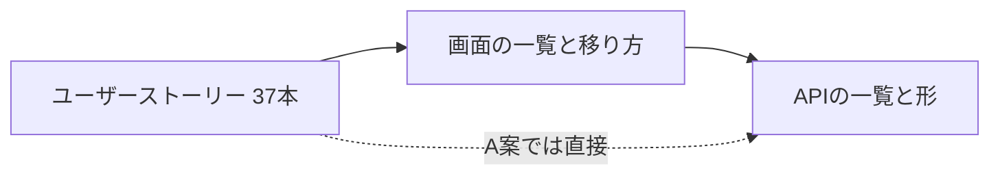
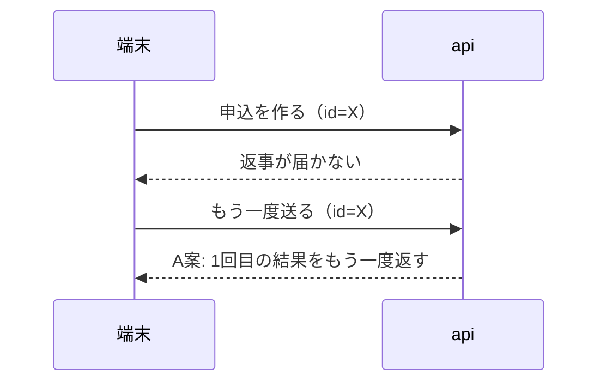

# 論点の記録: 工程5 API設計

- 機能名: api-design
- 確認のページ: https://claude.ai/artifact/EecRFSVi17iTJAGbZWMokX
- 進み具合: docs/discussions/api-design.progress.json

## 背景

工程3でデータモデルを、工程4で道具（HonoとZod、React＋Vite）を決めた。実装は土台も含めてDevinに渡すので、画面とLambda `api`のあいだで何をどの形でやりとりするかを、委譲の前に決めておく。最初の進め方の案では、この工程の出口を「APIの定義が検査を通り、MVP1のユーザーストーリーがどれかのAPIに対応している」としていた。ここで決めたことは、API設計の文書（`docs/api.md`）とADR-0005にまとめる。

## 前提

- 画面はCloudFrontとS3に置く静的なPWA。APIはAPI Gateway HTTP APIがCognitoのJWTを確かめてから、Lambda `api`に渡す（`docs/architecture.md`）。
- `api`はHonoでパスごとに公開関数を呼び分け、Zodで入力を確かめる。入力と出力の型は画面と共有する（ADR-0004の決定1と決定8）。
- 操作した人はJWTから取る。別のグループのIDを指定されたら、存在しないときと同じ「見つからない」を返す（`docs/data-model.md`「グループの所属と権限」）。
- 書き込みは1つのトランザクションで、最初にグループの行を`FOR SHARE`でロックする。IDはUUIDv7をアプリで作る（`docs/data-model.md`）。
- 画像は`api`が出す署名付きURLで、端末とS3が直接やりとりする（`docs/architecture.md`のB-2）。
- セトリには版番号があり、2人が同時に直したら古い版からの保存を断る（`docs/user-stories.md`のC-09）。
- 利用者は10人以下。1グループの公演は年に数十件の見込み。
- 部分更新では、送らなかった欄は`undefined`、消す欄は`null`にする（`.claude/rules/coding-standards.md`）。

## 論点

### 工程5で、APIのほかに画面の一覧と移り方まで決めるか

<!-- id: scope -->

- 工程: 設計
- 種類: 設計
- 優先度: 高
- 状態: 決定
- なぜ今: 最初の進め方の案では、主要な画面を設計の工程で描くことにしていたが、まだどの工程でも描いていない。APIの単位（画面ごとにまとめて返すか、資源ごとか）は、画面が決まっていないと決めにくい。
- 根拠: 工程0の進め方のページ（工程3に「主要画面のHTMLモック」）、ADR-0004「画面の移り方やデータの取り方の道具は、最初の1本の設計で決める」
- 選択肢:
  - A) APIだけ決める。画面は最初の1本の設計で決める
    - 利点: 工程5が早く閉じる
    - 欠点: 画面を描いたときに、APIの足りない項目や呼ぶ回数の多さが見つかって戻る
  - B) 画面の一覧と移り方、画面ごとに呼ぶAPIまで決める。見た目（色・配置）は最初の1本で決める
    - 利点: ストーリーごとに「どの画面で、どのAPIを呼ぶか」がそろい、Devinに画面のタスクを分けて渡せる
    - 欠点: 工程5の量が増える（画面は20前後の見込み）
  - C) Bに加えて、主要な画面のHTMLの見本まで作る
    - 利点: 見た目まで大関さんが先に確かめられる
    - 欠点: 工程がさらに延び、見た目は実装で変わることが多い
- 推奨: B（Devinへ画面のタスクを分けて渡すには、画面とAPIの対応が要る。見た目は動くもので確かめるほうが早い）
- 決定: B
- 推奨と同じか: 同じ
- 選ばなかった理由: A（画面を描いたときにAPIの足りない項目が見つかって戻るため）、C（見た目は実装で変わることが多く、動くもので確かめるほうが早いため）
- 反映先: docs/api.md「画面の一覧と移り方」、docs/decisions/ADR-0005-api-conventions.md 決定1
- 決めた日: 2026-11-21

### APIの定義を、どこに書くか

<!-- id: contract-source -->

- 工程: 設計
- 種類: API
- 優先度: 高
- 状態: 決定
- なぜ今: 画面とLambdaを別のDevinのタスクで作るので、両方が同じ定義を読む必要がある。レビューでも、定義と実装の食い違いを検査で見つけたい。
- 根拠: ADR-0004の決定1（APIの入力と出力の型を画面と共有する）と決定8（HonoとZod）
- 選択肢:
  - A) Zodのスキーマを元にし、`@hono/zod-openapi`でOpenAPIの文書を書き出してリポジトリに置く。CIで書き出し直して差分が無いかを見る
    - 利点: 定義は1か所で、人とCodexが読めるOpenAPIの文書も残る
    - 欠点: 依存が1つ増え、ルートの書き方が`@hono/zod-openapi`の形になる
  - B) OpenAPIの文書を手で書き、そこから型とZodのスキーマを作る
    - 利点: 実装の前にAPIの文書だけでレビューできる
    - 欠点: 生成の道具が増え、生成したコードを直したくなったときに困る
  - C) Zodのスキーマだけにし、画面はHonoの`hc`で型を受け取る。OpenAPIは作らない
    - 利点: 道具が最も少ない
    - 欠点: APIの一覧を人が読める文書が無く、ストーリーとの対応を検査で確かめにくい
- 推奨: A（定義が1か所のまま、レビューで読める文書と差分の検査が手に入る）
- 決定: C
- 推奨と同じか: 違う
- 理由: APIを外部に公開しないので、OpenAPIの文書は要らない。APIと画面の型は`hono/client`だけでそろう（2026-11-21、大関さんの構成の見直し）。ストーリーとAPIの対応は、API設計の文書の表で確かめる
- 選ばなかった理由: A（APIを外部に公開せず、依存とルートの書き方の制約が増えるため）、B（生成の道具が増えるため）
- 反映先: docs/decisions/ADR-0004-dev-tools.md「2026-11-21の追記」
- 決めた日: 2026-11-21

### パスに、グループIDを入れるか

<!-- id: path-shape -->

- 工程: 設計
- 種類: API
- 優先度: 高
- 状態: 決定
- なぜ今: 公開関数はどれも「操作した人」と「グループID」を受け取る。グループIDをどこから取るかで、すべてのパスの形が決まる。
- 根拠: `docs/data-model.md`「グループの所属と権限」、`docs/user-stories.md`のG-04（グループを切り替える）
- 選択肢:
  - A) `/groups/{groupId}/concerts/{concertId}`のように、資源ごとのパスの先頭にグループIDを入れる
    - 利点: どの要求がどのグループのものかがパスだけで分かり、ログと試験で追いやすい
    - 欠点: パスが長くなる
  - B) グループIDはヘッダ（`X-Group-Id`）で送り、パスは`/concerts/{concertId}`にする
    - 利点: パスが短い
    - 欠点: ヘッダを付け忘れた要求を見落としやすく、キャッシュやログで区別しにくい
  - C) パスに入れず、資源のIDからグループを引く
    - 利点: 画面はグループIDを知らなくてよい
    - 欠点: 最初の`FOR SHARE`のロックの前に、ほかの文脈のテーブルを読むことになる
- 推奨: A（ロックを取る前にグループIDが決まり、別グループのIDとの組み合わせを公開関数で確かめる形にそのまま合う）
- 決定: A
- 推奨と同じか: 同じ
- 選ばなかった理由: B（付け忘れた要求を見落としやすく、ログで区別しにくいため）、C（ロックの前にほかの文脈の表を読むことになるため）
- 反映先: docs/api.md「パスの形」、ADR-0005の決定2
- 決めた日: 2026-11-21

### 通信が切れて同じ作成を2回送ったとき、どう扱うか

<!-- id: idempotency -->

- 工程: 設計
- 種類: API
- 優先度: 高
- 状態: 決定
- なぜ今: 公演会場の近くは電波が弱い。チケット申込や頼まれ物が2つできると、リマインドが2回届いたり合計金額がずれたりする。作成のAPIすべての形が変わる。
- 根拠: `docs/data-model.md`「全体の決まり」（IDはUUIDv7をアプリで作る）、`docs/prfaq.md`（オフライン対応はしない）
- 選択肢:
  - A) 作成では、画面がUUIDv7のIDを作って送る。同じIDの行が同じグループにあり、中身も同じなら、1回目の結果を返す。中身が違えば断る
    - 利点: 表を増やさずに2重の作成を防げる
    - 欠点: 画面が作ったIDを信じるので、ほかのグループのIDと重なったときに「見つからない」と区別して返す決まりが要る
  - B) 要求ごとに`Idempotency-Key`ヘッダを付け、結果を別の表に24時間残す
    - 利点: 作成以外の操作（状態を進めるなど）にも使える
    - 欠点: 表が1つ増え、古い記録を消す処理が要る
  - C) 何もしない。2つできたら利用者が消す
    - 利点: 作りが最も単純
    - 欠点: リマインドの重複や合計金額のずれを利用者が気づくまで直せない
- 推奨: A（作成のほかの操作は、状態を進めるなど2回送っても結果が同じになる形にできるので、作成だけ防げば足りる）
- 決定: A
- 推奨と同じか: 同じ
- 選ばなかった理由: B（表と古い記録を消す処理が増え、作成のほかの操作は2回送っても同じ結果になる形にできるため）、C（リマインドの重複や合計金額のずれを利用者が気づくまで直せないため）
- 反映先: docs/api.md「作成を2回送ったとき」、ADR-0005の決定3
- 決めた日: 2026-11-21

### エラーを、どの形で返すか

<!-- id: error-shape -->

- 工程: 設計
- 種類: API
- 優先度: 高
- 状態: 決定
- なぜ今: 画面はエラーの種類（見つからない、入力の誤り、版が古い、解散中）ごとに出す文言を変える。すべてのAPIで同じ形にしないと、画面のタスクごとに読み方がばらばらになる。
- 根拠: `docs/data-model.md`「書き込みの順番」（解散・退会の開始後の書き込みは断る）、`docs/user-stories.md`のC-09（古い版からの保存は断る）
- 選択肢:
  - A) RFC 9457（`application/problem+json`）の形にし、`code`（`not_found`、`invalid_input`、`stale_version`、`group_closing`など）と、入力の誤りなら欄ごとの理由を足す
    - 利点: 決まった形なので、Devinも道具も迷わない
    - 欠点: `type`や`title`など、画面では使わない欄も返す
  - B) `{ "error": { "code", "message", "fields" } }`の独自の形にする
    - 利点: 必要な欄だけで小さい
    - 欠点: 形の説明をAPI設計の文書に自分で書く必要がある
- 推奨: A（決まった形を使えば、形の説明を書かずに済み、`code`の一覧だけ決めればよい）
- 決定: A
- 推奨と同じか: 同じ
- 選ばなかった理由: B（形の説明をAPI設計に自分で書く必要があるため）
- 反映先: docs/api.md「エラーの形」、ADR-0005の決定4
- 決めた日: 2026-11-21

### 一覧のAPIで、ページを分けるか

<!-- id: pagination -->

- 工程: 設計
- 種類: API
- 優先度: 中
- 状態: 決定
- なぜ今: 一覧のAPI（公演、参戦、品目、申込）すべての形が変わる。
- 根拠: 前提（利用者は10人以下、公演は年に数十件）、`docs/user-stories.md`のA-04（自分の参戦を一覧で見る）
- 選択肢:
  - A) MVP1では分けない。公演と参戦の一覧は年で絞れるようにする
    - 利点: 画面とAPIが単純
    - 欠点: 何年も使って件数が増えたら、分ける形に変える
  - B) すべての一覧をカーソルで分ける
    - 利点: 件数が増えても形を変えずに済む
    - 欠点: 10人の規模では使われない作りを全部の一覧に入れる
- 推奨: A（誰も求めていない将来のための作りを入れない。年で絞れば1回に返すのは数十件で済む）
- 決定: A
- 推奨と同じか: 同じ
- 選ばなかった理由: B（10人の規模では使われない作りを全部の一覧に入れることになるため）
- 反映先: docs/api.md「中身の形」、ADR-0005の決定5。PR #17のマージまで異議が無かったので決定にした（2026-11-21）
- 決めた日: 2026-11-21

### 同時に直したときの上書きを、セトリ以外でも防ぐか

<!-- id: concurrency -->

- 工程: 設計
- 種類: アプリの決まり
- 優先度: 中
- 状態: 決定
- なぜ今: 防ぐなら、更新のAPIに版番号を送らせ、表にも版番号の列を足す。データモデルの変更になる。
- 根拠: `docs/data-model.md`の`catalog.setlists`（版番号はセトリだけ）、`docs/user-stories.md`のC-08とC-09
- 選択肢:
  - A) セトリだけ防ぐ（今の決まりのまま）。ほかは後から保存したほうが残る
    - 利点: データモデルを変えずに済む
    - 欠点: 公演の情報を2人が同時に直すと、先の変更が消える
  - B) 複数のメンバーが直せる行（公演、ツアー、会場、品目）すべてに版番号を付ける
    - 利点: 先の変更が気づかないうちに消えることが無い
    - 欠点: 表とAPIがすべて版番号を扱い、画面にも食い違ったときの表示が要る
- 推奨: A（セトリは公演の直後に複数人が同時に入れるが、ほかの行を同時に直すことは10人の規模ではまれ）
- 決定: A
- 推奨と同じか: 同じ
- 選ばなかった理由: B（表とAPIと画面のすべてが版番号を扱うことになり、ほかの行を同時に直すことは10人の規模ではまれなため）
- 反映先: docs/api.md「公演カタログ」のセトリ、ADR-0005の決定5。PR #17のマージまで異議が無かったので決定にした（2026-11-21）
- 決めた日: 2026-11-21

### APIのURLを、画面と同じドメインにそろえるか

<!-- id: api-origin -->

- 工程: 設計
- 種類: 設計
- 優先度: 中
- 状態: 決定
- なぜ今: 別のドメインなら、API GatewayでCORSの設定が要る。同じなら、CloudFrontに`/api/*`をAPI Gatewayへ渡す設定が要る。Terraformのタスクの中身が変わる。
- 根拠: `docs/architecture.md`の全体図（端末からAPI Gatewayへ直接）と、2026-11-17の決定（つなぎ先は今の構成のまま図だけ整理）
- 選択肢:
  - A) 今の構成のまま、端末はAPI GatewayのURLへ直接送る。CORSは画面のドメインだけ許す
    - 利点: 決めた構成を変えずに済む
    - 欠点: CORSの設定を、画面のドメインが決まるたびに合わせる
  - B) CloudFrontの`/api/*`をAPI Gatewayへ渡し、同じドメインにする
    - 利点: CORSが要らない
    - 欠点: 2026-11-17に決めた構成を変え、CloudFrontを通る費用と設定が増える
- 推奨: A（2026-11-17に今の構成のままと決めており、変える理由が新しく出ていない）
- 決定: A
- 推奨と同じか: 同じ
- 選ばなかった理由: B（2026-11-17に決めた構成を変え、CloudFrontを通る費用と設定が増えるため）
- 反映先: docs/api.md「つなぎ先と認証」、ADR-0005の決定5。PR #17のマージまで異議が無かったので決定にした（2026-11-21）
- 決めた日: 2026-11-21

### 招待を見るAPIを、ログインの前に開けるか

<!-- id: invite-auth -->

- 工程: 設計
- 種類: API
- 優先度: 中
- 状態: 決定
- なぜ今: 招待リンクを開いた人に、ログインの前にグループ名を見せるかで、API GatewayにJWTの要らないパスを置くかが決まる。
- 根拠: `docs/data-model.md`「退会の手順」（招待リンクから登録したときだけ`users`の行を作る）、`docs/user-stories.md`のG-01
- 選択肢:
  - A) すべてのパスでJWTを求める。招待の2本だけ、`users`の行が無いJWTも受ける
    - 利点: JWTの要らないパスが無く、API Gatewayの設定が1つで済む
    - 欠点: 招待された人は、グループ名を見る前にCognitoで登録かログインをする
  - B) 招待を見るAPIだけ、JWTなしで開ける
    - 利点: ログインの前にグループ名を見せられる
    - 欠点: トークンを総当たりされる経路が1つ増え、流量の制限を別に決める必要がある
- 推奨: A（10人の招待制で、リンクは知り合いから届くので、先にグループ名を見せる必要が小さい）
- 決定: A
- 推奨と同じか: 同じ
- 選ばなかった理由: B（トークンを総当たりされる経路が1つ増え、流量の制限を別に決める必要があるため）
- 反映先: docs/api.md「つなぎ先と認証」、ADR-0005の決定5。Claudeが案として決めた。PR #17のマージまで異議が無かったので決定にした（2026-11-21）
- 決めた日: 2026-11-21

### 最初のオーナーを、どう作るか

<!-- id: first-owner -->

- 工程: 設計
- 種類: 設計
- 優先度: 高
- 状態: 決定
- なぜ今: `users`の行を作るのは招待から参加するときだけだが、招待リンクを出せるのはオーナーだけなので、最初の1人を作る道が要る。本番・結合検証・E2Eの環境を作るたびに通る（2026-11-21、reviewerの指摘）。
- 根拠: `docs/data-model.md`「退会の手順」（最初のオーナーを作るときにも`users`の行を作る）、`AGENTS.md`（手で流す手順は作らない）
- 選択肢:
  - A) デプロイの流れで流す初期データの手順で作る。CognitoのユーザーとDBの行、最初のグループを、設定に書いたメールアドレスから作る
    - 利点: 手で流す手順が要らず、E2Eの2人も同じ方法で作れる
    - 欠点: 初期データの手順を、2回流しても同じ結果になる形で作る必要がある
  - B) 管理者だけが呼べるAPI（Cognitoの管理者グループで判定）を足す
    - 利点: デプロイと切り離して、あとから作り直せる
    - 欠点: 権限の強いAPIがひとつ増え、守り方を別に決める必要がある
- 推奨: A（手で流す手順を作らない決まりに合い、APIに強い権限の入口を増やさない）
- 決定: A
- 推奨と同じか: 同じ
- 選ばなかった理由: B（権限の強いAPIがひとつ増え、守り方を別に決める必要があるため）
- 反映先: docs/api.md「つなぎ先と認証」、ADR-0005の決定5
- 決めた日: 2026-11-21

### 招待リンクのトークンを、どこで作るか

<!-- id: invite-token -->

- 工程: 設計
- 種類: 設計
- 優先度: 高
- 状態: 決定
- なぜ今: サーバーはトークンのハッシュだけを持つので、発行の要求を送り直したときに同じトークンを返す方法が要る。Cognitoは誰でも登録できるので、トークンがグループに入れるかを決める唯一の手段になる（2026-11-21、reviewerの指摘）。
- 根拠: `docs/data-model.md`の`groups.invite_links`（`token_hash`だけを保存する）
- 選択肢:
  - A) サーバーが、SSMに置く秘密の値とリンクのIDからHMAC-SHA256で作る
    - 利点: 送り直しでも同じトークンを返せ、強さを画面の乱数に頼らない
    - 欠点: SSMの秘密の値が1つ増える。値を替えると、使われていない招待リンクがすべて使えなくなる
  - B) 画面が32バイトの乱数を作って送る
    - 利点: 秘密の値が増えない
    - 欠点: サーバーは長さしか確かめられず、画面の乱数が弱いと推測される
- 推奨: A（グループに入れるかを決める値なので、作るのをサーバーに置く。SSMの標準のパラメーターは無料）
- 決定: A
- 推奨と同じか: 同じ
- 選ばなかった理由: B（サーバーは長さしか確かめられず、画面の乱数が弱いと推測されるため）
- 反映先: docs/api.md「グループ」の招待リンクを発行する、ADR-0005の決定5
- 決めた日: 2026-11-21

### ログインの方式と、ログインの画面をどこに置くか

<!-- id: login -->

- 工程: 要件
- 優先度: 低
- 状態: 後の工程へ
- なぜ今: 招待リンクからの登録（G-01）の流れと、iPhoneのホーム画面に追加したPWAでログインが続くかに関わる。Cognitoの設定の話で、APIの形には関わらないので、最初の1本の要件で決める。 パスキーは使わない（2026-11-21、大関さん。10人の招待制ではログインする場面が少なく、設定の手間に見合わない）。残るのは、メールとパスワードか、メールに届くコードか。
- 根拠: `docs/user-stories.md`のG-01、`docs/prfaq.md`（最小限の登録）

### 結合試験で、Neonのブランチを使うか

<!-- id: neon-branch -->

- 工程: 実装
- 優先度: 低
- 状態: 取り下げ
- なぜ今: ADR-0004で、工程5以降に回していた。
- 根拠: ADR-0004「この決定では決めないこと」、https://neon.com/faqs/free-plan-limits-and-quotas （計算時間はプロジェクトごとに月100時間）
- 理由: 2026-11-21に大関さんが、MVP1では使わないと決めた。結合試験はGitHub ActionsのPostgresのコンテナで回し（ADR-0004の決定8）、ロックを使う同時実行の試験もそこでできる。Neonのブランチは無料枠の計算時間を使う。PGliteは接続が1本だけなので、同時実行の試験に使えない
