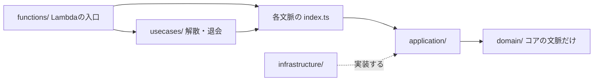

# 論点の記録: 文脈の中の層の分け方

- 機能名: code-layers
- 確認のページ: （まだ無い）
- 進み具合: docs/discussions/code-layers.progress.json

## 背景

ADR-0001とADR-0002で文脈とディレクトリの分け方は決めたが、文脈の中のコードの分け方は決めていない。実装をDevinに委譲する前に、ファイルの置き場所と依存してよい先を決めておく必要がある。2026-11-12に大関さんから「クリーンアーキテクチャとDDDの組み合わせで行くか」と聞かれ、文脈ごとに層の厚さを変える案を出した。

## 前提

- 書き込みは1つのDBトランザクションで、最初にグループの文脈のロックを取る（ADR-0002の決定3）。
- コアの文脈は参戦記録・チケット・グッズ（ADR-0001）。
- 実装は最初からDevinに委譲する（AGENTS.md）。

## 論点

### 文脈の中を、いくつの層に分けるか

<!-- id: layers-per-context -->

- 工程: 設計
- 種類: 設計
- 優先度: 高
- 状態: 決定
- なぜ今: Devinに渡す前に、ファイルの置き場所と依存の向きを決めないと、タスクごとに形がばらばらになる。ORMの選び方の前提にもなる。
- 根拠: ADR-0002の決定7（`src/contexts/<文脈>/`）、ADR-0001（コアの文脈）
- 選択肢:
  - A) コアの3文脈は3層（domain・application・infrastructure）、ほかの3文脈は2層（application・infrastructure）
    - 利点: コアの決まりをDBなしで試験でき、決まりの少ない文脈に中身のないクラスを作らずに済む
    - 欠点: 文脈によって形が違うので、Devinへの説明で文脈ごとに示す必要がある
  - B) 6つの文脈をすべて3層にする
    - 利点: 形がそろい、説明が1つで済む
    - 欠点: 公演カタログや通知に、中身のないクラスが並ぶ
  - C) すべての文脈を2層にし、公開関数に決まりとSQLを書く
    - 利点: ファイルが少なく、最初は速く書ける
    - 欠点: チケットの状態の移り方などをDBなしで試験できず、コアの決まりが散らばる
- 推奨: A（試験したいコアの決まりだけを分け、ほかは軽く保てる）
- 決定: A
- 推奨と同じか: 同じ
- 理由: 推奨のとおり
- 選ばなかった理由: B（公演カタログや通知に中身のないクラスが並ぶため）、C（チケットの状態の移り方などをDBなしで試験できず、コアの決まりが散らばるため）
- 反映先: docs/decisions/ADR-0003-layers-in-contexts.md の決定1
- 決めた日: 2026-11-17

