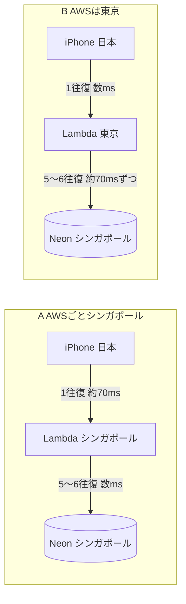

# 論点の記録: 工程6 費用の試算とリージョン

- 機能名: cost-and-region
- 確認のページ: https://claude.ai/artifact/Y8M6nQqf4KMBoH75RmHJtV
- 進み具合: docs/discussions/cost-and-region.progress.json

## 背景

設計の最後の工程で、AWSとNeonをどのリージョンに置くかと、月にいくらかかるかを決める。NeonとCognitoのリージョンは作ったあと変えられないので、Devinに土台を渡す前に決める。Neonには東京のリージョンが無く、近いのはシンガポールである。あわせて、まだ決めていないDBのバックアップの保持期間、AWSアカウントのプラン、費用と流量の上限を決める。ここで決めたことは、リージョンのADR（ADR-0006）とAWS構成（`docs/architecture.md`）の費用の節にまとめる。

## 前提

- 利用者は10人以下。1グループの公演は年に数十件、リマインドは月に数十件の見込み（PR/FAQ、データモデル）。
- Neonのリージョンは8つで、アジアはシンガポール（aws-ap-southeast-1）とシドニーだけ。東京（ap-northeast-1）は無い。リージョンはプロジェクトを作るときに決まり、あとで変えられない（https://neon.com/docs/introduction/regions ）。
- 東京とシンガポールのあいだの往復は約70ms（第三者の集計。測り方は書かれていない。https://www.economize.cloud/resources/aws/latency/ap-northeast-1-vs-ap-southeast-1/ ）。
- 書き込みのAPIは、1回の要求でLambdaとNeonのあいだを5〜6往復する（BEGIN、グループの行の`FOR SHARE`、読む、書く、読み直す、COMMIT。ADR-0002、ADR-0005）。往復の回数はLambdaとNeonの距離ごとにかかり、端末とAPIの距離は要求ごとに1回だけかかる。
- Neonの無料プランは、プロジェクトごとに月100 CU時間、容量0.5GBではなく1GB、外への転送は5GB。5分使わないと止まり、無料プランではこれを切れない。計算時間を使い切ると、次の月まで接続できなくなる（データは消えない）。履歴から戻せるのは6時間まで（1GBの変更まで）（https://neon.com/docs/introduction/free-tier 、https://neon.com/docs/introduction/restore-window ）。
- Neonの有料のLaunchプランは使った分だけ払う形で、計算は1 CU時間あたり0.106ドル、容量は1GB月あたり0.35ドル。履歴から戻せるのは既定1日、最大7日（https://neon.com/pricing ）。
- AWSの無料プラン（2025年7月からの新規アカウント）は、6か月かクレジットを使い切った時点で終わり、有料プランに移らないとアカウントが止まる。有料プランでも、常時無料の枠はそのまま使える（https://aws.amazon.com/free/free-tier-faqs/ ）。
- 常時無料の枠で確かめたもの。EventBridge Schedulerは月1,400万回まで無料（https://aws.amazon.com/eventbridge/pricing/ ）。Cognitoは月1万MAUまで無料で、期限が無い（https://aws.amazon.com/cognito/pricing/ ）。API Gateway HTTP APIの無料枠は、新規アカウントの12か月だけ月100万回（https://aws.amazon.com/api-gateway/pricing/ ）。東京とシンガポールの単価は、料金ページの本文からは読めなかったので、AWSの料金計算ツールで確かめる。
- ClaudeとDevinはAWSとNeonにつながない（AGENTS.mdの「コマンドの範囲」）。待ち時間を実際に測るときは、大関さんがMacで測る。測るスクリプトはClaudeが書いた（プロジェクトのファイルの`step6/measure-neon.mjs`）。シンガポールのNeonの試しのプロジェクトに、HTTPの問い合わせ、つなぎ直してのトランザクション、5分止まったあとの最初の書き込みを流し、AWSの東京とシンガポールの窓口への接続時間も測る。MacからNeonへの時間は、東京のLambdaからの時間の近い値として使う。
- 費用の試算（推測。シンガポールの単価はAWSの料金の一覧のデータで確かめた）。10人が1日に30回ずつ操作すると、API Gatewayは月に約9,000回で、1回あたり100万回1.25ドルの単価なら約0.01ドル。画像を300KBで200枚置くと、S3は1GB月0.025ドルの単価で約0.002ドル。Lambda（月100万回と40万GB秒）、Scheduler、SQS（月100万回）、Cognito、CloudWatch Logs（月5GB）、SSMの標準のパラメーター、外への転送（月100GB）は、無料の範囲に収まる。Neonの計算は、1日に20回起きて1回7分動くと、月に約70時間で、最小の大きさ（0.25 CU）なら約18 CU時間になり、無料の100 CU時間の2割に収まる。合わせて月に数円で、AWSのクレジットがあるあいだは0円になる。
- 費用が上限を超えるのは、5分より短い間隔でNeonを起こし続ける不具合があったときである。止まらずに動き続けると、0.25 CUでも月に約180 CU時間になり、無料の100 CU時間を超える。
- バックアップから戻すと、戻した時点より後に退会・解散で消したデータも戻る。消し終えた解散・退会の記録は最後の段で行ごと消すので（データモデルのR17）、何を消し直すかは記録からわからない。戻せる期間が長いほど、この消し直しの手間が増える。
- 途中で止まる・2回流れる・重なる流れ。この工程で処理の順番を決めるのは、バックアップの問いのBとDの案だけ。Dの毎日の写しは、書き終えてからS3に置くので、途中で止まっても半端な写しは残らない。2回流れても日時の名前で別の写しになり、保持期間で消える。マイグレーションと重なっても、`pg_dump`は1つの時点の写しを取る。Bの案では、写しを作ったあとでマイグレーションが止まったら、次のデプロイで同じ名前の写しを作り直す。2回流れたら、同じ名前の写しがあれば作らない。2本のデプロイが重なることは、GitHub Actionsの`concurrency`で止める（ADR-0004）。

## 論点

### AWSとNeonを、どのリージョンに置くか

<!-- id: region -->

- 工程: 設計
- 種類: 設計
- 優先度: 高
- 状態: 回答待ち
- なぜ今: NeonとCognitoのリージョンは作ったあと変えられない。Devinに土台（Terraform、Cognito）を渡す前に決める必要がある。どちらの案でもDBはシンガポールにあるので、個人の情報を国外に置くことは変わらない。違うのは待ち時間と、画像とCognitoを置く場所だけになる。
- 根拠: `docs/architecture.md`のC-2と「決めないこと」、`docs/discussions/aws-architecture.md`の「neon-region」、ADR-0004の決定5（状態ファイルのバケットが東京）
- 選択肢:
  - A) AWSもシンガポール（ap-southeast-1）に置く
    - 利点: 書き込み1回の待ちが、端末とAPIの1往復（約70ms）で済む
    - 欠点: 読むだけの軽い要求でも、毎回約70msかかる
  - B) AWSは東京のまま、Neonだけシンガポールに置く
    - 利点: 端末とAPIのあいだは速く、画像とCognitoは日本に置ける
    - 欠点: 書き込み1回で約350〜420ms待ちが増え、往復の多い処理ほど遅くなる
  - C) 決める前に、大関さんが手元から待ち時間を測る
    - 利点: 推測でなく、実際の数字で決められる
    - 欠点: Neonの試しのプロジェクトを作って測る手間がかかる。どちらの案でも往復の回数は変わらないので、結論は変わらない見込み
- 推奨: A（往復の回数が多いのはLambdaとNeonのあいだなので、そこを近くするほうが速い。DBが国外にあることはどちらの案でも同じ。測るなら、Aを選んだうえでCのスクリプトを流し、数字をADRに残す）

### DBを過去の時点に戻せる期間を、どれだけにするか

<!-- id: backup-retention -->

- 工程: 設計
- 種類: アプリの決まり
- 優先度: 高
- 状態: 回答待ち
- なぜ今: 退会の外部FAQに「DBのバックアップは保持期間が過ぎると消える」と書くと決めてあり、その期間が要る（データモデル「退会で消す範囲」）。期間でNeonのプランと費用が変わる。
- 根拠: `docs/data-model.md`の「決めないこと」、`docs/api.md`の「決めないこと」
- 選択肢:
  - A) Neonの無料プランのまま、6時間
    - 利点: 費用が0円のまま。退会した人のデータは6時間で戻せなくなり、FAQに短く書ける
    - 欠点: 壊れたことに6時間を過ぎて気づくと戻せない
  - B) Aに足して、デプロイの流れでマイグレーションの前にNeonの写し（ブランチ）を作り、同じデプロイの確かめが通ったら消す
    - 利点: マイグレーションでデータを壊したとき、その直前に戻せる
    - 欠点: デプロイの流れにNeonのAPIの鍵と手順が増える。確かめが通ったあとに見つかった壊れには役に立たない
  - C) NeonのLaunchプランにして、7日
    - 利点: 1週間以内に気づけば戻せる
    - 欠点: 計算の費用が月に約2ドルかかり（推測）、退会した人のデータが7日残るとFAQに書くことになる
  - D) Aに足して、GitHub Actionsで毎日`pg_dump`の写しをS3に置き、7日で消す
    - 利点: 無料のまま、1週間以内に気づけば前の日の状態に戻せる
    - 欠点: 退会した人のデータが7日残り、写しから戻したら消した人を手で探して消し直すことになる
- 推奨: A（10人の招待制で、壊したときは6時間以内に気づける見込み。マイグレーションは試験とE2Eを通してから流す）

### AWSアカウントを、無料プランと有料プランのどちらで作るか

<!-- id: aws-plan -->

- 工程: 設計
- 種類: 設計
- 優先度: 高
- 状態: 回答待ち
- なぜ今: PR/FAQの内部FAQに「工程6の前に決めます」とあり、まだ決めていない。無料プランは6か月で終わり、そのとき有料プランに移らないとアカウントが止まる。
- 根拠: `docs/prfaq.md`の内部FAQ「AWSアカウントはどうするか」
- 選択肢:
  - A) 最初から有料プランで作り、AWS Budgetsで月5ドルを超えそうなときにメールで知らせる
    - 利点: 6か月後に止まる心配が無く、使えるサービスの制限も無い
    - 欠点: 常時無料の枠を超えた分は、すぐに請求される
  - B) 無料プランで作り、6か月以内に有料プランへ移す
    - 利点: クレジット（最大200ドル）で、初めの半年の少額の料金がかからない
    - 欠点: 移し忘れるとアカウントが止まり、リマインドも止まる。無料プランで使えるサービスの範囲を確かめる手間がある
- 推奨: A（費用は月に数十円の見込みで、クレジットの得より、止まらないことを優先する）

### 費用と計算時間の見張りをどうするか

<!-- id: cost-alerts -->

- 工程: 設計
- 種類: 設計
- 優先度: 中
- 状態: 仮決定
- なぜ今: AWS構成の「決めないこと」に、Neonの計算時間の残りと費用の通知が残っている。Neonの計算時間を使い切ると次の月までDBにつながらず、リマインドも届かない。
- 根拠: `docs/architecture.md`の「決めないこと」
- 選択肢:
  - A) AWS Budgetsで月の予算を1つ作り、実績と予測の両方でメールを送る。Neonは使った量を月に1回コンソールで見る
    - 利点: 通知だけの予算は無料で（https://aws.amazon.com/aws-cost-management/aws-budgets/pricing ）、設定はTerraformで書ける
    - 欠点: Neonの計算時間が急に増えても、すぐには気づかない
  - B) Aに足して、Neonの使った量をAPIで読んで、50%を超えたら知らせる関数を作る
    - 利点: Neonが止まる前に気づける
    - 欠点: 定期に動く関数が1つ増え、Neonの鍵の置き場所も増える
- 推奨: A（見込みは上限の2割以下で、超えそうになるのは使い方が変わったときだけ）

### API Gatewayの流量の上限をいくつにするか

<!-- id: api-throttle -->

- 工程: 設計
- 種類: 設計
- 優先度: 中
- 状態: 仮決定
- なぜ今: ADR-0005の「この決定では決めないこと」に残っている。画面の不具合で要求が止まらなくなったとき、費用とNeonの計算時間が増え続けるのを防ぐ。
- 根拠: ADR-0005「この決定では決めないこと」
- 選択肢:
  - A) ステージの既定を、毎秒20回、瞬間40回にする
    - 利点: 10人が同時に画面を開いても届かず、暴走は止められる
    - 欠点: 値は推測で、E2Eを並べて流すと当たることがある
  - B) 上限を置かない（AWSの既定のまま）
    - 利点: 設定が要らない
    - 欠点: 暴走したとき、費用で気づくまで止まらない
- 推奨: A（利用者の数から見て十分に大きく、暴走だけを止められる）

### Terraformの状態ファイルのバケットを、どのリージョンに置くか

<!-- id: state-bucket-region -->

- 工程: 設計
- 種類: 設計
- 優先度: 中
- 状態: 仮決定
- なぜ今: ADR-0004の決定5で東京に置くと書いた。リージョンの問いでシンガポールを選ぶと、ほかの資源と分かれる。
- 根拠: ADR-0004の決定5
- 選択肢:
  - A) ほかのAWSの資源と同じリージョンに置く
    - 利点: リージョンが1つで済み、Terraformの設定が単純になる
    - 欠点: ADR-0004の書き方を直す
  - B) 東京のまま置く
    - 利点: ADR-0004を直さずに済む
    - 欠点: リージョンが2つになり、権限と設定が増える
- 推奨: A（リージョンを1つにそろえると、Devinに渡す設定が単純になる）
