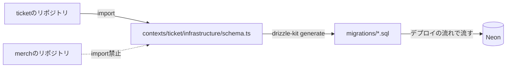

# 論点の記録: 工程4 開発の道具

- 機能名: dev-tools
- 確認のページ: https://claude.ai/artifact/AcBYH3AUQLTSmjMKQKPNmJ
- 進み具合: docs/discussions/dev-tools.progress.json

## 背景

工程3でデータモデルとLambdaの分け方を、ADR-0003で文脈の中の層の分け方を決めた。実装は最初からDevinに委譲するので、言語、DBの道具、マイグレーション、Neonへの接続、IaC、境目の検査、画面の道具を、委譲の前に決め切る必要がある（AGENTS.md「進め方の決まり」）。ここで決めた道具を、ADR-0004にまとめる。

## 前提

- Lambdaは`api`・`erasure-worker`・`notification-sender`の3つで、どれも呼ばれたときだけ動き、Neonにはその都度つなぐ（ADR-0002の決定5、`docs/architecture.md`のA-1）。
- 書き込みは1つのトランザクションで、最初にグループの文脈の行を`FOR SHARE`でロックし、結果を見て続きを決める。HTTPで1回ずつ送る接続は使わない（ADR-0002の決定3、`docs/data-model.md`）。
- スキーマは文脈ごとに6つ。複合外部キー、部分一意インデックス（NULLS NOT DISTINCT）を使う（`docs/data-model.md`）。
- 画面はCloudFrontとS3に置くPWAで、Web PushをiPhoneのホーム画面のPWAで受ける（`docs/architecture.md`のB-1）。
- migrationはデプロイの流れに入れ、手で流す手順は作らない。E2Eは2人をブラウザのcontext 2つで動かす（AGENTS.md）。
- 境目の検査は、文脈の外から`index.ts`以外をimportしないことと、`domain/`が外部のライブラリ・DB・AWSのSDKをimportしないことの2つ（ADR-0003の決定5）。

## 論点

### LambdaとPWAを、どの言語で書くか

<!-- id: language -->

- 工程: 設計
- 種類: 設計
- 優先度: 高
- 状態: 決定
- なぜ今: ORM、IaC、境目の検査の道具は、言語で候補が変わる。Devinに渡すタスクの書き方も決まらない。
- 根拠: AGENTS.md「採用スタック」、`.claude/rules/coding-standards.md`（TypeScriptを採るときの規約がすでにある）
- 選択肢:
  - A) LambdaもPWAもTypeScript（Node.js）
    - 利点: 画面とAPIで型を共有でき、ORM・IaC・検査の道具を1つの言語でそろえられる
    - 欠点: 型の設定とビルドの手間がかかる
  - B) LambdaはPython、PWAはTypeScript
    - 利点: Lambdaの起動が軽く、書く量が少ない
    - 欠点: 画面とAPIで型を共有できず、道具が2系統になる
  - C) LambdaはGo、PWAはTypeScript
    - 利点: Lambdaの起動が最も速く、型も強い
    - 欠点: 道具が2系統になり、ORMとIaCの選択肢が減る
- 推奨: A（画面とAPIで型をそろえられ、コーディング規約もすでにTypeScriptで書いてあるため）
- 決定: A
- 推奨と同じか: 同じ
- 理由: 推奨のとおり
- 選ばなかった理由: B（画面とAPIで型を共有できず、道具が2系統になるため）、C（道具が2系統になり、ORMとIaCの候補が減るため）
- 反映先: docs/decisions/ADR-0004-dev-tools.mdの決定1
- 決めた日: 2026-11-17

### DBを読み書きする道具に、何を使うか

<!-- id: db-library -->

- 工程: 設計
- 種類: 設計
- 優先度: 高
- 状態: 決定
- なぜ今: 公開関数とリポジトリの書き方、マイグレーションの道具、Neonへの接続の道具がこれで決まる。
- 根拠: ADR-0002の決定1〜3（文脈ごとのスキーマ、複合外部キー、`FOR SHARE`のロック）
- 選択肢:
  - A) Drizzle ORM（スキーマをTypeScriptで書き、drizzle-kitでSQLのマイグレーションを作る）
    - 利点: `pgSchema`で文脈ごとのスキーマを書け、`FOR SHARE`も部分一意インデックスもSQLを手で書かずに表せる
    - 欠点: マイグレーションの自動生成が意図どおりかを、毎回SQLで読む必要がある
  - B) Kysely（SQLに近いクエリビルダー。型はDBから生成する）
    - 利点: SQLとほぼ同じに書け、ロックも細かく書ける
    - 欠点: マイグレーションを別に手で書き、型の生成に動いているDBが要る
  - C) Prisma 7
    - 利点: 情報が多く、Devinも慣れている見込みが高い
    - 欠点: `FOR SHARE`はクエリの書き方に無くSQLを手で書くことになり、スキーマが1つのファイルにまとまって文脈ごとに分けにくい
- 推奨: A（文脈ごとのスキーマとロックを型つきで書け、テーブルがTypeScriptの値なので、ほかの文脈のテーブルを読むとimportの検査で止まる）
- 決定: A
- 推奨と同じか: 同じ
- 理由: 推奨のとおり
- 選ばなかった理由: B（マイグレーションを別に手で書き、型の生成に動いているDBが要るため）、C（`FOR SHARE`をSQLで手書きすることになり、スキーマを文脈ごとに分けにくいため）
- 反映先: docs/decisions/ADR-0004-dev-tools.mdの決定2
- 決めた日: 2026-11-17

### マイグレーションを、デプロイのどこで流すか

<!-- id: migration-timing -->

- 工程: 設計
- 種類: 設計
- 優先度: 高
- 状態: 決定
- なぜ今: デプロイの流れ（CI）を誰が何の権限で動かすかが決まり、土台をDevinに渡すときの作業が変わる。
- 根拠: AGENTS.md「migrationはデプロイの流れに入れる」、`docs/architecture.md`のC-1（接続文字列はSSM Parameter Store）
- 選択肢:
  - A) GitHub Actionsのデプロイの仕事で、先にマイグレーションを流し、続けてIaCでLambdaを更新する
    - 利点: 流れが1本で読みやすく、マイグレーションが失敗したらLambdaを更新しない
    - 欠点: GitHub ActionsがNeonの接続文字列を読めるようにする必要がある
  - B) IaCのデプロイの中で、マイグレーション用のLambdaを1回動かす
    - 利点: 接続文字列をSSMの外に出さずに済む
    - 欠点: Lambdaが1つ増え、失敗したときのログを追う場所が2つになる
  - C) `api`のLambdaが起動したときに流す
    - 利点: 仕組みがいちばん少ない
    - 欠点: 同時に起動すると重ねて流れ、要求の途中で表が変わる
- 推奨: A（失敗したら止まる順番が1本で見え、AWSにはGitHubのOIDCで入れるので長期の鍵を置かずに済む）
- 決定: A
- 推奨と同じか: 同じ
- 理由: 推奨のとおり
- 選ばなかった理由: B（Lambdaが1つ増え、失敗したときのログを追う場所が2つになるため）、C（同時に起動すると重ねて流れ、要求の途中で表が変わるため）
- 反映先: docs/decisions/ADR-0004-dev-tools.mdの決定3
- 決めた日: 2026-11-17

### 古い時刻のマイグレーションが飛ばされるのを、どう防ぐか

<!-- id: migration-order -->

- 工程: 設計
- 種類: 設計
- 優先度: 高
- 状態: 決定
- なぜ今: ADR-0004を承認する前のレビューで、`drizzle-kit migrate`がDBに記録された最後の時刻より古いファイルをエラーなしで飛ばすとわかった。AGENTS.mdはDevinに並行でタスクを渡すので、2つのPRがそれぞれマイグレーションを作ると起こる。tomotabiの「本番にmigrationが流れなかった」と同じ型である。
- 根拠: drizzle-orm 0.45.4の`pg-core/dialect`の`migrate`（DBの最後の`created_at`より大きい`folderMillis`だけを流す）、drizzle-kit 0.31.11の`check`（同じ1つ前の版から作られたマイグレーションは失敗、時刻の乱れは警告だけ）、ADR-0004の決定3
- 選択肢:
  - A) スキーマに触るタスクは、同時に1本だけ渡す
    - 利点: 検査が要らない
    - 欠点: 並行で渡せるタスクが減る。守られなかったときに気づく仕組みが無い
  - B) PRのマージの前に`main`の上でマイグレーションを作り直し、PRのCIとデプロイの手順2で時刻の並びを確かめる
    - 利点: 並行で渡せる。すり抜けてもデプロイの手順2で止まる
    - 欠点: CIとデプロイに小さな検査を書く。作り直しを忘れたPRはCIで落ちて手戻りになる
  - C) マイグレーションの時刻を、作った時刻でなく連番にする
    - 利点: 並びが読みやすい
    - 欠点: drizzle-kitの作るファイルを手で直すことになり、連番がぶつかったときに同じ問題が残る
- 推奨: B（並行の委譲を減らさずに済み、すり抜けたときも本番に流す前に止まるため）
- 決定: B
- 推奨と同じか: 同じ
- 理由: 推奨のとおり。2026-11-21に大関が承認したのは「決まりを足す」ことで、A〜Cからの選択は推奨のBで進めた。Bでよいかは、このPRのマージで承認する
- 選ばなかった理由: A（並行で渡せるタスクが減り、守られなかったときに気づけないため）、C（drizzle-kitのファイルを手で直すことになり、ぶつかったときに同じ問題が残るため）
- 反映先: docs/decisions/ADR-0004-dev-tools.mdの決定3
- 決めた日: 2026-11-21

### LambdaからNeonへ、どの方式でつなぐか

<!-- id: neon-connection -->

- 工程: 設計
- 種類: 設計
- 優先度: 高
- 状態: 決定
- なぜ今: 途中で判断を挟めるトランザクションが使えることが条件で、DBの道具とのつなぎ方もこれで決まる。
- 根拠: `docs/data-model.md`（HTTPで1回ずつ送る方式は使わない）、Neonの文書（https://neon.com/docs/connect/choose-connection 、https://neon.com/docs/serverless/serverless-driver）
- 選択肢:
  - A) Neonのサーバーレスドライバー（`@neondatabase/serverless`）のPoolを、WebSocketでつなぐ
    - 利点: Neonはサーバーレスの環境にこのドライバーを勧めており、TCPより接続までの往復が少ない
    - 欠点: Neonに専用のドライバーなので、ほかのPostgresに移るときは差し替えが要る
  - B) 普通のPostgresのドライバー（`pg`）でTCPにつなぐ
    - 利点: どのPostgresでも同じに動き、情報が多い
    - 欠点: 毎回つなぐ使い方では、接続までの往復が多い（Neonの文書ではTCPがおよそ8往復）
- 推奨: A（毎回つなぐ使い方では接続の往復が効いてくる。Drizzleにもこのドライバー用のつなぎ方がある）
- 決定: A
- 推奨と同じか: 同じ
- 理由: 推奨のとおり
- 選ばなかった理由: B（毎回つなぐ使い方では、接続までの往復が多いため）
- 反映先: docs/decisions/ADR-0004-dev-tools.mdの決定4
- 決めた日: 2026-11-17

### IaCの道具に、何を使うか

<!-- id: iac-tool -->

- 工程: 設計
- 種類: 設計
- 優先度: 高
- 状態: 決定
- なぜ今: 土台（Lambda、API Gateway、Cognito、Scheduler、S3、CloudFront）をDevinに渡す前に、書く道具を決める必要がある。
- 根拠: `docs/architecture.md`「この構成で決めないこと」、`docs/discussions/aws-architecture.md`（IaCで書く範囲）
- 選択肢:
  - A) AWS CDK（TypeScript）
    - 利点: AWSの公式で、アプリと同じ言語で書け、Lambdaのビルドも任せられる
    - 欠点: 裏でCloudFormationが動くので、失敗したときの巻き戻しが遅い
  - B) SST
    - 利点: Lambdaを手元で動かしながら開発でき、設定が短い
    - 欠点: 抽象が厚く、AWSの資源をそのまま見せたいポートフォリオには向きにくい
  - C) Terraform
    - 利点: AWSの外（Neon）も同じ道具で書ける
    - 欠点: 言語がHCLで、状態ファイルの置き場所を自分で用意する
- 推奨: A（アプリと同じTypeScriptで書け、AWSの資源の形がそのまま残る）
- 決定: C
- 推奨と同じか: 違う
- 理由: 理由は聞いていない（2026-11-17に聞いている）
- 選ばなかった理由: A（理由は聞いていない）、B（抽象が厚く、AWSの資源の形が見えにくいため）
- 反映先: docs/decisions/ADR-0004-dev-tools.mdの決定5
- 決めた日: 2026-11-17

### 文脈の境目の検査に、何を使うか

<!-- id: boundary-check -->

- 工程: 設計
- 種類: 設計
- 優先度: 高
- 状態: 決定
- なぜ今: ADR-0003で決めた2つの検査を、CIでどう書くかが決まる。
- 根拠: ADR-0003の決定5
- 選択肢:
  - A) ESLintのプラグイン（eslint-plugin-boundaries）
    - 利点: lintと同じ場所で止まり、Devinも書いている途中に気づける
    - 欠点: lintの道具をESLintに決めることになる
  - B) dependency-cruiser
    - 利点: lintの道具に関係なく使え、依存の図も出せる
    - 欠点: 道具が1つ増え、エディタでは気づけない
- 推奨: A（Devinが書いている途中で止まり、CIでもlintと一緒に動く）
- 決定: A
- 推奨と同じか: 同じ
- 理由: 推奨のとおり
- 選ばなかった理由: B（道具が1つ増え、エディタでは気づけないため）
- 反映先: docs/decisions/ADR-0004-dev-tools.mdの決定6
- 決めた日: 2026-11-17

### PWAの画面を、何で作るか

<!-- id: web-framework -->

- 工程: 設計
- 種類: 設計
- 優先度: 高
- 状態: 決定
- なぜ今: 最初の1本（登録からリマインドがiPhoneに届くまで）で画面を作るので、委譲の前に決める必要がある。
- 根拠: `docs/architecture.md`のB-1（画面はCloudFrontとS3に置く静的なファイル）、AGENTS.md「進め方の決まり」（Web PushはiPhoneのPWAで確かめる）
- 選択肢:
  - A) React＋Vite（PWAのService Workerはvite-plugin-pwaで作る）
    - 利点: 静的なファイルだけを出せ、情報とDevinの慣れが最も多い
    - 欠点: 画面の移り方やデータの取り方の道具を、別に選ぶ必要がある
  - B) Next.js（静的に書き出す）
    - 利点: 画面の移り方が最初から決まっている
    - 欠点: サーバーで動く機能の多くが使えず、静的に書き出す制約に気を配る必要がある
  - C) SvelteKit（静的に書き出す）
    - 利点: 書く量が少なく、軽い
    - 欠点: 情報とDevinの慣れがReactより少ない
- 推奨: A（S3に置く静的なファイルで足り、Web Push用のService Workerを自分で書ける）
- 決定: A
- 推奨と同じか: 同じ
- 理由: 推奨のとおり
- 選ばなかった理由: B（サーバーで動く機能の多くが使えず、静的に書き出す制約に気を配る必要があるため）、C（情報とDevinの慣れがReactより少ないため）
- 反映先: docs/decisions/ADR-0004-dev-tools.mdの決定7
- 決めた日: 2026-11-17

### 細かい道具を、推奨のまま決めてよいか

<!-- id: small-tools -->

- 工程: 設計
- 種類: 設計
- 優先度: 中
- 状態: 決定
- なぜ今: Devinに渡す土台のタスクで、パッケージの管理・試験・lintの道具が要る。
- 根拠: AGENTS.md（E2Eは2人をブラウザのcontext 2つで動かす）、`.claude/rules/coding-standards.md`（試験は`tests/`に置く）
- 選択肢:
  - A) pnpm（workspace）、Vitest、Playwright、ESLintとPrettier、GitHub Actions、LambdaはNode.jsのLTSのうちLambdaで使える最新のもの
    - 利点: どれも広く使われ、Devinが迷わない
    - 欠点: Biomeなど速い道具より、lintが遅い
  - B) npm、Jest、Playwright、Biome、GitHub Actions
    - 利点: 道具の数が少ない
    - 欠点: BiomeではA案の境目の検査（ESLintのプラグイン）が使えない
- 推奨: A（境目の検査をESLintで書け、Playwrightで2人のブラウザを1つの試験で動かせる）
- 決定: A
- 推奨と同じか: 同じ
- 理由: 推奨のとおり（仮決定に異議なし）。2026-11-21に、PR #8の論点の記録`tooling.md`にだけあった仮決定2つ（結合試験のDBはGitHub ActionsのPostgresのコンテナ、APIの入口はHonoとZod）も、大関の判断でここに加えた。`tooling.md`は消した
- 選ばなかった理由: B（BiomeではESLintのプラグインによる境目の検査が使えないため）
- 反映先: docs/decisions/ADR-0004-dev-tools.mdの決定8
- 決めた日: 2026-11-17

### Neonの接続文字列を入れるSSMの置き場所を、Terraformで作るか

<!-- id: ssm-in-terraform -->

- 工程: 設計
- 種類: 設計
- 優先度: 高
- 状態: 決定
- なぜ今: PR #9のDevin Reviewが、Terraformで置き場所を作ると接続文字列が状態ファイルに平文で残ると指摘した。CodexもPR #9で、置き場所が最初のマイグレーションより後に作られる順番の問題を指摘した。
- 根拠: ADR-0004の決定5、`docs/architecture.md`のC-1
- 選択肢:
  - A) Terraformでは作らない
    - 利点: 値が状態ファイルに一度も入らない
    - 欠点: 置き場所の名前を、Terraformと準備用のスクリプトの2か所で合わせる
  - B) Terraformで作り、状態ファイルのバケットを読める人を絞る
    - 利点: 置き場所もコードで管理できる
    - 欠点: 値が状態ファイルに平文で残る
- 推奨: A（置き場所は数が少なく変えることもまれなので、コードで持つ利点が小さい）
- 決定: A
- 推奨と同じか: 同じ
- 理由: 推奨のとおり
- 選ばなかった理由: B（値が状態ファイルに平文で残るため）
- 反映先: docs/decisions/ADR-0004-dev-tools.mdの決定3と決定5
- 決めた日: 2026-11-17

### 古い本番の承認待ちをどう扱うか

<!-- id: production-deploy-serialization -->

- 工程: 設計
- 種類: 設計
- 優先度: 高
- 状態: 決定
- なぜ今: 2回続けてマージすると、結合検証で動く版は新しい版に入れ替わる。本番の承認画面にどの版を残すか決める。
- 根拠: [オーナーの判断](https://github.com/oze-xxbumpxx/yoin/pull/40#discussion_r4681098816)、[GitHub Actionsの同時実行の仕様](https://docs.github.com/en/actions/how-tos/write-workflows/choose-when-workflows-run/control-workflow-concurrency)
- 選択肢:
  - A) 承認待ちを全部残し、承認後にS3の専用キーで順番を取る。
  - B) 本番の変更を1本ずつ進め、古い承認待ちはオーナーが断る。
- 推奨: B
- 決定: B。本番のジョブにだけ同時実行グループをかけ、進行中の変更は取り消さない。承認後、本番の権限を取る前に、結合検証に最後に配置して成功したSHAと照合し、不一致か取得できない場合は止める。最後に本番に出たSHAより古い場合も止める。承認は成果物がそろった最初の実デプロイで確かめる。
- 推奨と同じか: 同じ
- 理由: 承認した版が結合検証に最後に配置できた版と違う場合は、本番に出さない。本番の順番を取るためにAWSの設定を足さなくてよい。承認待ちのジョブが枠を持ち続ける動きは[GitHubの利用者報告 #17401](https://github.com/orgs/community/discussions/17401)にあり、公式文書には載っていない。
- 選ばなかった理由: S3のロックは、2回続けてマージすると結合検証が新しい版に上書きされ、古い承認待ちのSHAを結合検証で確かめられないうえ、1人で承認する間は要らない。承認だけの試行は、試行用の分岐が残り、実デプロイで使う本番の権限を確かめられない。
- 反映先: [ADR-0004の2026-11-24の追記](../decisions/ADR-0004-dev-tools.md#2026-11-24の追記)、#39
- 決めた日: 2026-11-24
- 前の決定: [新しい実行で古い承認待ちを置き換える](https://github.com/oze-xxbumpxx/yoin/pull/40#issuecomment-7132905362)。

### 初回用Terraformの状態をどこに置くか

<!-- id: terraform-bootstrap-state -->

- 工程: 設計
- 優先度: 高
- 状態: 決定
- 根拠: [オーナーの判断](https://github.com/oze-xxbumpxx/yoin/pull/40#issuecomment-7132905362)
- 決定: その他: 初回用Terraformの状態は手元で作り、作成したS3の別のキーへ`terraform init -migrate-state`で移す。
- 選ばなかった理由: 初回用の状態を手元だけに残す案は採用しない。
- 反映先: #35
- 決めた日: 2026-11-24

### 土台のIssueをいつ作るか

<!-- id: foundation-issue-planning-order -->

- 工程: 実装
- 優先度: 高
- 状態: 決定
- 根拠: [オーナーの判断](https://github.com/oze-xxbumpxx/yoin/pull/40#issuecomment-7132905362)
- 決定: その他: 実装計画と試験計画を先に書き、マージ後に計画から土台のIssueを作り直す。
- 選ばなかった理由: 先に作ったIssueを計画の代わりにせず、計画を土台のIssueのもとにする。
- 反映先: #34
- 決めた日: 2026-11-24

### 監視とアラートを、どこまで置くか

<!-- id: monitoring -->

- 工程: 運用
- 優先度: 低
- 状態: 取り下げ
- なぜ今: `erasure_jobs`の失敗やリマインドの送信失敗を、誰がどう知るかを決める必要がある。費用の試算と一緒に工程6で決める予定だった。
- 根拠: `docs/architecture.md`「この構成で決めないこと」
- 理由: 2026-11-21に、`docs/discussions/aws-architecture.md`の論点「failure-alerts」で決めた
