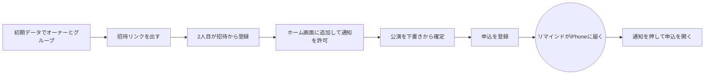

# 論点の記録: 最初の1本（登録からリマインドがiPhoneに届くまで）

- 機能名: first-slice
- 確認のページ: https://claude.ai/artifact/6hN723fZxgmnP59cujyHr8
- 進み具合: docs/discussions/first-slice.progress.json

## 背景

設計の工程1〜6が確定したので、最初の実装に入る。最初の1本は、招待リンクから登録し、グループで公演と申込を登録して、申込の期限のリマインドがホーム画面に追加したiPhoneにWeb Pushで届くまでを通す。本番と同じ構成の環境で動かし、実装はDevinに渡す。要件定義書の前に、作る範囲・ログインの方式・環境の分け方と、画面の見た目の方向を決める。見た目は、答えを受けて見本の画面を2〜3枚作って見てもらい、色の値と部品の決まりにしてからDevinに渡す。

## 前提

- 使う人は10人以下の招待制（PR/FAQ）。最初のオーナーとグループは、APIでなくデプロイの流れの初期データで作る（ADR-0005）。
- 画面は23あり、移り方と呼ぶAPIは`docs/api.md`で決まっている。見た目（色・配置・文言）、ログインの方式、画面の移り方とデータの取り方の道具は、この機能で決めることになっている（`docs/api.md`、ADR-0004、ADR-0005）。
- iPhoneでWeb Pushを受けられるのは、ホーム画面に追加したWebアプリだけ（ユーザーストーリーN-01）。通知の中身はDeclarative Web Pushの形にする（AWS構成のC-5）。
- iPhoneのホーム画面に追加したWebアプリは、Safariとログインの状態（Cookieや保存領域）を分けて持つ（https://bugs.webkit.org/show_bug.cgi?id=181849 ）。Safariで招待リンクから登録しても、ホーム画面から開くともう一度ログインが要る。
- パスキーは使わない（2026-11-21、大関さん）。Cognitoのメールに届くコードでのログインは、Essentialsのプランの機能で、Essentialsも月1万MAUまで無料（https://docs.aws.amazon.com/cognito/latest/developerguide/cognito-user-pool-settings-advanced-security-access-token.html 、https://aws.amazon.com/cognito/pricing/ ）。Cognitoが自分で送るメールは1日の通数に上限があるので、使う通数は設計で確かめる。
- Web Pushの通知は、ログインが切れていても届く。通知を押して申込を開くときにログインが要る。
- ClaudeとDevinはAWSとNeonにつながない（AGENTS.mdの「コマンドの範囲」）。結合検証の環境で動かして確かめるのは大関さんになる。
- 途中で止まる・2回流れる・重なる流れ。リマインドの予約・送信・取り消しの順番は、データモデル（R11、「リマインドの送り方」）で決まっていて、この回の問いでは変えない。この回で順番に関わるのは、環境を分ける問い（デプロイとマイグレーションを、どの環境で先に流すか）だけ。2本のデプロイの重なりは、環境ごとのGitHub Actionsの`concurrency`で止める（ADR-0004）。

## 論点

### 最初の1本で、どのストーリーまで作るか

<!-- id: scope -->

- 工程: 要件
- 種類: 設計
- 優先度: 高
- 状態: 回答待ち
- なぜ今: 作る範囲で、要件定義書の機能の一覧、Devinに渡すタスクの数、E2Eの流れが決まる。
- 根拠: AGENTS.mdの「進め方の決まり」（登録からリマインドがiPhoneに届くまでを1本で通す）、`docs/user-stories.md`
- 選択肢:
  - A) 流れに要るものだけ作る。招待リンクの発行と参加（G-01・G-02）、単発の公演を下書きから確定（C-02・C-03）、公演を見る（C-07）、申込の登録と状態を進める（T-01・T-02）、3種類のリマインド（T-03）、通知先の登録・届かない帯・通知から申込を開く（N-01〜N-03）
    - 利点: 1本の流れを早く本番と同じ環境で通せて、残りのストーリーは同じ形で足せる
    - 欠点: グループの切り替えやツアーのまとめ登録が無いので、仲間に試しに使ってもらうにはまだ足りない
  - B) Aに、グループを作る・切り替える（G-03・G-04）、ツアーのまとめ登録（C-01）、通知先を外す（N-04）を足す
    - 利点: いつもの仲間に試しに使ってもらえる形に近づく
    - 欠点: 画面が4つ増え、最初の委譲が大きくなって、土台の不具合と画面の不具合が混ざる
  - C) Aからさらに減らし、招待を使わずに初期データで2人を作る。リマインドは結果発表の1種類だけにする
    - 利点: Web Pushが届くまでを最も早く確かめられる
    - 欠点: 招待からの登録とiPhoneでのログインのやり直しという、一番つまずきやすい流れを後に回すことになる
- 推奨: A（iPhoneでのログインのやり直しと3種類のリマインドという一番危ない所を最初に通しつつ、画面を増やしすぎない）

### ログインの方式と、ログインの画面をどこに置くか

<!-- id: login -->

- 工程: 要件
- 種類: 画面
- 優先度: 高
- 状態: 回答待ち
- なぜ今: 招待リンクからの登録（G-01）の流れと、Cognitoの設定とプランが決まる。工程5から、この機能の要件に回していた。
- 根拠: `docs/discussions/api-design.md`の「ログインの方式」、`docs/api.md`のS-01、上の前提（ホーム画面のWebアプリはSafariとログインを分ける）
- 選択肢:
  - A) メールとパスワード。ログインの画面はCognitoが出す画面を使う
    - 利点: 画面を作らずに済み、Cognitoの無料の基本のプランで足りる
    - 欠点: Safariとホーム画面で2回ログインするときにパスワードを覚えている必要があり、画面がyoinの見た目と揃わない
  - B) メールに届くコード。ログインの画面はyoinの中に自分で作る
    - 利点: パスワードを持たずに済み、ホーム画面でのログインのやり直しもコードを入れるだけで、画面もyoinの見た目に揃う
    - 欠点: ログインの画面を自分で作る手間があり、CognitoはEssentialsのプランにする（月1万MAUまでは無料）
  - C) メールに届くコード。ログインの画面はCognitoが出す画面を使う
    - 利点: パスワードを持たずに済み、画面を作る手間も無い
    - 欠点: ホーム画面のWebアプリからCognitoのドメインへ移って戻る動きを、iPhoneで確かめる必要があり、見た目も揃わない
- 推奨: B（iPhoneではSafariとホーム画面で2回ログインするので、コードを入れるだけで済む方が招待された人がつまずかない）

### 結合検証の環境を、本番と別に作るか

<!-- id: environments -->

- 工程: 要件
- 種類: 設計
- 優先度: 高
- 状態: 回答待ち
- なぜ今: 環境の数で、Terraformの組み方、デプロイの流れ、初期データの作り方、Neonのプロジェクトの数が変わり、Devinに渡す土台のタスクが決まる。
- 根拠: AGENTS.md（最初の1本は本番と同じ構成の環境で動かす、結合検証の環境で見る項目には要るデータと作る人を書く）、ADR-0004（デプロイは環境ごとに1本ずつ）、ADR-0006（費用は月数円）
- 選択肢:
  - A) 結合検証と本番の2つを、同じTerraformで作る。マージしたらまず結合検証に出し、確かめてから本番に出す。NeonはDBのプロジェクトを分ける
    - 利点: マイグレーションを本番の前に1回流して確かめられ、プレリリースのあとに本番のデータを試しの操作で汚さない
    - 欠点: Cognito・通知の鍵・初期データが2組になり、最初の委譲で作るものが増える
  - B) 最初の1本は本番の環境1つだけ作り、プレリリースまでは本番を結合検証として使う。結合検証の環境はプレリリースの前に足す
    - 利点: 最初の委譲が小さく、早く1本を通せる
    - 欠点: あとから環境を足すときにTerraformとデプロイの流れを組み直すことになり、そのときの不具合はプレリリースの直前に出る
- 推奨: A（あとから環境を足すと、デプロイの流れの組み直しがプレリリースの直前に来る。費用は2つでも月数円の見込み）

### iPhoneで、登録とホーム画面への追加をどの順に案内するか

<!-- id: iphone-onboarding-order -->

- 工程: 要件
- 種類: 画面
- 優先度: 高
- 状態: 回答待ち
- なぜ今: 招待された人が最初に見る流れで、招待の画面（S-02）と初回の案内（S-03）の中身が決まる。ホーム画面のWebアプリはSafariとログインを分けるので、どちらかで2回目のログインが要る。
- 根拠: 上の前提、ユーザーストーリーG-01・N-01、`docs/api.md`のS-02・S-03
- 選択肢:
  - A) Safariで招待リンクを開き、ログインして参加まで済ませる。そのあと「ホーム画面に追加して、そこから開いてください」と案内し、ホーム画面から開いたらもう一度ログインして通知を許可する
    - 利点: 参加はリンクを開いたその場で終わるので、ホーム画面への追加でつまずいても、グループには入れている
    - 欠点: ログインが2回になる
  - B) 招待リンクを開いたら、先にホーム画面への追加を案内する。ホーム画面から開き直してから、ログインと参加をする
    - 利点: ログインが1回で済む
    - 欠点: ホーム画面に追加したときに招待リンクのURLが引き継がれるかをiPhoneで確かめていない（推測では引き継がれない場合がある）。引き継がれないと、招待リンクを開き直す手間が増える
- 推奨: A（ホーム画面への追加は手順が多くつまずきやすいので、その前に参加を終えておく。2回目のログインはメールのコードなら短い）

### ロック画面のリマインドに、公演名と受付名を出すか

<!-- id: push-content -->

- 工程: 要件
- 種類: 画面
- 優先度: 高
- 状態: 回答待ち
- なぜ今: 通知の中身（Declarative Web Pushの`title`と`body`）を、送る関数の要件に書く。iPhoneのロック画面には、通知の文がそのまま出る。
- 根拠: ユーザーストーリーT-03、AWS構成のC-5、データモデルの`notification.reminders`
- 選択肢:
  - A) 公演名・受付名・期限を出す（例「入金期限は明日21:00 / 〇〇ツアー 東京公演 FC先行」）
    - 利点: 通知を開かなくても、何をいつまでにすればよいかが分かる
    - 欠点: ロック画面を見た人に、どの公演のチケットを申し込んだかが見える
  - B) 種類と期限だけを出す（例「入金期限は明日21:00です」）。公演名は通知を開いてから見る
    - 利点: ロック画面から何の公演かが分からない
    - 欠点: 申込が2件以上あると、開くまでどの申込か分からない
- 推奨: A（リマインドの目的は期限に間に合わせることで、申込が複数あるときに開かずに見分けられる方が役に立つ。iPhoneの設定でロック画面の内容を隠すこともできる）

### 画面の雰囲気と色の方向をどれにするか

<!-- id: visual-mood -->

- 工程: 要件
- 種類: 画面
- 優先度: 高
- 状態: 回答待ち
- なぜ今: 答えを受けて見本の画面を作り、色の値と部品の決まりにしてDevinに渡す。方向が決まらないと見本を作れない。
- 根拠: PR/FAQ（いつもの仲間で、公演ごとの記録とチケット・グッズの準備を共有する）、`docs/api.md`（見た目はこの機能で決める）
- 選択肢:
  - A) 記録帳。白に近い生成りの地、墨色の文字、差し色は朱（#D9553B前後）。余白を広めに取り、線で区切る
    - 利点: セトリや参戦記録を読み返す画面に合い、文字が読みやすい
    - 欠点: ライブのアプリらしい華やかさは弱い
  - B) 夜の余韻。深い紺の地、明るい文字、差し色はペンライトのような暖かい黄（#F2B544前後）。カードを浮かせて並べる
    - 利点: 名前の「余韻」と合い、開演前の暗い会場でもまぶしくない
    - 欠点: 暗い地は、チケットの期限など細かい文字を長く読むと疲れやすい
  - C) やわらかい。白地に淡い色の面、差し色は青みの紫（#7C6CF2前後）、角を大きく丸める
    - 利点: 親しみやすく、仲間内のアプリらしい
    - 欠点: 色の面が多くなり、期限切れなどの注意の色が目立ちにくい
- 推奨: A（チケットの期限やセトリなど文字を読む画面が多いので、読みやすさを優先する。差し色の朱は、期限の注意にも使える）

### 暗い表示（ダークモード）をどう扱うか

<!-- id: dark-mode -->

- 工程: 要件
- 種類: 画面
- 優先度: 高
- 状態: 回答待ち
- なぜ今: 色の値を1組で渡すか2組で渡すかが変わり、見本の画面の数も変わる。
- 根拠: 上の「画面の雰囲気と色の方向」
- 選択肢:
  - A) 端末の設定に合わせ、明るい表示と暗い表示の両方を作る
    - 利点: 会場の暗い中では暗い表示、家では明るい表示と、端末の設定どおりに見える
    - 欠点: 色の値が2組になり、両方で文字の見やすさを確かめる手間が増える
  - B) 選んだ雰囲気の1組だけにする
    - 利点: 色の値が1組で済み、Devinに渡すものも試すものも少ない
    - 欠点: 雰囲気でAかCを選ぶと、暗い会場で画面がまぶしい
- 推奨: A（会場の暗い中で開くことが多いアプリで、端末の設定に合わせる方が自然。色を最初から変数で持てば、2組目の手間は色の値を決めることだけ）

### 書体をどうするか

<!-- id: font -->

- 工程: 要件
- 種類: 画面
- 優先度: 高
- 状態: 回答待ち
- なぜ今: Webフォントを読み込むかで、画面の重さとService Workerに置くものが変わる。
- 根拠: ADR-0004（React＋Vite、Service Workerはvite-plugin-pwa）
- 選択肢:
  - A) 端末の標準の書体（iPhoneはヒラギノ角ゴ、AndroidはNoto Sans CJK）を使う。数字は桁を揃える指定をする
    - 利点: 読み込みが無く、電波の弱い会場でもすぐ表示できる
    - 欠点: 端末によって文字の見え方が少し変わる
  - B) Noto Sans JPをWebフォントで読み込む
    - 利点: どの端末でも同じ見え方になる
    - 欠点: 日本語のWebフォントは数MBあり、分けて読み込んでも初回の表示が遅くなる
  - C) 本文は端末の書体、ロゴと見出しの英字だけ飾りのある書体にする
    - 利点: 読み込みは小さく、見出しに個性が出る
    - 欠点: 和文と英字の書体が混ざり、組み合わせを選ぶ手間がある
- 推奨: A（電波の弱い会場でも開いてすぐ読めることを優先する）

### 画面の部品を何で作るか

<!-- id: ui-toolkit -->

- 工程: 要件
- 種類: 設計
- 優先度: 高
- 状態: 回答待ち
- なぜ今: Devinに渡す部品の決まり（色の変数の置き方、ボタンやダイアログの作り方）が、この道具で決まる。ADR-0004では画面の道具をReact＋Viteまで決め、CSSの道具は決めていない。
- 根拠: ADR-0004、AGENTS.md（ADR級の決定はユーザーが行う）
- 選択肢:
  - A) Tailwind CSSとshadcn/ui。ダイアログ・選択・日時の入力などの部品の元のコードをリポジトリに写して、色と形を直して使う
    - 利点: 操作しやすさ（キーボード・読み上げ）を作り込んだ部品から始められ、色は変数で一か所にまとまる。部品のコードが手元にあるので見た目を自由に直せる
    - 欠点: Tailwindの書き方と、写した部品のコードの両方を保守する
  - B) Tailwind CSSだけを使い、部品は自分で作る
    - 利点: 依存が少なく、部品の中身をすべて自分で決められる
    - 欠点: ダイアログや選択の操作しやすさを、Devinが一から作ることになる
  - C) CSS Modulesと自分で作る部品
    - 利点: 書き方が素のCSSに近く、道具に縛られない
    - 欠点: 色や余白の決まりを守らせる仕組みが弱く、Devinの複数のタスクで見た目がずれやすい
  - D) 部品集（MantineやMUI）をそのまま使う
    - 利点: 部品が最も早く揃う
    - 欠点: 部品集の見た目から離れるほど上書きが増え、画面の読み込みも重くなる
- 推奨: A（並行するDevinのタスクで見た目を揃えるには、色の変数と部品が一か所にあるのがよい。部品のコードが手元にあるので、見本の画面に合わせて直せる）

### ホーム画面のアイコンと名前をどうするか

<!-- id: pwa-icon -->

- 工程: 要件
- 種類: 画面
- 優先度: 高
- 状態: 回答待ち
- なぜ今: アイコンとホーム画面に出る名前（manifestの`short_name`）は、初回の案内の画面の見本と、Devinに渡すmanifestに要る。
- 根拠: ADR-0004（vite-plugin-pwa）、ユーザーストーリーN-01
- 選択肢:
  - A) 名前は「yoin」（小文字）。アイコンは、差し色の地に、音が広がる輪（余韻）の図形
    - 利点: 小さいアイコンでも形が分かり、書体に左右されない
    - 欠点: 図形の意味は、初めて見た人には伝わりにくい
  - B) 名前は「yoin」（小文字）。アイコンは、差し色の地に小文字の「y」
    - 利点: 名前とアイコンがすぐ結びつく
    - 欠点: 文字だけのアイコンは、ほかのアプリと似やすい
  - C) 名前は「余韻」。アイコンは漢字の「余」
    - 利点: 日本語の名前の意味がそのまま伝わる
    - 欠点: リポジトリや英字の名前の「yoin」と、ホーム画面の名前が揃わない
- 推奨: A（ホーム画面の小さいアイコンでも見分けやすい。見本ではAとBの両方をアイコンの大きさで並べて見せる）

### 初回の案内を、飛ばして先に進めるか

<!-- id: onboarding-skip -->

- 工程: 要件
- 種類: 画面
- 優先度: 中
- 状態: 仮決定
- なぜ今: 初回の案内（S-03）で、ホーム画面への追加や通知の許可をしないと先に進めないかが決まる。
- 根拠: ユーザーストーリーN-01・N-02、`docs/api.md`のS-03・S-05
- 選択肢:
  - A) 飛ばせる。通知先が無いあいだは、グループのホームに帯を出し続ける（N-02）
    - 利点: パソコンや、あとで追加したい人も使い始められる
    - 欠点: 帯を見ても追加しない人には、リマインドが届かない
  - B) iPhoneでは、ホーム画面に追加して通知を許可するまで先に進めない
    - 利点: リマインドが届かない人がいなくなる
    - 欠点: パソコンで使いたい人や、通知を許可しない人が使えなくなる
- 推奨: A（通知を許可しない人も公演の記録には使えるので、止めずに帯で知らせる）

### ログインをどれだけ続けるか

<!-- id: session-length -->

- 工程: 要件
- 種類: アプリの決まり
- 優先度: 中
- 状態: 仮決定
- なぜ今: Cognitoのリフレッシュトークンの有効期限（既定30日、最大3,650日）の設定値を要件に書く。
- 根拠: 上の前提（通知はログインが切れても届くが、開くときにログインが要る）
- 選択肢:
  - A) 365日
    - 利点: 通知を押したときにログインを求められることが、ほぼ無い
    - 欠点: 端末をなくしたとき、ログインが長く残る
  - B) 30日（Cognitoの既定）
    - 利点: 端末をなくしたときにログインが残る期間が短い
    - 欠点: 月に1回はログインし直しになり、通知を押した直後にコードを待つことがある
- 推奨: A（リマインドを押してすぐ申込を開けることを優先する。端末をなくしたときの対処は、通知先を外す機能（N-04）と合わせて設計で書く）

### 画面の文言を、です・ます調にするか

<!-- id: ui-tone -->

- 工程: 要件
- 種類: 画面
- 優先度: 中
- 状態: 仮決定
- なぜ今: 見本の画面とDevinに渡す文言の決まりに要る。
- 根拠: `.claude/rules/writing-style.md`（文末をそろえる）
- 選択肢:
  - A) 案内や結果の文はです・ます調、ボタンは短い動詞（「保存」「参加する」）
    - 利点: 仲間内でもていねいに読め、ボタンは短く押しやすい
    - 欠点: 文が少し長くなる
  - B) 案内も常体の短い文（「保存した」）
    - 利点: 画面が詰まらない
    - 欠点: 案内の文がそっけなく読める
- 推奨: A（初めて招待された人が読む案内が多いので、ていねいな方が伝わる）

### 結合検証の環境で、iPhoneに届くことを誰がどう確かめるか

<!-- id: push-verification -->

- 工程: 要件
- 種類: 設計
- 優先度: 中
- 状態: 仮決定
- なぜ今: AGENTS.mdで、結合検証の環境で見る項目には、要るデータと作る人を書くと決めている。リマインドの時刻は前日の20時などなので、そのまま待つと確かめに1日かかる。
- 根拠: AGENTS.md、ユーザーストーリーT-03（登録したときに時刻を過ぎていれば次の送信で届ける）
- 選択肢:
  - A) 大関さんが、ホーム画面に追加したiPhoneで、結果発表日時を数分後にした申込を作り、届くこと・押して申込が開くことを見る。もう1人分は、2つ目の端末かパソコンのブラウザで招待から登録する
    - 利点: 本物の時刻の決まりのまま、数分で確かめられる
    - 欠点: 入金期限の前日20時の通知は、日をまたいで待たないと見られない（時刻の計算は自動の試験で確かめる）
  - B) 結合検証の環境だけ、送信時刻を早める設定を入れる
    - 利点: 3種類の通知をすぐ見られる
    - 欠点: 本番に無い分岐が入り、本番と同じ構成で確かめる意味が薄れる
- 推奨: A（本番と同じ動きのまま確かめ、時刻の計算は自動の試験とfast-checkで確かめる）

### 解散・退会の記録の状態から`done`を消すか

<!-- id: erasure-done-status -->

- 工程: 設計
- 種類: 設計
- 優先度: 中
- 状態: 仮決定
- なぜ今: 最初の1本のマイグレーションで表を作るので、使わない値を残すかをここで決める。工程5で、消し終えた記録は行ごと消すと決め（データモデルのR17）、`done`は使われなくなった。
- 根拠: `docs/data-model.md`の`erasure_jobs`（`status`と部分一意インデックス）、工程5の振り返り
- 選択肢:
  - A) `status`を`running`と`failed`だけにし、一意の決まりも「`status`が`done`でないもの」の条件を外して、すべての行で一意にする
    - 利点: 使わない値と条件が無くなり、読む人が`done`の行を探さずに済む
    - 欠点: データモデルの表と説明を直す
  - B) `done`を残す
    - 利点: あとで記録を残す形に戻すとき、値を足さずに済む
    - 欠点: 誰も書かない値が残り、試験とレビューで毎回「なぜあるか」を確かめることになる
- 推奨: A（行を消す形に決めたので、使わない値を残す理由が無い）

### 画面の移り方とデータの取り方の道具を何にするか

<!-- id: routing-data-tools -->

- 工程: 設計
- 優先度: 中
- 状態: 後の工程へ
- なぜ今: ADR-0004で、最初の1本の設計で決めることにしている。見た目と要件が決まってから、設計書の問いで出す。
- 根拠: ADR-0004「この決定では決めないこと」
