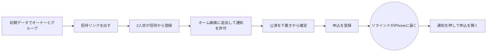

# 論点の記録: 最初の1本（登録からリマインドがiPhoneに届くまで）

- 機能名: first-slice
- 確認のページ: https://claude.ai/artifact/6hN723fZxgmnP59cujyHr8
- 進み具合: docs/discussions/first-slice.progress.json

## 背景

設計の工程1〜6が確定したので、最初の実装に入る。最初の1本は、招待リンクから登録し、グループで公演と申込を登録して、申込の期限のリマインドがホーム画面に追加したiPhoneにWeb Pushで届くまでを通す。本番と同じ構成の環境で動かし、実装はDevinに渡す。要件定義書の前に、作る範囲・ログインの方式・環境の分け方と、画面の見た目の方向を決める。見た目は、答えを受けて見本の画面を2〜3枚作って見てもらい、色の値と部品の決まりにしてからDevinに渡す。

## 前提

- 使う人は10人以下の招待制（PR/FAQ）。最初のオーナーとグループは、APIでなくデプロイの流れの初期データで作る（ADR-0005）。
- 画面は23あり、移り方と呼ぶAPIは`docs/api.md`で決まっている。見た目（色・配置・文言）、ログインの方式、画面の移り方とデータの取り方の道具は、この機能で決めることになっている（`docs/api.md`、ADR-0004、ADR-0005）。
- iPhoneでWeb Pushを受けられるのは、ホーム画面に追加したWebアプリだけ（ユーザーストーリーN-01）。通知の中身はDeclarative Web Pushの形にする（AWS構成のC-5）。
- iPhoneのホーム画面に追加したWebアプリは、Safariとログインの状態（Cookieや保存領域）を分けて持つ（https://bugs.webkit.org/show_bug.cgi?id=181849 ）。Safariで招待リンクから登録しても、ホーム画面から開くともう一度ログインが要る。
- パスキーは使わない（2026-11-21、大関さん）。Cognitoのメールに届くコードでのログインは、Essentialsのプランの機能で、Essentialsも月1万MAUまで無料（https://docs.aws.amazon.com/cognito/latest/developerguide/cognito-user-pool-settings-advanced-security-access-token.html 、https://aws.amazon.com/cognito/pricing/ ）。Cognitoが自分で送るメールは1日の通数に上限があるので、使う通数は設計で確かめる。
- Web Pushの通知は、ログインが切れていても届く。通知を押して申込を開くときにログインが要る。
- ClaudeとDevinはAWSとNeonにつながない（AGENTS.mdの「コマンドの範囲」）。結合検証の環境で動かして確かめるのは大関さんになる。
- 途中で止まる・2回流れる・重なる流れ。リマインドの予約・送信・取り消しの順番は、データモデル（R11、「リマインドの送り方」）で決まっていて、この回の問いでは変えない。この回で順番に関わるのは、環境を分ける問い（デプロイとマイグレーションを、どの環境で先に流すか）だけ。2本のデプロイの重なりは、環境ごとのGitHub Actionsの`concurrency`で止める（ADR-0004）。

## 論点

### 最初の1本で、どのストーリーまで作るか

<!-- id: scope -->

- 工程: 要件
- 種類: 設計
- 優先度: 中
- 状態: 仮決定
- なぜ今: 作る範囲で、要件定義書の機能の一覧、Devinに渡すタスクの数、E2Eの流れが決まる。
- 根拠: AGENTS.mdの「進め方の決まり」（登録からリマインドがiPhoneに届くまでを1本で通す）、`docs/user-stories.md`
- 選択肢:
  - A) 流れに要るものだけ作る。招待リンクの発行と参加（G-01・G-02）、単発の公演を下書きから確定（C-02・C-03）、公演を見る（C-07）、申込の登録と状態を進める（T-01・T-02）、3種類のリマインド（T-03）、通知先の登録・届かない帯・通知から申込を開く（N-01〜N-03）
    - 利点: 1本の流れを早く本番と同じ環境で通せて、残りのストーリーは同じ形で足せる
    - 欠点: グループの切り替えやツアーのまとめ登録が無いので、仲間に試しに使ってもらうにはまだ足りない
  - B) Aに、グループを作る・切り替える（G-03・G-04）、ツアーのまとめ登録（C-01）、通知先を外す（N-04）を足す
    - 利点: いつもの仲間に試しに使ってもらえる形に近づく
    - 欠点: 画面が4つ増え、最初の委譲が大きくなって、土台の不具合と画面の不具合が混ざる
  - C) Aからさらに減らし、招待を使わずに初期データで2人を作る。リマインドは結果発表の1種類だけにする
    - 利点: Web Pushが届くまでを最も早く確かめられる
    - 欠点: 招待からの登録とiPhoneでのログインのやり直しという、一番つまずきやすい流れを後に回すことになる
- 推奨: A（iPhoneでのログインのやり直しと3種類のリマインドという一番危ない所を最初に通しつつ、画面を増やしすぎない）
- 理由: 1回目の答えは範囲でなく進め方（要件定義書から先はDevinが書き、Claudeはレビューに専念する）だった。範囲を誰が決めるかを聞いている

### ログインの方式と、ログインの画面をどこに置くか

<!-- id: login -->

- 工程: 要件
- 種類: 画面
- 優先度: 高
- 状態: 決定
- なぜ今: 招待リンクからの登録（G-01）の流れと、Cognitoの設定とプランが決まる。工程5から、この機能の要件に回していた。
- 根拠: `docs/discussions/api-design.md`の「ログインの方式」、`docs/api.md`のS-01、上の前提（ホーム画面のWebアプリはSafariとログインを分ける）
- 選択肢:
  - A) メールとパスワード。ログインの画面はCognitoが出す画面を使う
    - 利点: 画面を作らずに済み、Cognitoの無料の基本のプランで足りる
    - 欠点: Safariとホーム画面で2回ログインするときにパスワードを覚えている必要があり、画面がyoinの見た目と揃わない
  - B) メールに届くコード。ログインの画面はyoinの中に自分で作る
    - 利点: パスワードを持たずに済み、ホーム画面でのログインのやり直しもコードを入れるだけで、画面もyoinの見た目に揃う
    - 欠点: ログインの画面を自分で作る手間があり、CognitoはEssentialsのプランにする（月1万MAUまでは無料）
  - C) メールに届くコード。ログインの画面はCognitoが出す画面を使う
    - 利点: パスワードを持たずに済み、画面を作る手間も無い
    - 欠点: ホーム画面のWebアプリからCognitoのドメインへ移って戻る動きを、iPhoneで確かめる必要があり、見た目も揃わない
- 推奨: B（iPhoneではSafariとホーム画面で2回ログインするので、コードを入れるだけで済む方が招待された人がつまずかない）
- 決定: B
- 推奨と同じか: 同じ
- 選ばなかった理由: A（Safariとホーム画面で2回ログインするとき、パスワードを覚えている必要がある）、C（Cognitoのドメインへ移って戻る動きをiPhoneで確かめる必要があり、見た目も揃わない）
- 反映先: （要件定義書を書いたあとに埋める）
- 決めた日: 2026-11-22

### 結合検証の環境を、本番と別に作るか

<!-- id: environments -->

- 工程: 要件
- 種類: 設計
- 優先度: 高
- 状態: 決定
- なぜ今: 環境の数で、Terraformの組み方、デプロイの流れ、初期データの作り方、Neonのプロジェクトの数が変わり、Devinに渡す土台のタスクが決まる。
- 根拠: AGENTS.md（最初の1本は本番と同じ構成の環境で動かす、結合検証の環境で見る項目には要るデータと作る人を書く）、ADR-0004（デプロイは環境ごとに1本ずつ）、ADR-0006（費用は月数円）
- 選択肢:
  - A) 結合検証と本番の2つを、同じTerraformで作る。マージしたらまず結合検証に出し、確かめてから本番に出す。NeonはDBのプロジェクトを分ける
    - 利点: マイグレーションを本番の前に1回流して確かめられ、プレリリースのあとに本番のデータを試しの操作で汚さない
    - 欠点: Cognito・通知の鍵・初期データが2組になり、最初の委譲で作るものが増える
  - B) 最初の1本は本番の環境1つだけ作り、プレリリースまでは本番を結合検証として使う。結合検証の環境はプレリリースの前に足す
    - 利点: 最初の委譲が小さく、早く1本を通せる
    - 欠点: あとから環境を足すときにTerraformとデプロイの流れを組み直すことになり、そのときの不具合はプレリリースの直前に出る
- 推奨: A（あとから環境を足すと、デプロイの流れの組み直しがプレリリースの直前に来る。費用は2つでも月数円の見込み）
- 決定: A
- 推奨と同じか: 同じ
- 選ばなかった理由: B（あとから環境を足すと、デプロイの流れの組み直しがプレリリースの直前に来る）
- 反映先: （要件定義書を書いたあとに埋める）
- 決めた日: 2026-11-22

### iPhoneで、登録とホーム画面への追加をどの順に案内するか

<!-- id: iphone-onboarding-order -->

- 工程: 要件
- 種類: 画面
- 優先度: 高
- 状態: 決定
- なぜ今: 招待された人が最初に見る流れで、招待の画面（S-02）と初回の案内（S-03）の中身が決まる。ホーム画面のWebアプリはSafariとログインを分けるので、どちらかで2回目のログインが要る。
- 根拠: 上の前提、ユーザーストーリーG-01・N-01、`docs/api.md`のS-02・S-03
- 選択肢:
  - A) Safariで招待リンクを開き、ログインして参加まで済ませる。そのあと「ホーム画面に追加して、そこから開いてください」と案内し、ホーム画面から開いたらもう一度ログインして通知を許可する
    - 利点: 参加はリンクを開いたその場で終わるので、ホーム画面への追加でつまずいても、グループには入れている
    - 欠点: ログインが2回になる
  - B) 招待リンクを開いたら、先にホーム画面への追加を案内する。ホーム画面から開き直してから、ログインと参加をする
    - 利点: ログインが1回で済む
    - 欠点: ホーム画面に追加したときに招待リンクのURLが引き継がれるかをiPhoneで確かめていない（推測では引き継がれない場合がある）。引き継がれないと、招待リンクを開き直す手間が増える
- 推奨: A（ホーム画面への追加は手順が多くつまずきやすいので、その前に参加を終えておく。2回目のログインはメールのコードなら短い）
- 決定: A
- 推奨と同じか: 同じ
- 選ばなかった理由: B（ホーム画面に追加したときに招待リンクのURLが引き継がれるかが分からず、つまずくと開き直しになる）
- 反映先: （要件定義書を書いたあとに埋める）
- 決めた日: 2026-11-22

### ロック画面のリマインドに、公演名と受付名を出すか

<!-- id: push-content -->

- 工程: 要件
- 種類: 画面
- 優先度: 高
- 状態: 決定
- なぜ今: 通知の中身（Declarative Web Pushの`title`と`body`）を、送る関数の要件に書く。iPhoneのロック画面には、通知の文がそのまま出る。
- 根拠: ユーザーストーリーT-03、AWS構成のC-5、データモデルの`notification.reminders`
- 選択肢:
  - A) 公演名・受付名・期限を出す（例「入金期限は明日21:00 / 〇〇ツアー 東京公演 FC先行」）
    - 利点: 通知を開かなくても、何をいつまでにすればよいかが分かる
    - 欠点: ロック画面を見た人に、どの公演のチケットを申し込んだかが見える
  - B) 種類と期限だけを出す（例「入金期限は明日21:00です」）。公演名は通知を開いてから見る
    - 利点: ロック画面から何の公演かが分からない
    - 欠点: 申込が2件以上あると、開くまでどの申込か分からない
- 推奨: A（リマインドの目的は期限に間に合わせることで、申込が複数あるときに開かずに見分けられる方が役に立つ。iPhoneの設定でロック画面の内容を隠すこともできる）
- 決定: A
- 推奨と同じか: 同じ
- 選ばなかった理由: B（申込が2件以上あると、開くまでどの申込か分からない）
- 反映先: （要件定義書を書いたあとに埋める）
- 決めた日: 2026-11-22

### 画面の雰囲気と色の方向をどれにするか

<!-- id: visual-mood -->

- 工程: 要件
- 種類: 画面
- 優先度: 高
- 状態: 決定
- なぜ今: 答えを受けて見本の画面を作り、色の値と部品の決まりにしてDevinに渡す。方向が決まらないと見本を作れない。
- 根拠: PR/FAQ（いつもの仲間で、公演ごとの記録とチケット・グッズの準備を共有する）、`docs/api.md`（見た目はこの機能で決める）
- 選択肢:
  - A) 記録帳。白に近い生成りの地、墨色の文字、差し色は朱（#D9553B前後）。余白を広めに取り、線で区切る
    - 利点: セトリや参戦記録を読み返す画面に合い、文字が読みやすい
    - 欠点: ライブのアプリらしい華やかさは弱い
  - B) 夜の余韻。深い紺の地、明るい文字、差し色はペンライトのような暖かい黄（#F2B544前後）。カードを浮かせて並べる
    - 利点: 名前の「余韻」と合い、開演前の暗い会場でもまぶしくない
    - 欠点: 暗い地は、チケットの期限など細かい文字を長く読むと疲れやすい
  - C) やわらかい。白地に淡い色の面、差し色は青みの紫（#7C6CF2前後）、角を大きく丸める
    - 利点: 親しみやすく、仲間内のアプリらしい
    - 欠点: 色の面が多くなり、期限切れなどの注意の色が目立ちにくい
- 推奨: A（チケットの期限やセトリなど文字を読む画面が多いので、読みやすさを優先する。差し色の朱は、期限の注意にも使える）
- 決定: その他: 今の音楽系のアプリを参考に、詳しく分析してから決める
- 推奨と同じか: 違う
- 理由: 大関さんの答えのまま
- 選ばなかった理由: 理由は聞いていない（選択肢から選ぶ前に、市場分析とデザインを先にしたいという答え）
- 反映先: 市場分析のあと、選び直す問いを足して出し直す
- 決めた日: 2026-11-22

### 暗い表示（ダークモード）をどう扱うか

<!-- id: dark-mode -->

- 工程: 要件
- 種類: 画面
- 優先度: 高
- 状態: 決定
- なぜ今: 色の値を1組で渡すか2組で渡すかが変わり、見本の画面の数も変わる。
- 根拠: 上の「画面の雰囲気と色の方向」
- 選択肢:
  - A) 端末の設定に合わせ、明るい表示と暗い表示の両方を作る
    - 利点: 会場の暗い中では暗い表示、家では明るい表示と、端末の設定どおりに見える
    - 欠点: 色の値が2組になり、両方で文字の見やすさを確かめる手間が増える
  - B) 選んだ雰囲気の1組だけにする
    - 利点: 色の値が1組で済み、Devinに渡すものも試すものも少ない
    - 欠点: 雰囲気でAかCを選ぶと、暗い会場で画面がまぶしい
- 推奨: A（会場の暗い中で開くことが多いアプリで、端末の設定に合わせる方が自然。色を最初から変数で持てば、2組目の手間は色の値を決めることだけ）
- 決定: A
- 推奨と同じか: 同じ
- 選ばなかった理由: B（暗い会場で明るい地の画面がまぶしい）
- 反映先: （要件定義書を書いたあとに埋める）
- 決めた日: 2026-11-22

### 書体をどうするか

<!-- id: font -->

- 工程: 要件
- 種類: 画面
- 優先度: 高
- 状態: 決定
- なぜ今: Webフォントを読み込むかで、画面の重さとService Workerに置くものが変わる。
- 根拠: ADR-0004（React＋Vite、Service Workerはvite-plugin-pwa）
- 選択肢:
  - A) 端末の標準の書体（iPhoneはヒラギノ角ゴ、AndroidはNoto Sans CJK）を使う。数字は桁を揃える指定をする
    - 利点: 読み込みが無く、電波の弱い会場でもすぐ表示できる
    - 欠点: 端末によって文字の見え方が少し変わる
  - B) Noto Sans JPをWebフォントで読み込む
    - 利点: どの端末でも同じ見え方になる
    - 欠点: 日本語のWebフォントは数MBあり、分けて読み込んでも初回の表示が遅くなる
  - C) 本文は端末の書体、ロゴと見出しの英字だけ飾りのある書体にする
    - 利点: 読み込みは小さく、見出しに個性が出る
    - 欠点: 和文と英字の書体が混ざり、組み合わせを選ぶ手間がある
- 推奨: A（電波の弱い会場でも開いてすぐ読めることを優先する）
- 決定: その他: 市場分析を優先して決める
- 推奨と同じか: 違う
- 理由: 大関さんの答えのまま
- 選ばなかった理由: 理由は聞いていない（選択肢から選ぶ前に、市場分析とデザインを先にしたいという答え）
- 反映先: 市場分析のあと、選び直す問いを足して出し直す
- 決めた日: 2026-11-22

### 画面の部品を何で作るか

<!-- id: ui-toolkit -->

- 工程: 要件
- 種類: 設計
- 優先度: 高
- 状態: 決定
- なぜ今: Devinに渡す部品の決まり（色の変数の置き方、ボタンやダイアログの作り方）が、この道具で決まる。ADR-0004では画面の道具をReact＋Viteまで決め、CSSの道具は決めていない。
- 根拠: ADR-0004、AGENTS.md（ADR級の決定はユーザーが行う）
- 選択肢:
  - A) Tailwind CSSとshadcn/ui。ダイアログ・選択・日時の入力などの部品の元のコードをリポジトリに写して、色と形を直して使う
    - 利点: 操作しやすさ（キーボード・読み上げ）を作り込んだ部品から始められ、色は変数で一か所にまとまる。部品のコードが手元にあるので見た目を自由に直せる
    - 欠点: Tailwindの書き方と、写した部品のコードの両方を保守する
  - B) Tailwind CSSだけを使い、部品は自分で作る
    - 利点: 依存が少なく、部品の中身をすべて自分で決められる
    - 欠点: ダイアログや選択の操作しやすさを、Devinが一から作ることになる
  - C) CSS Modulesと自分で作る部品
    - 利点: 書き方が素のCSSに近く、道具に縛られない
    - 欠点: 色や余白の決まりを守らせる仕組みが弱く、Devinの複数のタスクで見た目がずれやすい
  - D) 部品集（MantineやMUI）をそのまま使う
    - 利点: 部品が最も早く揃う
    - 欠点: 部品集の見た目から離れるほど上書きが増え、画面の読み込みも重くなる
- 推奨: A（並行するDevinのタスクで見た目を揃えるには、色の変数と部品が一か所にあるのがよい。部品のコードが手元にあるので、見本の画面に合わせて直せる）
- 決定: A
- 推奨と同じか: 同じ
- 選ばなかった理由: B（ダイアログや選択の操作しやすさを一から作ることになる）、C（並行のタスクで見た目がずれやすい）、D（上書きが増え、読み込みが重い）
- 反映先: （要件定義書を書いたあとに埋める）
- 決めた日: 2026-11-22

### ホーム画面のアイコンと名前をどうするか

<!-- id: pwa-icon -->

- 工程: 要件
- 種類: 画面
- 優先度: 高
- 状態: 決定
- なぜ今: アイコンとホーム画面に出る名前（manifestの`short_name`）は、初回の案内の画面の見本と、Devinに渡すmanifestに要る。
- 根拠: ADR-0004（vite-plugin-pwa）、ユーザーストーリーN-01
- 選択肢:
  - A) 名前は「yoin」（小文字）。アイコンは、差し色の地に、音が広がる輪（余韻）の図形
    - 利点: 小さいアイコンでも形が分かり、書体に左右されない
    - 欠点: 図形の意味は、初めて見た人には伝わりにくい
  - B) 名前は「yoin」（小文字）。アイコンは、差し色の地に小文字の「y」
    - 利点: 名前とアイコンがすぐ結びつく
    - 欠点: 文字だけのアイコンは、ほかのアプリと似やすい
  - C) 名前は「余韻」。アイコンは漢字の「余」
    - 利点: 日本語の名前の意味がそのまま伝わる
    - 欠点: リポジトリや英字の名前の「yoin」と、ホーム画面の名前が揃わない
- 推奨: A（ホーム画面の小さいアイコンでも見分けやすい。見本ではAとBの両方をアイコンの大きさで並べて見せる）
- 決定: その他: Claude Designで決める
- 推奨と同じか: 違う
- 理由: 大関さんの答えのまま
- 選ばなかった理由: 理由は聞いていない（選択肢から選ぶ前に、市場分析とデザインを先にしたいという答え）
- 反映先: 市場分析のあと、選び直す問いを足して出し直す
- 決めた日: 2026-11-22

### 初回の案内を、飛ばして先に進めるか

<!-- id: onboarding-skip -->

- 工程: 要件
- 種類: 画面
- 優先度: 中
- 状態: 仮決定
- なぜ今: 初回の案内（S-03）で、ホーム画面への追加や通知の許可をしないと先に進めないかが決まる。
- 根拠: ユーザーストーリーN-01・N-02、`docs/api.md`のS-03・S-05
- 選択肢:
  - A) 飛ばせる。通知先が無いあいだは、グループのホームに帯を出し続ける（N-02）
    - 利点: パソコンや、あとで追加したい人も使い始められる
    - 欠点: 帯を見ても追加しない人には、リマインドが届かない
  - B) iPhoneでは、ホーム画面に追加して通知を許可するまで先に進めない
    - 利点: リマインドが届かない人がいなくなる
    - 欠点: パソコンで使いたい人や、通知を許可しない人が使えなくなる
- 推奨: A（通知を許可しない人も公演の記録には使えるので、止めずに帯で知らせる）

### ログインをどれだけ続けるか

<!-- id: session-length -->

- 工程: 要件
- 種類: アプリの決まり
- 優先度: 中
- 状態: 仮決定
- なぜ今: Cognitoのリフレッシュトークンの有効期限（既定30日、最大3,650日）の設定値を要件に書く。
- 根拠: 上の前提（通知はログインが切れても届くが、開くときにログインが要る）
- 選択肢:
  - A) 365日
    - 利点: 通知を押したときにログインを求められることが、ほぼ無い
    - 欠点: 端末をなくしたとき、ログインが長く残る
  - B) 30日（Cognitoの既定）
    - 利点: 端末をなくしたときにログインが残る期間が短い
    - 欠点: 月に1回はログインし直しになり、通知を押した直後にコードを待つことがある
- 推奨: A（リマインドを押してすぐ申込を開けることを優先する。端末をなくしたときの対処は、通知先を外す機能（N-04）と合わせて設計で書く）
- 理由: 1回目に大関さんから「365日で問題ないか」と質問があった。チャットで答え、返事を待っている

### 画面の文言を、です・ます調にするか

<!-- id: ui-tone -->

- 工程: 要件
- 種類: 画面
- 優先度: 中
- 状態: 仮決定
- なぜ今: 見本の画面とDevinに渡す文言の決まりに要る。
- 根拠: `.claude/rules/writing-style.md`（文末をそろえる）
- 選択肢:
  - A) 案内や結果の文はです・ます調、ボタンは短い動詞（「保存」「参加する」）
    - 利点: 仲間内でもていねいに読め、ボタンは短く押しやすい
    - 欠点: 文が少し長くなる
  - B) 案内も常体の短い文（「保存した」）
    - 利点: 画面が詰まらない
    - 欠点: 案内の文がそっけなく読める
- 推奨: A（初めて招待された人が読む案内が多いので、ていねいな方が伝わる）

### 結合検証の環境で、iPhoneに届くことを誰がどう確かめるか

<!-- id: push-verification -->

- 工程: 要件
- 種類: 設計
- 優先度: 中
- 状態: 仮決定
- なぜ今: AGENTS.mdで、結合検証の環境で見る項目には、要るデータと作る人を書くと決めている。リマインドの時刻は前日の20時などなので、そのまま待つと確かめに1日かかる。
- 根拠: AGENTS.md、ユーザーストーリーT-03（登録したときに時刻を過ぎていれば次の送信で届ける）
- 選択肢:
  - A) 大関さんが、ホーム画面に追加したiPhoneで、結果発表日時を数分後にした申込を作り、届くこと・押して申込が開くことを見る。もう1人分は、2つ目の端末かパソコンのブラウザで招待から登録する
    - 利点: 本物の時刻の決まりのまま、数分で確かめられる
    - 欠点: 入金期限の前日20時の通知は、日をまたいで待たないと見られない（時刻の計算は自動の試験で確かめる）
  - B) 結合検証の環境だけ、送信時刻を早める設定を入れる
    - 利点: 3種類の通知をすぐ見られる
    - 欠点: 本番に無い分岐が入り、本番と同じ構成で確かめる意味が薄れる
- 推奨: A（本番と同じ動きのまま確かめ、時刻の計算は自動の試験とfast-checkで確かめる）

### 解散・退会の記録の状態から`done`を消すか

<!-- id: erasure-done-status -->

- 工程: 設計
- 種類: 設計
- 優先度: 中
- 状態: 仮決定
- なぜ今: 最初の1本のマイグレーションで表を作るので、使わない値を残すかをここで決める。工程5で、消し終えた記録は行ごと消すと決め（データモデルのR17）、`done`は使われなくなった。
- 根拠: `docs/data-model.md`の`erasure_jobs`（`status`と部分一意インデックス）、工程5の振り返り
- 選択肢:
  - A) `status`を`running`と`failed`だけにし、一意の決まりも「`status`が`done`でないもの」の条件を外して、すべての行で一意にする
    - 利点: 使わない値と条件が無くなり、読む人が`done`の行を探さずに済む
    - 欠点: データモデルの表と説明を直す
  - B) `done`を残す
    - 利点: あとで記録を残す形に戻すとき、値を足さずに済む
    - 欠点: 誰も書かない値が残り、試験とレビューで毎回「なぜあるか」を確かめることになる
- 推奨: A（行を消す形に決めたので、使わない値を残す理由が無い）

### 画面の移り方とデータの取り方の道具を何にするか

<!-- id: routing-data-tools -->

- 工程: 設計
- 優先度: 中
- 状態: 後の工程へ
- なぜ今: ADR-0004で、最初の1本の設計で決めることにしている。見た目と要件が決まってから、設計書の問いで出す。
- 根拠: ADR-0004「この決定では決めないこと」

### 要件定義書から先を、誰が書くか

<!-- id: who-writes -->

- 工程: 要件
- 種類: 設計
- 優先度: 高
- 状態: 決定
- なぜ今: 1回目の答えで、大関さんから進め方の指示があった。AGENTS.mdとこれまでの分担（設計まではClaude、実装はDevin）を変える。
- 根拠: 1回目の答え（範囲の問いへの「その他」）、AGENTS.mdの「作業分担」
- 選択肢:
  - A) これまでどおり、要件定義書・設計書・実装計画・試験計画はClaudeが書き、実装はDevin
    - 利点: AGENTS.mdを変えずに済む
    - 欠点: Devinを無料で多く使える期間（2026-12-20まで）に、委譲が実装だけになる
  - B) 要件定義書から先はDevinが書き、Claudeはレビューに専念する
    - 利点: Devinの無料期間を設計の文書にも使え、Claudeの見る目を書き手から切り離せる
    - 欠点: AGENTS.mdとスキルの分担を直す必要がある
- 推奨: A（問いとしては出していない。答えを受けて記録のために足した。Aはこれまでの分担）
- 決定: B
- 推奨と同じか: 違う
- 理由: 大関さんの答え「要件定義からは基本的にDevin手動で行って、Claudeはレビューに専念してもらいたい」
- 選ばなかった理由: 理由は聞いていない
- 反映先: （AGENTS.mdを直すPRで埋める）
- 決めた日: 2026-11-22

### 画面の基本の明るさと雰囲気をどれにするか

<!-- id: visual-mood-2 -->

- 工程: 要件
- 種類: 画面
- 優先度: 高
- 状態: 決定
- なぜ今: 1回目で「今の音楽系のアプリを調べてから決める」と答えをもらった。明るい表示と暗い表示の両方を作ることは決まったので（暗い表示の問い）、ここではどちらを基本の見た目として作り込むかと、雰囲気を決める。決まると見本の画面とアイコンの色に進める。
- 根拠: 2026-11-22にApp Storeで見た6本（LiveNote、LIVE x LIFE、メロコレ、Livelog、チケットカレンダー、Bandsintown）と、SpotifyとApple Music
- 選択肢:
  - A) 夜の余韻。暗い地を基本に作り込み、差し色は1色だけ。明るい表示は同じ部品の色違い
    - 利点: ライブの記録アプリで多い見た目で、開演前の暗い会場でも開きやすい。光る色を1色に絞れば、紫や黄緑の他のアプリと見分けられる
    - 欠点: 昼に期限を細かく読むときは、明るい表示より疲れやすい
  - B) 記録帳。明るい地を基本に作り込み、文字と余白で読ませる。暗い表示は色違い
    - 利点: 申込の期限やセトリを読む画面が読みやすく、Apple Musicのような落ち着いた見た目になる
    - 欠点: 調べた音楽系のアプリの中では地味で、ライブのアプリらしさは弱い
  - C) 推し活のポップ。明るいピンクなどの色の面と、丸い部品
    - 利点: 推し活のアプリに慣れた人には親しみやすい
    - 欠点: いつもの仲間の記録と準備という落ち着いた使い方には、色の面が多すぎる
- 推奨: A（調べたライブ記録のアプリ4本のうち3本が暗い地で、会場で開く使い方にも合う。差し色を暖かい1色にすれば、紫や黄緑の他のアプリと見分けられる）
- 決定: その他: Spotifyのようなデザインにしたい（暗い地が基本）
- 推奨と同じか: 違う（暗い地が基本という点は推奨のAと同じ）
- 理由: 大関さんがチャットで「Spotifyのようなデザインにしたい。もっと詳細に分析して」と書いた
- 選ばなかった理由: B・C（理由は聞いていない。Spotifyに寄せる答えなので明るい地とポップは外れる）
- 反映先: Spotifyを詳しく調べた3回目の問い
- 決めた日: 2026-11-22

### 差し色をどの色にするか

<!-- id: accent-color -->

- 工程: 要件
- 種類: 画面
- 優先度: 高
- 状態: 取り下げ
- なぜ今: 差し色はボタン・期限の印・アイコンの地に使う。見本の画面とClaude Designでのアイコンの前に要る。
- 根拠: 調べたアプリの差し色（LiveNoteは紫、LIVE x LIFEは黄緑、Spotifyは緑、Apple Musicは赤、Livelogとチケットカレンダーはピンク）
- 選択肢:
  - A) ペンライトの琥珀（#F2B544前後）
    - 利点: 調べたアプリと重ならず、暗い地で暖かく光って「余韻」の名前に合う
    - 欠点: 明るい地では文字の色に使えないので、明るい表示では濃い色に替える
  - B) 朱（#E8603C前後）
    - 利点: 明るい地でも暗い地でも見え、期限の注意にもそのまま使える
    - 欠点: 注意の赤と近く、ふつうのボタンと期限切れの印を見分けにくい
  - C) 紫（#9B7CFF前後）
    - 利点: ペンライトや夜の照明の色で、ライブらしい
    - 欠点: LiveNoteと同じ系統の色で、見分けにくい
- 推奨: A（他のアプリと重ならず、暗い地で光る色にできる。注意の色は朱を別に持つ）
- 理由: 答えが届く前に「Spotifyのようなデザインに」と方向が決まったので、Spotifyに寄せた前提で3回目に出し直す

### 書体をどうするか（調べたあと）

<!-- id: font-2 -->

- 工程: 要件
- 種類: 画面
- 優先度: 高
- 状態: 取り下げ
- なぜ今: 1回目で「市場分析を優先して決める」と答えをもらった。調べた日本語のアプリはどれも和文は端末の書体で、日付や見出しの英字で個性を出していた。
- 根拠: LIVE x LIFEの「NEXT LIVE」や「OPEN 17:30」のような英字の見出し、Spotifyの自社書体Spotify Mix（https://newsroom.spotify.com/2024-05-22/introducing-spotify-mix-our-new-and-exclusive-font/ ）
- 選択肢:
  - A) すべて端末の書体（iPhoneはヒラギノ角ゴ）
    - 利点: 読み込みが無い
    - 欠点: 日付や見出しで個性を出せない
  - B) 和文は端末の書体。日付・時刻・英字の見出しだけ、チケットの半券のような縦長の書体（Barlow Condensed）
    - 利点: 英数字だけなので読み込みは数十KBで、日付と時刻が並ぶ申込や公演の画面が引き締まる
    - 欠点: 英数字の書体のファイルを1つ持つ
  - C) 和文は端末の書体。英数字だけ丸みのある幾何学的な書体（Outfit）
    - 利点: 読み込みは数十KBで、やわらかい印象になる
    - 欠点: 縦長の書体より横に場所を取り、日付と時刻を並べると長くなる
  - D) 和文もNoto Sans JPを読み込む
    - 利点: どの端末でも同じ見え方
    - 欠点: 読み込みが数MBになり、電波の弱い会場で初回の表示が遅い
- 推奨: B（日付・開場・開演・期限の時刻を大きく見せる画面が多く、縦長の数字が合う。和文は読み込まない）
- 理由: 答えが届く前に「Spotifyのようなデザインに」と方向が決まったので、Spotifyに寄せた前提で3回目に出し直す

### Spotifyのどこまでを借りるか

<!-- id: spotify-borrow -->

- 工程: 要件
- 種類: 画面
- 優先度: 高
- 状態: 決定
- なぜ今: 「Spotifyのようなデザインに」をDevinに渡せる決まりにするには、借りる所と借りない所の線が要る。
- 根拠: Spotifyの見た目を書き起こした資料（https://raw.githubusercontent.com/VoltAgent/awesome-design-md/664b3e78fd1a298ba11973822da988483256d4b4/design-md/spotify/DESIGN.md ）、App StoreのSpotifyの紹介画像（2026-11-22に見た）、Spotify Mixの発表（https://newsroom.spotify.com/2024-05-22/introducing-spotify-mix-our-new-and-exclusive-font/ ）
- 選択肢:
  - A) 骨組みと質感を借りる。ほぼ黒の無彩色の地、明るさの段で重ねる面、丸いボタン、詰めた一覧、上の絞り込み、下のタブ。差し色・書体・アイコンはyoinのものにする
    - 利点: Spotifyらしい暗く落ち着いた使い心地になり、Spotifyの偽物には見えない
    - 欠点: 色と書体は別に決める必要がある
  - B) Aに加えて、差し色もSpotifyに近い緑にする
    - 利点: 見た目が最もSpotifyに近くなる
    - 欠点: Spotifyの看板の色で、ホーム画面に並ぶと見分けにくく、まねに見える。書体のSpotify MixはSpotify専用で使えない
- 推奨: A（Spotifyの良さは暗い無彩色の地と、色をジャケットに任せる作りにある。看板の緑と専用の書体は借りなくても同じ使い心地になる）
- 決定: A
- 推奨と同じか: 同じ
- 選ばなかった理由: B（緑はSpotifyの看板の色でまねに見え、Spotify Mixは使えない）
- 反映先: Claude Designの見本の画面と、色と部品の決まり
- 決めた日: 2026-11-22

### 画面の色を何から出すか

<!-- id: color-source -->

- 工程: 要件
- 種類: 画面
- 優先度: 高
- 状態: 決定
- なぜ今: Spotifyは画面を無彩色にして、色はジャケットの画像から出している。yoinの公演には画像が無いので、代わりの色の出どころを決めないと、暗いだけの画面になる。
- 根拠: 上の資料（UIは無彩色で、色はジャケットから）、データモデル（公演とアーティストに画像の列は無い。画像はグッズの品目だけ）
- 選択肢:
  - A) アーティストごとに色を1つ決め、公演のカードと公演の画面の上のグラデーションに使う。色はアーティストの名前から自動で決め、あとで選び直せる
    - 利点: 画像を持たずに、公演ごとに違う色が出て一覧で見分けやすい。入力の手間も増えない
    - 欠点: 選び直す欄が1つ増え、自動の色がアーティストの印象と合わないことがある
  - B) 公演やツアーに画像を貼れるようにする
    - 利点: Spotifyに最も近い、画像が主役の画面になる
    - 欠点: MVP1に無い機能で、画像の保存と削除の決まりがデータモデルに増える
  - C) 色は差し色だけにし、カードは無彩色のまま
    - 利点: 作るものが最も少ない
    - 欠点: 公演が並ぶと見分けにくく、Spotifyらしい色の変化が出ない
- 推奨: A（Spotifyのジャケットの役を、画像を足さずに果たせる。アーティストの色の列は1つ足すだけ）
- 決定: A
- 推奨と同じか: 同じ
- 選ばなかった理由: B（MVP1に無い機能で、画像の保存と削除の決まりが増える）、C（公演が並ぶと見分けにくい）
- 反映先: Claude Designの見本の画面と、色と部品の決まり
- 決めた日: 2026-11-22

### 差し色をどの色にするか（Spotifyに寄せたあと）

<!-- id: accent-color-3 -->

- 工程: 要件
- 種類: 画面
- 優先度: 高
- 状態: 決定
- なぜ今: Spotifyの緑の役（主なボタン・選んでいる印・期限の印）を担う色。アイコンの地にも使う。
- 根拠: Spotifyは緑を飾りに使わず、押すものと選んでいる印だけに使う（上の資料）
- 選択肢:
  - A) 琥珀（#F5B83D前後）
    - 利点: ペンライトの光のようで「余韻」に合い、ほぼ黒の地で最も目立つ
    - 欠点: 注意の橙と近いので、注意は赤だけにする決まりが要る
  - B) 珊瑚（#FF6B57前後）
    - 利点: 暖かく、ボタンとして押したくなる色
    - 欠点: 失敗の赤と近く、期限切れの印と見分けにくい
  - C) 水色（#5CC8FF前後）
    - 利点: 注意の赤・橙とはっきり分かれる
    - 欠点: 冷たい印象で、アーティストの色と並ぶと埋もれやすい
- 推奨: A（ほぼ黒の地で最も光り、Spotifyの緑と同じく一目で押せる所が分かる。注意は赤に絞る）
- 決定: A
- 推奨と同じか: 同じ
- 選ばなかった理由: B（失敗の赤と近い）、C（冷たい印象で、アーティストの色に埋もれる）
- 反映先: Claude Designの見本の画面と、色と部品の決まり
- 決めた日: 2026-11-22

### 画面の下に何を置くか

<!-- id: bottom-nav -->

- 工程: 要件
- 種類: 画面
- 優先度: 高
- 状態: 決定
- なぜ今: Spotifyは下に3〜4のタブと、いま再生中の曲の帯を置く。yoinの画面の移り方（`docs/api.md`）をこの形に当てはめるかで、画面の骨組みが決まる。
- 根拠: `docs/api.md`の画面の移り方（グループのホームから公演一覧・自分の参戦・設定へ移る）
- 選択肢:
  - A) 下にタブを3つ（ホーム・公演・自分）。その上に、Spotifyの再生中の帯の代わりに「次の期限」の帯を出す（例「入金期限 あす21:00 FC先行」）。押すと申込を開く
    - 利点: どの画面からも次にすることが見え、Spotifyの使い心地をyoinの目的に置き換えられる
    - 欠点: 期限が無いときの帯の出し方を決める必要がある
  - B) 下にタブを3つだけ置く
    - 利点: 作るものが少ない
    - 欠点: 期限はホームを開くまで見えない
  - C) タブを置かず、ホームから各画面に移る
    - 利点: 画面の移り方の図のままで作れる
    - 欠点: 自分の参戦や設定に移るのに、毎回ホームへ戻る
- 推奨: A（yoinの一番の目的は期限に間に合わせること。Spotifyで常に見える再生中の帯の場所に、次の期限を置く）
- 決定: A
- 推奨と同じか: 同じ
- 選ばなかった理由: B（期限がホームを開くまで見えない）、C（毎回ホームへ戻る）
- 反映先: Claude Designの見本の画面と、色と部品の決まり
- 決めた日: 2026-11-22

### 英数字の書体をどれにするか（Spotifyに寄せたあと）

<!-- id: font-3 -->

- 工程: 要件
- 種類: 画面
- 優先度: 高
- 状態: 決定
- なぜ今: SpotifyはCircularを元にした専用の書体（Spotify Mix）で、使えない。近い印象の無料の書体を選ぶ。和文は端末の書体（ヒラギノ角ゴ）で、Spotifyも日本語はヒラギノに任せている。
- 根拠: 上の資料（書体の予備の並びにHiragino Sansがある）、Spotify Mixの発表
- 選択肢:
  - A) Figtree（Circularに近い、丸みのある幾何学的な書体）
    - 利点: Spotifyの太い見出しと同じ印象になり、英数字だけなら読み込みは数十KB
    - 欠点: 縦長の書体より横に場所を取る
  - B) Barlow Condensed（縦長の書体）
    - 利点: 日付と時刻を大きく詰めて並べられる
    - 欠点: Spotifyの丸い印象とは離れる
  - C) 英数字も端末の書体
    - 利点: 読み込みが無い
    - 欠点: Spotifyらしい太い丸みが出ない
- 推奨: A（Spotifyの見出しの印象に最も近く、和文のヒラギノとも太さが合う）
- 決定: A
- 推奨と同じか: 同じ
- 選ばなかった理由: B（Spotifyの丸い印象から離れる）、C（太い丸みが出ない）
- 反映先: Claude Designの見本の画面と、色と部品の決まり
- 決めた日: 2026-11-22

### 券面に整理番号を出すか

<!-- id: entry-number -->

- 工程: 要件
- 種類: アプリの決まり
- 優先度: 中
- 状態: 回答待ち
- なぜ今: 見本の公演の画面の券に「整理番号 A-128」を出したが、データモデルの申込（`ticket.ticket_applications`）に整理番号の列が無い。座席は参戦記録の`seat`にあるが、公演のあとに書くもので、公演の前の券面には出せない。要件定義書の前に、券面に何を出すかを決める。
- 根拠: docs/data-model.md のチケットと参戦記録の表、見本の画面（チケットの作りの分析）。スタンディングの会場（Zeppなど）は座席の代わりに整理番号で入場の順が決まる
- 選択肢:
  - A) 申込に整理番号の欄を足す（null可、自由に書く）
    - 利点: 発券したあとに入れれば券面に出せる。入場の順を仲間で見比べられる
    - 欠点: 承認済みのデータモデル（ADR-0002）に列を1つ足す。2枚なら「A-128・129」のように1つの欄に書く
  - B) 申込に「座席・整理番号」の欄を1つ足す（null可、自由に書く）
    - 利点: 指定席とスタンディングのどちらも1つの欄で済む。券面の欄も1つ
    - 欠点: 公演のあとに書く参戦記録の座席と、似た欄が2つになる
  - C) 足さない。券面は日時・会場・受付名だけにする
    - 利点: データモデルを変えない
    - 欠点: 券面がさびしくなり、見本の画面と変わる
- 推奨: B（指定席でもスタンディングでも、発券したら券面に出せる。参戦記録を書くときは、この欄を座席の初期値に使える）
- 反映先: 要件定義書、データモデル（列を足すならADR-0002の追記）、見本の画面

### 明るい表示の色をこの組にするか

<!-- id: light-colors -->

- 工程: 要件
- 種類: 画面
- 優先度: 中
- 状態: 回答待ち
- なぜ今: 暗い表示と明るい表示の両方を作ることは決まった（暗い表示の問い）。Devinに渡す色の変数は、2組そろえて渡す。
- 根拠: 見本の画面の「ホーム（明るい表示）」と「明るい表示の色」の盤
- 選択肢:
  - A) 温かい白の地（#F7F5F1）と、濃くした琥珀の文字（#9A6200）
    - 利点: 紙の券に合う。琥珀の文字も白い地で読める
    - 欠点: 真っ白のアプリと並ぶと、少し黄ばんで見える
  - B) 真っ白の地（#FFFFFF）
    - 利点: iPhoneのほかのアプリとそろう
    - 欠点: 券の色が浮き、紙らしさが減る
  - C) 最初の1本は暗い表示だけにして、明るい表示はあとで作る
    - 利点: 最初の1本の作る量が減る
    - 欠点: 決めた「両方作る」と変わる。色の変数をあとで足すことになる
- 推奨: A（券の見た目を両方の表示でそろえられる。文字の色だけ変えれば読みやすさも保てる）
- 反映先: 色と部品の決まり、要件定義書

## 見本の画面（2026-11-22 大関さんが「いったんこの画面で」と了承）

Claude Designで作った見本の画面を、見た目の方向としていったん決めた（https://claude.ai/artifact/Nk8ihzVTNQAnszicgc9XMA ）。
画面はホーム・公演・公演（残り1週間）・申込の4枚と、色と部品の決まり、チケットの作りの分析の盤。
骨組みはSpotifyに寄せ、yoinだけの部品として紙のチケットの作り（通し番号、DATE・OPEN・START・SEATの欄、ミシン目とくぼみ、半券）を入れた。

見本へのコメントで決めたこと。

- ホームの過去の公演の棚は「行った公演」と書く。「余韻」は、行った公演の色が日ごとに薄れる見せ方の呼び名にだけ使う。
- 券の色はアーティストの色に合わせ、12色から選び直せる。自由な色にしないのは、券の白い文字を読めるようにするため。
- 公演の残りが7日を切ったら、公演の画面に日・時・分・秒のカウントダウンと7つの目盛りを出す。

要件で決めること: 券面の整理番号はデータモデルに無いので、申込に足すかを問う。
まだのもの: 明るい表示の色、アプリのアイコン。

## アプリのアイコン（2026-11-23 大関さんが決定）

Claude Designで決めた（https://claude.ai/artifact/Nk8ihzVTNQAnszicgc9XMA の「アイコンの市場分析」から「B3の色合い」まで）。

- 形: 重なる2枚の半券（B3）。前の券に、日時・座席の行と通し番号、くぼみからくぼみまでのミシン目、半券のバーコードを描く。29pt以下では行・ミシン目・バーコードを省く。
- 色: 夕焼けのステージ（G2）。前の券は#FFD86Eから#FF9E5E、#F25F8Bへ。半券は#FF9466から#E8507E。後ろの券は#B44A9Aから#4E2A7A。地は#2A1F2Eから#121016で、券の後ろにかすかな光を置く。
- 選ばなかった案: 広がる輪・ペンライトの光・頭文字y（何のアプリか伝わりにくい、または埋もれる）。半券の中では光の漏れる半券・ミシン目のyなど6案と、隙間を入れた仕上げ案。色はG1琥珀から橙・G3琥珀の光沢と、ポップにしたP1〜P3（大関さんがG2のままを選んだ）。
- アプリの差し色（琥珀#F5B83D）はそのまま。アイコンだけライブの照明の色にした。
- 書き出した絵: `docs/design-assets/icon/`（apple-touch-icon 180px、manifest用の192px・512px、maskableの192px・512px、元のSVG）。maskableは券を86%に縮めて、中央8割の円に収めた。
