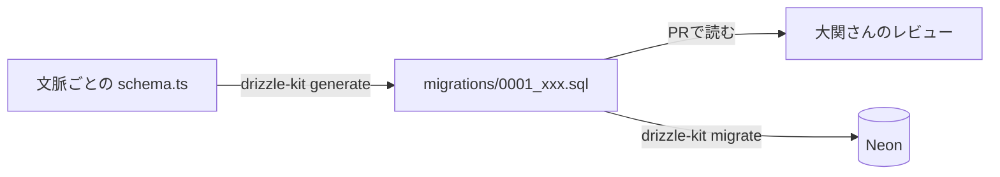
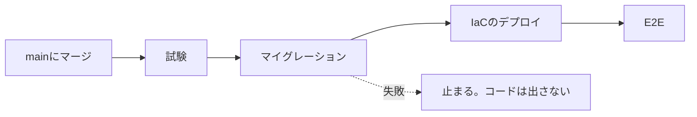

# 論点の記録: 道具の選び方

- 機能名: tooling
- 確認のページ: https://claude.ai/artifact/HTr5u2hU63aVstD3T7spXb
- 進み具合: docs/discussions/tooling.progress.json

## 背景

工程3でデータモデルとLambdaの分け方を、ADR-0003で文脈の中の層の分け方を決めた。実装は最初からDevinに委譲するので、委譲の前に言語・ORM・マイグレーション・Neonへの接続・IaC・画面・境目の検査の道具を決めておく必要がある（AGENTS.md）。この記録では、工程4で選ぶ道具を問いにして、答えをADR-0004にまとめる。

## 前提

- LambdaはVPCの外に置き、呼ばれたときだけNeonにつなぎ、終わったら切る（architecture.mdのA-1・A-2）。
- 書き込みは1つのトランザクションで行い、途中で`FOR SHARE`のロックを取って判断を挟む。HTTPで1回ずつ送る接続は使えない（ADR-0002の決定3、データモデル）。
- トランザクションは入口で1つ開いて公開関数に渡し、DIコンテナは使わない（ADR-0003の決定2・3）。
- 6つのスキーマに28のテーブルがあり、複合外部キー、文脈をまたぐRESTRICTの外部キー、未完了の行だけの一意制約（部分インデックス）、CHECK制約を使う（データモデル）。
- マイグレーションはデプロイの流れに入れ、手で流す手順は作らない（AGENTS.md）。
- 境目の検査は2つ。文脈の外から`index.ts`以外をimportしていないこと、`domain/`が外部のライブラリ・DB・AWSのSDKをimportしていないこと（ADR-0003の決定5）。
- E2Eは最初の1本から入れ、2人をブラウザのcontext 2つで動かす（AGENTS.md）。
- 費用はAWSとNeonの無料枠に収めることを目指す（PR/FAQ）。

## 論点

### APIとLambdaを何の言語で書くか

<!-- id: language-runtime -->

- 工程: 設計
- 種類: 設計
- 優先度: 高
- 状態: 回答待ち
- なぜ今: ORM・IaC・検査の道具は、すべて言語で候補が変わる。
- 根拠: AGENTS.md「IaCの道具・ORM・言語の細部は工程4で決める」、`.claude/rules/coding-standards.md`（TypeScriptの規約が既にある）
- 選択肢:
  - A) TypeScript。LambdaはNode.js 24（`nodejs24.x`、arm64）
    - 利点: 画面とAPIとIaCを1つの言語で書け、ハーネスの規約もそのまま使える
    - 欠点: Goより起動が遅く、依存パッケージが増えやすい
  - B) Go
    - 利点: Lambdaの起動が速く、1つの実行ファイルで配れる
    - 欠点: 画面はTypeScriptになるので言語が2つになり、ハーネスの規約も書き直す
  - C) Python
    - 利点: 書く量が少なく、AWSのSDKが手厚い
    - 欠点: 画面と型を共有できず、Lambdaの起動もTypeScriptと同程度
- 推奨: A（画面・API・IaCを1つの言語でそろえ、既にある規約とDevinへの説明を使い回せる）

### ORMとマイグレーションの道具を何にするか

<!-- id: orm-migration -->

- 工程: 設計
- 種類: 設計
- 優先度: 高
- 状態: 回答待ち
- なぜ今: 28のテーブルを最初の1本で作るので、テーブルの書き方とマイグレーションの形が決まっていないと委譲できない。
- 根拠: ADR-0002の決定1・2（スキーマ、複合外部キー、RESTRICT）、ADR-0003の決定3（トランザクションを入口で開いて渡す）、データモデルの`erasure_jobs`の部分一意制約
- 選択肢:
  - A) Drizzle ORMとdrizzle-kit
    - 利点: スキーマ・複合外部キー・部分インデックス・CHECK・`FOR SHARE`をTypeScriptで書け、マイグレーションはSQLのファイルとしてPRで読める
    - 欠点: 1.0の前で、版を上げるときに書き方が変わることがある
  - B) Prisma 7とPrisma Migrate
    - 利点: 利用者が多く、資料と事例がいちばん多い
    - 欠点: 部分インデックスはプレビューの機能で、`FOR SHARE`は生のSQLで書くことになる
  - C) Kyselyと手書きのSQLのマイグレーション
    - 利点: SQLに近く、型の付いたクエリをそのまま書ける
    - 欠点: 型をDBから生成するので、試験とCIでいつもDBを起こす必要がある
- 推奨: A（データモデルで使う制約とロックを全部同じ書き方で表せ、マイグレーションのSQLをPRで読める）

### LambdaからNeonへ何でつなぐか

<!-- id: neon-driver -->

- 工程: 設計
- 種類: 設計
- 優先度: 高
- 状態: 回答待ち
- なぜ今: 途中で判断を挟めるトランザクションが使える道具が限られ、ORMとの組み合わせも決まる。
- 根拠: ADR-0002の決定3、データモデル「HTTPで1回ずつ送る方式は使わない」、Neonの接続方法の資料（HTTPは途中で判断を挟めない）
- 選択肢:
  - A) node-postgres（`pg`）でTCPにつなぐ。1回の起動で1本の接続を作り、終わったら切る
    - 利点: いちばん使われている道具で、Drizzleとの組み合わせの事例も多い
    - 欠点: 接続のたびにTCPとTLSの往復がかかる
  - B) Neonのserverless driverをWebSocketで使う
    - 利点: Neonが作っている道具で、HTTPの軽い問い合わせと同じパッケージで済む
    - 欠点: LambdaはTCPが使えるので、WebSocketを通す利点が小さく、Nodeでは`ws`の設定も要る
  - C) postgres.js
    - 利点: 速く、テンプレートの書き方でSQLを書ける
    - 欠点: node-postgresより事例が少なく、Drizzleの例も少ない
- 推奨: A（Lambdaは普通のNodeでTCPが使えるので、いちばん事例の多い道具で足りる）

### マイグレーションをデプロイのどこで流すか

<!-- id: migration-in-deploy -->

- 工程: 設計
- 種類: 設計
- 優先度: 高
- 状態: 回答待ち
- なぜ今: tomotabiでは本番にマイグレーションが流れず機能が動かなかった。デプロイの流れを作る委譲の前に、流す場所を決める。
- 根拠: AGENTS.md「migrationはデプロイの流れに入れる」
- 選択肢:
  - A) GitHub Actionsのデプロイの仕事で、IaCのデプロイの前にマイグレーションを流す。接続文字列はOIDCで借りたAWSの権限でSSMから読む
    - 利点: 流れが1本の仕事に並び、失敗すればコードを出さずに止まる。秘密の置き場所もSSMの1か所のまま
    - 欠点: 古いコードが新しい表で動く間があるので、列を消す変更は2回に分ける
  - B) IaCのデプロイの途中で、マイグレーション用のLambdaを呼ぶ
    - 利点: 手元からデプロイしても必ず流れる
    - 欠点: Lambdaが1つ増え、失敗したときの巻き戻しがIaCの道具の動きに左右される
  - C) apiのLambdaが起動したときに流す
    - 利点: 仕組みがいちばん少ない
    - 欠点: 同時に起動すると重なり、要求の途中で表が変わる
- 推奨: A（失敗したらコードを出さずに止まり、何が起きたかがGitHub Actionsの記録に残る）

### IaCを何で書くか

<!-- id: iac-tool -->

- 工程: 設計
- 種類: 設計
- 優先度: 高
- 状態: 回答待ち
- なぜ今: 土台（IaC・CI・デプロイ）をDevinに委譲するので、道具が決まっていないと最初のタスクを書けない。
- 根拠: architecture.md「IaCの道具（CDK、Terraformなど）は工程4」、PR/FAQ（IaCをポートフォリオで見せる）
- 選択肢:
  - A) AWS CDK（TypeScript）
    - 利点: APIと同じ言語で書け、LambdaのTypeScriptをそのまま束ねてデプロイできる
    - 欠点: AWSの外（Neon）はCDKで扱えず、Neonは手で作る
  - B) Terraform
    - 利点: 求人でいちばん見かける道具で、NeonもAWSも1つの道具で書ける
    - 欠点: 言語がHCLになり、状態ファイルを置くS3とロックを先に用意する
  - C) SST
    - 利点: 手元で動かしながら作る仕組みが手厚い
    - 欠点: 中でPulumiとTerraformの部品を使うので、問題が起きたときに追う層が増える
- 推奨: A（言語が1つで済み、Lambdaの束ね方とデプロイが1つの道具に収まる。Neonは1つだけなので手で作っても困らない）

### 画面（PWA）を何で作るか

<!-- id: web-framework -->

- 工程: 設計
- 種類: 設計
- 優先度: 高
- 状態: 回答待ち
- なぜ今: 最初の1本は登録からiPhoneへの通知までを画面ごと通すので、画面の道具も委譲の前に要る。
- 根拠: architecture.mdのB-1（CloudFront + S3に静的なファイルを置く）、ADR-0003「画面のコードの分け方は工程4以降」
- 選択肢:
  - A) ReactとVite、vite-plugin-pwa
    - 利点: 静的なファイルだけを作るので置き場所に合い、Devinが書き慣れている
    - 欠点: ルーターやデータ取得の道具を自分で選んで足す
  - B) SvelteKit（静的に出力する）
    - 利点: 書く量が少なく、出来上がるファイルも小さい
    - 欠点: Reactより事例が少なく、Devinの出来が落ちるおそれがある（推測）
  - C) Next.js（静的に出力する）
    - 利点: 求人で見かけることが多い
    - 欠点: サーバーを使う機能の多くが静的な出力では使えず、利点が残らない
- 推奨: A（静的なファイルだけで済む構成に素直に合い、委譲先が書き慣れている）

### 文脈の境目を何で検査するか

<!-- id: boundary-check -->

- 工程: 設計
- 種類: 設計
- 優先度: 高
- 状態: 回答待ち
- なぜ今: ADR-0003の決定5で、CIで2つの決まりを検査すると決めた。委譲の最初のタスクから入れないと、境目を破るコードがたまる。
- 根拠: ADR-0003の決定5、ADR-0002の決定7（ほかの文脈のテーブルを読まない）
- 選択肢:
  - A) dependency-cruiser
    - 利点: importの決まりを1つの設定ファイルに書け、依存の図も出せる。テーブルの定義を文脈の中に置けば、ほかの文脈のテーブルを読むことも止められる
    - 欠点: ESLintとは別の道具が1つ増える
  - B) eslint-plugin-boundaries
    - 利点: ESLintの中で動き、エディタで書いた時点で気づける
    - 欠点: 決まりの書き方が要素の種類の定義に寄っていて、文脈と層の2軸を書くと設定が長くなる
  - C) 文脈ごとにパッケージを分け、TypeScriptのproject referencesで縛る
    - 利点: コンパイラが止めるので、検査の道具が要らない
    - 欠点: パッケージが6つ以上になり、設定とビルドが重くなる
- 推奨: A（決まりをADR-0003の文のまま設定に書け、図をREADMEやポートフォリオに使える）

### リポジトリの中をどう分けるか

<!-- id: repo-layout -->

- 工程: 設計
- 種類: 設計
- 優先度: 中
- 状態: 仮決定
- なぜ今: 委譲するタスクごとに主に触るファイルを書くので、置き場所が要る。
- 根拠: ADR-0002の決定7、`.claude/rules/coding-standards.md`（各workspaceの`tests/`）
- 選択肢:
  - A) pnpmのworkspaceで`apps/api`・`apps/web`・`infra`に分ける。`apps/api/src/`の中はADR-0002の決定7のまま
    - 利点: 画面・API・IaCの依存が分かれ、並行して委譲しても触るファイルが重なりにくい
    - 欠点: workspaceの設定が少し要る
  - B) 1つのパッケージにまとめる
    - 利点: 設定が少ない
    - 欠点: 画面とLambdaの依存が混ざり、Lambdaの束に要らないものが入りやすい
- 推奨: A（並行で渡すタスクをファイルで分けやすい）

### lintと整形を何にするか

<!-- id: lint-format -->

- 工程: 設計
- 種類: 設計
- 優先度: 中
- 状態: 仮決定
- なぜ今: 品質コマンドが無いと、委譲したPRをCIで止められない。
- 根拠: AGENTS.md「品質コマンド: まだ無い」
- 選択肢:
  - A) ESLint（typescript-eslintの型を使う決まり）とPrettier
    - 利点: `await`を付け忘れたPromise（`no-floating-promises`）を止められる。トランザクションの中で付け忘れると、コミットのあとに書き込みが走る
    - 欠点: Biomeより遅く、設定が2つになる
  - B) Biome
    - 利点: 速く、設定が1つで済む
    - 欠点: 型を使う決まりがtypescript-eslintより少ない
- 推奨: A（トランザクションの中の`await`の付け忘れを機械で止めたい）

### 試験の道具と、結合試験のDBを何にするか

<!-- id: test-tools -->

- 工程: 設計
- 種類: 設計
- 優先度: 中
- 状態: 仮決定
- なぜ今: 最初の1本の試験計画に、道具と結合試験のDBが要る。
- 根拠: ADR-0003（domainはDBなしで、ほかはDBを使う結合試験で確かめる）、AGENTS.md（E2Eは2人をcontext 2つで動かす）
- 選択肢:
  - A) 単体と結合はVitest、結合のDBはGitHub ActionsのPostgresのコンテナ（Neonと同じ版）、E2EはPlaywright
    - 利点: CIでNeonの計算時間を使わず、試験ごとに空のDBから始められる
    - 欠点: Neonにしかない動き（接続の数の上限、休止からの起動）は結合検証環境で見る
  - B) 結合のDBにNeonのブランチをPRごとに作る
    - 利点: 本番と同じDBで試せる
    - 欠点: 無料プランの計算時間を使い、ブランチの後片づけも要る
- 推奨: A（無料枠を本番と結合検証環境のために残せる）

### APIの入口でルーティングと入力の確認を何でするか

<!-- id: api-router -->

- 工程: 設計
- 種類: API
- 優先度: 中
- 状態: 仮決定
- なぜ今: 関数`api`の中でパスごとに公開関数を呼び分ける形を、最初の1本で作る。
- 根拠: ADR-0002の決定5（画面からのすべての操作を関数`api`で受ける）
- 選択肢:
  - A) HonoとZod
    - 利点: 小さく、Lambdaの入口として事例が多い。Zodの定義から画面側の型も作れる
    - 欠点: 道具が2つ増える
  - B) 道具を使わず、パスで`switch`する
    - 利点: 依存が無い
    - 欠点: 入力の確認とエラーの形を自分で書くことになり、タスクごとに書き方がずれる
- 推奨: A（入力の確認とエラーの形を1つにそろえられる）

### Neonのリージョンをどこにするか

<!-- id: neon-region -->

- 工程: 運用
- 優先度: 低
- 状態: 後の工程へ
- なぜ今: 工程6で、Neonの公式の一覧から東京に近いものを選ぶ（architecture.mdのC-2）。接続の往復の時間はここで決まるので、工程4では接続の道具だけ決める。
- 根拠: architecture.mdのC-2
