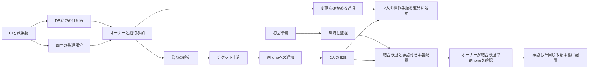

# 実装計画: 招待からリマインドがiPhoneに届くまで

- 前提となる設計書: [最初の1本の設計](../designs/first-slice.md)（[PR #32](https://github.com/oze-xxbumpxx/yoin/pull/32)で承認）
- 要件と試験: [要件定義](../requirements/first-slice.md)、[試験計画](../tests/first-slice.md)
- レベル: L3
- 実装ルート: 計画がマージされた後、Devinにタスクごとに委譲します。
- 判断理由: 既定どおりです。土台と製品を別の差分で確認し、結合検証で一つにつなぎます。

計画のマージ後、土台のIssue（旧#34〜#39）は下の作業単位から作り直します。計画段階では実装も実環境の変更もしません。作る範囲は設計の11画面、14テーブルと対応API、登録前・通知送信のLambdaまでです。退会、解散、ツアー、参戦記録、分配、支払い、失敗キューからの手動再送は作りません。

## 作業の分け方と主なファイル

下表は新規作成先です。画面の置き場所・CI・DBの設定など、先行タスクで作った共有ファイルへの配線は、先行タスクがマージされてから行います。依存とファイルが重ならないタスクだけを、別々の作業用クローンで並行して進めます。SWE-2 Flashのeffortを表に示します。「必ず見る」は[REVIEW.md](../../REVIEW.md)で人が差分を見る範囲です。「なし」の行でも通常のレビューは行います。

| タスク | 区分 | 主に触るファイル | 先に要るタスク | effort | 受け持つ試験 | 必ず見る |
| --- | --- | --- | --- | --- | --- | --- |
| 初回準備 | 土台 | `infra/terraform/bootstrap/main.tf`、`scripts/bootstrap-ssm.ts` | なし | high | なし | S3状態、IAM、OIDC、SSM |
| 環境と監視 | 土台 | `infra/terraform/main.tf`、`infra/terraform/environments/` | 初回準備の名前・ARNの取り決め | high | I10 | IaC、権限、費用、通知 |
| CIと成果物 | 土台 | `package.json`、`pnpm-workspace.yaml`、`pnpm-lock.yaml`、`vitest.config.ts`、`.github/workflows/ci.yml`、`apps/web/vite.config.ts` | なし | medium | なし | CIと境目の検査 |
| DB変更の仕組み | 土台 | `db/drizzle.config.ts`、`db/migrations/`の検査設定、`scripts/check-migrations.ts`・`scripts/migrate.ts` | CIと成果物 | high | I03 | SQL、削除条件、適用権限 |
| 画面の共通部分 | 製品 | `apps/web/index.html`、`apps/web/package.json`、`apps/web/components.json`、`apps/web/public/`、`apps/web/src/app/`・`styles/`・`components/ui/`、`apps/web/tests/app/` | CIと成果物 | high | U07 | ログイン状態、通信とキャッシュの分離 |
| オーナーと招待参加 | 製品 | `src/contexts/group/`、`src/functions/pre-sign-up/`、`src/functions/api/`、`scripts/seed-initial-data.ts`、`apps/web/src/features/join/` | DB変更の仕組み・画面の共通部分 | high | I01 | 登録、認可、グループのSQL・個人情報 |
| 公演を下書きから確定 | 製品 | `src/contexts/catalog/`、`apps/web/src/features/concert/` | オーナーと招待参加 | high | I11 | SQL、グループの参照・更新権限 |
| チケット申込から受取 | 製品 | `src/contexts/ticket/`、`apps/web/src/features/ticket/`・`home/` | 公演を下書きから確定 | high | U01、U04、U06、I02、I12 | SQL、他人の申込の更新拒否 |
| iPhoneへの通知 | 製品 | `src/contexts/notification/`、`src/functions/notification-sender/`、`apps/web/src/features/push/`、`apps/web/src/service-worker.ts` | チケット申込から受取 | high | U02、U03、U05、I04〜I07、I09 | 購読情報、送信権限、DBと予約 |
| 変更を確かめる道具 | 確認 | `.claude/skills/verify-first-slice/SKILL.md`、`.agents/skills/verify-first-slice`（リンク） | オーナーと招待参加 | medium | なし | PR前に使う検査の手順と両方の入口 |
| 2人で通す試験 | 確認 | `playwright.config.ts`、`tests/e2e/`、`tests/support/` | iPhoneへの通知 | high | E2E-01、E2E-02 | 試験専用の認証が本番に混ざらない差分 |
| 2人の操作手順を道具に足す | 確認 | `.claude/skills/verify-first-slice/SKILL.md` | 変更を確かめる道具・2人で通す試験 | medium | なし | PR前に使う2人の検査の手順 |
| 結合検証と承認付き本番配置 | 土台・最終確認 | `.github/workflows/deploy.yml`、`scripts/check-deployment-sha.ts`、`scripts/write-release-config.ts` | 初回準備・環境と監視・全製品成果物と2人の自動試験 | high | I08 | 承認、デプロイ、OIDC、DB |

## 実装手順

各タスクは担当の自動試験と品質コマンドを通し、人が見る結果とまだ見ていない結果を分けて残します。製品の各タスクで、その文脈のテーブル定義と必要なSQLを作ります。SQL生成と共通のAPIルート登録・画面ルート登録は、前に入った変更を取り込んで順に行います。通知の追加時にチケットの書き込みと接続します。接続前にチケットを単独で本番へ出しません。

<!-- delegation-task:bootstrap -->
### 初回準備: 環境ごとの状態、権限、設定を用意する

- 対象: `infra/terraform/bootstrap/`、`scripts/bootstrap-ssm.ts`。旧#35に対応します。
- effort: high
- 先に要るタスク: なし
- 受け持つ試験: なし
- やること: オーナーがNeonをシンガポールに2つ作り、Macの暗号化された場所で初回のTerraformを適用します。作ったS3の初回専用キーへ `terraform init -migrate-state` で移します。初回・結合検証・本番の状態キーとTerraform用ロックを分け、CIに初回分を許しません。GitHub ActionsはOIDCの短期認証だけを使います。SSMの秘密はオーナーが登録し、Terraformは名前とARNだけを使います。ランタイム・DB変更・初期データが読める名前を範囲ごとに分けます。
- Devinの完了条件（PRとCIで確かめる）: Terraformの検査と権限の差分で、状態キーの分離とCIから初回用キーへのアクセスを許さないことを確かめます。初回移行の手順を残し、秘密や状態をログ・成果物に置きません。
- オーナーが実環境で確かめること（要るデータと、それを誰が作るか）: M09。オーナーがAWS・Neonの環境、SSMの値、Macで作る初回状態を用意します。移行後に状態が読めて `terraform plan` に意図しない差分がなく、CIから初回用キーの読み書きを拒むことを確かめてから、ローカル状態と一時バックアップを破棄します。
<!-- /delegation-task -->

<!-- delegation-task:environment -->
### 環境と監視: 同じ定義から結合検証と本番を作る

- 対象: `infra/terraform/`の初回構成以外。旧#36に対応します。
- effort: high
- 先に要るタスク: 初回準備の名前・ARNの取り決め
- 受け持つ試験: I10
- やること: AWSをシンガポールに置き、API Gateway、3つのLambda、Cognito、Scheduler、S3・CloudFront、失敗キューを環境別に用意します。全APIルートに対象環境のJWT検査を付け、CORSも対象のPWAに限ります。SESの送信元と利用申請はオーナーが担当します。CognitoはADR-0007のメールOTPを使い、プールを手で直しません。月5ドルのBudgets、SES抑止、Lambda・SESの共有警報は結合検証のTerraformだけで管理します。これらの共有資源は本番にも効くため、オーナーが公開されないTerraform planで対象の差分を確認し、その変更を承認するまでは適用しません。GitHubの本番環境の承認とは別です。
- Devinの完了条件（PRとCIで確かめる）: I10で両環境のTerraform定義を検査します。秘密値を含めず、共有資源は結合検証側にだけ定義します。Lambdaは製品成果物がそろってから配置する手順を用意します。
- オーナーが実環境で確かめること（要るデータと、それを誰が作るか）: M06・M07・M10。オーナーが検証用宛先、招待、失敗試験のデータを用意し、CIが対象SHAの成果物を作ります。最初の実配置の後にLambdaのSHA・時刻のタグ、警報、流量、ログ保持と、認証・監視の動作を確かめます。
<!-- /delegation-task -->

<!-- delegation-task:ci-artifacts -->
### CIと成果物: 外部サービスなしで検査し、一度だけビルドする

- 対象: `.github/workflows/ci.yml`、ルートのpnpm設定とVitestの設定、`apps/web/vite.config.ts`。旧#37に対応します。
- effort: medium
- 先に要るタスク: なし
- 受け持つ試験: なし
- やること: PRとmainで、lint、型、境目、Vitest、使い捨てPostgreSQL、Playwright、ビルドの実在する検査を必須にします。製品の試験は各タスクから追加します。最初はランナー内の検査だけを有効にし、未実装の製品試験を成功扱いにしません。LambdaとPWAの成果物をテスト済みの完全SHAにひも付けます。PWAは環境値なしで1回ビルドし、結合検証と本番は同じものを使います。
- 完了条件: 一つでも失敗したSHAはデプロイへ渡らず、別SHAの成果物は使えません。試験の入口・JWTの発行者・鍵が製品に入らない検査を後続のE2Eとつなぎ、試験ファイルが実際に検出されることを確かめます。CIからAWS、Neon、実メール、実Pushへ接続しません。
<!-- /delegation-task -->

<!-- delegation-task:db-migrations -->
### DB変更の仕組み: SQLをデプロイの流れだけで流す

- 対象: `db/drizzle.config.ts`、`db/migrations/`、`scripts/check-migrations.ts`、`scripts/migrate.ts`。旧#38に対応します。
- effort: high
- 先に要るタスク: CIと成果物
- 受け持つ試験: I03
- やること: drizzle-kitの設定と生成・適用の入口を作ります。CIは `drizzle-kit check` とjournalの時刻順を確かめます。適用前にはDBに未記録の古いSQLがないか確認します。削除するSQLの `requires-deployed` は各Lambdaの版と切替時刻、旧版の最大実行時間15分の経過を確かめてから適用します。利用をやめる変更と削除を分けます。
- 完了条件: 空のDBへの適用、同じSQLの再実行、時刻違反と削除条件の未成立を使い捨てDBで確かめます。環境の設定はデプロイが渡し、手で実環境にSQLを流す手順は作りません。
<!-- /delegation-task -->

<!-- delegation-task:web-foundation -->
### 画面の共通部分とログイン状態の入れ物を作る

- 対象: `apps/web/index.html`、`apps/web/package.json`、`apps/web/components.json`、`apps/web/public/manifest.webmanifest`とアイコン、`apps/web/src/app/`・`styles/`・`components/ui/`、`apps/web/tests/app/`。
- effort: high
- 先に要るタスク: CIと成果物
- 受け持つ試験: U07
- やること: F-48のmanifestとアイコンを置きます。F-42〜F-45の色の変数とFigtreeを使い、Tailwind CSSとshadcn/uiを使える形にします。React Router、TanStack Query、`hono/client`の共通の入口を作ります。招待参加のタスクが、実際のAPI型とCognitoの操作をこの入口につなぎます。
- ログイン状態: セッションごとにQueryClientを作り、キーにユーザーIDとグループIDを含めます。ログアウト・会員交代では通信を中断し、古いキャッシュと端末の認証情報を消します。Safariとホーム画面のPWAは別のログイン状態を持ちます。招待や通知から戻る先は同一オリジンのパスだけにします。通知先はログアウトでは消さず、Service WorkerにはJWTを渡しません。
- 完了条件: U07で、yoinのmanifestとアイコン、明暗の色と書体、画面の移り方、会員を交代したときの通信とキャッシュの分離を確かめます。実際のメールOTPと2人の操作は後続のタスクでつなぎます。
<!-- /delegation-task -->

<!-- delegation-task:invite-and-join -->
### オーナーと招待参加: 2人が同じグループを開ける

- 対象: `src/contexts/group/`、`src/functions/api/`・`pre-sign-up/`、`scripts/seed-initial-data.ts`、`apps/web/src/features/join/`。
- effort: high
- 先に要るタスク: DB変更の仕組み・画面の共通部分
- 受け持つ試験: I01
- やること: 環境別の初期データ、S-01のメールOTP、S-02の参加、S-21の招待を作ります。初期データの再実行ではCognitoの既存subを使い、DB側は1トランザクションで重複なく作ります。登録前Lambdaは招待のハッシュ、期限、残り枠とグループ状態を検査し、登録開始数だけを1文で更新します。参加枠は参加の取引で使い、登録開始とは分けます。ログにはトークンや個人情報を出しません。
- 完了条件: オーナーの招待から2人目の登録・参加・ホーム表示まで通ります。招待なしの新規登録、使えない招待、権限のない発行を拒み、最後の1枠を2人で使えません。実メールと実プールの確認は結合検証でオーナーが行います。
<!-- /delegation-task -->

<!-- delegation-task:concert -->
### 公演を下書きから確定し、一覧と詳細に出す

- 対象: `src/contexts/catalog/`、`apps/web/src/features/concert/`、対応API・SQL。
- effort: high
- 先に要るタスク: オーナーと招待参加
- 受け持つ試験: I11
- やること: 会場・アーティストを選ぶ／追加する、単発公演を下書きから確定する、S-06〜S-08で一覧と詳細を開く流れを作ります。下書きは本人だけが読み書きでき、確定済み公演は同じグループで読めます。
- 完了条件: 保存や確定の再送で行が増えず、別グループ・不在・本人でない場合を契約どおりに区別します。今日を日本時間の「これから」に入れ、足りない欄を画面で示します。
<!-- /delegation-task -->

<!-- delegation-task:ticket -->
### チケット申込を作り、受取済みまで進める

- 対象: `src/contexts/ticket/`、`apps/web/src/features/ticket/`・`home/`、対応API・SQL。
- effort: high
- 先に要るタスク: 公演を下書きから確定
- 受け持つ試験: U01、U04、U06、I02、I12
- やること: 申込の作成・編集・状態変更・削除を作ります。本人の期限と受取可否は表示時に計算します。S-05のホームには最も近い公演、本人の次の行動と期限の帯を出します。券は設計と画面見本を使い、12色の明暗で読みやすさを保ちます。
- 完了条件: 申込から当選、入金済み、受取済みまで通ります。別のメンバーは読めても編集できません。状態遷移と期限の境目、券の文字の配置とコントラストを試験計画どおりに確認します。I12では申込の作成・削除を送り直しても、申込と通知の予約が重複しないことを確かめます。
<!-- /delegation-task -->

<!-- delegation-task:reminders -->
### 期限の予約とiPhoneへの通知をつなぐ

- 対象: `src/contexts/notification/`、`src/functions/notification-sender/`、`apps/web/src/features/push/`・`service-worker.ts`、対応API・SQL。
- effort: high
- 先に要るタスク: チケット申込から受取
- 受け持つ試験: U02、U03、U05、I04〜I07、I09
- やること: チケットの変更とSchedulerの世代切替をつなぎ、登録端末へのPush、見張り、端末別の再開を作ります。予約の引き受け・端末別の送信結果・失敗表示を設計の取引単位で扱います。S-03・S-23の案内とホームの通知先の帯、ログアウト後の通知からの復帰をつなぎます。
- 完了条件: 各期限から正しい予約が作られ、取り消し済み・古い世代は送信しません。一部の失敗で他端末を飛ばさず、再送上限と締切を守ります。試験計画の固定時計・並行実行で確かめ、実着信は結合検証のホーム画面から開くiPhoneで確認します。
<!-- /delegation-task -->

<!-- delegation-task:verification-skill -->
### 変更を確かめる道具を、招待の流れから使う

- 対象: `.claude/skills/verify-first-slice/SKILL.md`、`.agents/skills/verify-first-slice`（リンク）。
- effort: medium
- 先に要るタスク: オーナーと招待参加
- 受け持つ試験: なし
- やること: アプリの起動・試験データ・招待の操作・証拠の残し方をClaude Code側のスキルに書きます。`.agents/skills/verify-first-slice`から`../../.claude/skills/verify-first-slice`を指し、Devinも同じ手順を使います。
- 完了条件: DevinとClaude CodeがPRを出す前に、スキルに従ってローカルで動作を確かめられます。
- 必ず見る: 人が検査手順と両方の入口の差分を読みます。
<!-- /delegation-task -->

<!-- delegation-task:two-user-verification -->
### 2人のE2Eを自動で通す

- 対象: `playwright.config.ts`、`tests/e2e/`、`tests/support/`。
- effort: high
- 先に要るタスク: iPhoneへの通知
- 受け持つ試験: E2E-01、E2E-02
- やること: Playwrightでは2つの独立したcontextで、招待から受取済みまで操作します。ランナー内だけで署名した試験JWTを使い、製品の認証設定を緩めません。
- 完了条件: 使い捨てDBから再現でき、製品ビルドが試験入口と鍵を含まず、試験JWTを受けないことを検査できます。
<!-- /delegation-task -->

<!-- delegation-task:verification-skill-walkthrough -->
### 2人の操作手順を確かめの道具に足す

- 対象: `.claude/skills/verify-first-slice/SKILL.md`。
- effort: medium
- 先に要るタスク: 変更を確かめる道具・2人で通す試験
- 受け持つ試験: なし
- やること: 確かめの道具に、招待から公演・チケット申込・受取までの2人の操作順と証拠の残し方を追記します。E2Eの試験は変更しません。
- 完了条件: DevinとClaude Codeの両方の入口から同じ手順が読め、使い捨てDBで2人の流れを操作できます。
- 必ず見る: 人が2人の検査手順の差分を読みます。
<!-- /delegation-task -->

<!-- delegation-task:deploy-approval -->
### 結合検証を通した版を、承認後に本番に出す

- 対象: `.github/workflows/deploy.yml`、`scripts/check-deployment-sha.ts`、`scripts/write-release-config.ts`。旧#39に対応します。
- effort: high
- 先に要るタスク: 初回準備・環境と監視・全製品成果物と2人の自動試験
- 受け持つ試験: I08
- やること: 試験・ビルド → 結合検証のSQL → Terraform → 初期データ → PWA配置・キャッシュ更新の順に進めます。配置時に公開の `config.json`（API URL、CognitoのプールIDとクライアントID、VAPID公開鍵）を環境別に置きます。秘密鍵は配らず、設定をCloudFrontやService Workerでキャッシュしません。結合検証が `main` の先頭を選び直すなら、そのSHAで試験を通した成果物だけを使います。
- 結合検証のTerraform適用: 本番にも効く共有資源に差分があれば、オーナーが非公開のTerraform planでその差分を確認し、個別に承認するまで適用を止めます。GitHubの本番環境の承認とは別です。I08で、個別の承認が無ければ適用に進まないことを確かめます。
- 本番の承認: 配置した完全SHAを承認画面に表示します。本番ジョブだけに本番用の同時実行グループ（`cancel-in-progress: false`）を設定し、古い承認待ちはオーナーが断ります。本番では `main` を取り直しません。権限取得前にDeployments APIを読み、`integration`の最新成功SHAと不一致・取得不能なら停止します。`production`の最新成功SHAより古い、または順序・履歴が不明なら停止します。本番の成功履歴が0件でも、履歴が取得でき、オーナーが初回と確認した場合だけ進めます。
- Devinの完了条件（PRとCIで確かめる）: I08の代替履歴で、起動時と実配置のSHAが違っても、成功記録には実配置の完全SHAを渡すことを確かめます。承認・照合の成功前には本番の権限を取らず、承認した成果物だけを使う処理を確認します。承認だけの実行やS3の本番デプロイ用ロックは作りません。
- オーナーが実環境で確かめること（要るデータと、それを誰が作るか）: D01〜D04。CIが完全SHA付きの成果物を作り、オーナーが結合検証を通った候補2〜3件を続けて送り、本番の承認を操作します。完了条件は、`integration`の配置記録のSHAが、実際に配置したSHAであることを確かめることです。起動時と実配置のSHAが違う場合も確かめます。最初の実デプロイで、待ち列、古い実行の拒否、未承認・照合失敗では本番を変えず、承認した版だけを出すことを確認します。次の本番承認では、照合が読む `production` の最新成功記録と前回実際に配置したSHAが一致することを確かめます。
<!-- /delegation-task -->

## 依存関係

## 推奨として決め打ちした点

| まだ実装方法が決まっていない点 | 計画に置く推奨 | 選ばなかった案 |
| --- | --- | --- |
| 実際に配置した版を成功履歴に残す方法 | 結合検証の配置を終えた後、選び直した版の完全SHAを指定した配置記録に成功を記録します。本番の検査が読む記録と同じものを試験で読み返します。 | ワークフローの起動時のSHAに結びつく自動記録だけに任せる。実際に出した版と違うおそれがあります。 |
| 土台の定義ができてから実環境を確認する順番 | オーナーによるS3・OIDCなどの初回準備を先に済ませます。製品成果物と2人の自動試験がそろってから、本当の配置と承認を通します。 | 空の成果物や仮のLambdaで先に実配置する。製品が動く構成を確かめられず、試すだけの経路が残ります。 |

## 試験計画・止め方・戻し方

- [試験計画](../tests/first-slice.md)の自動試験は各PRとmainで通します。結合検証の実AWS・iPhoneと本番の承認はオーナーが担当し、実施者・環境・完全SHAと結果を残します。退会ができるまでは、2人目を本番に招きません。
- 途中で失敗したら次の段に進みません。本番で部分的に変更された疑いがあれば次の実行を承認せず、DB・Lambda・配置と予約の状態をオーナーが確かめます。DB変更は旧Lambdaと両立させ、過去のSHAを配置して復旧したことにはしません。DBの事故では書き込みと送信を止め、Neonの復元可能な範囲（通常最大6時間）を確認します。Cognito・Schedulerと照合し、有効な申込から将来の予約だけを組み直して再開します。
- 更新対象は試験計画、起動・試験の手順、初回準備とリリースの手順です。実装時に [データモデル](../data-model.md)の表・制約と [API](../api.md)の入出力を照合します。設計から外れる変更を黙って足さず、新たな設計変更として扱います。
