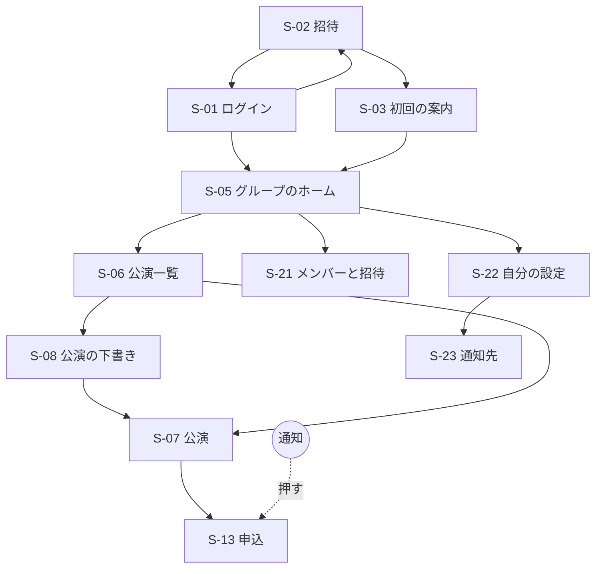

# 要件定義: 最初の1本（招待から、チケットのリマインドがiPhoneに届くまで）

- task-id: first-slice / 変更レベル: L3（ユーザー承認: 必要。PRのマージで、そのときの文書の中身をすべて承認したことになる）
- 作成日: 2026-11-23
- 書いた人: Claude Code。設計書・実装計画・試験計画から先はDevinが書く（2026-11-23、大関さんの判断）
- 論点の記録: [docs/discussions/first-slice.md](../discussions/first-slice.md)
- 見た目の決まり: [docs/ui-guidelines.md](../ui-guidelines.md)、見本の画面の書き出し: [docs/design-assets/screens/](../design-assets/screens/)。文言とデータは見本で、要件ではない

## 満たすユーザーストーリー

[docs/user-stories.md](../user-stories.md)のうち、次の11本を作る（論点「最初の1本で、どのストーリーまで作るか」の方針A。2026-11-23に大関さんが決めた）。

| 番号 | ストーリー | この回で作る範囲 |
| --- | --- | --- |
| G-01 | 招待リンクから参加する | すべて |
| G-02 | 招待リンクを発行する | すべて |
| C-02 | 単発の公演やフェスを登録する | すべて（ツアーは選べない） |
| C-03 | 下書きを確かめてから公演を確定する | 単発の公演の下書きだけ |
| C-07 | 公演の情報を確かめる | ツアーのグッズ販売時間を除く |
| T-01 | チケット申込を登録する | すべて。座席・整理番号の欄を足す |
| T-02 | 申込の状態を進める | すべて |
| T-03 | 期限のリマインドを受け取る | すべて（解散での取り消しを除く） |
| N-01 | 通知を受け取る端末を登録する | すべて |
| N-02 | 通知が届かない状態を知る | すべて |
| N-03 | 通知から申込を開く | すべて |

T-04（公演ごとの申込状況）は、公演の画面の申込の一覧が同じAPIと画面で満たすので、結果として入る。

## 背景

設計の工程1〜6は2026-11-22にすべて確定した（AGENTS.md「現在の状態」）。最初の実装は、登録からチケットのリマインドがiPhoneに届くまでを1本で通し、本番と同じ構成の環境で動かすと決めている（AGENTS.md「進め方の決まり」）。この1本で、AWS・Neon・Cognito・Web Pushの共通の仕組みと、デプロイの流れ（マイグレーションを含む）と、E2Eを一緒に作る。

## 目的

- いつもの仲間の2人目が、招待リンクから参加し、ホーム画面に追加したiPhoneでチケットの期限のリマインドを受け取れるようにする。
- 共通の仕組み（Terraform、GitHub Actions、Cognito、Web Push、マイグレーション）を本番と同じ形で先に通し、残りのストーリーを同じ形で足せるようにする。
- iPhoneでログインをやり直す流れと、3種類のリマインドという、一番つまずきやすい所を最初に確かめる。

## ユーザー要求（原文の要約）

- 登録からグループ・公演を経て、チケットのリマインドがiPhoneに届くまでを通す1本を作る。本番と同じ構成で動かす（2026-11-10）。
- 範囲は方針A。招待・単発の公演・申込・3種類のリマインド・通知先の登録まで（2026-11-23）。
- 要件定義書まではClaudeが書き、設計から先はDevinに任せる（2026-11-23）。
- 見た目はSpotifyの骨組みに、yoinだけの半券の部品を入れた見本の画面で進める（2026-11-22「いったんこの画面で」）。

## 画面と移り方

この回で作る画面は次の11。番号は[docs/api.md](../api.md)の画面の番号で、コードの名前には使わない。

| 画面 | この回の中身 |
| --- | --- |
| S-01 ログイン | メールアドレスを入れ、届いたコードを入れる。yoinの中の自前の画面 |
| S-02 招待 | グループ名と参加するボタン。未登録なら表示名の欄 |
| S-03 初回の案内 | ホーム画面への追加と通知の許可の案内。飛ばせる |
| S-05 グループのホーム | 次の公演の券、次にすることの一覧、通知が届かないときの帯 |
| S-06 公演一覧 | これからの公演と過去の公演、自分の公演の下書き |
| S-07 公演 | 公演の情報と、その公演の申込の一覧（S-12の中身を同じ画面に出す。見本の画面どおり） |
| S-08 公演の下書き | 単発の公演を入れる。会場・アーティストは登録済みから選ぶか新しく入れる |
| S-13 申込 | 状態と期限、リマインドの予定、状態を進めるボタン、直す・消す |
| S-21 メンバーと招待 | メンバーの一覧と、オーナーが招待リンクを発行する所 |
| S-22 自分の設定（一部） | 表示名と、通知先の一覧へのリンク、ログアウト |
| S-23 通知先（一部） | 登録した端末の一覧、この端末かの印、送れなかった印、この端末を登録するボタン。外すボタンは無い（N-04は対象外） |

画面の下には、タブを3つ（ホーム・公演・自分）と、その上に次の期限の帯を置く（論点「画面の下に何を置くか」）。「自分」タブはS-22を開く。この回のS-22には、表示名、通知先の一覧（S-23）へのリンク、ログアウト（F-08）だけを置く。ホームの通知先の帯からもS-23を開ける（F-18）。

## 機能要件

### 環境とデプロイ

- F-01 結合検証と本番の2つの環境を、同じTerraformで作る。NeonはDBのプロジェクトを環境ごとに分ける。Cognitoのユーザープール、VAPIDの鍵、招待リンクのトークンを作る秘密の値も環境ごとに持つ（論点「結合検証の環境を、本番と別に作るか」）。
- F-02 `main`にマージしたら、まず結合検証の環境にデプロイし、確かめてから本番にデプロイする。本番へのデプロイは、GitHub Actionsの環境（environment）の承認で止め、大関さんが承認してから進める。承認は本番のマイグレーションより前に置き、本番に出すのは結合検証で通したコミット（完全なSHAを承認の画面に出す）だけにする（ADR-0004の2026-11-23の追記）。どちらのデプロイの流れにも、試験、マイグレーション、Terraform、画面の配置を、この順に入れる（ADR-0004の決定3）。マイグレーションを手で流す手順は作らない。
- F-03 最初のオーナーとグループは、デプロイの流れで流す初期データの手順で、環境ごとに作る（ADR-0005）。手順は、Cognitoのユーザーをメールアドレスで作って`sub`を得てから（一時パスワードを持たせず、メールアドレスを確認済みにして、最初からメールのコードだけでログインできる形で作る）、`groups.users`・自分用グループ・仲間と使うグループ・メンバーの行を作る。途中で止まって再び流したときは、Cognitoにユーザーがあればその`sub`を使って続ける。`groups.users`・2つのグループ・メンバーの行は1つのトランザクションで作り、Cognitoのユーザーと行の両方がそろっているときだけ何もしない。オーナーのメールアドレスと表示名は、リポジトリに書かず、環境ごとにSSMに置いた値から読む。読めるのは、その環境の初期データのジョブだけにする（ADR-0004の2026-11-23の追記）。初回のログインで結ぶ形にはしない。「招待リンクを通らないログインでは行を作らない」決まり（F-07）の例外を作らないため。
- F-04 AWSとNeonの場所はシンガポールにする（ADR-0006の決定1）。費用の見張り（Budgets、流量の上限、要求数のアラーム）は、ADR-0006の決定5〜7のとおり入れる。

### ログイン（S-01）

- F-05 ログインは、メールアドレスに届くコードで行う。パスワードは持たない。ログインの画面はyoinの中に自前で作る（論点「ログインの方式」）。CognitoはEssentialsのプランにする。Cognitoにまだアカウントが無いメールアドレスなら、S-01は同じ画面の流れでCognitoのアカウントを作り（パスワードなしの登録と、メールのコードでの確認）、そのままJWTを得る。招待客の多くは初めてなので、この流れが無いとS-02へ進めない。Cognitoのアカウントを作れるのは、有効な招待リンクから来たときだけにする。招待リンクを知らない人がアカウントを作って、Cognitoのメールの通数と利用者の数を使わないようにするため。確かめ方（例: Cognitoの登録の前に動く関数で招待のトークンを確かめる）は設計で決める。Cognitoのアカウントを作っても`groups.users`の行は作らない（F-07）。
  - ユーザープールとS-01が使うアプリクライアントは、メールのコードだけでログインできるように設定する。初期データで作ったオーナーも同じ設定でログインする（F-03）。
- F-06 ログインは365日続ける（Cognitoのリフレッシュトークンの有効期限を365日にする。論点「ログインをどれだけ続けるか」は仮決定）。
- F-07 招待リンクを通らずにログインしただけでは、`groups.users`の行を作らない。行が無い人がログインしたら、「招待リンクから参加してください」と出す（G-01、`docs/api.md`の`not_registered`）。
- F-08 S-22からログアウトできる。

### 招待と参加（S-02、S-03、S-21）

- F-09 オーナーは、S-21で有効期限と利用回数の上限を付けて招待リンクを発行できる。発行したリンクはコピーして渡す（G-02）。トークンの作り方と保存の仕方は`docs/api.md`の「招待リンクを発行する」のとおり。
- F-10 招待リンクを開いた人は、ログインしていなければS-01でログイン（Cognitoにアカウントが無ければ作ってから。F-05）し、S-02に戻る。未登録の人は表示名を入れて参加する。参加すると、ユーザー、自分用グループ、そのグループのメンバーを1つのトランザクションで作る（G-01）。
- F-11 iPhoneでは、Safariで招待リンクを開き、ログインして参加まで済ませる。そのあとS-03で「ホーム画面に追加して、そこから開いてください」と案内する。ホーム画面から開いたら、もう一度ログインして通知を許可する（論点「iPhoneで、登録とホーム画面への追加をどの順に案内するか」）。
- F-12 S-03は飛ばせる。飛ばした人にも、通知先が無いあいだはグループのホームに帯を出す（論点「初回の案内を、飛ばして先に進めるか」は仮決定）。
- F-13 S-21は、メンバーの表示名・参加した日・オーナーかを一覧で出す。招待リンクを発行するボタンはオーナーにだけ出す。

### グループのホーム（S-05）

- F-14 ホームには、本人が入っている仲間と使うグループ（`kind`が`shared`）を出す。画面は起動したときに「自分を見る」と「自分のグループ一覧」（`GET /me/groups`）を呼び、仲間と使うグループを開く。この回にはグループを作る機能も切り替える機能も無いので、仲間と使うグループは初期データのグループ1つだけになる。自分用グループはこの回の画面には出さない。
- F-15 ホームの上に、これからの一番近い公演を券の形で出す。日付・開場・開演・会場・残りの日数を出す（見本の画面`home-dark.png`）。
- F-16 「次にすること」に、本人が申込者の申込のうち、今の状態であるべき期限（申込済みなら結果発表、当選なら入金期限、入金済みなら受取開始。`docs/api.md`の「申込とリマインド」の表と同じ）で、まだ来ていないものを近い順に出す。落選・受取済みの申込は出さない。押すとその申込を開く。
- F-17 次の期限の帯（タブの上）には、F-16の一番近い期限を1件出す。期限が無いときは帯を出さない。押すとその申込を開く。
- F-17a これからの公演が無いときは、券の代わりに公演がまだ無いことを出し、公演の下書き（S-08）を開くボタンを置く。次にすることが無いときは、無いことを一言で出す。オーナーや2人目が初めて開いたときは、この状態になる。文言は設計で決める。
- F-18 通知先が1台も無いとき、または送れなかった端末があるときは、ホームに帯を出し、押すとS-23を開く（N-02）。送れなかった端末とは、再送回数を使い切るか期限で打ち切ったときに一時失敗が残り、そのあとまだ1度も送れていない端末をいう（`last_failed_at`が入っている端末）。次にその端末へ送れたら、その端末の`last_failed_at`だけを空に戻す。帯が消えるのは、登録した端末が1台以上あり、`last_failed_at`が入った端末が1台も無くなったときである。端末が登録を消していた（Web Pushの応答が404・410）ときは、その通知先の行を消す（E-11）。この回は通知先を外すボタンが無いので、帯が出たままにならないよう、この決まりにする。

### 公演（S-06、S-07、S-08）

- F-19 公演の下書きを作り、直し、消し、確定できる。この回の下書きは単発の公演1件だけを持ち、ツアーは選べない（C-02、C-03）。公演名は確定するときに必須。
- F-20 下書きでは、会場とアーティストを、同じグループの登録済みのものから選ぶか、新しい名前で入れる。会場やアーティストが決まっていなくても下書きにできる（C-03）。アーティストは出演順に複数付けられる（C-02）。
- F-21 新しいアーティストを確定で作るとき、アーティストの色を名前から12色のどれかに決めて保存する（論点「画面の色を何から出すか」）。色を選び直す画面はこの回には作らない。
- F-22 公演一覧（S-06）は、これからの公演と過去の公演に分けて出す。今日の公演はこれからの公演に入れる。日付は日本時間で比べる（`docs/api.md`の「公演一覧」）。自分の下書きも出す。
- F-23 公演の画面（S-07）は、日付・会場と最寄り駅・開場開演・公式サイトのURL・出演順のアーティストを出す（C-07）。上の券は、出演順で1番目のアーティストの色を使う。アーティストが1人もいない公演は、12色の1番目（#C2185B）を使う。空の欄（開場・開演・最寄り駅・URL）は、欄ごと出さない。
- F-24 公演の画面の券の「座席・整理番号」には、本人が申込者で入金済みか受取済みの申込の座席・整理番号を出す。無ければ欄を出さない。
- F-25 公演まで7日を切ったら、公演の画面に日・時・分・秒の残り時間と7つの目盛りを出す（見本の画面`concert-countdown.png`）。残り時間は開演の時刻に向けて数える。開演が空なら開場、どちらも空なら公演日の0時（日本時間）に向けて数える。
- F-26 公演の画面に、その公演のグループ全員の申込を、申込者・受付名・枚数・状態（期限切れを含む）の一覧で出し、申込を足すボタンを置く（T-04、`docs/api.md`のS-12）。

### チケット申込（S-13）

- F-27 申込を登録できる。入れるのは、受付名、枚数、受取方法（コンビニ発券かスマチケ）、結果発表日時、入金期限、受取開始日時、座席・整理番号。期限と座席・整理番号は分かっているものだけでよい。最初の状態は申込済みか当選（先着）を選ぶ（T-01）。
- F-28 申込の座席・整理番号は、自由に書ける1つの欄にする（例「1階A12列34・35番」「A-128・129」）。指定席とスタンディングのどちらにも使う（論点「券面に整理番号を出すか」）。データモデルとADR-0002への追記は、このPRに含める。
- F-29 申込の状態は、申込済み → 当選／落選 → 入金済み → 受取済みの順に進める。期限切れは保存せず、当選のまま入金期限を過ぎたら計算して出す。期限切れからも入金済みに直せる（T-02、データモデルR9）。
- F-30 受取できるかどうかは、受取開始日時と今の時刻から計算して出す（T-02）。
- F-31 申込を直す・状態を変える・消すのは申込者だけ。ほかのメンバーには、そのボタンを出さない（T-01）。
- F-32 申込の画面には、結果発表・入金期限・受取開始の3つの期限と、それぞれのリマインドがいつ届くか（届いたか、予約したか、予約しないか）を出す（見本の画面`ticket-application.png`）。「申込を見る」APIは、申込者が見るときだけ、予約ごとに種類・届ける時刻（1分後に振り替えたあとの時刻）・状態（予約した・送った・取り消した）を返す。端末ごとの結果は返さない。送れなかった端末は帯とS-23で出す（F-18）。

### リマインド

- F-33 申込を作る・直す・状態を変える・消すたびに、`docs/api.md`の「申込とリマインド」の1つの関数で、あるべき予約に合わせる。結果発表はその時刻、入金期限は前日の20時と締切の3時間前、受取開始はその時刻に届ける（T-03、データモデル「届ける時刻」）。
- F-34 予約したときに届ける時刻を過ぎていたら、期限の前なら原則1分後に届け、期限ちょうど以降は予約しない。入金では、1分後の予約と起動までの幅が締切前に収まらなければ、保存直後に送信を始める。締切以降は送信を始めない（T-03、B-01）。
- F-35 リマインドは申込者だけに、その人の登録したすべての端末へ届ける（T-03）。
- F-36 予約・送信・取り消し・再送・見張りは、データモデル「予約の作り方」「送り方」のとおりにする。時刻を変えるときは新しい予約と見張りを先に作り、DBで切り替えが確定してから元の組を消す。切り替えに失敗したら元の組を残す。
- F-37 通知の文は、ロック画面で見分けられるように、期限の種類・時刻・公演名・受付名を入れる（論点「ロック画面のリマインドに、公演名と受付名を出すか」）。題は種類ごとに次の型にし、本文は「<公演名> / <受付名>」にする。受付名が空なら本文は公演名だけにする。

  | 種類 | 題の型 | 例 |
  | --- | --- | --- |
  | 結果発表 | 結果発表は<月/日> <時刻>です | 結果発表は1/8 12:00です |
  | 入金期限（前日20時） | 入金期限は<月/日> <時刻>です | 入金期限は1/10 21:00です |
  | 入金期限（3時間前） | 入金期限は<月/日> <時刻>です | 入金期限は1/10 21:00です |
  | 受取開始 | 受取が始まりました | 受取が始まりました |

  題には「今日」「明日」「あと3時間」のような、送った時刻で意味が変わる言葉を入れず、期限の日付と時刻（日本時間）だけを書く。文は予約したときに作る（F-37a）ので、再送（E-10）・引き受け直し（E-12）・時刻を過ぎてから予約して1分後に届ける分（B-01）で届く時刻がずれても、残り時間を実際より長く伝えないため。
- F-37a 通知の文は予約したときに作って保存する（データモデルの`reminders.title`・`body`）。受付名や公演名をあとで直しても、予約済みの文は作り直さない（B-04）。送る時刻を変えずに文だけを直す仕組みは、この回には作らない。
- F-37b 通知の中身はDeclarative Web Pushの形にし、対応していない環境のためにService Workerでも出す（ADR-0004の追記）。
- F-38 通知を押したら、その申込の画面（`/groups/<groupId>/ticket-applications/<id>`）を開く。ログインが切れていたら、ログインしてからその申込を開く（N-03）。

### 通知先（S-03、S-23）

- F-39 ホーム画面に追加したiPhoneのWebアプリと、パソコンのブラウザで、通知を許可して端末を登録できる。iPhoneのSafariのタブから開いたときは、登録のボタンの代わりに、ホーム画面に追加する手順を出す（N-01）。
- F-40 1人が複数の端末を登録できる。同じ端末の2回目の登録は、同じ行を返す（N-01、`docs/api.md`の「通知先を登録する」）。
- F-41 S-23に、登録した端末の名前（例「iPhone Safari」）、この端末かの印、最後に送れなかった日時を出す（N-02）。

### 見た目

- F-42 色・文字・形と間・部品は、[docs/ui-guidelines.md](../ui-guidelines.md)のとおりにする。色はCSSの変数で持ち、端末の設定に合わせて暗い表示と明るい表示を切り替える（論点「暗い表示（ダークモード）をどう扱うか」「明るい表示の色をこの組にするか」）。
- F-43 アーティストの色は、`docs/ui-guidelines.md`の「アーティストの色」の12色から選ぶ。券の背景は変えない。本体の文字全体は、グラデーションの明るい端を0%として、終点側の80〜100%に収める。半券の文字は、半券の単色の地の内側に収める。文字は、アーティストの色と明るい表示・暗い表示に応じて、白（#FFFFFF）か黒（#000000）に切り替える。12色すべてで、文字の下の地と4.5:1以上の差を取る。色ごとの組み合わせは`docs/ui-guidelines.md`に示す（論点「券の文字を読みやすくするには」）。
- F-44 英数字はFigtree、和文は端末の書体（ヒラギノ角ゴ）にする（論点「英数字の書体をどれにするか」）。
- F-45 画面の部品はTailwind CSSとshadcn/uiで作り、色は`docs/ui-guidelines.md`の変数から取る（論点「画面の部品を何で作るか」）。
- F-46 券の部品（ミシン目、くぼみ、半券、DATE・OPEN・START・SEATの欄、通し番号）は、`docs/ui-guidelines.md`の「半券のカード」と見本の画面`ticket-anatomy.png`の作りにする。「余韻」（行った公演の棚）と「仲間の輪」のメンバーの色は、参戦記録とグループの回で作るので、この回では作らない。
- F-47 画面の文言は、案内と結果の文をです・ます調、ボタンを短い動詞（「保存」「参加する」）にする（論点「画面の文言を、です・ます調にするか」は仮決定）。
- F-48 アプリの名前は「yoin」、ホーム画面のアイコンは`docs/design-assets/icon/`の絵を使う（apple-touch-icon 180px、manifestの192px・512px、maskableの192px・512px）。

### 確かめの道具

- F-49 アプリを起動し、E2Eの流れを操作して確かめるスキルを作る。Devinが作り、Claude CodeとDevinの両方がPRを出す前に使う（AGENTS.md、`docs/discussions/verification-loop.md`）。
- F-50 E2Eは、2人をブラウザのcontext 2つで動かす。オーナーが招待リンクを発行し、2人目が参加し、公演を確定し、申込を登録して状態を進めるまでを通す（AGENTS.md）。

## 非機能要件

- 性能: 使う人は10人以下（PR/FAQ）。公演会場の弱い電波で、作成の要求を送り直しても1件だけできる（`docs/api.md`の「作成を2回送ったとき」）。画面の表示の速さの数値の目標は置かない。
- 費用: ADR-0006の見込み（AWSは月数円、Neonは無料のプラン）を超えない作りにする。どの関数も定期的には起動しない（ADR-0002の決定5）。
- セキュリティ: すべてのAPIでCognitoのJWTを確かめ、招待の2本を除いて`users`の行が`active`かを毎回確かめる。グループの中の資源は、メンバーであることを確かめてから返す（`docs/api.md`の「つなぎ先と認証」「パスの形」）。秘密の値はSSM Parameter Storeに置き、リポジトリ・Terraform・PRに書かない（AGENTS.md「人がじっくり見る変更」）。
- 個人の情報: ログに表示名・メールアドレス・申込の中身を書かない。通知の文に公演名と受付名を出すことは、論点「ロック画面のリマインドに…」で決めた。
- 可用性: リマインドは取りこぼしを避け、まれに2回届くことは許す（T-03、データモデル「送り方」）。届かなかったときはAWS構成のC-4のキューに入れてメールで知らせる。
- 試験: 申込の状態の移り方と、申込からあるべき予約を出す関数、リマインドの引き受けと再送は、例を書く試験に加えてfast-checkで「決して破れない決まり」と「2回流しても同じ」を確かめる（AGENTS.md「進め方の決まり」）。

## 正常系

- P-01 オーナー（初期データ）がS-21で招待リンクを発行し、2人目がiPhoneのSafariでリンクを開き、メールのコードでログインし、表示名を入れて参加する。
- P-02 2人目がS-03の案内に従ってホーム画面に追加し、ホーム画面から開いてもう一度ログインし、通知を許可して端末を登録する。ホームの帯が消える。
- P-03 メンバーが単発の公演の下書きを作り、会場とアーティストを新しく入れて、確定する。公演一覧と公演の画面に出る。
- P-04 申込者が公演の画面から申込（申込済み、結果発表日時あり）を作る。結果発表の時刻に、申込者の端末に「結果発表」のリマインドが届く。
- P-05 申込者が当選にし、入金期限を入れる。前日の20時と締切の3時間前に、入金期限のリマインドが届く。
- P-06 申込者が入金済みにすると、入金期限のまだ届いていないリマインドが取り消され、受取開始のリマインドが予約される。
- P-07 通知を押すと、その申込の画面が開く。
- P-08 申込者が受取済みにする。予約は残らない。
- P-09 もう1人のメンバーが公演の画面を開くと、ほかの人の申込が状態つきで見えるが、直すボタンは出ない。

## 異常系

- E-01 有効期限を過ぎた、利用回数の上限に達した招待リンクを開いたら、参加できないと出す（`invite_unusable`。G-01）。
- E-02 招待リンクを通らずにログインした人には、招待リンクから参加するよう出し、ほかの画面は開けない（`not_registered`）。
- E-03 すでにメンバーの人が招待リンクを開いたら、何もせずグループのホームを開く（G-01）。登録済みの人は、表示名を聞かずにメンバーにだけ加える。
- E-04 オーナーでないメンバーには、招待リンクを発行するボタンを出さない。APIを直接呼んでも`forbidden`で断る（G-02）。
- E-05 申込者でないメンバーが申込を直す・状態を変える・消すAPIを呼んだら、`forbidden`で断る（T-01）。
- E-06 申込の状態の移り方に無い変更（落選から入金済みなど）は`invalid_transition`で断る（T-02）。
- E-07 別のグループの公演・申込・会場・アーティストのIDを送ったら、無いときと同じ`not_found`で断る。下書き・申込を消すときも、対象が無いか別のグループのIDなら404 `not_found`で断る。
- E-08 作成の要求を2回送ったら、2回目は1回目と同じ応答を返し、行を2つ作らない。同じIDで中身が違えば`id_conflict`（`docs/api.md`）。
- E-09 通知を押したときに申込がもう無ければ（消した）、見つからないと出す（N-03）。
- E-10 Web Pushで端末に送れなかったら、5分後が送信期限より前なら再送を予約する。再送は3回まで（最初の1回と合わせて4回）。再送回数を使い切るか期限で打ち切ったときに一時失敗が残った端末は、S-23とホームの帯で「送れなかった」と出し、AWS構成のC-4のキューに入れる（データモデル「予約の作り方」、F-18）。
- E-11 端末が登録を消していた（Web Pushの応答が404・410）ときは、その端末への送信を`gone`として記録し、再送しない。その通知先の行は消す（F-18）。行を消すと、外部キーのCASCADEでその端末の送信結果（`reminder_deliveries`）も消える。`gone`は送信の処理の中で再送を止めるためだけに使い、消したあとに見返す記録にはしない。原因を追うときは、送信の関数のログ（端末の内容と個人の情報を書かない）を見る。
- E-12 送信の途中で関数が止まったら、10分後に見張りの予約で引き受け直し、送れていない端末だけに送る（データモデル「送り方」）。
- E-13 申込を消した・落選にしたときは、まだ届いていないリマインドを取り消す。取り消しより先に送信が引き受けていたら、届くことは許す（T-03）。
- E-14 確定するときに会場が決まっていない、または公演名が無い下書きは`invalid_input`で断り、どの欄が足りないかを画面に出す（`docs/api.md`の「公演の下書きを確定する」）。
- E-15 別の人がすでに使っている`endpoint`で通知先を登録しようとしたら、購読を取り消してやり直し、新しい`endpoint`で登録する（`docs/api.md`の「通知先を登録する」）。
- E-16 ログインのコードを間違えた、期限が切れたときは、その旨を出し、コードを送り直せるようにする。CognitoまたはSESの要求数・送信数の上限に当たったときは、時間をおいてやり直すよう出す。
- E-17 通知の許可を断られたときは、S-03とS-23に、iPhoneの設定から許可し直す手順を出す。帯は出たままにする（F-18）。
- E-18 作った人でないメンバーが公演の下書きを直す・消す・確定するAPIを呼んだら、`forbidden`で断る（`docs/api.md`の「公演の下書きを作る・直す・消す」）。

## 境界条件

- B-01 入金期限の前日20時をすでに過ぎてから入金期限を入れたら、前日20時の分は原則1分後に届け、3時間前の分は予定どおり予約する。3時間前も過ぎていて締切の前なら、どちらも原則1分後に届ける。1分後の予約と起動までの幅が締切前に収まらなければ、該当する分を保存直後に送信する。締切ちょうど以降は予約も送信も始めない（F-34）。
- B-02 前日20時は日本時間で計算する。締切が0時台（例: 1月10日0:30）のとき、前日20時は1月9日20:00。
- B-03 結果発表日時・入金期限・受取開始日時が空の申込には、その期限のリマインドを予約しない。あとで入れたら予約し、空に戻したら取り消す。
- B-04 受付名だけを直したときは、予約の送信時刻を計算し直さない。送ったリマインドを作り直さない（`docs/api.md`の「申込とリマインド」）。
- B-05 期限切れは「当選のまま、今の時刻が入金期限と同じか後」とする。入金期限ちょうどの時刻から期限切れになる。受取できるかも同じく「今の時刻が受取開始日時と同じか後」とする。`docs/api.md`の申込一覧の`displayStatus`と`pickupAvailable`も、この判定で計算する。
- B-06 公演日が今日の公演は、これからの公演に入れる。日付の切り替わりは日本時間の0時（F-22）。
- B-07 公演までの残りが7日ちょうどのときに残り時間を出すかは、設計で決めて試験の観点に書く（F-25）。
- B-08 招待リンクの利用回数の上限の最後の1回に2人が同時に参加しても、1人だけが入る（`docs/api.md`）。
- B-09 枚数は1以上。上限は設計で決める。座席・整理番号と受付名の長さの上限も設計で決める。
- B-10 端末が1台も無い申込者のリマインドを、送信の時刻にどう記録するか（送ったとするか、端末が登録されるまで待つか）は、データモデルに書かれていないので設計で決める。ホームには帯を出す（F-18）。
- B-11 申込者でないメンバーの画面には、オーナーであっても、他人の申込の直すボタンが出ない（権限の境目）。
- B-12 招待リンクの有効期限は今より後、利用回数の上限は1以上でなければ発行できない（`invalid_input`）。上限の値は設計で決める。

## 前提

- 使う人は10人以下の招待制。最初のオーナーとグループは初期データで作る（PR/FAQ、ADR-0005）。
- iPhoneでWeb Pushを受けられるのは、ホーム画面に追加したWebアプリだけ。ホーム画面のWebアプリは、Safariとログインの状態を分けて持つ（論点の記録の「前提」）。
- Web Pushの通知はログインが切れていても届く。押して申込を開くときにログインが要る。
- データモデル、API、AWS構成、ADR-0001〜0006を土台にする。座席・整理番号、アーティストの色、送れなかった端末の印に加え、設計工程で決めた時刻変更（F-36）、削除時の応答（E-07）、認証メールのSES送信を反映する。
- ClaudeとDevinはAWSとNeonにつながない（AGENTS.md「コマンドの範囲」）。結合検証の環境で動かして確かめるのは大関さん。

## 制約

- 道具はADR-0004のとおり（TypeScript、Drizzle ORM、Neonのサーバーレスドライバー、Terraform、React＋Vite、HonoとZod、Powertools for AWS LambdaのLogger、eslint-plugin-boundaries、pnpm・Vitest・fast-check・Playwright・GitHub Actions）。
- コードの置き場所と層の分け方は、ADR-0002の決定7とADR-0003のとおり。コードの名前は用語集の英語名を使う。
- 画面の移り方とデータの取り方の道具は、設計書で決める（ADR-0004「この決定では決めないこと」、論点「画面の移り方とデータの取り方の道具を何にするか」）。
- 認証メールはシンガポールのAmazon SESで送る。送信通数はCognito既定送信の上限ではなく、送信するAWSアカウント・リージョンのSES割当に従う。オーナーがサンドボックス解除を申請する。

## 対象範囲

- 上の11画面と、それが呼ぶAPI（`docs/api.md`の該当の行）。G-04の「自分のグループ一覧」（`GET /me/groups`）は、起動したときにグループを開くために作る（F-14）。
- 3つのLambda関数のうち`api`と`notification-sender`。`erasure-worker`はこの回に作らない。
- マイグレーション: この回で使う表を作る。対象は`groups`の`users`・`groups`・`members`・`invite_links`、`catalog`の`artists`・`venues`・`tours`・`concerts`・`concert_artists`・`drafts`（`tours`は公演の外部キーの先として要る。ツアーを作る画面は無い）、`ticket`の`ticket_applications`、`notification`の3つの表。ほかの表を同じ回に作るかは設計で決める。
- Terraform: 2つの環境、API GatewayのHTTP API、Lambda、EventBridge Scheduler、Cognito、S3とCloudFront（画面の配置）、SSM Parameter Store、AWS構成のC-4のキューとメール、費用の見張り。
- GitHub Actions: 試験、マイグレーション、Terraform、画面の配置の順のデプロイの流れを、環境ごとに1本ずつ。
- PWA: manifest、アイコン、Service Worker（通知を出す・押したときに開く）。
- 確かめのスキルとE2E（F-49、F-50）。

主に触るファイル（設計で決め直してよい）: `src/contexts/group/`、`src/contexts/catalog/`、`src/contexts/ticket/`、`src/contexts/notification/`、`src/functions/api/`、`src/functions/notification-sender/`、画面のディレクトリ、Terraformのディレクトリ、`.github/workflows/`、マイグレーションのSQLのディレクトリ。画面・Terraform・SQLのディレクトリの名前はまだ決まっていない（AGENTS.md）。

## 対象外

- グループを作る・切り替える（G-03、G-04）。退会・解散・外す・抜ける（G-05〜G-08）と`erasure-worker`。
- ツアーのまとめ登録（C-01）、会場とアーティストを選び直す画面と消す操作（C-04、C-05）、昔の公演をさかのぼって登録する（C-06）、公演を直す（C-08）、セトリ（C-09）。公演の画面のセトリのボタンは出さない。確定済みで日付が過ぎた公演は一覧に出す（F-22）。
- 参戦記録のすべて（A-01〜A-05）。見本の画面にある「行った公演」の棚、「3人が行く」、参戦のボタンは出さない。
- スマチケの分配（T-05）。
- グッズのすべて（M-01〜M-06）と画像の置き場所。
- 通知先を外す（N-04）。S-23に外すボタンは置かない。
- アーティストの色を選び直す画面（F-21）。
- 表示名を変える機能（MVP1でも無い）。
- 独自ドメイン、プライバシーポリシー（公開の前に決める宿題）。

## 後方互換性・データ移行

アプリのコードと表はまだ無いので、既存のデータの移行は無い。承認済みのデータモデル（ADR-0002）に、次の2列を足す。このPRで`docs/data-model.md`とADR-0002の追記、`docs/api.md`に書き、座席・整理番号は用語集にも足す。

あわせて、データモデルの`push_subscriptions.last_failed_at`に、空に戻す時と`gone`の端末の行を消すことを書き足した（F-18）。列は変えない。

| 表 | 列 | 型 | 説明 | 決めた論点 |
| --- | --- | --- | --- | --- |
| `ticket.ticket_applications` | `seat_or_entry_number` | text | null可。座席か整理番号を自由に書く。券面に出す | 券面に整理番号を出すか |
| `catalog.artists` | `color` | text | F-43の12色のどれか。作るときに名前から決めて保存する | 画面の色を何から出すか |

## 受け入れ条件

自動の試験で確かめるもの（CIで通す）。

- AC-01 E2E（Playwright、context 2つ）で、招待の発行 → 2人目の参加 → 公演の確定 → 申込の登録 → 当選 → 入金済み → 受取済みが通る。ログインのコードの受け方は設計で決める。
- AC-02 申込からあるべき予約を出す関数を、fast-checkで確かめる。どの状態・期限の組でも、決まり（上の表と「届ける時刻」）から外れた予約を作らない。同じ入力で2回流しても予約が変わらない。
- AC-03 申込の状態の移り方を、fast-checkで確かめる。移り方の表に無い変更は必ず断る。
- AC-04 リマインドの引き受けと再送を、fast-checkで確かめる。同じ起動が2回届いても2本同時に送らない。取り消した予約は引き受けない。
  - E-12の試験では、送信結果の保存直後に処理が止まっても、再開時に送信済みの端末に再送せず、その端末の失敗の印も残らないことを確かめる。
- AC-05 P-01〜P-09、E-01〜E-18、B-01〜B-12の各項目に、試験の観点（`docs/tests/first-slice.md`）が1つ以上ある。F-16・F-17・F-17a（次にすることと次の期限の帯）、F-18（通知先の帯が出る・消える）、F-25（残り時間）にも観点を置く。
- AC-06 マイグレーションがデプロイの流れの中で流れ、手で流す手順が無い。
- AC-06a 券の文字を置く範囲（F-43）では、12色それぞれの明るい表示と暗い表示で、文字と地のコントラスト比が4.5:1以上になる。本文だけでなく、小見出しや通し番号、半券の文字も確かめる。狭い画面や文字の折り返しでも、文字全体が指定の範囲に収まることを確かめる。

結合検証の環境で人が確かめるもの（AGENTS.md「結合検証の環境で見る項目には、見るのに要るデータと、それを誰が作るかを書く」）。

| 確かめること | 要るデータ | 作る人 |
| --- | --- | --- |
| AC-07 iPhoneのSafariで招待リンクから参加し、ホーム画面に追加して、もう一度ログインして通知を許可できる | 結合検証の環境の招待リンク | 大関さん（オーナーとして発行） |
| AC-08 AC-07で参加した2人目が申込者の申込で、結果発表のリマインドが、その人のホーム画面に追加したiPhoneのロック画面に、公演名と受付名つきで届く。AC-09〜AC-10bも、この2人目の申込とiPhoneで見る | 2人目が作った、結果発表日時を数分後にした申込 | 大関さん（2人目として操作） |
| AC-09 入金期限のリマインドが届く。前日20時を過ぎてから登録して、前日20時の分が1分後に届くこと、3時間前の分が予約した時刻に届くことを確かめる | 入金期限を3時間と数分後にした当選の申込 | 大関さん（2人目として操作） |
| AC-10 通知を押すと、その申込の画面が開く | AC-08の通知 | 大関さん（2人目として操作） |
| AC-10a 受取開始のリマインドが届く | 受取開始日時を数分後にした入金済みの申込 | 大関さん（2人目として操作） |
| AC-10b ログインが切れた状態で通知を押し、ログインし直すと、ホームでなくその申込の画面が開く（F-38）。ログインの切り方（ログアウトしても通知先が残るか、など）は設計で決め、試験計画のこの項目の手順に書く | 受取開始日時を数分後にした、もう1件の入金済みの申込 | 大関さん（2人目として操作） |
| AC-11 オーナーとして、パソコンのブラウザで、2人目の申込が見え、直せない | AC-08で2人目が作った申込 | 大関さん（オーナーとして操作） |
| AC-12 暗い表示と明るい表示が、端末の設定で切り替わる | なし | 大関さん |

「前日20時」という時刻どおりに届くことは、日をまたいで待たないと見られないので、時刻の計算は自動の試験とfast-checkで確かめる（論点「結合検証の環境で、iPhoneに届くことを誰がどう確かめるか」は仮決定）。

## 決めたこと（問いと答え）

[docs/discussions/first-slice.md](../discussions/first-slice.md)

- 「自分」タブは、最小限の設定を開く（`my-tab`。S-22）。
- 券の背景は残し、文字を置く位置と白黒の組み合わせを決める（`ticket-text-contrast`。F-43）。

## 未決事項

論点の記録の仮決定は5件。この要件定義書は推奨どおりで書いた。違えば直す。

- 初回の案内を、飛ばして先に進めるか（`onboarding-skip`。F-12）
- ログインをどれだけ続けるか（`session-length`。F-06）
- 画面の文言を、です・ます調にするか（`ui-tone`。F-47）
- 結合検証の環境で、iPhoneに届くことを誰がどう確かめるか（`push-verification`。AC-07〜AC-12）
- 解散・退会の記録の状態から`done`を消すか（`erasure-done-status`。この回は`erasure_jobs`を作らないので、表を作る回までに決める）

後の工程へ回したものは1件。

- 画面の移り方とデータの取り方の道具を何にするか（`routing-data-tools`。設計書で決める）

設計で決めることとして、この要件定義書に書いたもの: ログインのコードをE2Eでどう受けるか（AC-01）、Cognitoのメールの通数（制約）、残り7日ちょうどの境目（B-07）、枚数と文字数の上限（B-09）、端末が無い人の予約の扱い（B-10）、公演の券に出す申込が複数あるときの選び方（F-24）、この回に作る表の範囲（対象範囲）。
